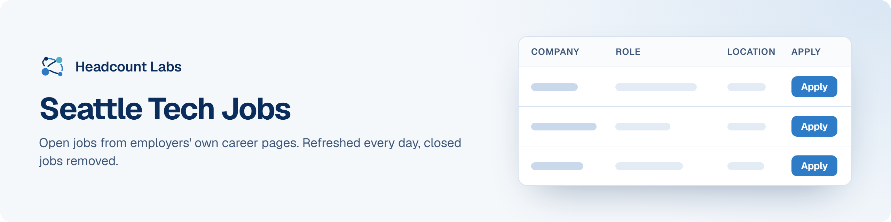

# Seattle Tech Jobs

Software, data, AI, product and design jobs in the Seattle area, sorted by field.

**233 open jobs** · 181 new since the last update · 66 removed because they closed or left the employer's board · updated November 19, 2026 at 5:18 AM EST

This list is built and refreshed every day by [Headcount Labs](https://headcountlabs.com/?utm_source=github&utm_medium=job-list&utm_campaign=seattle-tech-jobs), which reads jobs straight from employers' own career pages and job boards. Every job here was still listed on its source board when we last read that board, within the past 3 days, and was posted in the past 30 days. Copies of the same job are merged into one row, and jobs that close are removed at the next update.

Want this data in your own app or agent? Use the [Headcount Labs jobs API](https://headcountlabs.com/docs/?utm_source=github&utm_medium=job-list&utm_campaign=seattle-tech-jobs) (free tier), the [MCP server](https://headcountlabs.com/mcp/?utm_source=github&utm_medium=job-list&utm_campaign=seattle-tech-jobs) for Claude, ChatGPT and other AI assistants, or the [public dataset subsets](https://huggingface.co/HeadcountLabs) on Hugging Face (the full dataset is coming soon).

**Full dataset.** A bigger, one-off snapshot dated 2026-10-19 (all matching jobs, not only the open jobs below) is on Hugging Face: [Tech and software jobs](https://huggingface.co/datasets/HeadcountLabs/tech-jobs). It loads with `datasets.load_dataset` and is under the Open Database License (ODbL) 1.0.

**Jump to:** [Software engineering (132)](#software-engineering) · [Data, AI and machine learning (58)](#data-ai-and-machine-learning) · [Product and design (32)](#product-and-design) · [Hardware and engineering (9)](#hardware-and-engineering) · [Business, finance and operations (2)](#business-finance-and-operations)

**Columns.** *Apply* opens the original posting on the employer's site. *Details* opens the job on Headcount Labs, with every posting we found for it. *Remote* shows what the employer states; a dash means the posting doesn't say. *Pay* is the range the employer published.

## Software engineering

| Company | Role | Location | Remote | Pay | Posted | Apply | Details |
| --- | --- | --- | --- | --- | --- | :---: | :---: |
| **Oracle** | Lead Principal Platform Software Engineer | 

7 locations
United States Seattle, WA Redwood City, CA Santa Clara, CA Pleasanton, CA Austin, TX Nashville, TN
 | On-site | $114k–$306k/yr | Nov 19 |  | <a href="https://headcountlabs.com/catalog/jobs/a6fb4e28-66fb-4773-ad50-65eb6b2e7071?utm_source=github&utm_medium=job-list&utm_campaign=seattle-tech-jobs">via Headcount Labs</a> |
| **University of Washington** | Full Stack Software Engineer | Seattle, WA | Hybrid | $102k–$115k/yr | Nov 18 |  | <a href="https://headcountlabs.com/catalog/jobs/399d75be-8749-4517-8533-f2650c1d052e?utm_source=github&utm_medium=job-list&utm_campaign=seattle-tech-jobs">via Headcount Labs</a> |
| **Uber** | Staff Software Engineer: iOS (Core Build) | 

4 locations
San Francisco, CA Sunnyvale, CA Seattle, WA New York City, NY
 | Remote | $232k/yr | Nov 18 |  | <a href="https://headcountlabs.com/catalog/jobs/edd7739b-301d-48c5-a597-369291dde2f2?utm_source=github&utm_medium=job-list&utm_campaign=seattle-tech-jobs">via Headcount Labs</a> |
| **Oracle** | Senior Director, Platform Software Engineering | Seattle, WA | On-site | $141k–$414k/yr | Nov 18 |  | <a href="https://headcountlabs.com/catalog/jobs/22b8bae3-2920-4d05-aa61-40b505e5813a?utm_source=github&utm_medium=job-list&utm_campaign=seattle-tech-jobs">via Headcount Labs</a> |
| **Net-Inspect** | Senior Security DevOps Engineer | Kirkland, WA | — | $120k–$160k/yr | Nov 18 |  | <a href="https://headcountlabs.com/catalog/jobs/1a122ea1-156a-4ac8-94aa-3a0bd34cddab?utm_source=github&utm_medium=job-list&utm_campaign=seattle-tech-jobs">via Headcount Labs</a> |
| **LiveRamp** | Senior Fullstack Software Engineer | Seattle, WA | Hybrid | $130k–$196k/yr | Nov 18 |  | <a href="https://headcountlabs.com/catalog/jobs/5d0a3aef-e81b-4c05-845e-9cafd9f699ff?utm_source=github&utm_medium=job-list&utm_campaign=seattle-tech-jobs">via Headcount Labs</a> |
| **LinkedIn** | Sr. Software Engineer, Traffic Infra | Bellevue, WA | Hybrid | $144k–$236k/yr | Nov 18 |  | <a href="https://headcountlabs.com/catalog/jobs/3822aa64-4e5f-4014-9728-a443a98109be?utm_source=github&utm_medium=job-list&utm_campaign=seattle-tech-jobs">via Headcount Labs</a> |
| **JPMC** | Senior Lead Software Engineer- Inference Platform Engineer | Seattle, WA | Hybrid | $176k–$260k/yr | Nov 18 |  | <a href="https://headcountlabs.com/catalog/jobs/75bbdd72-3fb9-4335-929b-8e02b04ce0d7?utm_source=github&utm_medium=job-list&utm_campaign=seattle-tech-jobs">via Headcount Labs</a> |
| **COGNIZANT TECH SOLUTIONS A** | Senior C++ / Android Systems Engineer – AOSP, Backend &amp; Telemetry | Redmond, WA | — | — | Nov 18 |  | <a href="https://headcountlabs.com/catalog/jobs/c2869fd0-67fc-4c50-8dbd-35af65e70c24?utm_source=github&utm_medium=job-list&utm_campaign=seattle-tech-jobs">via Headcount Labs</a> |
| **Uber** | Sr Software Engineer - Developer Platform | 

4 locations
New York City, NY Seattle, WA Sunnyvale, CA San Francisco, CA
 | Remote | $202k/yr | Nov 17 |  | <a href="https://headcountlabs.com/catalog/jobs/b76499f3-5f94-4b99-8d8d-03ba5c6f5dd2?utm_source=github&utm_medium=job-list&utm_campaign=seattle-tech-jobs">via Headcount Labs</a> |
| **The Pokémon Company International** | Software Development Engineer | Bellevue, WA | — | $99k–$130k/yr | Nov 17 |  | <a href="https://headcountlabs.com/catalog/jobs/8f6f3102-57c8-4619-93a1-2683eac2d6bd?utm_source=github&utm_medium=job-list&utm_campaign=seattle-tech-jobs">via Headcount Labs</a> |
| **The Pokémon Company International** | Sr. Network Security Engineer | Bellevue, WA | — | $116k–$155k/yr | Nov 17 |  | <a href="https://headcountlabs.com/catalog/jobs/7fbcdf21-6700-4662-bd97-4e0b8c84ba4c?utm_source=github&utm_medium=job-list&utm_campaign=seattle-tech-jobs">via Headcount Labs</a> |
| **Plaid** | Staff Software Engineer - Data Infrastructure | 

2 locations
San Francisco, CA Seattle, WA
 | Hybrid | $208k–$274k/yr | Nov 17 |  | <a href="https://headcountlabs.com/catalog/jobs/84f1e634-77b2-46e9-9e5d-f26c4ddc5798?utm_source=github&utm_medium=job-list&utm_campaign=seattle-tech-jobs">via Headcount Labs</a> |
| **Plaid** | Staff Software Engineer - Alternative Access | 

3 locations
San Francisco, CA Seattle, WA New York City
 | Hybrid | $208k–$307k/yr | Nov 17 |  | <a href="https://headcountlabs.com/catalog/jobs/4b21e8e2-6271-4094-9469-d98354fe400f?utm_source=github&utm_medium=job-list&utm_campaign=seattle-tech-jobs">via Headcount Labs</a> |
| **Oracle** | Senior Principal Site Reliability Engineer - US Top Secret Clearance | 

3 locations
Reston, VA Seattle, WA Austin, TX
 | On-site | $111k–$235k/yr | Nov 17 |  | <a href="https://headcountlabs.com/catalog/jobs/149f105d-0ded-44a7-be72-1abe56092d6a?utm_source=github&utm_medium=job-list&utm_campaign=seattle-tech-jobs">via Headcount Labs</a> |
| **LinkedIn** | Software Engineer, Systems and Infrastructure | Bellevue, WA | Hybrid | $120k–$195k/yr | Nov 17 |  | <a href="https://headcountlabs.com/catalog/jobs/8f01f5bc-5b68-42bd-87e8-43ca43359e88?utm_source=github&utm_medium=job-list&utm_campaign=seattle-tech-jobs">via Headcount Labs</a> |
| **LinkedIn** | Staff Software Engineer, Development Infrastructure | Bellevue, WA | Hybrid | $170k–$277k/yr | Nov 17 |  | <a href="https://headcountlabs.com/catalog/jobs/4e9a847b-5386-4c1e-b630-b72f330d62cd?utm_source=github&utm_medium=job-list&utm_campaign=seattle-tech-jobs">via Headcount Labs</a> |
| **JPMC** | Principal Software Engineer-VPC | Seattle, WA | Hybrid | $204k–$285k/yr | Nov 17 |  | <a href="https://headcountlabs.com/catalog/jobs/852a9dbf-7db1-499d-9a0c-9da0c8e9787f?utm_source=github&utm_medium=job-list&utm_campaign=seattle-tech-jobs">via Headcount Labs</a> |
| **JPMC** | Sr Director of Software Engineering- Virtual Private Cloud | Seattle, WA | On-site | $204k–$285k/yr | Nov 17 |  | <a href="https://headcountlabs.com/catalog/jobs/6cae0d77-0e54-4417-8280-219d40ffa201?utm_source=github&utm_medium=job-list&utm_campaign=seattle-tech-jobs">via Headcount Labs</a> |
| **JPMC** | Software Engineer II: Fullstack | 

2 locations
Jersey City, NJ Seattle, WA
 | On-site | $124k–$150k/yr | Nov 17 |  | <a href="https://headcountlabs.com/catalog/jobs/accb6ae1-ce97-4a32-9f64-1731241aeec0?utm_source=github&utm_medium=job-list&utm_campaign=seattle-tech-jobs">via Headcount Labs</a> |
| **dpr** | Platform Developer &#124; OES | 

19 locations
Colorado Springs, CO Seattle, WA East Brunswick, NJ Tomball, TX Greenwood Village, CO Orlando, FL Phoenix, AZ Nashville, TN Durham, NC Smyrna, GA Austin, TX Dallas, TX +7 more
 | On-site | $100k–$144k/yr | Nov 17 |  | <a href="https://headcountlabs.com/catalog/jobs/94acd13d-08b5-48b7-9623-99fb0855b300?utm_source=github&utm_medium=job-list&utm_campaign=seattle-tech-jobs">via Headcount Labs</a> |
| **Crusoe** | Senior Software Engineer, Platform Networking | 

3 locations
San Francisco, CA Sunnyvale, CA Bellevue, WA
 | On-site | — | Nov 17 |  | <a href="https://headcountlabs.com/catalog/jobs/b247839a-9f26-484b-951d-3e5deb5c4057?utm_source=github&utm_medium=job-list&utm_campaign=seattle-tech-jobs">via Headcount Labs</a> |
| **Crusoe** | Staff Software Engineer, Networking | 

3 locations
San Francisco, CA Sunnyvale, CA Bellevue, WA
 | On-site | — | Nov 17 |  | <a href="https://headcountlabs.com/catalog/jobs/a534790e-ed8e-4c26-a396-52800e06cd32?utm_source=github&utm_medium=job-list&utm_campaign=seattle-tech-jobs">via Headcount Labs</a> |
| **Arm** | Principal Project / Program Manager for AI &amp; Developer Platforms | Seattle, WA | — | $214k–$290k/yr | Nov 17 |  | <a href="https://headcountlabs.com/catalog/jobs/f5e43750-2c45-4384-9ea0-07da5b60c22b?utm_source=github&utm_medium=job-list&utm_campaign=seattle-tech-jobs">via Headcount Labs</a> |
| **Arm** | Principal UX Researcher, AI &amp; Developer Platforms | 

3 locations
San Jose, CA Austin, TX Seattle, WA
 | — | $212k–$286k/yr | Nov 17 |  | <a href="https://headcountlabs.com/catalog/jobs/6259da6d-23f8-4c66-b6f0-9d1fac994202?utm_source=github&utm_medium=job-list&utm_campaign=seattle-tech-jobs">via Headcount Labs</a> |
| **Uber** | Staff Software Engineer - Code Hosting &amp; Merge | 

4 locations
San Francisco, CA Seattle, WA Sunnyvale, CA New York City, NY
 | Remote | $232k/yr | Nov 16 |  | <a href="https://headcountlabs.com/catalog/jobs/1fb2e66a-8f89-4389-8e3c-bd8d46a68d26?utm_source=github&utm_medium=job-list&utm_campaign=seattle-tech-jobs">via Headcount Labs</a> |
| **Snowflake** | Principal Software Engineer (Outer Loop), Engineering Systems | 

2 locations
Menlo Park, CA Bellevue, WA
 | On-site | $236k–$339k/yr | Nov 16 |  | <a href="https://headcountlabs.com/catalog/jobs/d030a8e2-c3dd-4048-85dc-1d6d55cc700a?utm_source=github&utm_medium=job-list&utm_campaign=seattle-tech-jobs">via Headcount Labs</a> |
| **Snowflake** | Staff Software Engineer, Cortex AI Functions | 

2 locations
Bellevue, WA Menlo Park, CA
 | On-site | $236k–$339k/yr | Nov 16 |  | <a href="https://headcountlabs.com/catalog/jobs/4b1ec234-7a09-493a-a444-bdc93e275dcf?utm_source=github&utm_medium=job-list&utm_campaign=seattle-tech-jobs">via Headcount Labs</a> |
| **Plaid** | Staff Software Engineer - Device Fingerprinting | 

3 locations
San Francisco, CA Seattle, WA New York City
 | Hybrid | $208k–$307k/yr | Nov 16 |  | <a href="https://headcountlabs.com/catalog/jobs/f80bf98d-170c-4b58-becc-5be249e958f5?utm_source=github&utm_medium=job-list&utm_campaign=seattle-tech-jobs">via Headcount Labs</a> |
| **Pinterest** | Staff Software Engineer, Product Infrastructure | 

3 locations
San Francisco, CA Palo Alto, CA Seattle, WA
 | Hybrid | $208k–$365k/yr | Nov 16 |  | <a href="https://headcountlabs.com/catalog/jobs/4cad13e2-7816-424f-9217-4ad8d7a1ed7a?utm_source=github&utm_medium=job-list&utm_campaign=seattle-tech-jobs">via Headcount Labs</a> |
| **Oracle** | Principal Network Developer | 

3 locations
Seattle, WA United States Santa Clara, CA
 | On-site | $102k–$210k/yr | Nov 16 |  | <a href="https://headcountlabs.com/catalog/jobs/8057e9fa-b0dd-4d24-b8a7-a053a7051034?utm_source=github&utm_medium=job-list&utm_campaign=seattle-tech-jobs">via Headcount Labs</a> |
| **Oracle** | Senior Network Developer - Optical | 

6 locations
Seattle, WA Nashville, TN Austin, TX Santa Clara, CA Reston, VA United States
 | On-site | $91k–$187k/yr | Nov 16 |  | <a href="https://headcountlabs.com/catalog/jobs/33c0cbb8-e940-42e4-9f9e-724063288932?utm_source=github&utm_medium=job-list&utm_campaign=seattle-tech-jobs">via Headcount Labs</a> |
| **Oracle** | Senior Network Developer | 

7 locations
Seattle, WA United States Austin, TX Santa Clara, CA Redwood City, CA Reston, VA Nashville, TN
 | On-site | $91k–$187k/yr | Nov 16 |  | <a href="https://headcountlabs.com/catalog/jobs/161490ec-e973-4a9f-af72-421dd89e6a8f?utm_source=github&utm_medium=job-list&utm_campaign=seattle-tech-jobs">via Headcount Labs</a> |
| **Anduril Industries** | Senior Software Engineer, World Model | Seattle, WA | — | $191k–$254k/yr | Nov 16 |  | <a href="https://headcountlabs.com/catalog/jobs/1d7c4b21-d6d0-4aa1-9d8d-f66eabd73870?utm_source=github&utm_medium=job-list&utm_campaign=seattle-tech-jobs">via Headcount Labs</a> |
| **Advanced Micro Devices, Inc** | Sr. Silicon Design Engineer: Hardware-Software Co-Design | Bellevue, WA | — | — | Nov 16 |  | <a href="https://headcountlabs.com/catalog/jobs/718e8d8a-52a3-46e4-940e-5aac68ee2231?utm_source=github&utm_medium=job-list&utm_campaign=seattle-tech-jobs">via Headcount Labs</a> |
| **Adobe** | Senior Full Stack Engineer - Agentic Engineering | Seattle, WA | On-site | $159k–$302k/yr | Nov 16 |  | <a href="https://headcountlabs.com/catalog/jobs/ab80c935-5434-47ea-80fe-e04a56692986?utm_source=github&utm_medium=job-list&utm_campaign=seattle-tech-jobs">via Headcount Labs</a> |
| **ServiceNow, Inc.** | Security Engineer Intern | Kirkland, WA | — | $58.96/hr | Nov 14 |  | <a href="https://headcountlabs.com/catalog/jobs/f0adb715-b5b8-4423-87c6-f8410e1e52aa?utm_source=github&utm_medium=job-list&utm_campaign=seattle-tech-jobs">via Headcount Labs</a> |
| **QXO** | Senior Manager, Software Engineering - Takeoff | Seattle, WA | — | $200k–$275k/yr | Nov 14 |  | <a href="https://headcountlabs.com/catalog/jobs/a67503a8-4dd9-4ff2-9827-d1e467136768?utm_source=github&utm_medium=job-list&utm_campaign=seattle-tech-jobs">via Headcount Labs</a> |
| **Baseten** | Software Engineer, Cloud Platform | 

5 locations
San Francisco, CA Toronto New York, NY Montreal Seattle, WA
 | Hybrid | $165k–$330k/yr | Nov 14 |  | <a href="https://headcountlabs.com/catalog/jobs/c2e39340-af69-4341-913a-0a30fa5e675d?utm_source=github&utm_medium=job-list&utm_campaign=seattle-tech-jobs">via Headcount Labs</a> |
| **MOUNT PLEASANT HOME INC** | Housing Developer II - Affordable Housing | Seattle, WA | On-site | $95k–$130k/yr | Nov 13 |  | <a href="https://headcountlabs.com/catalog/jobs/9bd933a9-e7a5-4097-b4d1-1847792b4a93?utm_source=github&utm_medium=job-list&utm_campaign=seattle-tech-jobs">via Headcount Labs</a> |
| **CoreWeave** | Senior Software Engineer II, Inference | Sunnyvale, CA / Bellevue, WA | — | $182k–$242k/yr | Nov 13 |  | <a href="https://headcountlabs.com/catalog/jobs/93aace4b-6dff-4326-9ad1-73bf5847133b?utm_source=github&utm_medium=job-list&utm_campaign=seattle-tech-jobs">via Headcount Labs</a> |
| **Anduril Industries** | Senior Software Security Engineer | 

4 locations
Costa Mesa, CA Seattle, WA Washington, DC Boston, MA
 | — | $191k–$254k/yr | Nov 13 |  | <a href="https://headcountlabs.com/catalog/jobs/2716630d-ec7d-43e1-95b8-0dc861807c43?utm_source=github&utm_medium=job-list&utm_campaign=seattle-tech-jobs">via Headcount Labs</a> |
| **The Pokémon Company International** | Software Development Engineer in Test | Bellevue, WA | — | $99k–$130k/yr | Nov 12 |  | <a href="https://headcountlabs.com/catalog/jobs/fee5b3d1-2a4f-402b-8ae5-a5d40221e571?utm_source=github&utm_medium=job-list&utm_campaign=seattle-tech-jobs">via Headcount Labs</a> |
| **Stripe** | Software Engineer – Backend Engineer – Tax Engineering | Seattle, WA | — | $175k–$235k/yr | Nov 12 |  | <a href="https://headcountlabs.com/catalog/jobs/51ff2000-de33-4a83-a807-c833f7273aa0?utm_source=github&utm_medium=job-list&utm_campaign=seattle-tech-jobs">via Headcount Labs</a> |
| **DoorDash USA** | Senior Software Engineer, ML Serving Platform | 

3 locations
San Francisco, CA Sunnyvale, CA Seattle, WA
 | — | $168k–$247k/yr | Nov 12 |  | <a href="https://headcountlabs.com/catalog/jobs/13089c9f-6fd1-429b-9a55-ec80ed72a97a?utm_source=github&utm_medium=job-list&utm_campaign=seattle-tech-jobs">via Headcount Labs</a> |
| **Brex** | Software Engineer II, Frontend (Banking) | 

3 locations
San Francisco, CA Seattle, WA New York, NY
 | — | $152k–$190k/yr | Nov 12 |  | <a href="https://headcountlabs.com/catalog/jobs/452774cb-6881-429b-b99d-89d4e5bcdedc?utm_source=github&utm_medium=job-list&utm_campaign=seattle-tech-jobs">via Headcount Labs</a> |
| **Echodyne Corp** | Senior Front-End Engineer | Kirkland, WA | — | $137k–$205k/yr | Nov 11 |  | <a href="https://headcountlabs.com/catalog/jobs/dea9a361-6bc2-4d52-a141-b648ca7c0804?utm_source=github&utm_medium=job-list&utm_campaign=seattle-tech-jobs">via Headcount Labs</a> |
| **Echodyne Corp** | Front-End Engineer II | Kirkland, WA | — | $114k–$171k/yr | Nov 11 |  | <a href="https://headcountlabs.com/catalog/jobs/3e0a4af4-ad26-4f54-adc7-39d8ea63db72?utm_source=github&utm_medium=job-list&utm_campaign=seattle-tech-jobs">via Headcount Labs</a> |
| **ATOMS Careers page** | Senior Software Engineer - Infrastructure Security Platform | Seattle, WA | On-site | $167k–$230k/yr | Nov 11 |  | <a href="https://headcountlabs.com/catalog/jobs/9d7f417e-c421-47c7-b15e-a2ee832440cf?utm_source=github&utm_medium=job-list&utm_campaign=seattle-tech-jobs">via Headcount Labs</a> |
| **Snap Inc.** | Staff Software Engineer, Android, Content | 

5 locations
Bellevue, WA Palo Alto, CA Los Angeles, CA San Francisco, CA New York, NY
 | — | $229k–$343k/yr | Nov 10 |  | <a href="https://headcountlabs.com/catalog/jobs/e11ac657-8e8a-4493-a6f7-02418a44f865?utm_source=github&utm_medium=job-list&utm_campaign=seattle-tech-jobs">via Headcount Labs</a> |
| **Pinterest** | Staff Security Software Engineer, Detection &amp; Response | Seattle, WA | Remote | $177k–$365k/yr | Nov 10 |  | <a href="https://headcountlabs.com/catalog/jobs/b02c4dd2-bab2-4a30-9095-35b23b84a62d?utm_source=github&utm_medium=job-list&utm_campaign=seattle-tech-jobs">via Headcount Labs</a> |
| **PACCAR** | Software Integration Test Engineer - Autonomous Vehicle Program | Kirkland, WA | — | $90k–$142k/yr | Nov 10 |  | <a href="https://headcountlabs.com/catalog/jobs/fdb669ec-15a2-4849-b828-34bcf8be4bfa?utm_source=github&utm_medium=job-list&utm_campaign=seattle-tech-jobs">via Headcount Labs</a> |
| **Axon** | Senior Software Engineer, Axon AI | Seattle, WA | — | $169k–$238k/yr | Nov 10 |  | <a href="https://headcountlabs.com/catalog/jobs/facf90c7-ed33-4b19-ab9d-3ea06c8c1eb7?utm_source=github&utm_medium=job-list&utm_campaign=seattle-tech-jobs">via Headcount Labs</a> |
| **Zoox** | Senior/Staff Software Engineer, Core Connectivity | 

2 locations
Foster City, CA Seattle, WA
 | Hybrid | $255k–$320k/yr | Nov 9 |  | <a href="https://headcountlabs.com/catalog/jobs/c4d8c39a-9fb0-431b-9fc6-d96953af273b?utm_source=github&utm_medium=job-list&utm_campaign=seattle-tech-jobs">via Headcount Labs</a> |
| **Ziff Davis** | Site Reliability Engineer | 

4 locations
Seattle, WA New York, NY Denver, CO Memphis, TN
 | — | $90k–$100k/yr | Nov 9 |  | <a href="https://headcountlabs.com/catalog/jobs/47e70c71-f39e-4cbf-abb0-16a79cb606ab?utm_source=github&utm_medium=job-list&utm_campaign=seattle-tech-jobs">via Headcount Labs</a> |
| **Pinterest** | Staff Software Engineer | 

4 locations
San Francisco, CA Los Angeles, CA Seattle, WA New York, NY
 | — | $208k–$365k/yr | Nov 9 |  | <a href="https://headcountlabs.com/catalog/jobs/740915ae-605b-4e53-95b1-13e3c7c621eb?utm_source=github&utm_medium=job-list&utm_campaign=seattle-tech-jobs">via Headcount Labs</a> |
| **Ookla** | Site Reliability Engineer | 

4 locations
Seattle, WA New York, NY Denver, CO Memphis, TN
 | — | $90k–$100k/yr | Nov 9 |  | <a href="https://headcountlabs.com/catalog/jobs/c00f9b91-40a3-464e-94b2-84930849de39?utm_source=github&utm_medium=job-list&utm_campaign=seattle-tech-jobs">via Headcount Labs</a> |
| **Lyft** | Senior Software Engineer, Forecasting &amp; Real-Time Optimization | 

2 locations
Seattle, WA San Francisco, CA
 | Hybrid | $136k–$170k/yr | Nov 9 |  | <a href="https://headcountlabs.com/catalog/jobs/0fc59936-c095-4f2f-9fad-8160dc467137?utm_source=github&utm_medium=job-list&utm_campaign=seattle-tech-jobs">via Headcount Labs</a> |
| **Everyday Health - Division** | Site Reliability Engineer | 

4 locations
Seattle, WA New York, NY Denver, CO Memphis, TN
 | — | $90k–$100k/yr | Nov 9 |  | <a href="https://headcountlabs.com/catalog/jobs/f419d76b-c1b7-454f-ad6f-f102787752f6?utm_source=github&utm_medium=job-list&utm_campaign=seattle-tech-jobs">via Headcount Labs</a> |
| **Nominal** | Lead Software Engineer, Backend - Growth &amp; Monetization | 

4 locations
New York, NY Los Angeles, CA Austin, TX Seattle, WA
 | — | — | Nov 8 |  | <a href="https://headcountlabs.com/catalog/jobs/af064726-b37d-4982-afcf-465cb492c3dc?utm_source=github&utm_medium=job-list&utm_campaign=seattle-tech-jobs">via Headcount Labs</a> |
| **Nominal** | Lead Software Engineer, Frontend - Growth &amp; Monetization | 

4 locations
New York, NY Seattle, WA Los Angeles, CA Austin, TX
 | — | — | Nov 8 |  | <a href="https://headcountlabs.com/catalog/jobs/2a0b392e-4920-47f3-963d-ec2fa56919bd?utm_source=github&utm_medium=job-list&utm_campaign=seattle-tech-jobs">via Headcount Labs</a> |
| **Nominal** | Full Stack Software Engineer, Compute | 

4 locations
New York, NY Seattle, WA Los Angeles, CA Austin, TX
 | — | — | Nov 8 |  | <a href="https://headcountlabs.com/catalog/jobs/1fe2cbf2-61c7-486b-9075-3da6733118be?utm_source=github&utm_medium=job-list&utm_campaign=seattle-tech-jobs">via Headcount Labs</a> |
| **Nominal** | Software Engineer, Runtime Infrastructure | 

4 locations
New York, NY Seattle, WA Los Angeles, CA Austin, TX
 | — | — | Nov 8 |  | <a href="https://headcountlabs.com/catalog/jobs/f89cb6de-be47-475a-85b3-9c7105a800c7?utm_source=github&utm_medium=job-list&utm_campaign=seattle-tech-jobs">via Headcount Labs</a> |
| **DAT** | Software Engineering Manager - Mobile | 

2 locations
Denver, CO Seattle, WA
 | Hybrid | $192k–$274k/yr | Nov 8 |  | <a href="https://headcountlabs.com/catalog/jobs/8cbbd111-8887-40b8-9202-7713f73d477e?utm_source=github&utm_medium=job-list&utm_campaign=seattle-tech-jobs">via Headcount Labs</a> |
| **Everpure** | Principal Software Engineer | 

2 locations
Bellevue, WA Santa Clara, CA
 | — | $244k–$298k/yr | Nov 7 |  | <a href="https://headcountlabs.com/catalog/jobs/797092f3-4686-4ac8-b37f-9b9716a9c281?utm_source=github&utm_medium=job-list&utm_campaign=seattle-tech-jobs">via Headcount Labs</a> |
| **QXO** | Staff Software Engineer, Fullstack | Seattle, WA | — | $160k–$288k/yr | Nov 6 |  | <a href="https://headcountlabs.com/catalog/jobs/9130d299-431e-41c0-b26d-91979f445928?utm_source=github&utm_medium=job-list&utm_campaign=seattle-tech-jobs">via Headcount Labs</a> |
| **PACCAR** | Embedded Application Software Engineer | Kirkland, WA | — | $90k–$142k/yr | Nov 6 |  | <a href="https://headcountlabs.com/catalog/jobs/8cc1d401-5b72-4b2a-bc2c-e9396fc02923?utm_source=github&utm_medium=job-list&utm_campaign=seattle-tech-jobs">via Headcount Labs</a> |
| **Nexxen** | Senior Software Engineer - AdTech Bidding Platform / Traffic Shaping Specialist | Bellevue, WA | — | — | Nov 6 |  | <a href="https://headcountlabs.com/catalog/jobs/76adfc52-b83d-4f49-a8eb-c01f454e13c1?utm_source=github&utm_medium=job-list&utm_campaign=seattle-tech-jobs">via Headcount Labs</a> |
| **Keysight Technologies, Inc.** | Solutions Engineer Software - Keysight EDA tools | 

3 locations
Santa Clara, CA Colorado Springs, CO Seattle, WA
 | — | $215k–$359k/yr | Nov 6 |  | <a href="https://headcountlabs.com/catalog/jobs/1af50542-736a-41f0-8f1d-5a2050de84d5?utm_source=github&utm_medium=job-list&utm_campaign=seattle-tech-jobs">via Headcount Labs</a> |
| **DAT** | Staff Software Engineer, Salesforce | 

3 locations
Denver, CO Portland, OR Seattle, WA
 | Hybrid | $195k–$221k/yr | Nov 6 |  | <a href="https://headcountlabs.com/catalog/jobs/8d88702e-e78f-47f2-a220-d5d4ed9ed8e4?utm_source=github&utm_medium=job-list&utm_campaign=seattle-tech-jobs">via Headcount Labs</a> |
| **Cohere** | Software Engineer, GPU Infrastructure | 

2 locations
Seattle, WA New York, NY
 | Remote | $200k–$325k/yr | Nov 6 |  | <a href="https://headcountlabs.com/catalog/jobs/b494a787-de3f-4c71-8392-d2ad2dd1c5ff?utm_source=github&utm_medium=job-list&utm_campaign=seattle-tech-jobs">via Headcount Labs</a> |
| **Anduril Industries** | Senior Manager, Software Engineering (Geospatial Platform) | Seattle, WA | — | $220k–$292k/yr | Nov 6 |  | <a href="https://headcountlabs.com/catalog/jobs/33daeb47-eca6-4893-ab45-975f21550d82?utm_source=github&utm_medium=job-list&utm_campaign=seattle-tech-jobs">via Headcount Labs</a> |
| **ServiceNow, Inc.** | Senior Staff Software Engineer - AI/ML Inference Engineering | 

3 locations
San Diego, CA Santa Clara, CA Kirkland, WA
 | — | $181k–$317k/yr | Nov 5 |  | <a href="https://headcountlabs.com/catalog/jobs/8e8ef6e1-fd7b-409f-be4c-2b84c4c6371d?utm_source=github&utm_medium=job-list&utm_campaign=seattle-tech-jobs">via Headcount Labs</a> |
| **Zoox** | Staff Software Engineer - GPU System Software, Onboard Execution | 

3 locations
Foster City, CA Boston, MA Seattle, WA
 | Hybrid | $290k–$322k/yr | Nov 4 |  | <a href="https://headcountlabs.com/catalog/jobs/c2ee69a7-03d8-4cb2-9871-94423dfb78e9?utm_source=github&utm_medium=job-list&utm_campaign=seattle-tech-jobs">via Headcount Labs</a> |
| **City of Seattle** | Applications Developer | Seattle, WA | — | $54.81–$82.28/hr | Nov 4 |  | <a href="https://headcountlabs.com/catalog/jobs/f8c95370-b964-4eef-aeb3-74b604c501c4?utm_source=github&utm_medium=job-list&utm_campaign=seattle-tech-jobs">via Headcount Labs</a> |
| **Axon** | Site Reliability Engineer II | 

2 locations
Boston, MA Seattle, WA
 | Hybrid | $116k–$185k/yr | Nov 4 |  | <a href="https://headcountlabs.com/catalog/jobs/78b8154d-ca3e-4ad0-99f3-7bfc5324aded?utm_source=github&utm_medium=job-list&utm_campaign=seattle-tech-jobs">via Headcount Labs</a> |
| **Anduril Industries** | Senior Software Engineer, Release | 

2 locations
Seattle, WA Costa Mesa, CA
 | — | $191k–$254k/yr | Nov 3 |  | <a href="https://headcountlabs.com/catalog/jobs/aa3ff5f1-339c-4437-96a9-6b12ab190e18?utm_source=github&utm_medium=job-list&utm_campaign=seattle-tech-jobs">via Headcount Labs</a> |
| **Anduril Industries** | Forward Deployed Software Engineer, Connected Warfare (Active Clearance) | 

3 locations
Colorado Springs, CO Seattle, WA Honolulu, HI
 | — | $114k–$192k/yr | Nov 3 |  | <a href="https://headcountlabs.com/catalog/jobs/b587b2b0-3b4f-4ca7-a2a4-324d87057849?utm_source=github&utm_medium=job-list&utm_campaign=seattle-tech-jobs">via Headcount Labs</a> |
| **Anduril Industries** | Staff Software Engineer, Release | 

2 locations
Seattle, WA Costa Mesa, CA
 | — | $220k–$292k/yr | Nov 3 |  | <a href="https://headcountlabs.com/catalog/jobs/0330e5d6-9852-48fa-8258-bd0860c53518?utm_source=github&utm_medium=job-list&utm_campaign=seattle-tech-jobs">via Headcount Labs</a> |
| **Truveta** | Software Engineer - Data Fulfillment | Seattle, WA | Hybrid | $110k–$145k/yr | Nov 2 |  | <a href="https://headcountlabs.com/catalog/jobs/051f59ec-337f-41cc-a9cc-562489c44775?utm_source=github&utm_medium=job-list&utm_campaign=seattle-tech-jobs">via Headcount Labs</a> |
| **PACCAR** | Software Engineer - Embedded Systems | Kirkland, WA | — | $90k–$142k/yr | Nov 2 |  | <a href="https://headcountlabs.com/catalog/jobs/4433c45c-86fd-430f-afbc-d775fed7bb00?utm_source=github&utm_medium=job-list&utm_campaign=seattle-tech-jobs">via Headcount Labs</a> |
| **impact.com** | Senior Software Engineer | 

2 locations
Seattle, WA Victoria
 | Hybrid | — | Nov 2 |  | <a href="https://headcountlabs.com/catalog/jobs/0604b9b3-82a2-4492-874c-5d6da7bf9aa0?utm_source=github&utm_medium=job-list&utm_campaign=seattle-tech-jobs">via Headcount Labs</a> |
| **CoreWeave** | Software and AI Engineer | Sunnyvale, CA / Bellevue, WA | — | $153k–$204k/yr | Nov 2 |  | <a href="https://headcountlabs.com/catalog/jobs/3676f6d8-c3db-45b5-acc0-bd5b26db07e8?utm_source=github&utm_medium=job-list&utm_campaign=seattle-tech-jobs">via Headcount Labs</a> |
| **Snap Inc.** | Software Engineer, Specs Lenses C++, Level 5 | 

4 locations
Los Angeles, CA Bellevue, WA Palo Alto, CA San Francisco, CA
 | — | $209k–$313k/yr | Nov 1 |  | <a href="https://headcountlabs.com/catalog/jobs/a5e37b07-1d90-44da-b8fc-af99d1014d6f?utm_source=github&utm_medium=job-list&utm_campaign=seattle-tech-jobs">via Headcount Labs</a> |
| **Perplexity** | Member of Technical Staff (Software Engineer, API Platform) | 

4 locations
San Francisco, CA Seattle, WA New York City, NY Toronto
 | — | $220k–$405k/yr | Oct 31 |  | <a href="https://headcountlabs.com/catalog/jobs/eef19812-824f-4262-92fe-d23be4ae2c84?utm_source=github&utm_medium=job-list&utm_campaign=seattle-tech-jobs">via Headcount Labs</a> |
| **Snap Inc.** | Staff Security Engineer, Level 6, Application Security | 

3 locations
Bellevue, WA Palo Alto, CA Los Angeles, CA
 | — | $251k–$377k/yr | Oct 30 |  | <a href="https://headcountlabs.com/catalog/jobs/cb7e83f5-40cc-43ce-8448-39c602443cc9?utm_source=github&utm_medium=job-list&utm_campaign=seattle-tech-jobs">via Headcount Labs</a> |
| **Hadrian Automation** | Software Engineer, Identity | 

3 locations
Los Angeles, CA San Francisco Bay Area, CA Bellevue, WA
 | On-site | $170k–$200k/yr | Oct 30 |  | <a href="https://headcountlabs.com/catalog/jobs/0d6d7363-3738-47df-ac42-605867e2b288?utm_source=github&utm_medium=job-list&utm_campaign=seattle-tech-jobs">via Headcount Labs</a> |
| **ServiceNow, Inc.** | Senior Staff Product Security Engineer &#124; Product Security Incident Response Team (PSIRT) | 

3 locations
San Diego, CA Santa Clara, CA Kirkland, WA
 | — | $181k–$317k/yr | Oct 29 |  | <a href="https://headcountlabs.com/catalog/jobs/421fb8bf-d4f3-4222-a4aa-525a8111dab7?utm_source=github&utm_medium=job-list&utm_campaign=seattle-tech-jobs">via Headcount Labs</a> |
| **Robinhood** | Senior Software Engineer, AI Security | 

2 locations
Bellevue, WA Menlo Park, CA
 | — | $196k–$230k/yr | Oct 29 |  | <a href="https://headcountlabs.com/catalog/jobs/b13f30d6-8141-46c8-b94f-9bcb8874f741?utm_source=github&utm_medium=job-list&utm_campaign=seattle-tech-jobs">via Headcount Labs</a> |
| **Kymeta** | Senior Software Engineer | Redmond, WA | — | $140k–$190k/yr | Oct 29 |  | <a href="https://headcountlabs.com/catalog/jobs/bf5274fe-11ad-40a8-8d20-7b34e6ea9894?utm_source=github&utm_medium=job-list&utm_campaign=seattle-tech-jobs">via Headcount Labs</a> |
| **Docusign** | Lead Software Engineer, Identity &amp; Authentication Platform | Seattle, WA | — | $179k–$263k/yr | Oct 29 |  | <a href="https://headcountlabs.com/catalog/jobs/fad2feb7-d787-4ad7-8428-885aac709e37?utm_source=github&utm_medium=job-list&utm_campaign=seattle-tech-jobs">via Headcount Labs</a> |
| **Axon** | Unity Developer - Internal Tools | Seattle, WA | Hybrid | $106k–$170k/yr | Oct 29 |  | <a href="https://headcountlabs.com/catalog/jobs/1284796f-f0f4-4d6e-a7ce-1b8c98ae1c51?utm_source=github&utm_medium=job-list&utm_campaign=seattle-tech-jobs">via Headcount Labs</a> |
| **The Pokémon Company International** | Software Development Engineer in Test (12-month Fixed Term) | Bellevue, WA | — | $117k–$156k/yr | Oct 28 |  | <a href="https://headcountlabs.com/catalog/jobs/3553420c-36b7-4d07-8013-3db6f7a620d9?utm_source=github&utm_medium=job-list&utm_campaign=seattle-tech-jobs">via Headcount Labs</a> |
| **Stripe** | Software Engineer - Full stack | Seattle, WA | — | $157k–$235k/yr | Oct 28 |  | <a href="https://headcountlabs.com/catalog/jobs/4c5da690-1119-40a9-b4b5-c0230d19dd3c?utm_source=github&utm_medium=job-list&utm_campaign=seattle-tech-jobs">via Headcount Labs</a> |
| **Spring Health** | Software Engineer II, Identity | Seattle, WA | Hybrid | $120k–$153k/yr | Oct 28 |  | <a href="https://headcountlabs.com/catalog/jobs/e8969274-ea67-4695-94de-db7150072234?utm_source=github&utm_medium=job-list&utm_campaign=seattle-tech-jobs">via Headcount Labs</a> |
| **Snap Inc.** | Staff Software Engineer, Spam and Abuse | 

3 locations
Palo Alto, CA Bellevue, WA Santa Monica, CA
 | — | $229k–$343k/yr | Oct 28 |  | <a href="https://headcountlabs.com/catalog/jobs/a5b652c2-8fb6-4a5a-ac41-8a6b45fe54e3?utm_source=github&utm_medium=job-list&utm_campaign=seattle-tech-jobs">via Headcount Labs</a> |
| **Snap Inc.** | Staff Software Engineer, Backend, Level 6 | 

5 locations
New York, NY San Francisco, CA Bellevue, WA Los Angeles, CA Palo Alto, CA
 | — | $229k–$343k/yr | Oct 28 |  | <a href="https://headcountlabs.com/catalog/jobs/0f6e2225-7fcc-412d-b9d4-dbd363a039ae?utm_source=github&utm_medium=job-list&utm_campaign=seattle-tech-jobs">via Headcount Labs</a> |
| **Robinhood** | Senior Software Engineer, Capacity &amp; Efficiency | Bellevue, WA | — | $196k–$230k/yr | Oct 28 |  | <a href="https://headcountlabs.com/catalog/jobs/be4a9796-1359-435e-86f7-4f5adec7f9db?utm_source=github&utm_medium=job-list&utm_campaign=seattle-tech-jobs">via Headcount Labs</a> |
| **QXO** | Senior Software Engineer | Seattle, WA | — | $138k–$235k/yr | Oct 28 |  | <a href="https://headcountlabs.com/catalog/jobs/091ac210-ee2b-4b6b-b010-5f364cede7e7?utm_source=github&utm_medium=job-list&utm_campaign=seattle-tech-jobs">via Headcount Labs</a> |
| **Perplexity** | Member of Technical Staff (Site Reliability Engineer, Cloud Infrastructure) | 

4 locations
San Francisco, CA United States Seattle, WA New York City, NY
 | Remote | $220k–$405k/yr | Oct 28 |  | <a href="https://headcountlabs.com/catalog/jobs/f7ca0be4-bd17-4bdf-b56a-a49b84064cc0?utm_source=github&utm_medium=job-list&utm_campaign=seattle-tech-jobs">via Headcount Labs</a> |
| **Perplexity** | Member of Technical Staff (Software Engineer, GPU Cluster Infrastructure) | 

5 locations
San Francisco, CA United States Toronto Seattle, WA New York City, NY
 | Remote | $250k–$485k/yr | Oct 28 |  | <a href="https://headcountlabs.com/catalog/jobs/1d297ab8-f1f8-4eb2-9606-7abd1cc53e5d?utm_source=github&utm_medium=job-list&utm_campaign=seattle-tech-jobs">via Headcount Labs</a> |
| **Omni** | Frontend Engineer | 

5 locations
San Francisco, CA Santa Cruz, CA Denver, CO Philadelphia, PA Seattle, WA
 | Hybrid | $160k–$250k/yr | Oct 28 |  | <a href="https://headcountlabs.com/catalog/jobs/0d478a3c-685f-457b-a654-bcf11ccf72a3?utm_source=github&utm_medium=job-list&utm_campaign=seattle-tech-jobs">via Headcount Labs</a> |
| **Omni** | Frontend Engineer, Data Visualization | 

5 locations
San Francisco, CA Santa Cruz, CA Denver, CO Philadelphia, PA Seattle, WA
 | Hybrid | $160k–$250k/yr | Oct 28 |  | <a href="https://headcountlabs.com/catalog/jobs/5c424cec-7dc9-4ede-bd49-7d5aecc919f3?utm_source=github&utm_medium=job-list&utm_campaign=seattle-tech-jobs">via Headcount Labs</a> |
| **Flexport** | Software Engineer II, Autonomous Freight Technology | Bellevue, WA | On-site | $147k–$183k/yr | Oct 28 |  | <a href="https://headcountlabs.com/catalog/jobs/371c145e-058f-4b64-a41e-d8ed51646f8a?utm_source=github&utm_medium=job-list&utm_campaign=seattle-tech-jobs">via Headcount Labs</a> |
| **Brex** | Staff Software Engineer - Identity &amp; Access Management | 

4 locations
Vancouver San Francisco, CA Seattle, WA New York, NY
 | — | — | Oct 28 |  | <a href="https://headcountlabs.com/catalog/jobs/70f251b2-db52-4758-b1b8-f231ba3f5cfe?utm_source=github&utm_medium=job-list&utm_campaign=seattle-tech-jobs">via Headcount Labs</a> |
| **Axon** | Sr Director, Software Engineering | Seattle, WA | Hybrid | $220k–$352k/yr | Oct 28 |  | <a href="https://headcountlabs.com/catalog/jobs/363ccd8f-ccf6-44e5-8163-3ea96c33c354?utm_source=github&utm_medium=job-list&utm_campaign=seattle-tech-jobs">via Headcount Labs</a> |
| **Auger** | Software Development Engineer in Test | Bellevue, WA | — | — | Oct 28 |  | <a href="https://headcountlabs.com/catalog/jobs/babd3d20-bd65-4bf0-abe3-ffa48bfd5822?utm_source=github&utm_medium=job-list&utm_campaign=seattle-tech-jobs">via Headcount Labs</a> |
| **Advanced Micro Devices, Inc** | Software Development Engineer - AI Workload Optimization | Bellevue, WA | — | — | Oct 28 |  | <a href="https://headcountlabs.com/catalog/jobs/b1e8ddb7-7974-49f0-baf2-d075b5ed6ae5?utm_source=github&utm_medium=job-list&utm_campaign=seattle-tech-jobs">via Headcount Labs</a> |
| **Viasat, Inc.** | Team Lead, Connectivity Management — Aviation Edge Software (MAS) | 

4 locations
Carlsbad, CA Seattle, WA Tempe, AZ Germantown, MD
 | — | $168k–$265k/yr | Oct 27 |  | <a href="https://headcountlabs.com/catalog/jobs/926e4e4b-77e5-427d-af7a-32764e56c3b7?utm_source=github&utm_medium=job-list&utm_campaign=seattle-tech-jobs">via Headcount Labs</a> |
| **Echodyne Corp** | Senior Software Engineer, Fullstack | Kirkland, WA | — | $137k–$205k/yr | Oct 27 |  | <a href="https://headcountlabs.com/catalog/jobs/3f69432a-75d2-4fd7-8a78-e3b5882a37cc?utm_source=github&utm_medium=job-list&utm_campaign=seattle-tech-jobs">via Headcount Labs</a> |
| **Zeno Power** | Senior Cloud Platform Engineer (Contractor) | Seattle, WA | Remote | $80–$105/hr | Oct 26 |  | <a href="https://headcountlabs.com/catalog/jobs/e58f124a-3159-40a1-bfa1-6c94db33b876?utm_source=github&utm_medium=job-list&utm_campaign=seattle-tech-jobs">via Headcount Labs</a> |
| **Stripe** | Android Engineer, Identity | 

3 locations
Seattle, WA San Francisco, CA New York City, NY
 | — | — | Oct 26 |  | <a href="https://headcountlabs.com/catalog/jobs/5ee58424-27e3-49ff-8973-bcb29036dfe7?utm_source=github&utm_medium=job-list&utm_campaign=seattle-tech-jobs">via Headcount Labs</a> |
| **Stripe** | iOS Engineer, Identity | 

3 locations
Seattle, WA San Francisco, CA New York City, NY
 | — | — | Oct 26 |  | <a href="https://headcountlabs.com/catalog/jobs/2116a020-e6f0-4640-ba4d-2922383e2eed?utm_source=github&utm_medium=job-list&utm_campaign=seattle-tech-jobs">via Headcount Labs</a> |
| **Brillio** | Staff Security Engineer – AI - R01573022 | Seattle, WA | On-site | $120k–$130k/yr | Oct 26 |  | <a href="https://headcountlabs.com/catalog/jobs/a4a17987-42af-4ed2-85f1-605b5c4bf2e0?utm_source=github&utm_medium=job-list&utm_campaign=seattle-tech-jobs">via Headcount Labs</a> |
| **Brillio** | Site Reliability and Network Infrastructure Engineer - R01573075 | Seattle, WA | On-site | $120k–$130k/yr | Oct 26 |  | <a href="https://headcountlabs.com/catalog/jobs/dc6b85ee-38e4-4ab8-8f2b-32b0330a20de?utm_source=github&utm_medium=job-list&utm_campaign=seattle-tech-jobs">via Headcount Labs</a> |
| **LiveRamp** | Senior Site Reliability Engineer | Seattle, WA | Hybrid | $127k–$196k/yr | Oct 23 |  | <a href="https://headcountlabs.com/catalog/jobs/906a0b93-f44f-4f72-9d31-64cd426bc46a?utm_source=github&utm_medium=job-list&utm_campaign=seattle-tech-jobs">via Headcount Labs</a> |
| **DAT** | Staff Software Engineer, Fintech Platform | Seattle, WA | Hybrid | $198k–$246k/yr | Oct 23 |  | <a href="https://headcountlabs.com/catalog/jobs/cf06b9cb-1760-4f9d-b55c-26a63a63af24?utm_source=github&utm_medium=job-list&utm_campaign=seattle-tech-jobs">via Headcount Labs</a> |
| **Zoox** | Senior Staff/Principal Software Engineer - GPU System Software, Onboard Execution | 

3 locations
Foster City, CA Seattle, WA Boston, MA
 | Hybrid | $339k–$455k/yr | Oct 22 |  | <a href="https://headcountlabs.com/catalog/jobs/7665ac5a-4dae-463d-a35e-c78b12b208f5?utm_source=github&utm_medium=job-list&utm_campaign=seattle-tech-jobs">via Headcount Labs</a> |
| **HDR** | Software Engineer | 

5 locations
Omaha, NE St Louis, MO Minneapolis, MN Seattle, WA Salt Lake City, UT
 | — | — | Oct 22 |  | <a href="https://headcountlabs.com/catalog/jobs/9d96127f-61ac-4403-ae7a-c8bbc2cf34f5?utm_source=github&utm_medium=job-list&utm_campaign=seattle-tech-jobs">via Headcount Labs</a> |
| **DAT** | Senior Software Engineer | Seattle, WA | Hybrid | $162k–$207k/yr | Oct 22 |  | <a href="https://headcountlabs.com/catalog/jobs/4771ee10-3b79-4cb5-bbf0-823733c3b118?utm_source=github&utm_medium=job-list&utm_campaign=seattle-tech-jobs">via Headcount Labs</a> |
| **ClickHouse** | Full Stack Software Engineer, Support Operations | 

6 locations
United States Denver, CO Seattle, WA Austin, TX Boston, MA San Francisco, CA
 | Remote | $154k–$194k/yr | Oct 22 |  | <a href="https://headcountlabs.com/catalog/jobs/66c35fbf-63d4-4ae0-99fc-65fc263c72db?utm_source=github&utm_medium=job-list&utm_campaign=seattle-tech-jobs">via Headcount Labs</a> |
| **Blueprint Technologies** | Junior Azure DevOps Engineer | Redmond, WA | On-site | $40–$45/hr | Oct 22 |  | <a href="https://headcountlabs.com/catalog/jobs/8b6671e5-96e5-4fd8-8d10-eee7f037a0d6?utm_source=github&utm_medium=job-list&utm_campaign=seattle-tech-jobs">via Headcount Labs</a> |
| **Baseten** | Software Engineer - Billing &amp; Internal Tooling | 

5 locations
San Francisco, CA Toronto New York, NY Montreal Seattle, WA
 | Hybrid | $165k–$330k/yr | Oct 22 |  | <a href="https://headcountlabs.com/catalog/jobs/87be510c-9c05-4140-975b-e9bdb85d8e7b?utm_source=github&utm_medium=job-list&utm_campaign=seattle-tech-jobs">via Headcount Labs</a> |
| **Baseten** | Product Platform - Backend Engineer | 

3 locations
San Francisco, CA New York, NY Seattle, WA
 | Hybrid | $165k–$330k/yr | Oct 22 |  | <a href="https://headcountlabs.com/catalog/jobs/5506f672-70f8-414f-be2c-42206cec150d?utm_source=github&utm_medium=job-list&utm_campaign=seattle-tech-jobs">via Headcount Labs</a> |
| **Baseten** | Software Engineer - Identity &amp; Authorization | 

5 locations
San Francisco, CA Toronto New York, NY Montreal Seattle, WA
 | Hybrid | $165k–$330k/yr | Oct 22 |  | <a href="https://headcountlabs.com/catalog/jobs/e5be7543-a570-41bc-b06d-5afaaa17cc64?utm_source=github&utm_medium=job-list&utm_campaign=seattle-tech-jobs">via Headcount Labs</a> |
| **Baseten** | Software Engineer - Partner Platform | 

5 locations
San Francisco, CA Toronto New York, NY Montreal Seattle, WA
 | Hybrid | $165k–$330k/yr | Oct 22 |  | <a href="https://headcountlabs.com/catalog/jobs/df48c2a2-442c-4507-a65c-0162aec21f0a?utm_source=github&utm_medium=job-list&utm_campaign=seattle-tech-jobs">via Headcount Labs</a> |
| **onX** | Web Engineer III | 

11 locations
Austin, TX Bozeman, MT Denver, CO Free Solo Kalispell, MT Minneapolis, MN Missoula, MT Open to Portland, OR Salt Lake City, UT Seattle, WA
 | Remote | $130k–$153k/yr | Oct 21 |  | <a href="https://headcountlabs.com/catalog/jobs/35f0d6f7-1f47-464b-9169-9542a4249fe2?utm_source=github&utm_medium=job-list&utm_campaign=seattle-tech-jobs">via Headcount Labs</a> |
| **Honeywell Aerospace** | Principal Software Engineer | Redmond, WA | — | $190k–$214k/yr | Oct 21 |  | <a href="https://headcountlabs.com/catalog/jobs/8f5d255b-a860-4df8-a527-84aaaa8c17c4?utm_source=github&utm_medium=job-list&utm_campaign=seattle-tech-jobs">via Headcount Labs</a> |
| **DoorDash USA** | Software Engineer, Reliability Platform | 

4 locations
San Francisco, CA Sunnyvale, CA Seattle, WA New York City, NY
 | — | $131k–$192k/yr | Oct 21 |  | <a href="https://headcountlabs.com/catalog/jobs/672f21fe-a74f-44c9-b688-9a359bab395b?utm_source=github&utm_medium=job-list&utm_campaign=seattle-tech-jobs">via Headcount Labs</a> |
| **Docusign** | Software Engineer Intern | Seattle, WA | — | $38–$45/hr | Oct 21 |  | <a href="https://headcountlabs.com/catalog/jobs/c223c1fa-d122-4b1c-bfe7-bfaa26940174?utm_source=github&utm_medium=job-list&utm_campaign=seattle-tech-jobs">via Headcount Labs</a> |
| **QXO** | Staff AI Engineer, Full-Stack | Seattle, WA | — | $160k–$288k/yr | Oct 20 |  | <a href="https://headcountlabs.com/catalog/jobs/675c08ab-f0c4-483e-a078-9b7f5f811532?utm_source=github&utm_medium=job-list&utm_campaign=seattle-tech-jobs">via Headcount Labs</a> |
| **LiveRamp** | Staff Backend Software Engineer - Activations | Seattle, WA | Hybrid | $156k–$235k/yr | Oct 20 |  | <a href="https://headcountlabs.com/catalog/jobs/c30e690e-5a55-4750-8d54-524fc9d3425b?utm_source=github&utm_medium=job-list&utm_campaign=seattle-tech-jobs">via Headcount Labs</a> |

## Data, AI and machine learning

| Company | Role | Location | Remote | Pay | Posted | Apply | Details |
| --- | --- | --- | --- | --- | --- | :---: | :---: |
| **ZS** | Strategic Alliances Senior Associate - Data partners | 

4 locations
Chicago, IL New York, NY Bellevue, WA South San Francisco, CA
 | — | — | Nov 18 |  | <a href="https://headcountlabs.com/catalog/jobs/36478d98-ecd2-40fe-9474-fe0c4e509799?utm_source=github&utm_medium=job-list&utm_campaign=seattle-tech-jobs">via Headcount Labs</a> |
| **University of Washington** | AI Research Engineer | Seattle, WA | Hybrid | $102k–$144k/yr | Nov 18 |  | <a href="https://headcountlabs.com/catalog/jobs/1e9c94cf-2e05-4c84-a439-d9e3d537fec6?utm_source=github&utm_medium=job-list&utm_campaign=seattle-tech-jobs">via Headcount Labs</a> |
| **University of Washington** | Research Scientist/Engineer 4: OME Molecular Ecologist &amp; Bioinformatician | Seattle, WA | — | $99k–$103k/yr | Nov 18 |  | <a href="https://headcountlabs.com/catalog/jobs/15b2e5ce-9c83-46c1-af1f-07acfd8b72d8?utm_source=github&utm_medium=job-list&utm_campaign=seattle-tech-jobs">via Headcount Labs</a> |
| **University of Washington** | Research Scientist/Engineer 3 - Department of Psychiatry and Behavioral Sciences | Seattle, WA | Hybrid | $80k–$133k/yr | Nov 18 |  | <a href="https://headcountlabs.com/catalog/jobs/d51d529b-95a1-4f46-97c1-6de562525cb8?utm_source=github&utm_medium=job-list&utm_campaign=seattle-tech-jobs">via Headcount Labs</a> |
| **Uber** | Engineering Manager II - Batch Data | 

2 locations
Seattle, WA Sunnyvale, CA
 | Remote | $232k/yr | Nov 18 |  | <a href="https://headcountlabs.com/catalog/jobs/c724f6f1-276a-4a59-97f4-57234a853cd2?utm_source=github&utm_medium=job-list&utm_campaign=seattle-tech-jobs">via Headcount Labs</a> |
| **LiveRamp** | Principal Product Manager, Data Platform &amp; Data Catalog | 

2 locations
Seattle, WA San Francisco, NY
 | Hybrid | $181k–$234k/yr | Nov 18 |  | <a href="https://headcountlabs.com/catalog/jobs/c732210c-bed1-4e1d-a3b9-5c3621be2041?utm_source=github&utm_medium=job-list&utm_campaign=seattle-tech-jobs">via Headcount Labs</a> |
| **Digital Realty** | Senior AI Engineer | 

10 locations
Dallas, TX Austin, TX Charlotte, NC San Francisco, CA Ashburn, VA Denver, CO Seattle, WA Portland Los Angeles, CA New York, NY
 | Remote | $160k–$190k/yr | Nov 18 |  | <a href="https://headcountlabs.com/catalog/jobs/5257149d-3f89-4813-846f-4084ec2c1b8b?utm_source=github&utm_medium=job-list&utm_campaign=seattle-tech-jobs">via Headcount Labs</a> |
| **Boeing** | Product Manager-Aviation and Data Platform (Senior, or Principal) | 

2 locations
Seattle, WA Denver, CO
 | — | — | Nov 18 |  | <a href="https://headcountlabs.com/catalog/jobs/564aa50a-72a0-45b3-b852-2026ac332b64?utm_source=github&utm_medium=job-list&utm_campaign=seattle-tech-jobs">via Headcount Labs</a> |
| **Siemens** | Senior PLC Controls Designer - Data Centers | 

6 locations
Morristown, NJ Atlanta, MI Detroit, MI Nashville, TN Seattle, WA Salt Lake City, UT
 | — | $68k–$117k/yr | Nov 17 |  | <a href="https://headcountlabs.com/catalog/jobs/c7c372a8-882d-462c-b5d6-93ebf072827f?utm_source=github&utm_medium=job-list&utm_campaign=seattle-tech-jobs">via Headcount Labs</a> |
| **ServiceNow, Inc.** | Forward Deployed Solution Engineer – Applied AI FDE | Kirkland, WA | — | $201k–$352k/yr | Nov 17 |  | <a href="https://headcountlabs.com/catalog/jobs/9dab9073-ba6c-4e03-a9a1-1462721bd0bb?utm_source=github&utm_medium=job-list&utm_campaign=seattle-tech-jobs">via Headcount Labs</a> |
| **Plaid** | Senior Machine Learning Engineer - Fraud | 

3 locations
New York City Seattle, WA San Francisco, CA
 | Hybrid | $229k–$315k/yr | Nov 17 |  | <a href="https://headcountlabs.com/catalog/jobs/ec268ba4-2383-4bbf-b61d-64bd6fc61a7e?utm_source=github&utm_medium=job-list&utm_campaign=seattle-tech-jobs">via Headcount Labs</a> |
| **Plaid** | Staff Machine Learning Engineer (Research Scientist) - Fraud | 

3 locations
New York City Seattle, WA San Francisco, CA
 | Hybrid | $249k–$368k/yr | Nov 17 |  | <a href="https://headcountlabs.com/catalog/jobs/550ff786-86db-41b2-813b-26c0296c1ad7?utm_source=github&utm_medium=job-list&utm_campaign=seattle-tech-jobs">via Headcount Labs</a> |
| **Plaid** | Staff Data Scientist - Fraud | 

3 locations
New York City Seattle, WA San Francisco, CA
 | Hybrid | $208k–$307k/yr | Nov 17 |  | <a href="https://headcountlabs.com/catalog/jobs/d1ead90c-ad41-4bee-9bb8-a19c6a602778?utm_source=github&utm_medium=job-list&utm_campaign=seattle-tech-jobs">via Headcount Labs</a> |
| **Plaid** | Staff Machine Learning Engineer - Fraud | 

3 locations
San Francisco, CA Seattle, WA New York City
 | Hybrid | $249k–$368k/yr | Nov 17 |  | <a href="https://headcountlabs.com/catalog/jobs/d13a2830-3c9f-4481-b847-677870330804?utm_source=github&utm_medium=job-list&utm_campaign=seattle-tech-jobs">via Headcount Labs</a> |
| **libertymutualgroup** | Senior Data Analytics Engineer, Distribution and Marekting | 

6 locations
Boston, MA United States Columbus, OH Seattle, WA Portsmouth, NH Plano, TX
 | Remote | — | Nov 17 |  | <a href="https://headcountlabs.com/catalog/jobs/f488442a-99e8-4973-ac65-a4cb68569183?utm_source=github&utm_medium=job-list&utm_campaign=seattle-tech-jobs">via Headcount Labs</a> |
| **libertymutualgroup** | Director, Data Science - Rollout acceleration AI | 

6 locations
Boston, MA United States Seattle, WA Plano, TX Portsmouth, NH Columbus, OH
 | Remote | — | Nov 17 |  | <a href="https://headcountlabs.com/catalog/jobs/d931b4c0-c2bc-4435-830a-bc075467ede5?utm_source=github&utm_medium=job-list&utm_campaign=seattle-tech-jobs">via Headcount Labs</a> |
| **JPMorganChase** | Technology, Data and Product - United States - 2027 ReEntry Program | 

12 locations
Plano, TX Houston, TX Atlanta, GA Tampa, FL Chicago, IL Columbus, OH Jersey City, NJ New York, NY Newark, DE Palo Alto, CA Seattle, WA Charlotte, NC
 | On-site | — | Nov 17 |  | <a href="https://headcountlabs.com/catalog/jobs/3df3060e-18a4-4439-971e-3cd22c7e35e9?utm_source=github&utm_medium=job-list&utm_campaign=seattle-tech-jobs">via Headcount Labs</a> |
| **JPMC** | Home Lending Data Product Manager Vice President | 

3 locations
Plano, TX Jacksonville, FL Seattle, WA
 | On-site | $133k–$215k/yr | Nov 17 |  | <a href="https://headcountlabs.com/catalog/jobs/0a77fc7f-2e25-4d74-928b-f8bd2f36a0b4?utm_source=github&utm_medium=job-list&utm_campaign=seattle-tech-jobs">via Headcount Labs</a> |
| **Ramboll** | Civil Engineering Lead – Data Centers | 

7 locations
Blue Bell, PA Baton Rouge, LA Dallas, TX Seattle, WA Austin, TX Houston, TX New Orleans, LA
 | Hybrid | $82k–$102k/yr | Nov 16 |  | <a href="https://headcountlabs.com/catalog/jobs/6f1956e8-854a-4db4-916b-5320ae1aa71b?utm_source=github&utm_medium=job-list&utm_campaign=seattle-tech-jobs">via Headcount Labs</a> |
| **PACCAR** | Associate Data Scientist | Bellevue, WA | — | $90k–$142k/yr | Nov 16 |  | <a href="https://headcountlabs.com/catalog/jobs/da5448f6-8767-473c-ab06-c711ccaa330d?utm_source=github&utm_medium=job-list&utm_campaign=seattle-tech-jobs">via Headcount Labs</a> |
| **libertymutualgroup** | Manager, Data Operations | 

6 locations
Seattle, WA United States Columbus, OH Boston, MA Portsmouth, NH Plano, TX
 | Remote | — | Nov 16 |  | <a href="https://headcountlabs.com/catalog/jobs/57423180-fa0f-4f72-b6e4-1c1294f66af2?utm_source=github&utm_medium=job-list&utm_campaign=seattle-tech-jobs">via Headcount Labs</a> |
| **libertymutualgroup** | Product Owner, Policy Data Extraction &amp; Transformation | 

7 locations
United States Boston, MA Portsmouth, NH Plano, TX Indianapolis, IN Seattle, WA Columbus, OH
 | Remote | — | Nov 16 |  | <a href="https://headcountlabs.com/catalog/jobs/1a552cdc-3969-434b-b5a2-26ffed7fae16?utm_source=github&utm_medium=job-list&utm_campaign=seattle-tech-jobs">via Headcount Labs</a> |
| **JPMC** | Data and Analytics Product Delivery Team - Analytics Solutions Senior Associate | 

3 locations
Seattle, WA Columbus, OH Plano, TX
 | On-site | $109k–$165k/yr | Nov 16 |  | <a href="https://headcountlabs.com/catalog/jobs/78110c65-5419-4909-ae5d-e1aab6191389?utm_source=github&utm_medium=job-list&utm_campaign=seattle-tech-jobs">via Headcount Labs</a> |
| **Ecolab Inc.** | Mechanical Engineer Data Center – Customer Focused Team | Seattle, WA | On-site | — | Nov 16 |  | <a href="https://headcountlabs.com/catalog/jobs/8a4e4eac-0653-41c9-ac99-ad144b2b793b?utm_source=github&utm_medium=job-list&utm_campaign=seattle-tech-jobs">via Headcount Labs</a> |
| **Echodyne Corp** | Senior Data Engineer | Kirkland, WA | — | $137k–$205k/yr | Nov 16 |  | <a href="https://headcountlabs.com/catalog/jobs/5ad016b8-c5f2-4611-a1f1-4a8afe90d70a?utm_source=github&utm_medium=job-list&utm_campaign=seattle-tech-jobs">via Headcount Labs</a> |
| **University of Washington** | Research Scientist/Engineer Assistant | Seattle, WA | — | $53k–$63k/yr | Nov 13 |  | <a href="https://headcountlabs.com/catalog/jobs/19e41b83-de73-4612-b3dc-6b1de3eedefd?utm_source=github&utm_medium=job-list&utm_campaign=seattle-tech-jobs">via Headcount Labs</a> |
| **SSA Marine** | Senior Data Governance Analyst | Seattle, WA | — | $110k–$125k/yr | Nov 13 |  | <a href="https://headcountlabs.com/catalog/jobs/f2035e2e-ff1b-4d48-b58e-86916616ea51?utm_source=github&utm_medium=job-list&utm_campaign=seattle-tech-jobs">via Headcount Labs</a> |
| **QXO** | Senior Product Manager - Technical (Data Product Tooling) | Seattle, WA | — | $145k–$275k/yr | Nov 13 |  | <a href="https://headcountlabs.com/catalog/jobs/35a5d032-c41f-44d3-a714-a86cf9bd9397?utm_source=github&utm_medium=job-list&utm_campaign=seattle-tech-jobs">via Headcount Labs</a> |
| **Zoox** | Contract Student Worker - Machine Learning Engineer | 

4 locations
Boston, MA Foster City, CA Seattle, WA San Diego, CA
 | On-site | $30/hr | Nov 12 |  | <a href="https://headcountlabs.com/catalog/jobs/50df4326-9c5c-4685-8cb1-00dc72719c3e?utm_source=github&utm_medium=job-list&utm_campaign=seattle-tech-jobs">via Headcount Labs</a> |
| **Zscaler** | Principal GenAI Data Engineer | 

2 locations
Bellevue, WA Santa Clara, CA
 | Hybrid | $186k–$265k/yr | Nov 11 |  | <a href="https://headcountlabs.com/catalog/jobs/67a93b43-f793-4dcc-a028-91cb2b935083?utm_source=github&utm_medium=job-list&utm_campaign=seattle-tech-jobs">via Headcount Labs</a> |
| **University of Washington** | Research Scientist/ Engineer 4, Fisheries Genomics | Seattle, WA | Hybrid | $99k–$108k/yr | Nov 11 |  | <a href="https://headcountlabs.com/catalog/jobs/435792c3-5522-4d46-9649-e31e73e54d68?utm_source=github&utm_medium=job-list&utm_campaign=seattle-tech-jobs">via Headcount Labs</a> |
| **Fleet Data Centers** | Principal Civil Engineer, Data Center Design Engineering | 

4 locations
Alexandria, VA Austin, TX Denver, CO Seattle, WA
 | Remote | $150k–$195k/yr | Nov 10 |  | <a href="https://headcountlabs.com/catalog/jobs/cd8643e8-7bd2-4620-8927-9ec58f586a20?utm_source=github&utm_medium=job-list&utm_campaign=seattle-tech-jobs">via Headcount Labs</a> |
| **Nominal** | Group Product Manager - Data Foundation | 

3 locations
New York, NY Seattle, WA Los Angeles, CA
 | — | — | Nov 8 |  | <a href="https://headcountlabs.com/catalog/jobs/670fc92d-e691-4a5e-9abb-ff8efa502836?utm_source=github&utm_medium=job-list&utm_campaign=seattle-tech-jobs">via Headcount Labs</a> |
| **University of Washington** | GIS Data Specialist | Seattle, WA | — | $86k–$101k/yr | Nov 6 |  | <a href="https://headcountlabs.com/catalog/jobs/bb05e65f-2384-4bb8-b681-039d929e3849?utm_source=github&utm_medium=job-list&utm_campaign=seattle-tech-jobs">via Headcount Labs</a> |
| **University of Washington** | Research Scientist/Engineer 3 | Seattle, WA | Hybrid | $80k–$89k/yr | Nov 6 |  | <a href="https://headcountlabs.com/catalog/jobs/4c67b37f-7a1a-40e9-9c12-df67993ab087?utm_source=github&utm_medium=job-list&utm_campaign=seattle-tech-jobs">via Headcount Labs</a> |
| **ServiceNow, Inc.** | Staff Machine Learning Engineer_Voice AI Engineer | 

2 locations
Kirkland, WA Santa Clara, CA
 | — | $176k–$308k/yr | Nov 6 |  | <a href="https://headcountlabs.com/catalog/jobs/f2f8906f-2789-4614-aa90-a072c2108dbe?utm_source=github&utm_medium=job-list&utm_campaign=seattle-tech-jobs">via Headcount Labs</a> |
| **Docusign** | Lead Data Engineer | 

2 locations
San Francisco, CA Seattle, WA
 | — | $188k–$266k/yr | Nov 6 |  | <a href="https://headcountlabs.com/catalog/jobs/d374e744-1ca8-4e93-bc8e-c340eeb1b392?utm_source=github&utm_medium=job-list&utm_campaign=seattle-tech-jobs">via Headcount Labs</a> |
| **Rowan Digital Infrastructure** | Data Center Compliance Analyst | 

2 locations
Denver, CO Seattle, WA
 | Hybrid | $90k–$105k/yr | Nov 5 |  | <a href="https://headcountlabs.com/catalog/jobs/8fb298b0-2a37-4c61-854c-cf6f9eb1ec50?utm_source=github&utm_medium=job-list&utm_campaign=seattle-tech-jobs">via Headcount Labs</a> |
| **HDR** | Federal Business Group Data Steward | 

75 locations
Omaha, NE Cincinnati, OH Charlotte, NC Bellevue, WA Cheyenne, WY Kansas City, MO Sioux Falls, SD Saint Louis Park, MN Fort Lauderdale, FL Nashville, TN Newark, NJ Baltimore, MD +63 more
 | — | — | Nov 5 |  | <a href="https://headcountlabs.com/catalog/jobs/ca5e0c53-93d7-401f-9a72-916742054483?utm_source=github&utm_medium=job-list&utm_campaign=seattle-tech-jobs">via Headcount Labs</a> |
| **UNAVAILABLE** | Asst Dir, Data Products (STP) | 

7 locations
United States Boston, MA Portsmouth, NH Plano, TX Seattle, WA Columbus, OH Indianapolis, IN
 | Remote | $106k–$183k/yr | Nov 4 |  | <a href="https://headcountlabs.com/catalog/jobs/0c25201a-eeb2-46ff-bf41-b8297a3baafc?utm_source=github&utm_medium=job-list&utm_campaign=seattle-tech-jobs">via Headcount Labs</a> |
| **Rowan Digital Infrastructure** | Data Engineer, Operations Analytics | 

2 locations
Denver, CO Seattle, WA
 | Hybrid | $109k–$125k/yr | Nov 4 |  | <a href="https://headcountlabs.com/catalog/jobs/0e0e22bd-1835-48e8-acb9-82d286ff946b?utm_source=github&utm_medium=job-list&utm_campaign=seattle-tech-jobs">via Headcount Labs</a> |
| **Virta Health** | Senior Engineer, Machine Learning | 

3 locations
San Francisco, CA Seattle, WA New York, NY
 | Remote | $230k–$250k/yr | Nov 3 |  | <a href="https://headcountlabs.com/catalog/jobs/1aa81443-7450-4b94-a82b-20a44341f6ea?utm_source=github&utm_medium=job-list&utm_campaign=seattle-tech-jobs">via Headcount Labs</a> |
| **ServiceNow, Inc.** | Senior Staff Machine Learning Engineer_Voice AI | 

3 locations
Santa Clara, CA Kirkland, WA San Diego, CA
 | — | $201k–$352k/yr | Nov 3 |  | <a href="https://headcountlabs.com/catalog/jobs/1054aa67-1f0e-4772-aa6b-dd17a5b804fe?utm_source=github&utm_medium=job-list&utm_campaign=seattle-tech-jobs">via Headcount Labs</a> |
| **Robinhood** | Senior AI Operations Engineer, Enterprise Tech | 

3 locations
Bellevue, WA Menlo Park, CA New York, NY
 | — | $153k–$180k/yr | Nov 2 |  | <a href="https://headcountlabs.com/catalog/jobs/5cc6837b-a9eb-49fc-9b62-94dbbd012a7c?utm_source=github&utm_medium=job-list&utm_campaign=seattle-tech-jobs">via Headcount Labs</a> |
| **Colliers Engineering &amp; Design** | Architecture Project Manager - Data Centers (Hybrid) | Seattle, WA | Hybrid | $80k–$152k/yr | Nov 1 |  | <a href="https://headcountlabs.com/catalog/jobs/a7663683-146d-4e4a-a0a6-ddf9503e6014?utm_source=github&utm_medium=job-list&utm_campaign=seattle-tech-jobs">via Headcount Labs</a> |
| **REI (Recreational Equipment Inc.)** | Manager, Logistics Data &amp; Analytics | Seattle, WA | — | $98k–$157k/yr | Oct 30 |  | <a href="https://headcountlabs.com/catalog/jobs/df8338ed-40f5-4eeb-82cd-363508a27384?utm_source=github&utm_medium=job-list&utm_campaign=seattle-tech-jobs">via Headcount Labs</a> |
| **onX** | Geospatial Data Operations Specialist (Fixed-Term) - Fish | 

9 locations
Austin, TX Bozeman, MT Denver, CO Kalispell, MT Minneapolis, MN Missoula, MT Portland, OR Salt Lake City, UT Seattle, WA
 | Remote | $25–$27.50/hr | Oct 28 |  | <a href="https://headcountlabs.com/catalog/jobs/b99a947b-5c40-4def-a543-2ac7ad96eb4f?utm_source=github&utm_medium=job-list&utm_campaign=seattle-tech-jobs">via Headcount Labs</a> |
| **Crusoe** | Staff Engineer, Crusoe Managed Data Transfer (Distributed Systems) | 

3 locations
San Francisco, CA Sunnyvale, CA Bellevue, WA
 | On-site | — | Oct 28 |  | <a href="https://headcountlabs.com/catalog/jobs/91748c28-8e61-4d1d-abb7-f355dd02e62e?utm_source=github&utm_medium=job-list&utm_campaign=seattle-tech-jobs">via Headcount Labs</a> |
| **Zoox** | Machine Learning Engineer - Vision Foundation Models | 

4 locations
Foster City, CA Boston, MA Seattle, WA San Diego, CA
 | Hybrid | $254k–$305k/yr | Oct 27 |  | <a href="https://headcountlabs.com/catalog/jobs/d3411058-3e20-4fe2-b1e0-ddd0bf180fab?utm_source=github&utm_medium=job-list&utm_campaign=seattle-tech-jobs">via Headcount Labs</a> |
| **Rowan Digital Infrastructure** | Data Center Mechanical Engineer | 

2 locations
Denver, CO Seattle, WA
 | Hybrid | $108k–$125k/yr | Oct 27 |  | <a href="https://headcountlabs.com/catalog/jobs/5fcf8547-450d-44f3-8ce0-52fee96f91c0?utm_source=github&utm_medium=job-list&utm_campaign=seattle-tech-jobs">via Headcount Labs</a> |
| **QXO** | Senior AI Engineer, Platform | Seattle, WA | — | $138k–$235k/yr | Oct 27 |  | <a href="https://headcountlabs.com/catalog/jobs/1deb6bbe-3f3c-4a89-9da0-8109b961012d?utm_source=github&utm_medium=job-list&utm_campaign=seattle-tech-jobs">via Headcount Labs</a> |
| **Cohere** | Data Annotation Specialist - German Writer/Translator | 

12 locations
Calgary Boston, MA Nashville, TN Richmond, VA Phoenix, AZ Seattle, WA United States Vancouver North America &#124; Utah Ottawa Toronto Montreal
 | Remote | — | Oct 27 |  | <a href="https://headcountlabs.com/catalog/jobs/01be00e4-1704-48fd-8b46-a3dffb1c896e?utm_source=github&utm_medium=job-list&utm_campaign=seattle-tech-jobs">via Headcount Labs</a> |
| **Blueprint Technologies** | Sales Director, Data &amp; AI Solutions | Bellevue, WA | Hybrid | $145k–$160k/yr | Oct 27 |  | <a href="https://headcountlabs.com/catalog/jobs/f6688758-31e9-4540-8253-47c439bc8ae1?utm_source=github&utm_medium=job-list&utm_campaign=seattle-tech-jobs">via Headcount Labs</a> |
| **Striveworks** | Senior Machine Learning Engineer–Field Engagement | 

3 locations
Washington, DC Seattle, WA Raleigh-Durham, NC
 | — | $160k–$200k/yr | Oct 26 |  | <a href="https://headcountlabs.com/catalog/jobs/fe487531-8ddd-4130-8997-480cca2b7d8e?utm_source=github&utm_medium=job-list&utm_campaign=seattle-tech-jobs">via Headcount Labs</a> |
| **Snap Inc.** | Director, Machine Learning Engineer, Content | 

4 locations
Los Angeles, CA Bellevue, WA Palo Alto, CA San Francisco, CA
 | — | $334k–$500k/yr | Oct 23 |  | <a href="https://headcountlabs.com/catalog/jobs/79f3d77c-84da-41b6-95c8-e536b2074a66?utm_source=github&utm_medium=job-list&utm_campaign=seattle-tech-jobs">via Headcount Labs</a> |
| **McKinstry** | Business Development Manager- Data Center Construction | Seattle, WA | — | $118k–$210k/yr | Oct 21 |  | <a href="https://headcountlabs.com/catalog/jobs/9adcc13b-a2e4-4411-8371-7fe3334aba8c?utm_source=github&utm_medium=job-list&utm_campaign=seattle-tech-jobs">via Headcount Labs</a> |
| **LiveRamp** | Principal Data Scientist, Analytics | Seattle, WA | Hybrid | $194k–$228k/yr | Oct 20 |  | <a href="https://headcountlabs.com/catalog/jobs/f5f5ecc9-d17f-454b-a907-f68018d51fae?utm_source=github&utm_medium=job-list&utm_campaign=seattle-tech-jobs">via Headcount Labs</a> |
| **LiveRamp** | Manager, Data Analytics | Seattle, WA | Hybrid | $150k–$192k/yr | Oct 20 |  | <a href="https://headcountlabs.com/catalog/jobs/6f75b37b-50b9-4ee4-922d-467c2a00e285?utm_source=github&utm_medium=job-list&utm_campaign=seattle-tech-jobs">via Headcount Labs</a> |

## Product and design

| Company | Role | Location | Remote | Pay | Posted | Apply | Details |
| --- | --- | --- | --- | --- | --- | :---: | :---: |
| **Pinterest** | Director, Product Management - Personalization &amp; Marketplace | 

4 locations
Palo Alto, CA San Francisco, CA Seattle, WA Los Angeles, CA
 | Hybrid | — | Nov 18 |  | <a href="https://headcountlabs.com/catalog/jobs/b17f4ec5-326d-4de5-ab16-0caf06465609?utm_source=github&utm_medium=job-list&utm_campaign=seattle-tech-jobs">via Headcount Labs</a> |
| **Oracle** | Principal Product Manager - OCI Multicloud | 

3 locations
Nashville, TN Seattle, WA United States
 | On-site | $84k–$210k/yr | Nov 17 |  | <a href="https://headcountlabs.com/catalog/jobs/d48d8e67-f91f-4fd1-959c-aa0887a3d9d9?utm_source=github&utm_medium=job-list&utm_campaign=seattle-tech-jobs">via Headcount Labs</a> |
| **Boeing** | Senior Network Designer | 

9 locations
Seattle, WA Everett, WA Seal Beach, CA Berkeley, MO Huntington Beach, CA Long Beach, CA Hazelwood, MO Ridley Park, PA North Charleston, SC
 | — | $149k–$215k/yr | Nov 17 |  | <a href="https://headcountlabs.com/catalog/jobs/d6077960-4c19-4149-9c62-3d695e88daa8?utm_source=github&utm_medium=job-list&utm_campaign=seattle-tech-jobs">via Headcount Labs</a> |
| **Fanatics Collectibles** | Summer 2027 Internship - Product Management Intern | Seattle, WA | On-site | $27/hr | Nov 15 |  | <a href="https://headcountlabs.com/catalog/jobs/c032d8e9-e013-4b56-b0e4-5c084404e630?utm_source=github&utm_medium=job-list&utm_campaign=seattle-tech-jobs">via Headcount Labs</a> |
| **The Pokémon Company International** | Game Systems Designer | Bellevue, WA | Hybrid | $86k–$102k/yr | Nov 13 |  | <a href="https://headcountlabs.com/catalog/jobs/07804e70-25d4-4520-8133-bc989996d620?utm_source=github&utm_medium=job-list&utm_campaign=seattle-tech-jobs">via Headcount Labs</a> |
| **Pinterest** | Staff Product Manager, App Install | 

2 locations
San Francisco, CA Seattle, WA
 | Remote | $165k–$339k/yr | Nov 12 |  | <a href="https://headcountlabs.com/catalog/jobs/d5625110-c14f-4493-bddf-eb6ef7dbedf2?utm_source=github&utm_medium=job-list&utm_campaign=seattle-tech-jobs">via Headcount Labs</a> |
| **Flexport** | Senior Product Manager, Fulfillment | Bellevue, WA | On-site | $156k–$194k/yr | Nov 12 |  | <a href="https://headcountlabs.com/catalog/jobs/736e7386-e5e6-40b5-901d-9e452eb7cdf8?utm_source=github&utm_medium=job-list&utm_campaign=seattle-tech-jobs">via Headcount Labs</a> |
| **Plaid** | Product Manager - Account Verification | 

3 locations
New York City Seattle, WA San Francisco, CA
 | Hybrid | $176k–$244k/yr | Nov 10 |  | <a href="https://headcountlabs.com/catalog/jobs/83531bc6-2fbe-4b87-a2a2-c9a969f3d14b?utm_source=github&utm_medium=job-list&utm_campaign=seattle-tech-jobs">via Headcount Labs</a> |
| **Robinhood** | Senior Product Manager, Paid Marketing | 

3 locations
Bellevue, WA Menlo Park, CA New York, NY
 | — | $166k–$195k/yr | Nov 9 |  | <a href="https://headcountlabs.com/catalog/jobs/e72792a2-e880-4d46-a371-f8c256f2ba39?utm_source=github&utm_medium=job-list&utm_campaign=seattle-tech-jobs">via Headcount Labs</a> |
| **Lightning AI** | Senior Product Designer | 

3 locations
New York, NY San Francisco, CA Seattle, WA
 | Hybrid | $160k–$200k/yr | Nov 9 |  | <a href="https://headcountlabs.com/catalog/jobs/c5ca9c65-2424-429c-80a7-27e15303f39c?utm_source=github&utm_medium=job-list&utm_campaign=seattle-tech-jobs">via Headcount Labs</a> |
| **Nominal** | Product Manager - Secure &amp; Govern | 

3 locations
New York, NY Seattle, WA Los Angeles, CA
 | — | — | Nov 8 |  | <a href="https://headcountlabs.com/catalog/jobs/929d811d-208d-4529-bcbb-dbec4249093a?utm_source=github&utm_medium=job-list&utm_campaign=seattle-tech-jobs">via Headcount Labs</a> |
| **Nominal** | Product Manager - Manage Usage &amp; Cost | 

3 locations
New York, NY Seattle, WA Los Angeles, CA
 | — | — | Nov 8 |  | <a href="https://headcountlabs.com/catalog/jobs/7f823836-043a-4e8e-938b-cd4cd4766f38?utm_source=github&utm_medium=job-list&utm_campaign=seattle-tech-jobs">via Headcount Labs</a> |
| **Nominal** | Product Manager - Run &amp; Scale Reliably | 

3 locations
New York, NY Seattle, WA Los Angeles, CA
 | — | — | Nov 8 |  | <a href="https://headcountlabs.com/catalog/jobs/10c4310b-6e85-46e7-a0dc-d859f8370f5a?utm_source=github&utm_medium=job-list&utm_campaign=seattle-tech-jobs">via Headcount Labs</a> |
| **Snap Inc.** | Product Manager, Ad Tech | 

6 locations
Los Angeles, CA Chicago, IL New York, NY San Francisco, CA Bellevue, WA Palo Alto, CA
 | — | $209k–$313k/yr | Nov 7 |  | <a href="https://headcountlabs.com/catalog/jobs/d2ce6fa2-1467-485e-89da-9fa4965aab9c?utm_source=github&utm_medium=job-list&utm_campaign=seattle-tech-jobs">via Headcount Labs</a> |
| **DoorDash USA** | Staff Visual Designer- Studio Central | 

3 locations
San Francisco, CA Seattle, WA New York, NY
 | — | $177k–$260k/yr | Nov 6 |  | <a href="https://headcountlabs.com/catalog/jobs/9c9b9d04-6382-41b1-812e-a496bc524f8c?utm_source=github&utm_medium=job-list&utm_campaign=seattle-tech-jobs">via Headcount Labs</a> |
| **DoorDash USA** | Principal Visual Designer - Studio Central | 

3 locations
New York City, NY San Francisco, CA Seattle, WA
 | — | $209k–$307k/yr | Nov 6 |  | <a href="https://headcountlabs.com/catalog/jobs/213b9e9b-2dc5-4e12-b260-10a141b88710?utm_source=github&utm_medium=job-list&utm_campaign=seattle-tech-jobs">via Headcount Labs</a> |
| **DAT** | Technical Product Manager | Seattle, WA | — | $138k–$185k/yr | Nov 6 |  | <a href="https://headcountlabs.com/catalog/jobs/6bd16c66-d386-40ed-86cf-8bb61c29c7f2?utm_source=github&utm_medium=job-list&utm_campaign=seattle-tech-jobs">via Headcount Labs</a> |
| **Temporal (member)** | Staff Product Manager, Nexus | 

4 locations
San Francisco, CA Seattle, WA United States New York, NY
 | Hybrid | $200k–$262k/yr | Nov 4 |  | <a href="https://headcountlabs.com/catalog/jobs/f92fda28-14f5-47fd-8616-701e7df9cc2d?utm_source=github&utm_medium=job-list&utm_campaign=seattle-tech-jobs">via Headcount Labs</a> |
| **Robinhood** | Staff Visual Designer, Product Creative | 

3 locations
Bellevue, WA Menlo Park, CA New York, NY
 | — | $191k–$225k/yr | Nov 4 |  | <a href="https://headcountlabs.com/catalog/jobs/7eea6b98-70fa-4a63-92fe-e856951440f0?utm_source=github&utm_medium=job-list&utm_campaign=seattle-tech-jobs">via Headcount Labs</a> |
| **Docusign** | Principal Product Manager | 

3 locations
San Francisco, CA Chicago, IL Seattle, WA
 | — | $212k–$343k/yr | Nov 4 |  | <a href="https://headcountlabs.com/catalog/jobs/2ec169be-93ab-46de-9fc8-f3420b0766ca?utm_source=github&utm_medium=job-list&utm_campaign=seattle-tech-jobs">via Headcount Labs</a> |
| **Flexport** | Senior Product Manager, Ops Tech | 

2 locations
Bellevue, WA San Francisco, CA
 | On-site | $156k–$194k/yr | Nov 3 |  | <a href="https://headcountlabs.com/catalog/jobs/3bc699f3-7add-47dc-a296-c11314e0a973?utm_source=github&utm_medium=job-list&utm_campaign=seattle-tech-jobs">via Headcount Labs</a> |
| **Anduril Industries** | Senior Product Manager, Identity | 

4 locations
Washington, DC Boston, MA Seattle, WA Costa Mesa, CA
 | — | $167k–$222k/yr | Nov 3 |  | <a href="https://headcountlabs.com/catalog/jobs/964a5bfb-4787-4124-b917-5b2acb91454d?utm_source=github&utm_medium=job-list&utm_campaign=seattle-tech-jobs">via Headcount Labs</a> |
| **Stanley 1913** | Senior Product Manager | Seattle, WA | — | $130k–$160k/yr | Oct 29 |  | <a href="https://headcountlabs.com/catalog/jobs/e0779c1d-3a1a-4712-843d-4ebf1ec26174?utm_source=github&utm_medium=job-list&utm_campaign=seattle-tech-jobs">via Headcount Labs</a> |
| **Docusign** | Product Designer, CLM | 

3 locations
San Francisco, CA Chicago, IL Seattle, WA
 | — | $105k–$162k/yr | Oct 29 |  | <a href="https://headcountlabs.com/catalog/jobs/96315fb4-893d-4c99-adcd-b36afbd386ff?utm_source=github&utm_medium=job-list&utm_campaign=seattle-tech-jobs">via Headcount Labs</a> |
| **Docusign** | Lead Product Designer - Manage | 

3 locations
San Francisco, CA Chicago, IL Seattle, WA
 | — | $186k–$301k/yr | Oct 29 |  | <a href="https://headcountlabs.com/catalog/jobs/f5e45b83-2da1-4012-a932-b5a60407cf8f?utm_source=github&utm_medium=job-list&utm_campaign=seattle-tech-jobs">via Headcount Labs</a> |
| **ServiceNow, Inc.** | Director, Product Management - Security and Risk Partnerships | 

2 locations
Kirkland, WA Santa Clara, CA
 | — | $221k–$387k/yr | Oct 28 |  | <a href="https://headcountlabs.com/catalog/jobs/287f5137-d42a-498b-8101-f325eb81f6e0?utm_source=github&utm_medium=job-list&utm_campaign=seattle-tech-jobs">via Headcount Labs</a> |
| **Snap Inc.** | Staff Product Manager, Ads Measurement | 

6 locations
Bellevue, WA Chicago, IL Palo Alto, CA Los Angeles, CA New York, NY San Francisco, CA
 | — | $229k–$343k/yr | Oct 27 |  | <a href="https://headcountlabs.com/catalog/jobs/cc40afb4-6575-415d-8669-fc841c33d8c1?utm_source=github&utm_medium=job-list&utm_campaign=seattle-tech-jobs">via Headcount Labs</a> |
| **Avalara** | Senior UX Designer | Seattle, WA | — | — | Oct 23 |  | <a href="https://headcountlabs.com/catalog/jobs/f254f67d-3034-4a5f-88d3-d1e5709ae939?utm_source=github&utm_medium=job-list&utm_campaign=seattle-tech-jobs">via Headcount Labs</a> |
| **Avalara** | Senior Product Manager, MyLodgeTax | Seattle, WA | — | — | Oct 22 |  | <a href="https://headcountlabs.com/catalog/jobs/16f018ba-e021-4d97-89a8-646536e5eff9?utm_source=github&utm_medium=job-list&utm_campaign=seattle-tech-jobs">via Headcount Labs</a> |
| **NBBJ** | Interior Designer - Healthcare Practice | 

2 locations
Seattle, WA Portland, OR
 | — | $100k–$110k/yr | Oct 21 |  | <a href="https://headcountlabs.com/catalog/jobs/3ea30979-7882-4f8b-b742-c6f8fdb6c852?utm_source=github&utm_medium=job-list&utm_campaign=seattle-tech-jobs">via Headcount Labs</a> |
| **LiveRamp** | Principal Product Manager, Financial Services Solutions | Seattle, WA | Hybrid | $160k–$234k/yr | Oct 20 |  | <a href="https://headcountlabs.com/catalog/jobs/fb26f866-f3ec-4c8b-801b-5cf9e1eb01df?utm_source=github&utm_medium=job-list&utm_campaign=seattle-tech-jobs">via Headcount Labs</a> |
| **LiveRamp** | Lead Privacy Product Manager | Seattle, WA | Hybrid | $141k–$208k/yr | Oct 20 |  | <a href="https://headcountlabs.com/catalog/jobs/92732148-bcef-4f0c-a178-f103011a8276?utm_source=github&utm_medium=job-list&utm_campaign=seattle-tech-jobs">via Headcount Labs</a> |

## Hardware and engineering

| Company | Role | Location | Remote | Pay | Posted | Apply | Details |
| --- | --- | --- | --- | --- | --- | :---: | :---: |
| **Agile Space Industries** | Senior Systems Engineer I/II | Seattle, WA | On-site | $116k–$160k/yr | Nov 18 |  | <a href="https://headcountlabs.com/catalog/jobs/3fefb026-23d8-4573-af1d-430ae9c564f2?utm_source=github&utm_medium=job-list&utm_campaign=seattle-tech-jobs">via Headcount Labs</a> |
| **Oracle** | Principal Network Engineer | 

2 locations
Seattle, WA United States
 | On-site | $115k–$235k/yr | Nov 16 |  | <a href="https://headcountlabs.com/catalog/jobs/3190ff15-a8dd-4292-b883-533c61881c86?utm_source=github&utm_medium=job-list&utm_campaign=seattle-tech-jobs">via Headcount Labs</a> |
| **Oracle Cloud Infrastructure** | Senior Network Engineer | 

4 locations
Santa Clara, CA Seattle, WA Reston, VA United States
 | On-site | $91k–$187k/yr | Nov 12 |  | <a href="https://headcountlabs.com/catalog/jobs/ce0d90f1-e389-4b93-922d-ac8d3abc64fb?utm_source=github&utm_medium=job-list&utm_campaign=seattle-tech-jobs">via Headcount Labs</a> |
| **Honeywell Aerospace** | Sr Advanced Systems Engineer | Redmond, WA | Hybrid | $133k–$167k/yr | Nov 12 |  | <a href="https://headcountlabs.com/catalog/jobs/b335ffe2-185d-46e7-acfb-afe73c9ff876?utm_source=github&utm_medium=job-list&utm_campaign=seattle-tech-jobs">via Headcount Labs</a> |
| **Cummins Talent Acquisition** | Systems Engineering Product Specialist | Seattle, WA | On-site | $106k–$158k/yr | Nov 9 |  | <a href="https://headcountlabs.com/catalog/jobs/fb7871a6-7c82-4974-b270-5fe6aab8b186?utm_source=github&utm_medium=job-list&utm_campaign=seattle-tech-jobs">via Headcount Labs</a> |
| **Kymeta** | Staff RF Systems Engineer | Redmond, WA | — | — | Oct 29 |  | <a href="https://headcountlabs.com/catalog/jobs/a749f71c-4e6e-420e-b2da-71f80e283524?utm_source=github&utm_medium=job-list&utm_campaign=seattle-tech-jobs">via Headcount Labs</a> |
| **Docusign** | Cloud Ops Engineer | 

2 locations
Seattle, WA Chicago, IL
 | — | $143k–$203k/yr | Oct 27 |  | <a href="https://headcountlabs.com/catalog/jobs/f8789a38-bac3-4166-920f-c95720365a27?utm_source=github&utm_medium=job-list&utm_campaign=seattle-tech-jobs">via Headcount Labs</a> |
| **Anduril Industries** | Senior Systems Engineer, Army &amp; NGC2 (Active Clearance) | 

2 locations
Seattle, WA Washington, DC
 | Remote | $166k–$220k/yr | Oct 27 |  | <a href="https://headcountlabs.com/catalog/jobs/bc00991f-c903-4e8d-b3a7-8dc10c33c78e?utm_source=github&utm_medium=job-list&utm_campaign=seattle-tech-jobs">via Headcount Labs</a> |
| **PACCAR** | Electronics Systems Engineer - Product Support | Kirkland, WA | — | $90k–$142k/yr | Oct 21 |  | <a href="https://headcountlabs.com/catalog/jobs/26b3ae87-0c37-4ba3-9995-a0958fff5566?utm_source=github&utm_medium=job-list&utm_campaign=seattle-tech-jobs">via Headcount Labs</a> |

## Business, finance and operations

| Company | Role | Location | Remote | Pay | Posted | Apply | Details |
| --- | --- | --- | --- | --- | --- | :---: | :---: |
| **Crusoe** | Senior Financial Analyst, Cloud Product Finance | 

3 locations
Sunnyvale, CA Bellevue, WA San Francisco, CA
 | On-site | — | Oct 27 |  | <a href="https://headcountlabs.com/catalog/jobs/5e1d37c9-035f-4a63-abe5-2a4631de8c44?utm_source=github&utm_medium=job-list&utm_campaign=seattle-tech-jobs">via Headcount Labs</a> |
| **Crusoe** | Manager, Cloud Product Finance | 

3 locations
Sunnyvale, CA Bellevue, WA San Francisco, CA
 | On-site | — | Oct 23 |  | <a href="https://headcountlabs.com/catalog/jobs/223e2b8d-6b5e-4643-8ec9-c8a2e1bd8712?utm_source=github&utm_medium=job-list&utm_campaign=seattle-tech-jobs">via Headcount Labs</a> |

## Related data on Headcount Labs

- [Job postings data for Washington state](https://headcountlabs.com/data/job-postings-washington-us/)
- [Software engineer salary data from posted pay](https://headcountlabs.com/salary-data/software-engineer/)
- [US job market report: open jobs by state, top employers, pay and remote share](https://headcountlabs.com/reports/us-job-market/)

## More lists from Headcount Labs

[Software Engineering Internships](https://github.com/HeadcountLabs/software-engineering-internships) · [Data Science, AI and Machine Learning Internships](https://github.com/HeadcountLabs/data-science-ai-internships) · [Engineering Internships](https://github.com/HeadcountLabs/engineering-internships) · [Business, Finance and Marketing Internships](https://github.com/HeadcountLabs/business-finance-internships) · [Internships in the US](https://github.com/HeadcountLabs/internships) · [New Grad Software Engineer Jobs](https://github.com/HeadcountLabs/new-grad-software-engineer-jobs) · [Entry-Level and New Grad Jobs](https://github.com/HeadcountLabs/entry-level-jobs) · [Entry-Level Data Analyst Jobs](https://github.com/HeadcountLabs/entry-level-data-analyst-jobs) · [Remote Software Engineer Jobs](https://github.com/HeadcountLabs/remote-software-engineer-jobs) · [Remote Data, AI and Machine Learning Jobs](https://github.com/HeadcountLabs/remote-data-jobs) · [Remote Product Manager Jobs](https://github.com/HeadcountLabs/remote-product-manager-jobs) · [Remote Marketing Jobs](https://github.com/HeadcountLabs/remote-marketing-jobs) · [Remote Sales Jobs](https://github.com/HeadcountLabs/remote-sales-jobs) · [Remote Customer Support and Success Jobs](https://github.com/HeadcountLabs/remote-customer-support-jobs) · [Remote Healthcare Jobs](https://github.com/HeadcountLabs/remote-healthcare-jobs) · [Remote Finance and Accounting Jobs](https://github.com/HeadcountLabs/remote-finance-accounting-jobs) · [Remote Jobs in the US](https://github.com/HeadcountLabs/remote-jobs) · [AI and Machine Learning Engineer Jobs](https://github.com/HeadcountLabs/ai-ml-engineer-jobs) · [Data Engineer Jobs](https://github.com/HeadcountLabs/data-engineer-jobs) · [Cybersecurity Jobs](https://github.com/HeadcountLabs/cybersecurity-jobs) · [Product Manager Jobs](https://github.com/HeadcountLabs/product-manager-jobs) · [Registered Nurse Jobs](https://github.com/HeadcountLabs/registered-nurse-jobs) · [Software Jobs Paying $200k+](https://github.com/HeadcountLabs/high-paying-software-jobs) · [Tech and Software Jobs in the US](https://github.com/HeadcountLabs/tech-jobs) · [Jobs with Salary Listed in the US](https://github.com/HeadcountLabs/pay-transparency-jobs) · [San Francisco Bay Area Tech Jobs](https://github.com/HeadcountLabs/bay-area-tech-jobs) · [New York City Tech Jobs](https://github.com/HeadcountLabs/new-york-tech-jobs) · [Austin Tech Jobs](https://github.com/HeadcountLabs/austin-tech-jobs) · [Boston Tech Jobs](https://github.com/HeadcountLabs/boston-tech-jobs) · [Los Angeles Tech Jobs](https://github.com/HeadcountLabs/los-angeles-tech-jobs) · [Washington, DC Tech Jobs](https://github.com/HeadcountLabs/washington-dc-tech-jobs)

## Contributing

This README is generated, so edits to it are overwritten at the next update. If a job is closed, a link is broken or a detail is wrong, [open an issue](../../issues/new) with the link and we'll fix it in the data, which fixes it everywhere. Requests for new lists are welcome too.

## License

The list data is under the [Open Database License (ODbL) 1.0](LICENSE). Our own values in it are under the [Database Contents License (DbCL) 1.0](https://opendatacommons.org/licenses/dbcl/1-0/). Credit "Headcount Labs (https://headcountlabs.com)" when you reuse it. Job description text is the employer's own text and is not licensed by us. Takedown requests: [https://headcountlabs.com/remove/](https://headcountlabs.com/remove/). Location data includes data from OpenStreetMap contributors (ODbL) and Overture Maps. The same rows are in [`data/jobs.csv`](data/jobs.csv).

Generated by Headcount Labs from the jobs API on November 19, 2026 at 5:18 AM EST. At most 8 jobs per employer are shown in each list.
