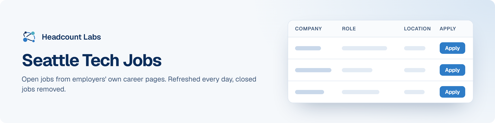

# Seattle Tech Jobs

Software, data, AI, product and design jobs in the Seattle area, sorted by field.

**400 open jobs** · 68 new since the last update · 68 removed because they closed or left the employer's board · updated October 22, 2026 at 6:12 AM EDT

This list is built and refreshed every day by [Headcount Labs](https://headcountlabs.com/?utm_source=github&utm_medium=job-list&utm_campaign=seattle-tech-jobs), which reads jobs straight from employers' own career pages and job boards. Every job here was still listed on its source board when we last read that board, within the past 3 days, and was posted in the past 30 days. Copies of the same job are merged into one row, and jobs that close are removed at the next update.

Want this data in your own app or agent? Use the [Headcount Labs jobs API](https://headcountlabs.com/docs/?utm_source=github&utm_medium=job-list&utm_campaign=seattle-tech-jobs) (free tier), the [MCP server](https://headcountlabs.com/mcp/?utm_source=github&utm_medium=job-list&utm_campaign=seattle-tech-jobs) for Claude, ChatGPT and other AI assistants, or the [public dataset subsets](https://huggingface.co/HeadcountLabs) on Hugging Face (the full dataset is coming soon).

**Full dataset.** A bigger, one-off snapshot dated 2026-10-19 (all matching jobs, not only the open jobs below) is on Hugging Face: [Tech and software jobs](https://huggingface.co/datasets/HeadcountLabs/tech-jobs). It loads with `datasets.load_dataset` and is under the Open Database License (ODbL) 1.0.

**Jump to:** [Software engineering (193)](#software-engineering) · [Data, AI and machine learning (128)](#data-ai-and-machine-learning) · [Product and design (68)](#product-and-design) · [Hardware and engineering (10)](#hardware-and-engineering) · [Business, finance and operations (1)](#business-finance-and-operations)

**Columns.** *Apply* opens the original posting on the employer's site. *Details* opens the job on Headcount Labs, with every posting we found for it. *Remote* shows what the employer states; a dash means the posting doesn't say. *Pay* is the range the employer published.

## Software engineering

| Company | Role | Location | Remote | Pay | Posted | Apply | Details |
| --- | --- | --- | --- | --- | --- | :---: | :---: |
| **WFB Ashurst Perkins Coie US LLP** | Manager, Software Engineering | 

12 locations
Seattle, WA Anchorage, AK Austin, TX Bellevue, WA Boise, ID Chicago, IL Dallas, TX Denver, CO Houston, TX Phoenix, AZ Portland, OR Washington, DC
 | Hybrid | $147k–$234k/yr | Oct 21 |  | <a href="https://headcountlabs.com/catalog/jobs/25bd3d68-c53e-482f-b7cc-d73ecbfa32c6?utm_source=github&utm_medium=job-list&utm_campaign=seattle-tech-jobs">via Headcount Labs</a> |
| **WEX Inc** | Staff Software Engineer – Data Acquisition | 

7 locations
Maine Bay Area, CA Boston, MA Chicago, IL Dallas, TX Seattle, WA California
 | Remote | $141k–$173k/yr | Oct 21 |  | <a href="https://headcountlabs.com/catalog/jobs/80d4438a-9c08-41a4-bfe7-9eb47b5c4445?utm_source=github&utm_medium=job-list&utm_campaign=seattle-tech-jobs">via Headcount Labs</a> |
| **Warner Bros. Discovery** | Senior Software Engineer (Boundary Traffic Management) | 

2 locations
Bellevue, WA New York, NY
 | Hybrid | $146k–$272k/yr | Oct 21 |  | <a href="https://headcountlabs.com/catalog/jobs/17805185-941f-4d8c-bd96-5c79ceb70b70?utm_source=github&utm_medium=job-list&utm_campaign=seattle-tech-jobs">via Headcount Labs</a> |
| **Warner Bros. Discovery** | Staff Software Engineer | 

2 locations
Bellevue, WA New York, NY
 | Hybrid | $166k–$308k/yr | Oct 21 |  | <a href="https://headcountlabs.com/catalog/jobs/d0fb7aa6-4963-4bf0-b929-a96b6c326698?utm_source=github&utm_medium=job-list&utm_campaign=seattle-tech-jobs">via Headcount Labs</a> |
| **Stryker Employment Company, LLC** | Staff Cybersecurity Engineer | Redmond, WA | On-site | $118k–$197k/yr | Oct 21 |  | <a href="https://headcountlabs.com/catalog/jobs/c7689621-62a4-4a13-bc59-1c1f33907902?utm_source=github&utm_medium=job-list&utm_campaign=seattle-tech-jobs">via Headcount Labs</a> |
| **Storable** | Software Development Engineer | Seattle, WA | — | — | Oct 21 |  | <a href="https://headcountlabs.com/catalog/jobs/e85d544a-67c2-4eb6-942d-8c035d93dceb?utm_source=github&utm_medium=job-list&utm_campaign=seattle-tech-jobs">via Headcount Labs</a> |
| **Storable** | Sr. Software Development Engineer | Seattle, WA | — | — | Oct 21 |  | <a href="https://headcountlabs.com/catalog/jobs/e22e5147-b0b6-4458-9b5e-11c21c01728d?utm_source=github&utm_medium=job-list&utm_campaign=seattle-tech-jobs">via Headcount Labs</a> |
| **Storable** | Principal Software Development Engineer | Seattle, WA | — | — | Oct 21 |  | <a href="https://headcountlabs.com/catalog/jobs/919d90af-58cc-4671-8f91-ca1ec1f41552?utm_source=github&utm_medium=job-list&utm_campaign=seattle-tech-jobs">via Headcount Labs</a> |
| **Storable** | Staff Software Development Engineer | Seattle, WA | — | — | Oct 21 |  | <a href="https://headcountlabs.com/catalog/jobs/138be143-cd63-4604-8037-f73965b81053?utm_source=github&utm_medium=job-list&utm_campaign=seattle-tech-jobs">via Headcount Labs</a> |
| **Sonos, Inc.** | Senior Software Development Manager, Mobile App Experience | Seattle, WA | Hybrid | $192k–$240k/yr | Oct 21 |  | <a href="https://headcountlabs.com/catalog/jobs/e51ac3a4-62fc-4170-8e4b-9eef10f30f50?utm_source=github&utm_medium=job-list&utm_campaign=seattle-tech-jobs">via Headcount Labs</a> |
| **Snap Inc.** | Staff Software Engineer, iOS, Level 6 | 

4 locations
Los Angeles, CA Bellevue, WA New York, NY Palo Alto, CA
 | — | $229k–$343k/yr | Oct 21 |  | <a href="https://headcountlabs.com/catalog/jobs/acacc3ae-1d38-4609-9b6c-f3ec6f7a6d54?utm_source=github&utm_medium=job-list&utm_campaign=seattle-tech-jobs">via Headcount Labs</a> |
| **Sapience AI Corporation** | Senior Lead Engineer, Platform Engineering and Cloud Resilience | Seattle, WA | — | $160k–$180k/yr | Oct 21 |  | <a href="https://headcountlabs.com/catalog/jobs/735eda3e-a0f0-444c-820c-edbbc16ff179?utm_source=github&utm_medium=job-list&utm_campaign=seattle-tech-jobs">via Headcount Labs</a> |
| **Salesforce, Inc.** | Software Engineer, DNS &amp; Cloud Infrastructure | 

4 locations
Washington - Bellevue California - San Francisco Bellevue, WA San Francisco, CA
 | — | $117k–$177k/yr | Oct 21 |  | <a href="https://headcountlabs.com/catalog/jobs/4ed2d73b-f58e-4e1b-b6c5-cdcd174d4e45?utm_source=github&utm_medium=job-list&utm_campaign=seattle-tech-jobs">via Headcount Labs</a> |
| **Rakuten USA, Inc.** | Intern - Software Engineer, AI User Experience | Bellevue, WA | — | — | Oct 21 |  | <a href="https://headcountlabs.com/catalog/jobs/733e3b1a-0c2f-43c8-8e09-66530e07406e?utm_source=github&utm_medium=job-list&utm_campaign=seattle-tech-jobs">via Headcount Labs</a> |
| **Plaid** | Software Engineer - Security Engineering | 

3 locations
Seattle, WA New York City San Francisco, CA
 | On-site | $189k–$243k/yr | Oct 21 |  | <a href="https://headcountlabs.com/catalog/jobs/1c7aba95-8d31-4155-9f71-05b408e8a82e?utm_source=github&utm_medium=job-list&utm_campaign=seattle-tech-jobs">via Headcount Labs</a> |
| **Fluidstack** | Security Engineer, Offensive Security | 

5 locations
San Francisco, CA New York, NY Austin, TX United States Seattle, WA
 | On-site | $224k–$275k/yr | Oct 21 |  | <a href="https://headcountlabs.com/catalog/jobs/a8cbe0b1-c887-4ee7-9f2d-5def280756c5?utm_source=github&utm_medium=job-list&utm_campaign=seattle-tech-jobs">via Headcount Labs</a> |
| **Fluidstack** | Security Engineer, OT | 

5 locations
San Francisco, CA New York, NY Austin, TX United States Seattle, WA
 | On-site | $275k–$344k/yr | Oct 21 |  | <a href="https://headcountlabs.com/catalog/jobs/73667627-407d-4a31-b220-06cf5e8ef19a?utm_source=github&utm_medium=job-list&utm_campaign=seattle-tech-jobs">via Headcount Labs</a> |
| **Fluidstack** | Security Engineer, Exposure and Vulnerability Management | 

5 locations
San Francisco, CA New York, NY Austin, TX United States Seattle, WA
 | On-site | $224k–$275k/yr | Oct 21 |  | <a href="https://headcountlabs.com/catalog/jobs/5267eeef-29e6-4ae1-abd6-83cc8104653c?utm_source=github&utm_medium=job-list&utm_campaign=seattle-tech-jobs">via Headcount Labs</a> |
| **DriveWealth** | Principal Security Engineer | 

7 locations
Austin, TX AMER-US Dallas, TX Denver, CO Miami, FL San Francisco, CA Seattle, WA
 | Remote | $215k–$235k/yr | Oct 21 |  | <a href="https://headcountlabs.com/catalog/jobs/74a46e2d-e200-467c-8683-9bd7b173173c?utm_source=github&utm_medium=job-list&utm_campaign=seattle-tech-jobs">via Headcount Labs</a> |
| **DoorDash USA** | Software Engineer, Reliability Platform | 

4 locations
San Francisco, CA Sunnyvale, CA Seattle, WA New York City, NY
 | — | $131k–$192k/yr | Oct 21 |  | <a href="https://headcountlabs.com/catalog/jobs/9e03fafc-6aa8-4e22-823a-a9d8e3eb4373?utm_source=github&utm_medium=job-list&utm_campaign=seattle-tech-jobs">via Headcount Labs</a> |
| **ATOMS Careers page** | Senior Software Engineer - Infrastructure Security Platform | Seattle, WA | On-site | $167k–$230k/yr | Oct 21 |  | <a href="https://headcountlabs.com/catalog/jobs/b9d5421a-647a-49fe-9342-f18b2e69d11a?utm_source=github&utm_medium=job-list&utm_campaign=seattle-tech-jobs">via Headcount Labs</a> |
| **Armanino Advisory LLC** | ServiceNow Business Systems Developer | 

20 locations
New York City, NY Atlanta, GA Austin, TX Bellevue, WA Boca Raton, FL Century City, CA Chicago, IL Dallas, TX Denver, CO Downtown Los Angeles, CA Garden City, NY Irvine, CA +8 more
 | — | $134k–$183k/yr | Oct 21 |  | <a href="https://headcountlabs.com/catalog/jobs/72d143b1-a13b-4fc0-b472-3d3ff9c5113e?utm_source=github&utm_medium=job-list&utm_campaign=seattle-tech-jobs">via Headcount Labs</a> |
| **WEX Inc** | Senior Full-Stack Engineer (Java / Spring Boot) | 

9 locations
Maine Bay Area, CA Boston, MA Dallas, TX Salt Lake City, UT Seattle, WA Portland, ME California United States
 | Remote | $122k–$146k/yr | Oct 20 |  | <a href="https://headcountlabs.com/catalog/jobs/ecfe7cee-95d5-4209-91b1-2e048212622e?utm_source=github&utm_medium=job-list&utm_campaign=seattle-tech-jobs">via Headcount Labs</a> |
| **Uber** | 2027 Software Engineering Intern, US | 

3 locations
San Francisco, CA Sunnyvale, CA Seattle, WA
 | Remote | $52/hr | Oct 20 |  | <a href="https://headcountlabs.com/catalog/jobs/47448a9b-150a-4c8c-8faa-8f35ceeb12c8?utm_source=github&utm_medium=job-list&utm_campaign=seattle-tech-jobs">via Headcount Labs</a> |
| **Snap Inc.** | Software Engineer, Full Stack, Level 4 | 

5 locations
Los Angeles, CA Bellevue, WA New York, NY Palo Alto, CA San Francisco, CA
 | — | $157k–$235k/yr | Oct 20 |  | <a href="https://headcountlabs.com/catalog/jobs/085954a7-d1fa-4e38-b79a-5f81da286738?utm_source=github&utm_medium=job-list&utm_campaign=seattle-tech-jobs">via Headcount Labs</a> |
| **Snap Inc.** | Software Engineer, ML infrastructure, Core Inference, Level 4 | 

4 locations
United States Bellevue, WA Los Angeles, CA Palo Alto, CA
 | On-site | $157k–$235k/yr | Oct 20 |  | <a href="https://headcountlabs.com/catalog/jobs/b864786c-317d-43f3-98f2-55e9cd1f7456?utm_source=github&utm_medium=job-list&utm_campaign=seattle-tech-jobs">via Headcount Labs</a> |
| **Salesforce, Inc.** | Software Engineer, AI Systems (PMTS) | 

5 locations
San Francisco, CA Boston, MA New York Bellevue, WA Seattle, WA
 | — | $172k–$314k/yr | Oct 20 |  | <a href="https://headcountlabs.com/catalog/jobs/21393c34-c00e-4e78-b31f-f68f5d0cf023?utm_source=github&utm_medium=job-list&utm_campaign=seattle-tech-jobs">via Headcount Labs</a> |
| **Salesforce, Inc.** | Staff &amp; Senior Staff Data Platform Engineer - Slack | 

4 locations
San Francisco, CA Atlanta, GA New York Seattle, WA
 | — | $197k–$365k/yr | Oct 20 |  | <a href="https://headcountlabs.com/catalog/jobs/35274ddb-b54e-4eb2-aa1f-573ad2e5b408?utm_source=github&utm_medium=job-list&utm_campaign=seattle-tech-jobs">via Headcount Labs</a> |
| **Salesforce, Inc.** | Software Engineering, AI Systems (SMTS) | 

6 locations
California - San Francisco New York - New York Washington - Bellevue San Francisco, CA New York Bellevue, WA
 | — | $148k–$224k/yr | Oct 20 |  | <a href="https://headcountlabs.com/catalog/jobs/c845408b-cfe7-4e35-b744-a3807e8280a8?utm_source=github&utm_medium=job-list&utm_campaign=seattle-tech-jobs">via Headcount Labs</a> |
| **Reliable Robotics Corporation** | Simulation Software Engineer | 

3 locations
Mountain View, CA Seattle, WA San Diego, CA
 | On-site | $160k–$215k/yr | Oct 20 |  | <a href="https://headcountlabs.com/catalog/jobs/9c3d3f29-3ae2-48fd-8a76-c853facbcd16?utm_source=github&utm_medium=job-list&utm_campaign=seattle-tech-jobs">via Headcount Labs</a> |
| **QXO** | Staff AI Engineer, Full-Stack | Seattle, WA | — | $160k–$288k/yr | Oct 20 |  | <a href="https://headcountlabs.com/catalog/jobs/675c08ab-f0c4-483e-a078-9b7f5f811532?utm_source=github&utm_medium=job-list&utm_campaign=seattle-tech-jobs">via Headcount Labs</a> |
| **Moloco** | Staff Software Engineer - AI Applications | 

2 locations
Menlo Park, CA Seattle, WA
 | — | $220k–$275k/yr | Oct 20 |  | <a href="https://headcountlabs.com/catalog/jobs/f82c4a30-191d-4971-9e02-2d04c845f29b?utm_source=github&utm_medium=job-list&utm_campaign=seattle-tech-jobs">via Headcount Labs</a> |
| **ITC Federal, Inc.** | Software/ML Engineer (Top-Secret) | Redmond, WA | Remote | $120k–$160k/yr | Oct 20 |  | <a href="https://headcountlabs.com/catalog/jobs/02b7c138-0d89-406b-9e3a-91d24217806c?utm_source=github&utm_medium=job-list&utm_campaign=seattle-tech-jobs">via Headcount Labs</a> |
| **Gradial** | Software Engineer | Seattle, WA | — | $14/hr | Oct 20 |  | <a href="https://headcountlabs.com/catalog/jobs/4a99e3b9-d291-4aa4-8661-cd3c4e1c49fd?utm_source=github&utm_medium=job-list&utm_campaign=seattle-tech-jobs">via Headcount Labs</a> |
| **Gradial** | Staff Security Engineer, AI | Seattle, WA | — | $220k–$265k/yr | Oct 20 |  | <a href="https://headcountlabs.com/catalog/jobs/50c90160-793c-483c-9d2e-db219e995f03?utm_source=github&utm_medium=job-list&utm_campaign=seattle-tech-jobs">via Headcount Labs</a> |
| **Gradial** | Staff Security Engineer, Product &amp; Platform | Seattle, WA | — | $220k–$265k/yr | Oct 20 |  | <a href="https://headcountlabs.com/catalog/jobs/446cf507-3c94-415e-991e-ba9bffe8f68b?utm_source=github&utm_medium=job-list&utm_campaign=seattle-tech-jobs">via Headcount Labs</a> |
| **Anthropic** | Security Engineer / Research Engineer, RL Security | San Francisco, CA &#124; New York City, NY &#124; Seattle, WA | — | $320k–$405k/yr | Oct 20 |  | <a href="https://headcountlabs.com/catalog/jobs/2352fccf-bcf7-464e-bc5c-1ca406e70adc?utm_source=github&utm_medium=job-list&utm_campaign=seattle-tech-jobs">via Headcount Labs</a> |
| **Anthropic** | Staff+ Software Engineer, VectorDB | 

2 locations
New York City, NY &#124; Seattle, WA San Francisco, CA &#124; New York City, NY &#124; Seattle, WA
 | — | $320k–$485k/yr | Oct 20 |  | <a href="https://headcountlabs.com/catalog/jobs/f87c27e7-8e6f-4913-a240-a28dcfba63c3?utm_source=github&utm_medium=job-list&utm_campaign=seattle-tech-jobs">via Headcount Labs</a> |
| **UiPath** | Senior Software Engineer - Frontend | Bellevue, WA | On-site | $180k–$235k/yr | Oct 19 |  | <a href="https://headcountlabs.com/catalog/jobs/d57f239e-b256-4b84-a972-c54235c1d877?utm_source=github&utm_medium=job-list&utm_campaign=seattle-tech-jobs">via Headcount Labs</a> |
| **UiPath** | Principal Software Engineer | Bellevue, WA | On-site | $218k–$250k/yr | Oct 19 |  | <a href="https://headcountlabs.com/catalog/jobs/085030ed-e484-4feb-bb4e-644d1b7c06ed?utm_source=github&utm_medium=job-list&utm_campaign=seattle-tech-jobs">via Headcount Labs</a> |
| **Uber** | Staff Security Engineer - Engineer | Seattle, WA | Remote | $232k/yr | Oct 19 |  | <a href="https://headcountlabs.com/catalog/jobs/53862370-dbb4-4897-bb23-20acbafd47a6?utm_source=github&utm_medium=job-list&utm_campaign=seattle-tech-jobs">via Headcount Labs</a> |
| **Trimble Inc.** | Software Engineering Manager | 

2 locations
Lake Oswego, OR Seattle, WA
 | — | $171k–$235k/yr | Oct 19 |  | <a href="https://headcountlabs.com/catalog/jobs/1e22dd0a-5d32-41b2-94df-1ca3d6f55e09?utm_source=github&utm_medium=job-list&utm_campaign=seattle-tech-jobs">via Headcount Labs</a> |
| **Siteimprove** | Principal Software Engineer | Bellevue, WA | Hybrid | $133k–$166k/yr | Oct 19 |  | <a href="https://headcountlabs.com/catalog/jobs/c5cad4f0-e6e0-4855-a84e-2c57f64bc98e?utm_source=github&utm_medium=job-list&utm_campaign=seattle-tech-jobs">via Headcount Labs</a> |
| **Sapience AI Corporation** | Forward Deployed Backend AI Engineer | Seattle, WA | — | $156k–$168k/yr | Oct 19 |  | <a href="https://headcountlabs.com/catalog/jobs/fab73afe-dd09-4e23-9ef2-26db78f1fc2f?utm_source=github&utm_medium=job-list&utm_campaign=seattle-tech-jobs">via Headcount Labs</a> |
| **Salesforce, Inc.** | Summer 2027 Intern - Software Engineer (Security/Government) | 

2 locations
San Francisco, CA Bellevue, WA
 | — | $43–$52/hr | Oct 19 |  | <a href="https://headcountlabs.com/catalog/jobs/f7ac388e-39d6-4b30-b429-a739532b2fc2?utm_source=github&utm_medium=job-list&utm_campaign=seattle-tech-jobs">via Headcount Labs</a> |
| **PricewaterhouseCoopers Advisory Services LLC** | Manager, Full Stack AI Engineer - AWS | 

32 locations
New York Hartford, CT Stamford, CT Washington, DC Boca Raton, FL Jacksonville, FL Miami, FL Orlando, FL Tampa, FL Des Moines, IA Detroit, MI Grand Rapids, MI +20 more
 | — | $99k–$232k/yr | Oct 19 |  | <a href="https://headcountlabs.com/catalog/jobs/b781d533-5341-4a85-b94e-8ca700606f6e?utm_source=github&utm_medium=job-list&utm_campaign=seattle-tech-jobs">via Headcount Labs</a> |
| **PricewaterhouseCoopers Advisory Services LLC** | Senior Associate, Full Stack AI Engineer — AWS | 

33 locations
New York Hartford, CT Stamford, CT Washington, DC Boca Raton, FL Jacksonville, FL Miami, FL Orlando, FL Tampa, FL Des Moines, IA Detroit, MI Grand Rapids, MI +21 more
 | — | $77k–$202k/yr | Oct 19 |  | <a href="https://headcountlabs.com/catalog/jobs/0b72333b-b84e-4805-88fa-e5aac33485c3?utm_source=github&utm_medium=job-list&utm_campaign=seattle-tech-jobs">via Headcount Labs</a> |
| **Nintendo** | Intern - IT Software Engineer | Redmond, WA | On-site | $35/hr | Oct 19 |  | <a href="https://headcountlabs.com/catalog/jobs/39917a82-55b8-4f86-9825-253c0a6f5060?utm_source=github&utm_medium=job-list&utm_campaign=seattle-tech-jobs">via Headcount Labs</a> |
| **LiveRamp, Inc.** | Senior Software Engineer | 

2 locations
San Francisco, CA Seattle, WA
 | Hybrid | — | Oct 19 |  | <a href="https://headcountlabs.com/catalog/jobs/2085aa48-583c-4321-a989-b40105f7a927?utm_source=github&utm_medium=job-list&utm_campaign=seattle-tech-jobs">via Headcount Labs</a> |
| **Docusign** | Senior Software Engineer - Oracle Fusion Finance - Record-to-Report | 

2 locations
San Francisco, CA Seattle, WA
 | — | $165k–$266k/yr | Oct 19 |  | <a href="https://headcountlabs.com/catalog/jobs/319f7f68-62c5-41da-ad03-94782deb73da?utm_source=github&utm_medium=job-list&utm_campaign=seattle-tech-jobs">via Headcount Labs</a> |
| **Clark Nuber, PS** | Salesforce Platform Builder and Developer, Senior Consultant (Remote: WA, AZ, CA, ID, OR, TX) | Bellevue, WA | Remote | $100k/yr | Oct 19 |  | <a href="https://headcountlabs.com/catalog/jobs/7e522e27-d754-412d-9628-2187281d4e7d?utm_source=github&utm_medium=job-list&utm_campaign=seattle-tech-jobs">via Headcount Labs</a> |
| **BlackSky** | Senior Engineer - Embedded/Flight Software | Seattle, WA | Hybrid | $140k–$165k/yr | Oct 19 |  | <a href="https://headcountlabs.com/catalog/jobs/f9bc2a68-12a3-47bb-9bfa-5c1ede9fb095?utm_source=github&utm_medium=job-list&utm_campaign=seattle-tech-jobs">via Headcount Labs</a> |
| **Anthropic** | Staff+ Software Engineer, Memory &amp; Search | 

3 locations
New York City, NY New York City, NY &#124; Seattle, WA San Francisco, CA &#124; New York City, NY &#124; Seattle, WA
 | Remote | $405k–$485k/yr | Oct 19 |  | <a href="https://headcountlabs.com/catalog/jobs/8e52eb46-b580-465c-ba89-94f8185a8989?utm_source=github&utm_medium=job-list&utm_campaign=seattle-tech-jobs">via Headcount Labs</a> |
| **Zoox** | Senior/Staff Software Engineer, ML Training Optimization | 

2 locations
Foster City, CA Seattle, WA
 | On-site | $254k–$350k/yr | Oct 16 |  | <a href="https://headcountlabs.com/catalog/jobs/188e18e9-82a4-40f2-afdd-1cb6d6711a7f?utm_source=github&utm_medium=job-list&utm_campaign=seattle-tech-jobs">via Headcount Labs</a> |
| **Uber** | Principal Security Engineer | 

3 locations
Sunnyvale, CA San Francisco, CA Seattle, WA
 | Remote | $302k/yr | Oct 16 |  | <a href="https://headcountlabs.com/catalog/jobs/0b38e19b-2a51-488c-b7e1-b745b668258d?utm_source=github&utm_medium=job-list&utm_campaign=seattle-tech-jobs">via Headcount Labs</a> |
| **Snap Inc.** | Software Engineer, ML Infrastructure, ML Platform Level 5 | 

3 locations
Los Angeles, CA Palo Alto, CA Bellevue, WA
 | — | $209k–$313k/yr | Oct 16 |  | <a href="https://headcountlabs.com/catalog/jobs/7350aead-dad3-4257-83b4-d1c617ff0806?utm_source=github&utm_medium=job-list&utm_campaign=seattle-tech-jobs">via Headcount Labs</a> |
| **Quest International** | Healthcare Software Integration Engineer | 

17 locations
Irvine, CA Cincinnati, OH Denver, CO Washington, DC Chicago, IL Detroit, MI Arlington, VA Baltimore, MD Oklahoma City, OK United States Florida Union City, GA +5 more
 | Remote | $32–$35/hr | Oct 16 |  | <a href="https://headcountlabs.com/catalog/jobs/e852e68c-52c6-4e5f-bee0-27ca10f1ce39?utm_source=github&utm_medium=job-list&utm_campaign=seattle-tech-jobs">via Headcount Labs</a> |
| **Netflix, Inc.** | Software Engineer 5 - Ads Identity Graph | 

8 locations
New York, NY Seattle, WA Los Angeles, CA Los Gatos, CA New York Los Angeles Los Gatos Seattle
 | On-site | $388k–$558k/yr | Oct 16 |  | <a href="https://headcountlabs.com/catalog/jobs/63be30cf-a17d-474f-a058-0ea0f7f4c096?utm_source=github&utm_medium=job-list&utm_campaign=seattle-tech-jobs">via Headcount Labs</a> |
| **Kaiser Permanente** | Category Management Specialist V - Medical Software | 

2 locations
Pasadena, CA Seattle, WA
 | — | — | Oct 16 |  | <a href="https://headcountlabs.com/catalog/jobs/9b248116-4964-445d-9303-53bcd403be07?utm_source=github&utm_medium=job-list&utm_campaign=seattle-tech-jobs">via Headcount Labs</a> |
| **Hadrian Automation** | Software Engineer, Identity &amp; Access Management | 

3 locations
Los Angeles, CA San Francisco Bay Area, CA Seattle/Bellevue Area, WA
 | On-site | $192k–$274k/yr | Oct 16 |  | <a href="https://headcountlabs.com/catalog/jobs/f4204f9b-dda0-46f1-8213-76e9c5fbcb4c?utm_source=github&utm_medium=job-list&utm_campaign=seattle-tech-jobs">via Headcount Labs</a> |
| **Docusign** | Lead Software Engineer - Data Protection | Seattle, WA | — | $179k–$263k/yr | Oct 16 |  | <a href="https://headcountlabs.com/catalog/jobs/739a7438-8fd9-4412-80ab-c801ee491467?utm_source=github&utm_medium=job-list&utm_campaign=seattle-tech-jobs">via Headcount Labs</a> |
| **DAT** | Security Engineer II | Seattle, WA | Hybrid | $129k–$166k/yr | Oct 16 |  | <a href="https://headcountlabs.com/catalog/jobs/03b28d92-8bdf-4594-a33a-9800dbf67623?utm_source=github&utm_medium=job-list&utm_campaign=seattle-tech-jobs">via Headcount Labs</a> |
| **BlackSky** | Staff Engineer, Flight Software/Embedded Software | Seattle, WA | Hybrid | $155k–$180k/yr | Oct 16 |  | <a href="https://headcountlabs.com/catalog/jobs/04a46b80-0e1f-43b4-a49e-ae990c5ee305?utm_source=github&utm_medium=job-list&utm_campaign=seattle-tech-jobs">via Headcount Labs</a> |
| **Wrapbook** | Senior Software Engineer, Applied AI | Seattle, WA | Hybrid | $206k–$284k/yr | Oct 15 |  | <a href="https://headcountlabs.com/catalog/jobs/02e29601-1c35-4721-ac2f-117c19b2de80?utm_source=github&utm_medium=job-list&utm_campaign=seattle-tech-jobs">via Headcount Labs</a> |
| **University of Washington** | Senior Software Engineer: Systems Engineer | Seattle, WA | — | $115k–$150k/yr | Oct 15 |  | <a href="https://headcountlabs.com/catalog/jobs/6a850477-3fa7-4231-901a-cb57680f37a5?utm_source=github&utm_medium=job-list&utm_campaign=seattle-tech-jobs">via Headcount Labs</a> |
| **Uber** | Sr Software Engineer - Developer Platform | 

4 locations
New York City, NY Seattle, WA Sunnyvale, CA San Francisco, CA
 | Remote | $202k/yr | Oct 15 |  | <a href="https://headcountlabs.com/catalog/jobs/b76499f3-5f94-4b99-8d8d-03ba5c6f5dd2?utm_source=github&utm_medium=job-list&utm_campaign=seattle-tech-jobs">via Headcount Labs</a> |
| **Tin Can** | Software Engineer, Core Product | Seattle, WA | On-site | $145k–$175k/yr | Oct 15 |  | <a href="https://headcountlabs.com/catalog/jobs/fb0611ed-9fc8-40ef-8e4e-b41f9369d388?utm_source=github&utm_medium=job-list&utm_campaign=seattle-tech-jobs">via Headcount Labs</a> |
| **DoorDash USA** | Software Engineer, ML Infrastructure (MDX) | 

3 locations
San Francisco, CA Sunnyvale, CA Seattle, WA
 | — | $131k–$192k/yr | Oct 15 |  | <a href="https://headcountlabs.com/catalog/jobs/a22a9dc6-4ad9-4a5b-b26a-cd9b959635cb?utm_source=github&utm_medium=job-list&utm_campaign=seattle-tech-jobs">via Headcount Labs</a> |
| **Cast AI** | Developer Relations &amp; Experience Engineer | 

3 locations
Los Angeles, CA San Francisco, CA Seattle, WA
 | Remote | — | Oct 15 |  | <a href="https://headcountlabs.com/catalog/jobs/d093b541-f94b-4f89-ac9b-0b369a45c997?utm_source=github&utm_medium=job-list&utm_campaign=seattle-tech-jobs">via Headcount Labs</a> |
| **Viasat, Inc.** | Senior Software Engineer, Temporary | 

4 locations
Carlsbad, CA Tempe, AZ Englewood, CO Seattle, WA
 | — | $140k–$222k/yr | Oct 14 |  | <a href="https://headcountlabs.com/catalog/jobs/beb90218-4e06-41e6-9b73-1f712ef896ba?utm_source=github&utm_medium=job-list&utm_campaign=seattle-tech-jobs">via Headcount Labs</a> |
| **Truveta** | Software Engineer - Security &amp; Trust | Seattle, WA | On-site | $110k–$145k/yr | Oct 14 |  | <a href="https://headcountlabs.com/catalog/jobs/7d23d88b-82e2-48c5-b7b4-381783193c34?utm_source=github&utm_medium=job-list&utm_campaign=seattle-tech-jobs">via Headcount Labs</a> |
| **Pathstone** | Azure Cloud Engineer | 

4 locations
Bellevue, WA Newtown Square, PA New York, NY San Francisco, CA
 | Hybrid | $105k–$130k/yr | Oct 14 |  | <a href="https://headcountlabs.com/catalog/jobs/dc0aaf2f-6fad-442f-875b-3e2bbb7fa059?utm_source=github&utm_medium=job-list&utm_campaign=seattle-tech-jobs">via Headcount Labs</a> |
| **Docker** | Senior Software Engineer, AI Developer Tools | 

2 locations
San Francisco, CA Seattle, WA
 | Remote | — | Oct 14 |  | <a href="https://headcountlabs.com/catalog/jobs/bab0d3ae-4970-493c-b26f-e3fdf98bec23?utm_source=github&utm_medium=job-list&utm_campaign=seattle-tech-jobs">via Headcount Labs</a> |
| **Docker** | Staff Software Engineer, AI Developer Tools | 

2 locations
San Francisco, CA Seattle, WA
 | Remote | — | Oct 14 |  | <a href="https://headcountlabs.com/catalog/jobs/66496dfb-a52c-4f7f-8c9f-a89faf85428c?utm_source=github&utm_medium=job-list&utm_campaign=seattle-tech-jobs">via Headcount Labs</a> |
| **Disney Entertainment &amp; Sports LLC** | Sr Principal Software Engineer | 

3 locations
Seattle, WA New York, NY San Francisco, CA
 | Hybrid | $243k–$326k/yr | Oct 14 |  | <a href="https://headcountlabs.com/catalog/jobs/af55ea93-a461-4474-9731-c6e9e733937a?utm_source=github&utm_medium=job-list&utm_campaign=seattle-tech-jobs">via Headcount Labs</a> |
| **CoreWeave** | Senior Software Engineer, Network Development | Livingston, NJ / New York, NY / Sunnyvale, CA / Bellevue, WA | — | $165k–$220k/yr | Oct 14 |  | <a href="https://headcountlabs.com/catalog/jobs/517b67ac-af99-44a7-944f-77c4d48b3e52?utm_source=github&utm_medium=job-list&utm_campaign=seattle-tech-jobs">via Headcount Labs</a> |
| **Brown and Caldwell** | Senior Cyber Security Engineer | 

13 locations
Lakewood, CO Nashville, TN Chicago, IL Walnut Creek, CA New York City, NY Alexandria, VA Houston, TX Atlanta, GA West Palm Beach, FL Seattle, WA Los Angeles, CA Irvine, CA +1 more
 | Hybrid | $129k–$177k/yr | Oct 14 |  | <a href="https://headcountlabs.com/catalog/jobs/72235f00-1387-4188-b5ba-0e20b92af53b?utm_source=github&utm_medium=job-list&utm_campaign=seattle-tech-jobs">via Headcount Labs</a> |
| **ATOMS Careers page** | Software Engineering Intern - 2027 Winter Term | Seattle, WA | On-site | $70/hr | Oct 14 |  | <a href="https://headcountlabs.com/catalog/jobs/e78b6885-21e6-4c2e-bdc2-fca6a7368117?utm_source=github&utm_medium=job-list&utm_campaign=seattle-tech-jobs">via Headcount Labs</a> |
| **Anthropic** | Staff+ Software Engineer, Platform Acceleration | San Francisco, CA &#124; New York City, NY &#124; Seattle, WA | — | $405k–$485k/yr | Oct 14 |  | <a href="https://headcountlabs.com/catalog/jobs/4fc71015-08c6-43fd-92a3-7b0b9ddbc590?utm_source=github&utm_medium=job-list&utm_campaign=seattle-tech-jobs">via Headcount Labs</a> |
| **Anduril Industries** | Senior Software Engineer, Simulation Platform | Seattle, WA | — | $191k–$254k/yr | Oct 14 |  | <a href="https://headcountlabs.com/catalog/jobs/56586e62-d547-4ad3-9606-93d92937a021?utm_source=github&utm_medium=job-list&utm_campaign=seattle-tech-jobs">via Headcount Labs</a> |
| **AbbVie** | Lead Site Reliability Engineer - Allergan Aesthetics | Seattle, WA | Remote | $142k–$268k/yr | Oct 14 |  | <a href="https://headcountlabs.com/catalog/jobs/bf95aa58-6b55-40cc-8e6c-c6cfa93ba019?utm_source=github&utm_medium=job-list&utm_campaign=seattle-tech-jobs">via Headcount Labs</a> |
| **Truveta** | Senior Software Engineer - Normalization Platform | Seattle, WA | Hybrid | $155k–$190k/yr | Oct 13 |  | <a href="https://headcountlabs.com/catalog/jobs/cbef2dcf-1eb2-4892-bf6b-54ffe5836f64?utm_source=github&utm_medium=job-list&utm_campaign=seattle-tech-jobs">via Headcount Labs</a> |
| **Tanium** | Senior Software Engineer | 

3 locations
Bellevue, WA Durham, NC Emeryville, CA
 | Hybrid | $191k–$293k/yr | Oct 13 |  | <a href="https://headcountlabs.com/catalog/jobs/366d6809-28d6-4e61-9012-de5d062a1fb7?utm_source=github&utm_medium=job-list&utm_campaign=seattle-tech-jobs">via Headcount Labs</a> |
| **Snap Inc.** | Director, Software Engineering, Product Eng | 

4 locations
Los Angeles, CA Bellevue, WA Palo Alto, CA San Francisco, CA
 | — | $334k–$500k/yr | Oct 13 |  | <a href="https://headcountlabs.com/catalog/jobs/d3e2cc57-9a0f-4a33-8902-f54bc7140a10?utm_source=github&utm_medium=job-list&utm_campaign=seattle-tech-jobs">via Headcount Labs</a> |
| **Reliable Robotics Corporation** | Sr. Embedded Software Engineer, Radar | Seattle, WA | — | $210k–$280k/yr | Oct 13 |  | <a href="https://headcountlabs.com/catalog/jobs/f4b9fc4b-9367-4313-987e-79b6a5ab5a1f?utm_source=github&utm_medium=job-list&utm_campaign=seattle-tech-jobs">via Headcount Labs</a> |
| **EchoMark** | Backend Engineer | Bellevue, WA | On-site | $120k–$150k/yr | Oct 13 |  | <a href="https://headcountlabs.com/catalog/jobs/7d430bf9-f032-4559-99f2-f8bde846330a?utm_source=github&utm_medium=job-list&utm_campaign=seattle-tech-jobs">via Headcount Labs</a> |
| **DoorDash USA** | Senior Software Engineer, Data Engineering | 

3 locations
San Francisco, CA Sunnyvale, CA Seattle, WA
 | Hybrid | $144k–$212k/yr | Oct 13 |  | <a href="https://headcountlabs.com/catalog/jobs/feabd4f9-2c3e-49fe-afdd-a80510ebba03?utm_source=github&utm_medium=job-list&utm_campaign=seattle-tech-jobs">via Headcount Labs</a> |
| **DoorDash USA** | Senior Software Engineer, Machine Learning | 

3 locations
San Francisco, CA New York, NY Seattle, WA
 | Hybrid | $168k–$247k/yr | Oct 13 |  | <a href="https://headcountlabs.com/catalog/jobs/d82c1c9d-7a87-444e-a5ad-201555522f52?utm_source=github&utm_medium=job-list&utm_campaign=seattle-tech-jobs">via Headcount Labs</a> |
| **DoorDash USA** | Senior Software Engineer, Backend (All Teams) | 

4 locations
San Francisco, CA New York City, NY Sunnyvale, CA Seattle, WA
 | Hybrid | $160k–$235k/yr | Oct 13 |  | <a href="https://headcountlabs.com/catalog/jobs/d2d3d1d7-961c-4720-832c-469e79c81123?utm_source=github&utm_medium=job-list&utm_campaign=seattle-tech-jobs">via Headcount Labs</a> |
| **DoorDash USA** | Senior Software Engineer, Spark Platform | 

4 locations
San Francisco, CA Sunnyvale, CA Seattle, WA New York City, NY
 | — | $160k–$235k/yr | Oct 13 |  | <a href="https://headcountlabs.com/catalog/jobs/43964daf-2548-4792-9c04-0c75af0e7f47?utm_source=github&utm_medium=job-list&utm_campaign=seattle-tech-jobs">via Headcount Labs</a> |
| **Docusign** | Software Engineer | Seattle, WA | — | $112k–$162k/yr | Oct 13 |  | <a href="https://headcountlabs.com/catalog/jobs/1df36053-173c-4b2a-be7c-a23bb55455bd?utm_source=github&utm_medium=job-list&utm_campaign=seattle-tech-jobs">via Headcount Labs</a> |
| **Cloudflare** | Senior Software Engineer, Distributed Databases | 

3 locations
Austin, TX London Seattle, WA
 | Hybrid | — | Oct 13 |  | <a href="https://headcountlabs.com/catalog/jobs/4544f7fa-131b-44a8-9342-a7edc2044c2a?utm_source=github&utm_medium=job-list&utm_campaign=seattle-tech-jobs">via Headcount Labs</a> |
| **AAA Wa** | Senior Security Engineer | Bellevue, WA | Hybrid | $160k–$191k/yr | Oct 13 |  | <a href="https://headcountlabs.com/catalog/jobs/a629ef13-1180-405c-a682-ec61ae52fd67?utm_source=github&utm_medium=job-list&utm_campaign=seattle-tech-jobs">via Headcount Labs</a> |
| **Rippling** | Senior Software Engineer, Security | 

3 locations
New York, NY Seattle, WA San Francisco, CA
 | On-site | — | Oct 12 |  | <a href="https://headcountlabs.com/catalog/jobs/4d048787-53c1-4706-9a3e-e13b68e41b6d?utm_source=github&utm_medium=job-list&utm_campaign=seattle-tech-jobs">via Headcount Labs</a> |
| **Okta** | Senior Site Reliability Engineer - EPG | 

2 locations
Bellevue, WA San Francisco, CA
 | Hybrid | $165k–$227k/yr | Oct 12 |  | <a href="https://headcountlabs.com/catalog/jobs/09de4403-1e9f-4c03-b22f-2da0b34250b5?utm_source=github&utm_medium=job-list&utm_campaign=seattle-tech-jobs">via Headcount Labs</a> |
| **Echodyne Corp** | Senior Software Engineering Manager, Data Platform | Kirkland, WA | — | $165k–$247k/yr | Oct 12 |  | <a href="https://headcountlabs.com/catalog/jobs/00c68c8c-8b6c-4040-8a0f-88d5b9ab885b?utm_source=github&utm_medium=job-list&utm_campaign=seattle-tech-jobs">via Headcount Labs</a> |
| **Disney Entertainment &amp; Sports LLC** | Manager, Product Software Engineering - Mobile | 

2 locations
New York, NY Seattle, WA
 | Hybrid | $182k–$245k/yr | Oct 12 |  | <a href="https://headcountlabs.com/catalog/jobs/bca94cac-4787-436f-9fd4-1fb124649a12?utm_source=github&utm_medium=job-list&utm_campaign=seattle-tech-jobs">via Headcount Labs</a> |
| **Disney Entertainment &amp; Sports LLC** | Product Software Engineer II | 

3 locations
Bristol, CT Glendale, CA Seattle, WA
 | Hybrid | $119k–$160k/yr | Oct 11 |  | <a href="https://headcountlabs.com/catalog/jobs/8b0a9677-86f0-46bc-9c69-9acecf73345d?utm_source=github&utm_medium=job-list&utm_campaign=seattle-tech-jobs">via Headcount Labs</a> |
| **Disney Entertainment &amp; Sports LLC** | Sr Product Software Engineer (Swift) | 

4 locations
Seattle, WA Glendale, CA New York, NY San Francisco, CA
 | Hybrid | $158k–$212k/yr | Oct 11 |  | <a href="https://headcountlabs.com/catalog/jobs/7b812771-ba92-4037-b5bd-a051791c36dd?utm_source=github&utm_medium=job-list&utm_campaign=seattle-tech-jobs">via Headcount Labs</a> |
| **Anduril Industries** | Senior Front End Software Engineer, React | 

3 locations
Arlington, VA Seattle, WA Washington, DC
 | — | $191k–$292k/yr | Oct 11 |  | <a href="https://headcountlabs.com/catalog/jobs/f7debc09-88a1-4aa3-b750-b9511f2416d9?utm_source=github&utm_medium=job-list&utm_campaign=seattle-tech-jobs">via Headcount Labs</a> |
| **Anduril Industries** | Senior Software Engineer, Strategic Defense | 

4 locations
Costa Mesa, CA Reston, VA Seattle, WA Washington, DC
 | — | $191k–$292k/yr | Oct 11 |  | <a href="https://headcountlabs.com/catalog/jobs/a1e5f3a1-e88e-4003-a610-35996888e5c6?utm_source=github&utm_medium=job-list&utm_campaign=seattle-tech-jobs">via Headcount Labs</a> |
| **Anduril Industries** | Software Engineer, Strategic Defense | 

4 locations
Costa Mesa, CA Reston, VA Seattle, WA Washington, DC
 | — | $166k–$220k/yr | Oct 11 |  | <a href="https://headcountlabs.com/catalog/jobs/d23ccec2-a297-4bc9-b96f-67fd4a42b66c?utm_source=github&utm_medium=job-list&utm_campaign=seattle-tech-jobs">via Headcount Labs</a> |
| **University of Washington** | Software Engineer | Seattle, WA | — | $108k–$144k/yr | Oct 10 |  | <a href="https://headcountlabs.com/catalog/jobs/c55332fd-fd73-46e8-a383-ddd9c1136341?utm_source=github&utm_medium=job-list&utm_campaign=seattle-tech-jobs">via Headcount Labs</a> |
| **UKG** | Principal Site Reliability Engineer | Seattle, WA | — | $184k–$265k/yr | Oct 10 |  | <a href="https://headcountlabs.com/catalog/jobs/3b85b170-4b27-4476-831e-3a6201d194e6?utm_source=github&utm_medium=job-list&utm_campaign=seattle-tech-jobs">via Headcount Labs</a> |
| **SpaceXSI** | Infrastructure Security Engineer (Bare Metal &amp; Platform) | 

4 locations
Palo Alto, CA Austin, TX New York, NY Seattle, WA
 | — | $100k–$258k/yr | Oct 10 |  | <a href="https://headcountlabs.com/catalog/jobs/85859971-5bdd-421c-ad8a-68065118b77f?utm_source=github&utm_medium=job-list&utm_campaign=seattle-tech-jobs">via Headcount Labs</a> |
| **Uber** | Sr Manager, Security Engineering - Engineer | Seattle, WA | Remote | $267k/yr | Oct 9 |  | <a href="https://headcountlabs.com/catalog/jobs/beee4b77-50be-42cd-8a60-244099e54981?utm_source=github&utm_medium=job-list&utm_campaign=seattle-tech-jobs">via Headcount Labs</a> |
| **Stripe** | Software Engineer | Seattle, WA | — | $190k–$286k/yr | Oct 9 |  | <a href="https://headcountlabs.com/catalog/jobs/de097f38-da8e-4ea2-9639-9da696aeda51?utm_source=github&utm_medium=job-list&utm_campaign=seattle-tech-jobs">via Headcount Labs</a> |
| **Snap Inc.** | Manager, Software Engineering, Core Infrastructure | Bellevue, WA | — | $229k–$343k/yr | Oct 9 |  | <a href="https://headcountlabs.com/catalog/jobs/5378cc12-0b87-444e-8014-2871957d971b?utm_source=github&utm_medium=job-list&utm_campaign=seattle-tech-jobs">via Headcount Labs</a> |
| **Scribd, Inc.** | Senior Software Engineer (Frontend), Search | 

11 locations
San Francisco, CA Toronto Los Angeles, CA Denver, CO Chicago, IL New York City, NY Vancouver Seattle, WA Austin, TX Boston, MA Dallas, TX
 | — | — | Oct 9 |  | <a href="https://headcountlabs.com/catalog/jobs/90a1fce2-3d1e-49aa-be10-e1331979f925?utm_source=github&utm_medium=job-list&utm_campaign=seattle-tech-jobs">via Headcount Labs</a> |
| **REI (Recreational Equipment Inc.)** | Senior Software Engineer | Seattle, WA | — | $113k–$181k/yr | Oct 9 |  | <a href="https://headcountlabs.com/catalog/jobs/a2b51766-403c-4629-9048-c3c59f1f4f35?utm_source=github&utm_medium=job-list&utm_campaign=seattle-tech-jobs">via Headcount Labs</a> |
| **Port of Seattle** | Information Security Engineer/Analyst I | Seattle, WA | — | $108k/yr | Oct 9 |  | <a href="https://headcountlabs.com/catalog/jobs/97d8ad85-3793-462c-b8db-7b672d423fbe?utm_source=github&utm_medium=job-list&utm_campaign=seattle-tech-jobs">via Headcount Labs</a> |
| **Okta** | Staff Software Engineer, Security | Bellevue, WA | — | $194k–$267k/yr | Oct 9 |  | <a href="https://headcountlabs.com/catalog/jobs/a4f05f4b-5d30-4b3a-be81-249ac0aef23f?utm_source=github&utm_medium=job-list&utm_campaign=seattle-tech-jobs">via Headcount Labs</a> |
| **NexHealth** | Senior Software Engineer | 

9 locations
Seattle, WA San Francisco, CA Austin, TX Boston, MA Denver, CO New York, NY Atlanta, GA Raleigh, NC Chicago, IL
 | Remote | $165k–$230k/yr | Oct 9 |  | <a href="https://headcountlabs.com/catalog/jobs/65ab7378-111b-4814-b97a-9957e63cbe47?utm_source=github&utm_medium=job-list&utm_campaign=seattle-tech-jobs">via Headcount Labs</a> |
| **Gradial** | Staff Software Engineer, Platform | Seattle, WA | — | $220k–$265k/yr | Oct 9 |  | <a href="https://headcountlabs.com/catalog/jobs/6cadf1ae-01f5-440f-9237-f10618b38e9d?utm_source=github&utm_medium=job-list&utm_campaign=seattle-tech-jobs">via Headcount Labs</a> |
| **Docusign** | Software Engineer Intern | Seattle, WA | — | $38–$45/hr | Oct 9 |  | <a href="https://headcountlabs.com/catalog/jobs/11c7537a-a7d7-4900-98bc-b8a079c701c0?utm_source=github&utm_medium=job-list&utm_campaign=seattle-tech-jobs">via Headcount Labs</a> |
| **CoreWeave** | Senior Security Engineer, Networking | Livingston, NJ / New York, NY / Sunnyvale, CA / Bellevue, WA | — | $153k–$204k/yr | Oct 9 |  | <a href="https://headcountlabs.com/catalog/jobs/9e9647d7-c59d-4d3d-aee0-5451dcb5f3c4?utm_source=github&utm_medium=job-list&utm_campaign=seattle-tech-jobs">via Headcount Labs</a> |
| **CoreWeave** | Senior Security Engineer, Vulnerability Management | Livingston, NJ / New York, NY / Sunnyvale, CA / Bellevue, WA | — | $165k–$242k/yr | Oct 9 |  | <a href="https://headcountlabs.com/catalog/jobs/08c35722-24c1-4c2d-afdf-6f1b802bd236?utm_source=github&utm_medium=job-list&utm_campaign=seattle-tech-jobs">via Headcount Labs</a> |
| **Boeing** | Full Stack Data Scientist | 

2 locations
Seattle, WA Arlington, VA
 | — | $138k–$186k/yr | Oct 9 |  | <a href="https://headcountlabs.com/catalog/jobs/53056128-d244-4885-b78a-6eb88477bab2?utm_source=github&utm_medium=job-list&utm_campaign=seattle-tech-jobs">via Headcount Labs</a> |
| **Aurelian** | Software Engineer (New Grad) | Seattle, WA | On-site | $100k–$130k/yr | Oct 9 |  | <a href="https://headcountlabs.com/catalog/jobs/3a3a4d16-0de7-4105-8f57-557b09d2dc8e?utm_source=github&utm_medium=job-list&utm_campaign=seattle-tech-jobs">via Headcount Labs</a> |
| **Salesforce, Inc.** | Senior Software Engineer, Identity Security | 

4 locations
San Francisco, CA Atlanta, GA Bellevue, WA Seattle, WA
 | — | $172k–$260k/yr | Oct 8 |  | <a href="https://headcountlabs.com/catalog/jobs/c02d7338-2672-4863-9756-9737b3a861b5?utm_source=github&utm_medium=job-list&utm_campaign=seattle-tech-jobs">via Headcount Labs</a> |
| **RADAR** | Senior Site Reliability Engineer | 

3 locations
Seattle, WA Sunnyvale, CA or San Diego, CA
 | — | $170k–$219k/yr | Oct 8 |  | <a href="https://headcountlabs.com/catalog/jobs/c1fb985d-b760-4298-83e5-1c68bba30463?utm_source=github&utm_medium=job-list&utm_campaign=seattle-tech-jobs">via Headcount Labs</a> |
| **Pacific Northwest National Laboratory** | DevOps/Platform Engineer II | 

2 locations
Richland, WA Seattle, WA
 | — | $109k/yr | Oct 8 |  | <a href="https://headcountlabs.com/catalog/jobs/b7c9679b-d4a3-4f1b-a038-89b29beb3367?utm_source=github&utm_medium=job-list&utm_campaign=seattle-tech-jobs">via Headcount Labs</a> |
| **OpenAI** | Software Engineer, HSM Infrastructure Security, Consumer Devices | Seattle, WA | — | $347k–$445k/yr | Oct 8 |  | <a href="https://headcountlabs.com/catalog/jobs/d941d050-a359-4b0b-bfce-883402c8277d?utm_source=github&utm_medium=job-list&utm_campaign=seattle-tech-jobs">via Headcount Labs</a> |
| **Nauwork** | Senior Software Engineer | Seattle, WA | Remote | $170k/yr | Oct 8 |  | <a href="https://headcountlabs.com/catalog/jobs/88872e56-1a1f-4962-9a5e-33d57968ddbe?utm_source=github&utm_medium=job-list&utm_campaign=seattle-tech-jobs">via Headcount Labs</a> |
| **Luma** | Software Engineer, Inference | 

4 locations
Redwood City, CA United States New York, NY Seattle, WA
 | Hybrid | $195k–$345k/yr | Oct 8 |  | <a href="https://headcountlabs.com/catalog/jobs/bd9d0383-66c4-4598-90a6-db2d166f2218?utm_source=github&utm_medium=job-list&utm_campaign=seattle-tech-jobs">via Headcount Labs</a> |
| **Gates Foundation** | Senior Program Officer, Software &amp; AI | Seattle, WA | — | $213k–$330k/yr | Oct 8 |  | <a href="https://headcountlabs.com/catalog/jobs/0641134e-85be-48e4-b3eb-e4d66c514967?utm_source=github&utm_medium=job-list&utm_campaign=seattle-tech-jobs">via Headcount Labs</a> |
| **ExtraHop** | Senior Software Engineer &#124; Cloud | (US) &#124; Seattle, WA | Remote | $160k–$180k/yr | Oct 8 |  | <a href="https://headcountlabs.com/catalog/jobs/67d35b03-27c1-433c-9b70-ecec12f894d5?utm_source=github&utm_medium=job-list&utm_campaign=seattle-tech-jobs">via Headcount Labs</a> |
| **ExtraHop** | Software Engineer III &#124; Framework | (US) &#124; Seattle, WA | Remote | $150k–$163k/yr | Oct 8 |  | <a href="https://headcountlabs.com/catalog/jobs/eb9ba29c-8422-46e6-8f9d-65a8fabb3aca?utm_source=github&utm_medium=job-list&utm_campaign=seattle-tech-jobs">via Headcount Labs</a> |
| **Echodyne Corp** | Product Manager – Software | Kirkland, WA | — | $114k–$171k/yr | Oct 8 |  | <a href="https://headcountlabs.com/catalog/jobs/12aa0a57-f32b-471f-9cba-1cdb76db9e51?utm_source=github&utm_medium=job-list&utm_campaign=seattle-tech-jobs">via Headcount Labs</a> |
| **Costco IT** | Software Engineer - Costco Travel | Issaquah (Seattle), WA | — | $130k–$160k/yr | Oct 8 |  | <a href="https://headcountlabs.com/catalog/jobs/1992d12c-7f70-4469-9419-48ce0122830d?utm_source=github&utm_medium=job-list&utm_campaign=seattle-tech-jobs">via Headcount Labs</a> |
| **Block** | Staff Software Engineer, Payments Acquiring | 

2 locations
Bay Area, CA Seattle, WA
 | — | $264k–$395k/yr | Oct 8 |  | <a href="https://headcountlabs.com/catalog/jobs/e4176c95-78de-481c-ad20-0994c44146d8?utm_source=github&utm_medium=job-list&utm_campaign=seattle-tech-jobs">via Headcount Labs</a> |
| **Blink Health** | Senior Site Reliability Engineer II | 

3 locations
New York, NY Pittsburgh, PA Seattle, WA
 | — | — | Oct 8 |  | <a href="https://headcountlabs.com/catalog/jobs/e755d0fa-6f4c-4e40-b6fa-7b280a1d184e?utm_source=github&utm_medium=job-list&utm_campaign=seattle-tech-jobs">via Headcount Labs</a> |
| **Anduril Industries** | Senior AI Infrastructure Engineer, Physical Infrastructure | Seattle, WA | — | $166k–$220k/yr | Oct 8 |  | <a href="https://headcountlabs.com/catalog/jobs/a91998bd-103b-4c2a-86c1-770fc76fe73e?utm_source=github&utm_medium=job-list&utm_campaign=seattle-tech-jobs">via Headcount Labs</a> |
| **US: Mastercard International Incor** | Principal Software Development Engineer | 

4 locations
Arlington, VA O'Fallon, MO Seattle, WA R-286148
 | — | $195k–$323k/yr | Oct 7 |  | <a href="https://headcountlabs.com/catalog/jobs/a0f7ff24-2000-42c8-96ad-b438998508b0?utm_source=github&utm_medium=job-list&utm_campaign=seattle-tech-jobs">via Headcount Labs</a> |
| **Scribd, Inc.** | Staff Software Engineer, Core Everand | 

11 locations
San Francisco, CA Toronto Los Angeles, CA Denver, CO Chicago, IL New York City, NY Vancouver Seattle, WA Austin, TX Boston, MA Dallas, TX
 | Remote | — | Oct 7 |  | <a href="https://headcountlabs.com/catalog/jobs/989134f2-462c-4355-b305-89e5ed624e62?utm_source=github&utm_medium=job-list&utm_campaign=seattle-tech-jobs">via Headcount Labs</a> |
| **QXO** | Staff Software Engineer | Seattle, WA | — | $160k–$288k/yr | Oct 7 |  | <a href="https://headcountlabs.com/catalog/jobs/ae759b0b-d0bb-4a64-8993-25ba928e0966?utm_source=github&utm_medium=job-list&utm_campaign=seattle-tech-jobs">via Headcount Labs</a> |
| **Pacific Northwest National Laboratory** | Hiring Event - Lead Software Engineer IV | 

2 locations
Richland, WA Seattle, WA
 | — | $161k/yr | Oct 7 |  | <a href="https://headcountlabs.com/catalog/jobs/927b1703-19cb-40c0-a05d-12baf21b60e5?utm_source=github&utm_medium=job-list&utm_campaign=seattle-tech-jobs">via Headcount Labs</a> |
| **Pacific Northwest National Laboratory** | Hiring Event - Chief Software Engineer V | 

2 locations
Richland, WA Seattle, WA
 | — | $192k/yr | Oct 7 |  | <a href="https://headcountlabs.com/catalog/jobs/2351ebbc-6825-4624-98f0-ec1e26fd5998?utm_source=github&utm_medium=job-list&utm_campaign=seattle-tech-jobs">via Headcount Labs</a> |
| **Pacific Northwest National Laboratory** | Hiring Event - Senior Software Engineer III | 

2 locations
Richland, WA Seattle, WA
 | — | $133k/yr | Oct 7 |  | <a href="https://headcountlabs.com/catalog/jobs/54eab5c3-cfd1-49d7-94ac-fbda12ff5553?utm_source=github&utm_medium=job-list&utm_campaign=seattle-tech-jobs">via Headcount Labs</a> |
| **Metropolis** | Senior Software Engineer, AI Agentic Platform | Seattle, WA | — | $177k/yr | Oct 7 |  | <a href="https://headcountlabs.com/catalog/jobs/93a51708-6c87-4cbc-9fb1-b2cb2436928e?utm_source=github&utm_medium=job-list&utm_campaign=seattle-tech-jobs">via Headcount Labs</a> |
| **Gradial** | Staff Software Engineer, Backend | Seattle, WA | — | $220k–$265k/yr | Oct 7 |  | <a href="https://headcountlabs.com/catalog/jobs/5afaa565-bbca-4dce-8768-7fca0b7bdc85?utm_source=github&utm_medium=job-list&utm_campaign=seattle-tech-jobs">via Headcount Labs</a> |
| **Finvari** | Backend / Server Engineer (Senior or Staff) | Seattle, WA | Hybrid | $180k–$200k/yr | Oct 7 |  | <a href="https://headcountlabs.com/catalog/jobs/fcd8ab10-04bb-4d1f-93e2-67b8bcd3f18a?utm_source=github&utm_medium=job-list&utm_campaign=seattle-tech-jobs">via Headcount Labs</a> |
| **Designworks Talent** | Staff AI Training Infrastructure Engineer | Bellevue, WA | Hybrid | — | Oct 7 |  | <a href="https://headcountlabs.com/catalog/jobs/afbc2629-04d4-4785-914a-2a32eb75a5bd?utm_source=github&utm_medium=job-list&utm_campaign=seattle-tech-jobs">via Headcount Labs</a> |
| **Designworks Talent** | Senior AI Training Infrastructure Engineer | Bellevue, WA | Hybrid | — | Oct 7 |  | <a href="https://headcountlabs.com/catalog/jobs/9fb9b2ee-eae2-4aaf-b147-acca40e36c0e?utm_source=github&utm_medium=job-list&utm_campaign=seattle-tech-jobs">via Headcount Labs</a> |
| **Crusoe** | Senior Staff Software Engineer, Cloud Availability Platform | 

3 locations
San Francisco, CA Sunnyvale, CA Bellevue, WA
 | On-site | — | Oct 7 |  | <a href="https://headcountlabs.com/catalog/jobs/7243495c-e2a9-4bd7-a589-22a8b6dcc615?utm_source=github&utm_medium=job-list&utm_campaign=seattle-tech-jobs">via Headcount Labs</a> |
| **Anduril Industries** | Staff Software Engineer, Stateful Systems | Seattle, WA | — | $220k–$292k/yr | Oct 7 |  | <a href="https://headcountlabs.com/catalog/jobs/ad1e4823-15fc-4c9a-baed-e0ef432c5a05?utm_source=github&utm_medium=job-list&utm_campaign=seattle-tech-jobs">via Headcount Labs</a> |
| **UKG** | Sr. Staff Software Engineer (Agentic AI) | Seattle, WA | — | $146k–$241k/yr | Oct 6 |  | <a href="https://headcountlabs.com/catalog/jobs/e17f087b-14c6-4404-b020-85433e9ae764?utm_source=github&utm_medium=job-list&utm_campaign=seattle-tech-jobs">via Headcount Labs</a> |
| **Scribd, Inc.** | Staff Cloud Security Engineer | 

11 locations
San Francisco, CA Toronto Los Angeles, CA Denver, CO Chicago, IL New York City, NY Vancouver Seattle, WA Austin, TX Boston, MA Dallas, TX
 | — | — | Oct 6 |  | <a href="https://headcountlabs.com/catalog/jobs/f706c7f3-86ca-4993-b3d1-e0b22d8a5667?utm_source=github&utm_medium=job-list&utm_campaign=seattle-tech-jobs">via Headcount Labs</a> |
| **Scribd, Inc.** | Senior iOS Engineer | 

11 locations
San Francisco, CA Toronto Los Angeles, CA Denver, CO Chicago, IL New York City, NY Vancouver Seattle, WA Austin, TX Boston, MA Dallas, TX
 | — | — | Oct 6 |  | <a href="https://headcountlabs.com/catalog/jobs/3275af16-3194-4103-8b25-6ddd578c96ed?utm_source=github&utm_medium=job-list&utm_campaign=seattle-tech-jobs">via Headcount Labs</a> |
| **Robinhood** | Staff Software Engineer, AI Security | 

2 locations
Bellevue, WA Menlo Park, CA
 | — | $230k–$270k/yr | Oct 6 |  | <a href="https://headcountlabs.com/catalog/jobs/95f5965e-477d-4ee0-9eda-6ceda85c0dfc?utm_source=github&utm_medium=job-list&utm_campaign=seattle-tech-jobs">via Headcount Labs</a> |
| **Principal Financial Group** | Equity Analyst, Software | 

4 locations
New York, NY Denver, CO Des Moines, IA Seattle, WA
 | — | $141k–$243k/yr | Oct 6 |  | <a href="https://headcountlabs.com/catalog/jobs/d9dbd2e2-6c60-4a4e-9d51-2ec5a99569ef?utm_source=github&utm_medium=job-list&utm_campaign=seattle-tech-jobs">via Headcount Labs</a> |
| **Pinterest** | Staff Software Engineer, App Promotion | 

3 locations
San Francisco, CA Seattle, WA CA, WA
 | Hybrid | $189k–$390k/yr | Oct 6 |  | <a href="https://headcountlabs.com/catalog/jobs/4bd7724b-38e1-4c41-ae4a-9dca7d867c65?utm_source=github&utm_medium=job-list&utm_campaign=seattle-tech-jobs">via Headcount Labs</a> |
| **Metropolis** | Senior Software Engineer, Incentive Offers | Seattle, WA | — | $177k/yr | Oct 6 |  | <a href="https://headcountlabs.com/catalog/jobs/924e60cf-61ef-4b79-917b-1ffec6f1b7a4?utm_source=github&utm_medium=job-list&utm_campaign=seattle-tech-jobs">via Headcount Labs</a> |
| **Metropolis** | Senior Software Engineer, Visit Experience | Seattle, WA | — | $177k/yr | Oct 6 |  | <a href="https://headcountlabs.com/catalog/jobs/4859b3ed-7cf2-49a0-ae20-4daaed4f8119?utm_source=github&utm_medium=job-list&utm_campaign=seattle-tech-jobs">via Headcount Labs</a> |
| **Join Our Talent Community** | 2026 AfroTech Software Product Manager | 

2 locations
New York, NY Seattle, WA
 | Hybrid | $162k–$259k/yr | Oct 6 |  | <a href="https://headcountlabs.com/catalog/jobs/8463f7a5-6f87-4977-9b9e-9878dbe63c0e?utm_source=github&utm_medium=job-list&utm_campaign=seattle-tech-jobs">via Headcount Labs</a> |
| **F5, Inc. (United States)** | Software Development Engineer Intern (Seattle, WA) | Seattle, WA | — | $42–$55/hr | Oct 6 |  | <a href="https://headcountlabs.com/catalog/jobs/766bb7d3-2bde-457b-9b45-308eacfde2a4?utm_source=github&utm_medium=job-list&utm_campaign=seattle-tech-jobs">via Headcount Labs</a> |
| **Digital Realty** | Senior Software Manager Platform | 

9 locations
Dallas, TX Austin, TX Charlotte, NC Boston, MA Denver, CO Seattle, WA Chicago, IL Ashburn, VA New York, NY
 | Hybrid | $155k–$175k/yr | Oct 6 |  | <a href="https://headcountlabs.com/catalog/jobs/6c1c3bd8-f3ab-42d1-8857-b6af5f58a4f1?utm_source=github&utm_medium=job-list&utm_campaign=seattle-tech-jobs">via Headcount Labs</a> |
| **DAT** | Staff Software Engineer | 

2 locations
Denver, CO Seattle, WA
 | Hybrid | $183k–$228k/yr | Oct 6 |  | <a href="https://headcountlabs.com/catalog/jobs/b361bf61-150b-4bed-9def-f3c11a2bc489?utm_source=github&utm_medium=job-list&utm_campaign=seattle-tech-jobs">via Headcount Labs</a> |
| **Anthropic** | Software Engineer, Staff: Applied AI, Science &amp; Engineering | 

3 locations
New York City, NY San Francisco, CA Seattle, WA
 | — | $405k–$485k/yr | Oct 6 |  | <a href="https://headcountlabs.com/catalog/jobs/36b04e47-61bf-4e1b-be89-06e444239f93?utm_source=github&utm_medium=job-list&utm_campaign=seattle-tech-jobs">via Headcount Labs</a> |
| **Anduril Industries** | Senior Security Engineer, Identity | 

3 locations
Boston, MA Washington, DC Seattle, WA
 | — | $166k–$220k/yr | Oct 6 |  | <a href="https://headcountlabs.com/catalog/jobs/222bc094-93d6-4216-bcd1-30188251b45a?utm_source=github&utm_medium=job-list&utm_campaign=seattle-tech-jobs">via Headcount Labs</a> |
| **Truveta** | Principal Software Engineer - Clinical Analytics | Seattle, WA | Hybrid | $222k–$240k/yr | Oct 5 |  | <a href="https://headcountlabs.com/catalog/jobs/78ac2e1f-01b2-434c-ae3c-7a4c9b499e94?utm_source=github&utm_medium=job-list&utm_campaign=seattle-tech-jobs">via Headcount Labs</a> |
| **QXO** | Senior Software Engineer | Seattle, WA | — | $138k–$235k/yr | Oct 5 |  | <a href="https://headcountlabs.com/catalog/jobs/29802334-42b1-4602-9e76-2995623432f5?utm_source=github&utm_medium=job-list&utm_campaign=seattle-tech-jobs">via Headcount Labs</a> |
| **Quindar** | Backend Engineer | 

4 locations
Denver, CO Seattle, WA Washington, DC San Francisco, CA
 | Hybrid | $120k–$180k/yr | Oct 5 |  | <a href="https://headcountlabs.com/catalog/jobs/acf5f1fd-b4af-42a7-98e6-5255d1821721?utm_source=github&utm_medium=job-list&utm_campaign=seattle-tech-jobs">via Headcount Labs</a> |
| **Pinterest Job Advertisements** | Software Engineer II | Seattle, WA | — | $194k–$255k/yr | Oct 5 |  | <a href="https://headcountlabs.com/catalog/jobs/bad625ea-7111-47b0-ab23-2216c91ac86e?utm_source=github&utm_medium=job-list&utm_campaign=seattle-tech-jobs">via Headcount Labs</a> |
| **OpenAI** | Backend Software Engineer, Cooperative AI (Evals) | 

2 locations
San Francisco, CA Seattle, WA
 | — | $266k–$445k/yr | Oct 5 |  | <a href="https://headcountlabs.com/catalog/jobs/251d9ec7-8a96-4d6d-a5c6-687dcf72467a?utm_source=github&utm_medium=job-list&utm_campaign=seattle-tech-jobs">via Headcount Labs</a> |
| **OpenAI** | Software Engineer, Cooperative AI | 

2 locations
San Francisco, CA Seattle, WA
 | — | $266k–$445k/yr | Oct 5 |  | <a href="https://headcountlabs.com/catalog/jobs/2ebe9963-83c0-485c-91e4-02ae5e73bf17?utm_source=github&utm_medium=job-list&utm_campaign=seattle-tech-jobs">via Headcount Labs</a> |
| **Omni** | Frontend Engineer, Data Visualization | 

5 locations
San Francisco, CA Santa Cruz, CA Denver, CO Philadelphia, PA Seattle, WA
 | Hybrid | $160k–$250k/yr | Oct 5 |  | <a href="https://headcountlabs.com/catalog/jobs/c36b1863-9b03-4976-978b-72ac454e29cc?utm_source=github&utm_medium=job-list&utm_campaign=seattle-tech-jobs">via Headcount Labs</a> |
| **Endurance Energy** | Senior/Principal Software Engineer | Seattle, WA | On-site | $200k–$250k/yr | Oct 5 |  | <a href="https://headcountlabs.com/catalog/jobs/b01290e2-5b6a-4306-9c1f-c29423f2a22c?utm_source=github&utm_medium=job-list&utm_campaign=seattle-tech-jobs">via Headcount Labs</a> |
| **CrowdStrike, Inc.** | Principal Software Engineer, Sensor - Mac, Linux, or Windows (Hybrid) | 

5 locations
Redmond, WA Toronto Austin, TX New York, NY Sunnyvale, CA
 | Hybrid | $195k–$290k/yr | Oct 5 |  | <a href="https://headcountlabs.com/catalog/jobs/c392518f-a2de-4b91-bb0c-334fa5d64a96?utm_source=github&utm_medium=job-list&utm_campaign=seattle-tech-jobs">via Headcount Labs</a> |
| **Baseten** | Software Engineer - Inference Platform | 

5 locations
San Francisco, CA Toronto New York, NY Montreal Seattle, WA
 | Hybrid | $180k–$360k/yr | Oct 5 |  | <a href="https://headcountlabs.com/catalog/jobs/92ee6c4f-36ca-4d90-be64-e3249b4a14ea?utm_source=github&utm_medium=job-list&utm_campaign=seattle-tech-jobs">via Headcount Labs</a> |
| **Baseten** | Software Engineer - Inference Performance | 

5 locations
San Francisco, CA Toronto New York, NY Montreal Seattle, WA
 | Hybrid | $180k–$360k/yr | Oct 5 |  | <a href="https://headcountlabs.com/catalog/jobs/8716fc30-2212-4eee-8671-37e7d2bcf28c?utm_source=github&utm_medium=job-list&utm_campaign=seattle-tech-jobs">via Headcount Labs</a> |
| **Astronics Corporation** | Software Engineer Intern - Summer 2027 | Kirkland, WA | — | — | Oct 5 |  | <a href="https://headcountlabs.com/catalog/jobs/b1c84403-6191-46d6-98e9-0bba87584c08?utm_source=github&utm_medium=job-list&utm_campaign=seattle-tech-jobs">via Headcount Labs</a> |
| **Anthropic** | Staff + Software Security Engineer, Secure Frameworks | San Francisco, CA &#124; New York City, NY &#124; Seattle, WA | — | $32k–$485k/yr | Oct 5 |  | <a href="https://headcountlabs.com/catalog/jobs/d9388020-b096-4df7-8a7b-c3dc7a274454?utm_source=github&utm_medium=job-list&utm_campaign=seattle-tech-jobs">via Headcount Labs</a> |
| **Providence** | Senior Cloud Engineer IS - Hybrid | Redmond, WA | Hybrid | $61.31–$104.39/hr | Oct 3 |  | <a href="https://headcountlabs.com/catalog/jobs/0a1cb93b-bf22-4f10-8803-8387d941d4d1?utm_source=github&utm_medium=job-list&utm_campaign=seattle-tech-jobs">via Headcount Labs</a> |
| **US Tech Solutions** | Software Engineer IV #26-24772 | Redmond, WA | — | $80–$110/hr | Oct 2 |  | <a href="https://headcountlabs.com/catalog/jobs/0ed8cc60-b5fc-4e03-b964-952c149eb71f?utm_source=github&utm_medium=job-list&utm_campaign=seattle-tech-jobs">via Headcount Labs</a> |
| **PitchBook Data** | Sr. Software Development Engineer | Seattle, WA | On-site | $175k–$215k/yr | Oct 2 |  | <a href="https://headcountlabs.com/catalog/jobs/89755734-ecca-4202-9cea-2e34bd1335ba?utm_source=github&utm_medium=job-list&utm_campaign=seattle-tech-jobs">via Headcount Labs</a> |
| **LiveRamp, Inc.** | Co-Op, DevOps Engineer | 

3 locations
San Francisco, CA New York, NY Seattle, WA
 | Hybrid | — | Oct 2 |  | <a href="https://headcountlabs.com/catalog/jobs/f7f59506-4cce-41bb-a54e-51a405cf6a6f?utm_source=github&utm_medium=job-list&utm_campaign=seattle-tech-jobs">via Headcount Labs</a> |
| **LiveRamp, Inc.** | Staff Site Reliability Engineer | 

3 locations
San Francisco, CA New York, NY Seattle, WA
 | Hybrid | — | Oct 2 |  | <a href="https://headcountlabs.com/catalog/jobs/76d06527-21ae-429f-b394-1d370956583d?utm_source=github&utm_medium=job-list&utm_campaign=seattle-tech-jobs">via Headcount Labs</a> |
| **Docusign** | Software Engineering Intern – Self-Service Directory Diagnostics | Seattle, WA | — | $34–$38/hr | Oct 2 |  | <a href="https://headcountlabs.com/catalog/jobs/cefae5f8-6212-4b28-b800-d4434aa8f6e5?utm_source=github&utm_medium=job-list&utm_campaign=seattle-tech-jobs">via Headcount Labs</a> |
| **UKG** | Staff Software Engineer (Agentic AI) | Seattle, WA | — | $130k–$214k/yr | Oct 1 |  | <a href="https://headcountlabs.com/catalog/jobs/f3385df6-8c53-4414-9a38-b4f7bd7dec73?utm_source=github&utm_medium=job-list&utm_campaign=seattle-tech-jobs">via Headcount Labs</a> |
| **SpaceX** | Sr. RF Silicon Software Engineer (RFIC Engineering) | Redmond, WA | — | $165k–$270k/yr | Oct 1 |  | <a href="https://headcountlabs.com/catalog/jobs/e16c8e79-3911-447d-ad90-7feecdfe6286?utm_source=github&utm_medium=job-list&utm_campaign=seattle-tech-jobs">via Headcount Labs</a> |
| **SpaceX** | Software Engineer, AI Infrastructure (Starshield) | 

4 locations
Washington, DC Redmond, WA Palo Alto, CA Hawthorne, CA
 | — | $125k–$160k/yr | Oct 1 |  | <a href="https://headcountlabs.com/catalog/jobs/4a196402-04ee-4e40-8dad-d2b4a8ee9fd2?utm_source=github&utm_medium=job-list&utm_campaign=seattle-tech-jobs">via Headcount Labs</a> |
| **SpaceX** | Sr. Software Engineer, AI Infrastructure (Starshield) | 

4 locations
Hawthorne, CA Palo Alto, CA Washington, DC Redmond, WA
 | — | $165k–$265k/yr | Oct 1 |  | <a href="https://headcountlabs.com/catalog/jobs/2f033abe-92b8-4cb3-849c-3d757a2c9c43?utm_source=github&utm_medium=job-list&utm_campaign=seattle-tech-jobs">via Headcount Labs</a> |
| **Pear Suite** | Staff/Software Software Engineer | 

6 locations
Los Angeles, CA Austin, TX Seattle, WA Portland, OR Boston, MA Denver, CO
 | Hybrid | $120k–$150k/yr | Oct 1 |  | <a href="https://headcountlabs.com/catalog/jobs/8039ac67-b983-4b79-862c-f15b72b271c3?utm_source=github&utm_medium=job-list&utm_campaign=seattle-tech-jobs">via Headcount Labs</a> |
| **Join Our Talent Community** | 2026 AfroTech Software Engineer | 

5 locations
Boston, MA New York, NY Scottsdale, AZ Seattle, WA Sterling, VA
 | Hybrid | $106k–$238k/yr | Oct 1 |  | <a href="https://headcountlabs.com/catalog/jobs/00824d7e-c965-41b7-a4b0-a8183f37968c?utm_source=github&utm_medium=job-list&utm_campaign=seattle-tech-jobs">via Headcount Labs</a> |
| **Gusto, Inc.** | Staff Software Engineer, Retirement Financial Platform | 

9 locations
Austin, TX Burlingame, CA Chicago, IL Denver, CO Los Angeles, CA Miami, FL New York, NY San Francisco, CA Seattle, WA
 | Remote | $163k–$204k/yr | Oct 1 |  | <a href="https://headcountlabs.com/catalog/jobs/7571fbc6-8f35-44fb-a855-5b92950cac16?utm_source=github&utm_medium=job-list&utm_campaign=seattle-tech-jobs">via Headcount Labs</a> |
| **Docker** | Staff Software Engineer, Billing | Seattle, WA | Remote | — | Oct 1 |  | <a href="https://headcountlabs.com/catalog/jobs/735c3cf9-1e9d-44d0-94e1-b82bac1c8dd8?utm_source=github&utm_medium=job-list&utm_campaign=seattle-tech-jobs">via Headcount Labs</a> |
| **SpaceX** | RF Silicon Software Engineer (RFIC Engineering) | Redmond, WA | — | $125k–$165k/yr | Sep 30 |  | <a href="https://headcountlabs.com/catalog/jobs/977b46e5-820b-4ff5-88f4-4092c4bd0378?utm_source=github&utm_medium=job-list&utm_campaign=seattle-tech-jobs">via Headcount Labs</a> |
| **QXO** | Senior Manager, Software Engineering - Transactions | Seattle, WA | — | $200k–$275k/yr | Sep 30 |  | <a href="https://headcountlabs.com/catalog/jobs/9c2b542e-1562-4904-a8cd-79102502bc26?utm_source=github&utm_medium=job-list&utm_campaign=seattle-tech-jobs">via Headcount Labs</a> |
| **Providence** | Senior Principal Software Engineer IS - Cloud Engineering, Hybrid | Redmond, WA | Hybrid | $76.20–$129.74/hr | Sep 30 |  | <a href="https://headcountlabs.com/catalog/jobs/40aa5f38-c4e1-4cc8-9a70-bff90ee25c5b?utm_source=github&utm_medium=job-list&utm_campaign=seattle-tech-jobs">via Headcount Labs</a> |
| **Omni** | Frontend Engineer | 

5 locations
San Francisco, CA Santa Cruz, CA Denver, CO Philadelphia, PA Seattle, WA
 | Hybrid | $160k–$250k/yr | Sep 30 |  | <a href="https://headcountlabs.com/catalog/jobs/60f23c41-3f8f-4dcf-b4ea-aa443b5e3b95?utm_source=github&utm_medium=job-list&utm_campaign=seattle-tech-jobs">via Headcount Labs</a> |
| **Fresh Consulting** | Lead Robotics Software Systems Engineer | Bellevue, WA | On-site | $150k–$185k/yr | Sep 30 |  | <a href="https://headcountlabs.com/catalog/jobs/0d728bc1-d1a4-4780-8c76-3aab48ae87cc?utm_source=github&utm_medium=job-list&utm_campaign=seattle-tech-jobs">via Headcount Labs</a> |
| **Brex** | Senior Software Engineer - Identity &amp; Access Management | 

3 locations
San Francisco, CA Seattle, WA New York, NY
 | — | $192k–$240k/yr | Sep 30 |  | <a href="https://headcountlabs.com/catalog/jobs/cd6430b4-8540-4bc6-9a41-8e76ce6a7298?utm_source=github&utm_medium=job-list&utm_campaign=seattle-tech-jobs">via Headcount Labs</a> |

## Data, AI and machine learning

| Company | Role | Location | Remote | Pay | Posted | Apply | Details |
| --- | --- | --- | --- | --- | --- | :---: | :---: |
| **Warner Bros. Discovery** | Principal Data Scientist | 

4 locations
San Francisco, CA Burbank, CA Bellevue, WA New York, NY
 | Hybrid | $228k–$423k/yr | Oct 21 |  | <a href="https://headcountlabs.com/catalog/jobs/219cafab-9abc-417e-905d-3817d94038f5?utm_source=github&utm_medium=job-list&utm_campaign=seattle-tech-jobs">via Headcount Labs</a> |
| **Plaid** | Staff Machine Learning Engineer (Research Scientist) - DFAI | 

2 locations
San Francisco, CA Seattle, WA
 | Hybrid | $249k–$368k/yr | Oct 21 |  | <a href="https://headcountlabs.com/catalog/jobs/fe292827-2782-4c7b-9fb3-b2b8c1a2d204?utm_source=github&utm_medium=job-list&utm_campaign=seattle-tech-jobs">via Headcount Labs</a> |
| **Okta** | Senior Data Analyst (Auth0) | 

4 locations
Chicago, IL New York, NY Seattle, WA Washington, DC
 | Hybrid | $114k–$156k/yr | Oct 21 |  | <a href="https://headcountlabs.com/catalog/jobs/a68fc6f8-a531-4fb6-9463-fa1e3e996367?utm_source=github&utm_medium=job-list&utm_campaign=seattle-tech-jobs">via Headcount Labs</a> |
| **McKinstry** | Sales Coordinator- Data Center Development | Seattle, WA | — | $25–$41/hr | Oct 21 |  | <a href="https://headcountlabs.com/catalog/jobs/e2396eba-ba55-4b19-bdf1-b229d438b6f1?utm_source=github&utm_medium=job-list&utm_campaign=seattle-tech-jobs">via Headcount Labs</a> |
| **McKinstry** | Business Development Manager- Data Center Construction | Seattle, WA | — | $118k–$210k/yr | Oct 21 |  | <a href="https://headcountlabs.com/catalog/jobs/9adcc13b-a2e4-4411-8371-7fe3334aba8c?utm_source=github&utm_medium=job-list&utm_campaign=seattle-tech-jobs">via Headcount Labs</a> |
| **Launch Potato** | Staff Data Scientist, Lead Generation | 

77 locations
Panama City Alajuela Cartago Heredia San Jose Belo Horizonte Brasilia Fortaleza Manaus Rio de Jaineiro Salvador Sao Paulo +65 more
 | Remote | — | Oct 21 |  | <a href="https://headcountlabs.com/catalog/jobs/dbf1ded7-c97c-4cea-918f-0c7b36613529?utm_source=github&utm_medium=job-list&utm_campaign=seattle-tech-jobs">via Headcount Labs</a> |
| **Launch Potato** | Lead Data Scientist, AdTech | 

77 locations
Buenos Aires Cordoba La Plata Mar del Plata Rosario Santa fe Lima Valparaíso Barranquilla Bogota Cali Medellin +65 more
 | Remote | — | Oct 21 |  | <a href="https://headcountlabs.com/catalog/jobs/99a64565-9963-4b63-b947-8f4b5b9e3472?utm_source=github&utm_medium=job-list&utm_campaign=seattle-tech-jobs">via Headcount Labs</a> |
| **UW1861 University of Washington** | Research Scientist/Engineer 1 | Seattle, WA | — | — | Oct 20 |  | <a href="https://headcountlabs.com/catalog/jobs/8138f2e8-2233-4644-a48e-9a1b816959cd?utm_source=github&utm_medium=job-list&utm_campaign=seattle-tech-jobs">via Headcount Labs</a> |
| **University of Washington** | Research Scientist/Engineer 1 | Seattle, WA | — | $749k–$1,008k/yr | Oct 20 |  | <a href="https://headcountlabs.com/catalog/jobs/9f2e9b06-8bab-412f-a56d-f90f6288ab3b?utm_source=github&utm_medium=job-list&utm_campaign=seattle-tech-jobs">via Headcount Labs</a> |
| **The Energy Authority Inc** | Data Science Intern – Generative AI | Bellevue, WA | — | $20.98–$28.40/hr | Oct 20 |  | <a href="https://headcountlabs.com/catalog/jobs/69cf050d-3aa1-47d8-ab37-d5974ce6a2c2?utm_source=github&utm_medium=job-list&utm_campaign=seattle-tech-jobs">via Headcount Labs</a> |
| **Snap Inc.** | Data Scientist, Level 4 | 

6 locations
Los Angeles, CA Bellevue, WA New York, NY Palo Alto, CA San Francisco, CA Seattle, WA
 | — | $157k–$235k/yr | Oct 20 |  | <a href="https://headcountlabs.com/catalog/jobs/7c80855e-89f8-4c7e-8435-80ecaa53af91?utm_source=github&utm_medium=job-list&utm_campaign=seattle-tech-jobs">via Headcount Labs</a> |
| **Rakuten USA, Inc.** | Early Career AI Engineer, Intern | Bellevue, WA | — | $30–$50/hr | Oct 20 |  | <a href="https://headcountlabs.com/catalog/jobs/63faac36-584d-43a7-a019-7db77355c1fd?utm_source=github&utm_medium=job-list&utm_campaign=seattle-tech-jobs">via Headcount Labs</a> |
| **QXO** | Senior AI Engineer, Platform | Seattle, WA | — | $138k–$235k/yr | Oct 20 |  | <a href="https://headcountlabs.com/catalog/jobs/1deb6bbe-3f3c-4a89-9da0-8109b961012d?utm_source=github&utm_medium=job-list&utm_campaign=seattle-tech-jobs">via Headcount Labs</a> |
| **PACCAR** | Summer 2027 - Field Service Data Analyst Intern | Kirkland, WA | — | $25/hr | Oct 20 |  | <a href="https://headcountlabs.com/catalog/jobs/52b708bd-3b94-4f9c-86d9-35d8caa6fc18?utm_source=github&utm_medium=job-list&utm_campaign=seattle-tech-jobs">via Headcount Labs</a> |
| **Milliman** | Healthcare Data Analyst (MedInsight) | Seattle, WA | Hybrid | $80k–$109k/yr | Oct 20 |  | <a href="https://headcountlabs.com/catalog/jobs/9e2563c9-312d-48c2-aa18-89d30c2e74a2?utm_source=github&utm_medium=job-list&utm_campaign=seattle-tech-jobs">via Headcount Labs</a> |
| **LiveRamp, Inc.** | Principal Data Scientist, Analytics | 

3 locations
San Francisco, CA New York, NY Seattle, WA
 | Hybrid | — | Oct 20 |  | <a href="https://headcountlabs.com/catalog/jobs/90aecc59-af06-464f-b077-5d8f2df7b0ea?utm_source=github&utm_medium=job-list&utm_campaign=seattle-tech-jobs">via Headcount Labs</a> |
| **ITC Federal, Inc.** | Data Scientist (Top-Secret) | Redmond, WA | Remote | $120k–$160k/yr | Oct 20 |  | <a href="https://headcountlabs.com/catalog/jobs/36830e8a-98c4-4a07-af74-a28484c92acb?utm_source=github&utm_medium=job-list&utm_campaign=seattle-tech-jobs">via Headcount Labs</a> |
| **EOS** | Data Center Surge Lead (Travel Team) | 

7 locations
Ashburn, VA Cheyenne, WY Montgomery, AL New Albany, OH Salt Lake City, UT Santa Clara, CA Seattle, WA
 | On-site | — | Oct 20 |  | <a href="https://headcountlabs.com/catalog/jobs/6a32a6ac-b870-4a2b-8626-789d7f2f9b57?utm_source=github&utm_medium=job-list&utm_campaign=seattle-tech-jobs">via Headcount Labs</a> |
| **Ares Operations LLC** | Senior Manager, Data Center Development, North America | Bellevue, WA | — | $180k–$210k/yr | Oct 20 |  | <a href="https://headcountlabs.com/catalog/jobs/e411b3c6-0b31-45c9-bc04-67fbfa0c749e?utm_source=github&utm_medium=job-list&utm_campaign=seattle-tech-jobs">via Headcount Labs</a> |
| **11 Seattle Children's Hospital** | Program Manager II - Data Coordinating Center | Seattle, WA | On-site | $110k–$165k/yr | Oct 20 |  | <a href="https://headcountlabs.com/catalog/jobs/e763028a-307c-4635-871d-832a76e52205?utm_source=github&utm_medium=job-list&utm_campaign=seattle-tech-jobs">via Headcount Labs</a> |
| **United States of Aritzia Inc.** | Digital - Senior Data Analyst / Data Analyst | Seattle, WA | — | $100k–$300k/yr | Oct 19 |  | <a href="https://headcountlabs.com/catalog/jobs/04b4fe3b-1b65-48bd-bd8d-1dccdf77668f?utm_source=github&utm_medium=job-list&utm_campaign=seattle-tech-jobs">via Headcount Labs</a> |
| **Uber** | Principal Engineer - ML / AI – Foundation Models | 

3 locations
San Francisco, CA Sunnyvale, CA Seattle, WA
 | Remote | $302k/yr | Oct 19 |  | <a href="https://headcountlabs.com/catalog/jobs/ca3aa51e-ee1b-479c-93b6-d68fa15b8432?utm_source=github&utm_medium=job-list&utm_campaign=seattle-tech-jobs">via Headcount Labs</a> |
| **Sapience AI Corporation** | Forward Deployed AI Sales Engineer | Seattle, WA | — | $180k–$190k/yr | Oct 19 |  | <a href="https://headcountlabs.com/catalog/jobs/1b1f87a8-a23f-4241-a27a-e56d79e55bb2?utm_source=github&utm_medium=job-list&utm_campaign=seattle-tech-jobs">via Headcount Labs</a> |
| **PricewaterhouseCoopers Advisory Services LLC** | Manager, Data and Analytics Engineering, PricewaterhouseCoopers Advisory Services LLC, Seattle, WA | Seattle, WA | — | $150k–$175k/yr | Oct 19 |  | <a href="https://headcountlabs.com/catalog/jobs/bbf16045-3a5a-4167-9af5-0d2877369e90?utm_source=github&utm_medium=job-list&utm_campaign=seattle-tech-jobs">via Headcount Labs</a> |
| **PEMCO** | Senior Data Scientist - Actuarial | 

11 locations
Seattle, WA IL WA ID OR FL OH SC TX NC AZ
 | Remote | $155k–$189k/yr | Oct 19 |  | <a href="https://headcountlabs.com/catalog/jobs/e952d1cd-609d-4361-bbec-b301bd50b657?utm_source=github&utm_medium=job-list&utm_campaign=seattle-tech-jobs">via Headcount Labs</a> |
| **PEMCO** | Data Scientist - Actuarial | 

11 locations
Seattle, WA IL WA ID OR FL OH SC TX NC AZ
 | Remote | $128k–$156k/yr | Oct 19 |  | <a href="https://headcountlabs.com/catalog/jobs/e62f00cd-4660-40dc-8b2b-61f23ea857e7?utm_source=github&utm_medium=job-list&utm_campaign=seattle-tech-jobs">via Headcount Labs</a> |
| **PACCAR** | Summer 2027 - Dealer Development Marketing Data Analytics Intern | Kirkland, WA | — | $25/hr | Oct 19 |  | <a href="https://headcountlabs.com/catalog/jobs/e88754e2-4da5-4926-879a-3f2eb1bd4aae?utm_source=github&utm_medium=job-list&utm_campaign=seattle-tech-jobs">via Headcount Labs</a> |
| **Milliman** | Healthcare Data Analyst (Medicaid Finance &amp; Policy) | 

2 locations
Seattle, WA Chicago, IL
 | Remote | $72k–$132k/yr | Oct 19 |  | <a href="https://headcountlabs.com/catalog/jobs/dd7b9b7e-10c4-4766-9351-cdbd967464ea?utm_source=github&utm_medium=job-list&utm_campaign=seattle-tech-jobs">via Headcount Labs</a> |
| **CoreWeave** | Development Project Manager, Data Center Development | Livingston, NJ / New York, NY / Sunnyvale, CA / San Francisco, CA / Bellevue, WA | — | $122k–$179k/yr | Oct 19 |  | <a href="https://headcountlabs.com/catalog/jobs/1a7464cf-3208-4c62-b853-0ea152a347f3?utm_source=github&utm_medium=job-list&utm_campaign=seattle-tech-jobs">via Headcount Labs</a> |
| **Cloudflare** | Engineering Manager, Data Center Operations | 

7 locations
Atlanta, GA Austin, TX Denver, CO New York, NY San Francisco, CA Seattle, WA Washington, DC
 | Hybrid | — | Oct 19 |  | <a href="https://headcountlabs.com/catalog/jobs/e9c94984-e622-43c8-9b94-48f690b169fe?utm_source=github&utm_medium=job-list&utm_campaign=seattle-tech-jobs">via Headcount Labs</a> |
| **Uber** | Staff Machine Learning Engineer - Rider Intelligence | 

3 locations
Seattle, WA Sunnyvale, CA San Francisco, CA
 | Remote | $232k/yr | Oct 16 |  | <a href="https://headcountlabs.com/catalog/jobs/105540c9-09d7-4d47-a762-25d2a2a73301?utm_source=github&utm_medium=job-list&utm_campaign=seattle-tech-jobs">via Headcount Labs</a> |
| **Uber** | US&amp;C People Operations Employee Data Specialist | 

2 locations
San Francisco, CA Seattle, WA
 | Remote | $37.50/hr | Oct 16 |  | <a href="https://headcountlabs.com/catalog/jobs/061f9ef6-a624-4456-909a-8bd6a4865d2c?utm_source=github&utm_medium=job-list&utm_campaign=seattle-tech-jobs">via Headcount Labs</a> |
| **Scribd, Inc.** | Principal Analytics Engineer, AI Native Self Service Analytics | 

11 locations
San Francisco, CA Toronto Los Angeles, CA Denver, CO Chicago, IL New York City, NY Vancouver Seattle, WA Austin, TX Boston, MA Dallas, TX
 | — | — | Oct 16 |  | <a href="https://headcountlabs.com/catalog/jobs/7906482c-5cb7-419d-b354-db61cb0dbeb6?utm_source=github&utm_medium=job-list&utm_campaign=seattle-tech-jobs">via Headcount Labs</a> |
| **Scribd, Inc.** | Lead Analytics Engineer — Payments, Identity &amp; Trust and Safety | 

11 locations
San Francisco, CA Toronto Los Angeles, CA Denver, CO Chicago, IL New York City, NY Vancouver Seattle, WA Austin, TX Boston, MA Dallas, TX
 | — | — | Oct 16 |  | <a href="https://headcountlabs.com/catalog/jobs/535cc226-ff87-45da-94d7-085537f13291?utm_source=github&utm_medium=job-list&utm_campaign=seattle-tech-jobs">via Headcount Labs</a> |
| **Rippling** | Product Lead, Reporting and Analytics | 

2 locations
Seattle, WA San Francisco, CA
 | — | — | Oct 16 |  | <a href="https://headcountlabs.com/catalog/jobs/36c80fb5-0ccb-47df-952d-e59937193c5e?utm_source=github&utm_medium=job-list&utm_campaign=seattle-tech-jobs">via Headcount Labs</a> |
| **PricewaterhouseCoopers Advisory Services LLC** | AI &amp; GenAI Data Scientist-Senior Associate | 

28 locations
New York Hartford, CT Stamford, CT Washington, DC Jacksonville, FL Miami, FL Tampa, FL Des Moines, IA Detroit, MI Grand Rapids, MI Florham Park, NJ Las Vegas, NV +16 more
 | — | $77k–$202k/yr | Oct 16 |  | <a href="https://headcountlabs.com/catalog/jobs/05176d07-2d56-4724-aa27-18ede73f69de?utm_source=github&utm_medium=job-list&utm_campaign=seattle-tech-jobs">via Headcount Labs</a> |
| **Pinterest** | Staff Machine Learning Engineer, Ads Conversion Core Modeling | 

3 locations
San Francisco, CA Palo Alto, CA Seattle, WA
 | Hybrid | $223k–$390k/yr | Oct 16 |  | <a href="https://headcountlabs.com/catalog/jobs/d8972565-96c1-40e4-970d-7fa80f10d3a1?utm_source=github&utm_medium=job-list&utm_campaign=seattle-tech-jobs">via Headcount Labs</a> |
| **Impinj** | Senior Product Manager, Enterprise AI | Seattle, WA | — | $148k–$222k/yr | Oct 16 |  | <a href="https://headcountlabs.com/catalog/jobs/20eac707-1373-42ec-b003-5ed79a788a3b?utm_source=github&utm_medium=job-list&utm_campaign=seattle-tech-jobs">via Headcount Labs</a> |
| **Headway** | Senior Data Scientist | 

3 locations
New York, NY San Francisco, CA Seattle, WA
 | Hybrid | $180k–$225k/yr | Oct 16 |  | <a href="https://headcountlabs.com/catalog/jobs/81c66743-29c8-4e9b-a9e9-277776b57603?utm_source=github&utm_medium=job-list&utm_campaign=seattle-tech-jobs">via Headcount Labs</a> |
| **CoreWeave** | Director, Data Center Engineering | Livingston, NJ / New York, NY / Sunnyvale, CA / San Francisco, CA / Bellevue, WA | — | $180k–$264k/yr | Oct 16 |  | <a href="https://headcountlabs.com/catalog/jobs/b8690e5b-59fd-4627-b633-7edb7883c495?utm_source=github&utm_medium=job-list&utm_campaign=seattle-tech-jobs">via Headcount Labs</a> |
| **AAA Wa** | API Integration &amp; Agentic AI Engineer | Bellevue, WA | Hybrid | $121k–$145k/yr | Oct 16 |  | <a href="https://headcountlabs.com/catalog/jobs/529e363b-11ea-4441-bd59-d58242446b5a?utm_source=github&utm_medium=job-list&utm_campaign=seattle-tech-jobs">via Headcount Labs</a> |
| **Zscaler** | Sr. Manager, People Data Infrastructure &amp; Platforms | 

2 locations
Bellevue, WA Santa Clara, CA
 | Hybrid | $172k–$215k/yr | Oct 15 |  | <a href="https://headcountlabs.com/catalog/jobs/d234bc6f-296c-48e0-abe5-809b8bc3ebf2?utm_source=github&utm_medium=job-list&utm_campaign=seattle-tech-jobs">via Headcount Labs</a> |
| **Yoodli AI Roleplays** | Principal Data Scientist | Seattle, WA | Hybrid | $200k–$220k/yr | Oct 15 |  | <a href="https://headcountlabs.com/catalog/jobs/07dcf4c8-ba97-4e2e-8f45-7acc1da217e3?utm_source=github&utm_medium=job-list&utm_campaign=seattle-tech-jobs">via Headcount Labs</a> |
| **University of Washington** | Research Scientist/Engineer Assistant | Seattle, WA | — | $53k–$57k/yr | Oct 15 |  | <a href="https://headcountlabs.com/catalog/jobs/c48fb935-a199-453f-a814-d0490d61c4f7?utm_source=github&utm_medium=job-list&utm_campaign=seattle-tech-jobs">via Headcount Labs</a> |
| **PwC US Consulting LLP** | Managed Services - Data, Analytics &amp; AI - Director | 

28 locations
Atlanta, GA Hartford, CT Washington, DC Jacksonville, FL Miami, FL Tampa, FL Detroit, MI Grand Rapids, MI Florham Park, NJ Las Vegas, NV Albany, NY Buffalo, NY +16 more
 | — | $155k–$410k/yr | Oct 15 |  | <a href="https://headcountlabs.com/catalog/jobs/98c16846-7105-4613-86d2-ca7dccbcc0ec?utm_source=github&utm_medium=job-list&utm_campaign=seattle-tech-jobs">via Headcount Labs</a> |
| **PitchBook Data** | Machine Learning Engineer | Seattle, WA | On-site | $125k–$180k/yr | Oct 15 |  | <a href="https://headcountlabs.com/catalog/jobs/6f38c0ec-ad56-4959-93fa-bfed42474523?utm_source=github&utm_medium=job-list&utm_campaign=seattle-tech-jobs">via Headcount Labs</a> |
| **PitchBook Data** | Sr. Machine Learning Engineer | Seattle, WA | On-site | $170k–$240k/yr | Oct 15 |  | <a href="https://headcountlabs.com/catalog/jobs/21d16ecb-0bac-46d4-81db-2fed61c81c23?utm_source=github&utm_medium=job-list&utm_campaign=seattle-tech-jobs">via Headcount Labs</a> |
| **PACCAR** | Purchasing Data Engineer | Bellevue, WA | — | $90k–$142k/yr | Oct 15 |  | <a href="https://headcountlabs.com/catalog/jobs/92408476-bcfa-4ca7-80a7-9ba9570baff2?utm_source=github&utm_medium=job-list&utm_campaign=seattle-tech-jobs">via Headcount Labs</a> |
| **Grow Therapy** | Senior Data Analyst, Lives Covered | 

3 locations
San Francisco, CA Seattle, WA New York City
 | Hybrid | $152k–$177k/yr | Oct 15 |  | <a href="https://headcountlabs.com/catalog/jobs/310a0ffb-f6f7-4078-afbf-adcf40d236da?utm_source=github&utm_medium=job-list&utm_campaign=seattle-tech-jobs">via Headcount Labs</a> |
| **Disney Entertainment &amp; Sports LLC** | Lead Machine Learning Engineer | 

3 locations
San Francisco, CA Santa Monica, CA Seattle, WA
 | Hybrid | $188k–$252k/yr | Oct 15 |  | <a href="https://headcountlabs.com/catalog/jobs/685c036e-e013-4327-b4d9-3d7618072786?utm_source=github&utm_medium=job-list&utm_campaign=seattle-tech-jobs">via Headcount Labs</a> |
| **Databricks** | Product Finance Director, AI Products &amp; GPU Investment Strategy | 

3 locations
Mountain View, CA San Francisco, CA Seattle, WA
 | — | $224k–$308k/yr | Oct 15 |  | <a href="https://headcountlabs.com/catalog/jobs/5a52d05d-492c-403a-a828-ef118cfb3dab?utm_source=github&utm_medium=job-list&utm_campaign=seattle-tech-jobs">via Headcount Labs</a> |
| **the Lynden Family of Companies** | Business Data Analyst | Seattle, WA | On-site | $77k–$105k/yr | Oct 14 |  | <a href="https://headcountlabs.com/catalog/jobs/cd866929-ef93-4432-b932-473d05088787?utm_source=github&utm_medium=job-list&utm_campaign=seattle-tech-jobs">via Headcount Labs</a> |
| **SonderMind** | Sr. Staff Data Engineer | 

13 locations
Denver, CO Dallas, TX Salt Lake City, UT Raleigh, NC Columbus, OH Seattle, WA Trenton, NJ Boston, MA Portland, OR Philadelphia, PA Austin, TX New York City, NY +1 more
 | Remote | — | Oct 14 |  | <a href="https://headcountlabs.com/catalog/jobs/cb863fe9-cfcb-4d2c-ba8a-3482397b25aa?utm_source=github&utm_medium=job-list&utm_campaign=seattle-tech-jobs">via Headcount Labs</a> |
| **Rippling** | Lead Product Manager - Data Catalog | 

2 locations
Seattle, WA San Francisco, CA
 | — | — | Oct 14 |  | <a href="https://headcountlabs.com/catalog/jobs/9ad220d2-6203-4e7f-ae0c-7b6a820c6553?utm_source=github&utm_medium=job-list&utm_campaign=seattle-tech-jobs">via Headcount Labs</a> |
| **Fanatics Commerce** | AI Production Designer | 

2 locations
Irvine, CA Seattle, WA
 | — | — | Oct 14 |  | <a href="https://headcountlabs.com/catalog/jobs/5df391f6-beea-48ec-834f-a2e4cd8f3ae7?utm_source=github&utm_medium=job-list&utm_campaign=seattle-tech-jobs">via Headcount Labs</a> |
| **Disney Entertainment &amp; Sports LLC** | Sr Data Engineer | 

4 locations
Seattle, WA Glendale, CA Santa Monica, CA San Francisco, CA
 | Hybrid | $158k–$212k/yr | Oct 14 |  | <a href="https://headcountlabs.com/catalog/jobs/6d47f4f4-11ac-45e3-85b3-4045397f399b?utm_source=github&utm_medium=job-list&utm_campaign=seattle-tech-jobs">via Headcount Labs</a> |
| **ZS** | Strategic Alliances Senior Associate - Data partners | 

3 locations
Bellevue, WA South San Francisco, CA Chicago, IL
 | — | — | Oct 13 |  | <a href="https://headcountlabs.com/catalog/jobs/0ef1e7a3-cc0d-4542-91f2-badeca975772?utm_source=github&utm_medium=job-list&utm_campaign=seattle-tech-jobs">via Headcount Labs</a> |
| **University of Washington** | Research Scientist/Engineer 2 | Seattle, WA | — | $77k–$83k/yr | Oct 13 |  | <a href="https://headcountlabs.com/catalog/jobs/9d4f677a-5596-418c-8f47-65db0355f598?utm_source=github&utm_medium=job-list&utm_campaign=seattle-tech-jobs">via Headcount Labs</a> |
| **Salesforce, Inc.** | Lead Product Designer - Qualified, AI Products | Seattle, WA | Remote | $172k–$260k/yr | Oct 13 |  | <a href="https://headcountlabs.com/catalog/jobs/1784eb2a-3cc2-4ade-a6f0-7fa6f9554897?utm_source=github&utm_medium=job-list&utm_campaign=seattle-tech-jobs">via Headcount Labs</a> |
| **DoorDash USA** | Senior Machine Learning Engineer, Drive | 

3 locations
San Francisco, CA Sunnyvale, CA Seattle, WA
 | — | $137k–$202k/yr | Oct 13 |  | <a href="https://headcountlabs.com/catalog/jobs/777459ac-3c85-4167-9fd9-f571c6f54838?utm_source=github&utm_medium=job-list&utm_campaign=seattle-tech-jobs">via Headcount Labs</a> |
| **DoorDash USA** | Senior Machine Learning Engineer, New Verticals Agentic Foundations | 

4 locations
San Francisco, CA Sunnyvale, CA Seattle, WA NewYork, NY
 | — | $168k–$247k/yr | Oct 13 |  | <a href="https://headcountlabs.com/catalog/jobs/05f2ab8b-9b54-401c-b519-ca01fdbe1b12?utm_source=github&utm_medium=job-list&utm_campaign=seattle-tech-jobs">via Headcount Labs</a> |
| **Zoox** | Machine Learning Engineer - 3D Sensor Simulation | 

2 locations
Foster City, CA Seattle, WA
 | Hybrid | $189k–$283k/yr | Oct 12 |  | <a href="https://headcountlabs.com/catalog/jobs/88afebe1-9ae4-4cda-8b71-a1b7ce41aa90?utm_source=github&utm_medium=job-list&utm_campaign=seattle-tech-jobs">via Headcount Labs</a> |
| **Zoox** | Senior / Staff Machine Learning Engineer - 3D Sensor Simulation | 

2 locations
Foster City, CA Seattle, WA
 | Hybrid | $242k–$348k/yr | Oct 12 |  | <a href="https://headcountlabs.com/catalog/jobs/25029a2d-599b-4c79-b8f5-cdfb2cc10606?utm_source=github&utm_medium=job-list&utm_campaign=seattle-tech-jobs">via Headcount Labs</a> |
| **DAT** | Sr AI Engineer (Emerging AI) | Seattle, WA | Hybrid | $162k–$207k/yr | Oct 12 |  | <a href="https://headcountlabs.com/catalog/jobs/478f5b5e-08ef-4ce4-a56c-72b7c94f176c?utm_source=github&utm_medium=job-list&utm_campaign=seattle-tech-jobs">via Headcount Labs</a> |
| **Walt Disney Attractions Technology LLC** | Manager, Data Engineering | 

4 locations
Orlando, FL Anaheim, CA Glendale, CA Seattle, WA
 | Hybrid | $166k–$222k/yr | Oct 11 |  | <a href="https://headcountlabs.com/catalog/jobs/40bd827a-264e-4fd9-a310-52462237c547?utm_source=github&utm_medium=job-list&utm_campaign=seattle-tech-jobs">via Headcount Labs</a> |
| **Serko Ltd** | Principal Engineer - Agentic AI Applications | 

3 locations
California City, CA Seattle, WA Washington, DC
 | Remote | — | Oct 11 |  | <a href="https://headcountlabs.com/catalog/jobs/f96cceaa-963c-4ff5-8a4e-a12fc3304f77?utm_source=github&utm_medium=job-list&utm_campaign=seattle-tech-jobs">via Headcount Labs</a> |
| **Disney Worldwide Services, Inc.** | Lead Data Architect | 

3 locations
Burbank, CA Orlando, FL Seattle, WA
 | On-site | $150k–$202k/yr | Oct 11 |  | <a href="https://headcountlabs.com/catalog/jobs/87ba9ecc-7d8e-49ac-a9a6-a89ae00f8f7e?utm_source=github&utm_medium=job-list&utm_campaign=seattle-tech-jobs">via Headcount Labs</a> |
| **Disney Worldwide Services, Inc.** | Senior Manager, AI &amp; Machine Learning Engineering | 

3 locations
Orlando, FL Burbank, CA Seattle, WA
 | Hybrid | $200k–$269k/yr | Oct 11 |  | <a href="https://headcountlabs.com/catalog/jobs/7744d753-82e7-4299-87fb-268e419d94fc?utm_source=github&utm_medium=job-list&utm_campaign=seattle-tech-jobs">via Headcount Labs</a> |
| **Disney Entertainment &amp; Sports LLC** | Manager, Machine Learning Engineering - Ad Platforms | 

2 locations
Seattle, WA Santa Monica, CA
 | Hybrid | $174k–$234k/yr | Oct 11 |  | <a href="https://headcountlabs.com/catalog/jobs/59658d93-2afc-4440-9e08-a7ce040a3168?utm_source=github&utm_medium=job-list&utm_campaign=seattle-tech-jobs">via Headcount Labs</a> |
| **Disney Entertainment &amp; Sports LLC** | Senior Machine Learning Engineering Manager, Ad Platforms | 

2 locations
Seattle, WA Santa Monica, CA
 | Hybrid | $210k–$282k/yr | Oct 11 |  | <a href="https://headcountlabs.com/catalog/jobs/d7387725-a312-4e00-b26d-d871a53bfbb1?utm_source=github&utm_medium=job-list&utm_campaign=seattle-tech-jobs">via Headcount Labs</a> |
| **Advanced Systems Group** | Senior Airtable Data Operations Architect | 

3 locations
Culver City, CA New York, NY Seattle, WA
 | On-site | $175k–$210k/yr | Oct 11 |  | <a href="https://headcountlabs.com/catalog/jobs/dd36aa0b-409f-4cc9-ab8b-ddab380f8de3?utm_source=github&utm_medium=job-list&utm_campaign=seattle-tech-jobs">via Headcount Labs</a> |
| **Snap Inc.** | Principal Machine Learning Engineer, Platform Integrity Engineering, Level 7 | 

6 locations
Bellevue, WA Los Angeles, CA New York, NY Palo Alto, CA San Francisco, CA Seattle, WA
 | — | $276k–$414k/yr | Oct 10 |  | <a href="https://headcountlabs.com/catalog/jobs/fcb6a6a6-c16a-44bf-abd5-526eb64ccd6f?utm_source=github&utm_medium=job-list&utm_campaign=seattle-tech-jobs">via Headcount Labs</a> |
| **The Boeing Company** | Senior Privacy and Data Protection Professional | 

6 locations
Plano, TX Arlington, VA Everett, WA North Charleston, SC Renton, WA Seattle, WA
 | Hybrid | $125k–$181k/yr | Oct 9 |  | <a href="https://headcountlabs.com/catalog/jobs/b43a3aaa-65d4-42c1-a269-b015ff5396e3?utm_source=github&utm_medium=job-list&utm_campaign=seattle-tech-jobs">via Headcount Labs</a> |
| **Pacific Northwest National Laboratory** | Post Doctorate Research Associate - Maritime Data Analyst | Seattle, WA | — | $69k/yr | Oct 9 |  | <a href="https://headcountlabs.com/catalog/jobs/c6fdac37-bdfd-49b4-ae71-3f22a6c44664?utm_source=github&utm_medium=job-list&utm_campaign=seattle-tech-jobs">via Headcount Labs</a> |
| **Hubble Network** | Principal Product Manager, Vertical Solutions &amp; AI | 

2 locations
San Francisco, CA Seattle, WA
 | — | $150k–$235k/yr | Oct 9 |  | <a href="https://headcountlabs.com/catalog/jobs/fdf8d6c4-7c6d-41f5-9de9-05e4a9da8937?utm_source=github&utm_medium=job-list&utm_campaign=seattle-tech-jobs">via Headcount Labs</a> |
| **Aon Corporation** | Assistant Vice President, Health Analytics Data Scientist | 

5 locations
Atlanta, GA Chicago, IL Denver, CO Dallas, TX Seattle, WA
 | — | $160k–$190k/yr | Oct 9 |  | <a href="https://headcountlabs.com/catalog/jobs/291ee26d-98b3-44a3-a1a3-f7bfb13eeb34?utm_source=github&utm_medium=job-list&utm_campaign=seattle-tech-jobs">via Headcount Labs</a> |
| **Anthropic** | Data Engineer, Product | San Francisco, CA &#124; New York City, NY &#124; Seattle, WA | — | $320k–$405k/yr | Oct 9 |  | <a href="https://headcountlabs.com/catalog/jobs/4cc9e1e0-f92b-4d6f-8609-13812d5d4bf4?utm_source=github&utm_medium=job-list&utm_campaign=seattle-tech-jobs">via Headcount Labs</a> |
| **Advanced Systems Group** | Data Operations Engineer (Seattle, WA) | Seattle, WA | On-site | $100k–$120k/yr | Oct 9 |  | <a href="https://headcountlabs.com/catalog/jobs/20d3f857-473b-4a04-af2a-6e0962e506ad?utm_source=github&utm_medium=job-list&utm_campaign=seattle-tech-jobs">via Headcount Labs</a> |
| **ServiceNow** | Sr. Staff Product Designer, AI/ML | Kirkland, WA | Remote | $191k–$334k/yr | Oct 8 |  | <a href="https://headcountlabs.com/catalog/jobs/0cfbfdf0-67c3-4da8-8b93-4c4286db67b8?utm_source=github&utm_medium=job-list&utm_campaign=seattle-tech-jobs">via Headcount Labs</a> |
| **Salesforce, Inc.** | Solution Engineer (Pre-Sales) – Data Foundation (MuleSoft &amp; Informatica) | 

12 locations
New York Irvine, CA San Francisco, CA Denver, CO Atlanta, GA Chicago, IL Indianapolis, IN Boston, MA Austin, TX Dallas, TX Mclean, VA Seattle, WA
 | — | $70k–$245k/yr | Oct 8 |  | <a href="https://headcountlabs.com/catalog/jobs/333056e0-e35d-4184-89e6-ffd8c68f9a7c?utm_source=github&utm_medium=job-list&utm_campaign=seattle-tech-jobs">via Headcount Labs</a> |
| **Rowan Digital Infrastructure** | Data Center Mechanical Engineer | 

2 locations
Denver, CO Seattle, WA
 | Hybrid | $108k–$125k/yr | Oct 8 |  | <a href="https://headcountlabs.com/catalog/jobs/5fcf8547-450d-44f3-8ce0-52fee96f91c0?utm_source=github&utm_medium=job-list&utm_campaign=seattle-tech-jobs">via Headcount Labs</a> |
| **Prologis Management LLC** | Senior Semantic Data Engineer | 

10 locations
San Francisco, CA Atlanta, GA Chicago, IL Columbus, OH Dallas, TX Denver, CO Nashville, TN New York, NY Phoenix, AZ Seattle, WA
 | — | $104k–$144k/yr | Oct 8 |  | <a href="https://headcountlabs.com/catalog/jobs/9d3d5749-24db-4dd6-af06-8ac585bb14ee?utm_source=github&utm_medium=job-list&utm_campaign=seattle-tech-jobs">via Headcount Labs</a> |
| **Pinterest** | Staff Machine Learning Engineer, Content Visual AI | 

3 locations
San Francisco, CA New York City, NY Seattle, WA
 | Remote | $189k–$390k/yr | Oct 8 |  | <a href="https://headcountlabs.com/catalog/jobs/4f63dcbf-780a-41d6-9987-428d3c36419b?utm_source=github&utm_medium=job-list&utm_campaign=seattle-tech-jobs">via Headcount Labs</a> |
| **Okta** | Senior Product Manager, Okta for AI Agents | 

5 locations
Bellevue, WA Chicago, IL New York, NY San Francisco, CA Washington, DC
 | — | — | Oct 8 |  | <a href="https://headcountlabs.com/catalog/jobs/f6a06611-ef41-45fd-9e29-bf5a62b85fae?utm_source=github&utm_medium=job-list&utm_campaign=seattle-tech-jobs">via Headcount Labs</a> |
| **Luma** | Research Scientist / Engineer – Performance Optimization | 

6 locations
Redwood City, CA United States EU New York, NY Seattle, WA London
 | Hybrid | $195k–$395k/yr | Oct 8 |  | <a href="https://headcountlabs.com/catalog/jobs/14385e39-4946-4f11-91da-ad93b88a4c5b?utm_source=github&utm_medium=job-list&utm_campaign=seattle-tech-jobs">via Headcount Labs</a> |
| **Luma** | Research Scientist / Engineer – Training Infrastructure | 

7 locations
Redwood City, CA United States EU New York, NY INT Seattle, WA London
 | Hybrid | $195k–$395k/yr | Oct 8 |  | <a href="https://headcountlabs.com/catalog/jobs/03adaf87-a218-4c60-9ad8-317394ae5a70?utm_source=github&utm_medium=job-list&utm_campaign=seattle-tech-jobs">via Headcount Labs</a> |
| **US: Mastercard International Incor** | Senior Principal AI Engineer- AI Center of Excellence | 

8 locations
San Francisco, CA Atlanta, GA Boston, MA Miami, FL New York City, NY O'Fallon, MO Purchase, NY Seattle, WA
 | Remote | $254k–$407k/yr | Oct 7 |  | <a href="https://headcountlabs.com/catalog/jobs/f5e5b294-887a-4982-9461-77be191e7418?utm_source=github&utm_medium=job-list&utm_campaign=seattle-tech-jobs">via Headcount Labs</a> |
| **PitchBook Data** | Manager, Data Operations - APAC | Seattle, WA | On-site | $209k/yr | Oct 7 |  | <a href="https://headcountlabs.com/catalog/jobs/c46048f5-a6d6-41ff-83f3-326af8b8894c?utm_source=github&utm_medium=job-list&utm_campaign=seattle-tech-jobs">via Headcount Labs</a> |
| **Pacific Northwest National Laboratory** | Hiring Event – Chief Data Scientist V | 

2 locations
Richland, WA Seattle, WA
 | — | $195k/yr | Oct 7 |  | <a href="https://headcountlabs.com/catalog/jobs/8982e0be-c35f-495d-aa04-b79508ed4eae?utm_source=github&utm_medium=job-list&utm_campaign=seattle-tech-jobs">via Headcount Labs</a> |
| **Pacific Northwest National Laboratory** | Hiring Event – Senior Data Scientist III | 

2 locations
Richland, WA Seattle, WA
 | — | $140k/yr | Oct 7 |  | <a href="https://headcountlabs.com/catalog/jobs/71512964-df39-421d-89dd-ef35ca8b4e83?utm_source=github&utm_medium=job-list&utm_campaign=seattle-tech-jobs">via Headcount Labs</a> |
| **Pacific Northwest National Laboratory** | Hiring Event – Lead Data Scientist IV | 

2 locations
Richland, WA Seattle, WA
 | — | $167k/yr | Oct 7 |  | <a href="https://headcountlabs.com/catalog/jobs/2756ad10-49c1-4a83-b63f-9444fc944707?utm_source=github&utm_medium=job-list&utm_campaign=seattle-tech-jobs">via Headcount Labs</a> |
| **Docusign** | Sr. Machine Learning Engineer | Seattle, WA | — | $179k–$263k/yr | Oct 7 |  | <a href="https://headcountlabs.com/catalog/jobs/3c076cd4-fb19-4bff-b9cb-64916b2f2634?utm_source=github&utm_medium=job-list&utm_campaign=seattle-tech-jobs">via Headcount Labs</a> |
| **Designworks Talent** | Data Center Operations and Maintenance Senior Director | Bellevue, WA | Hybrid | — | Oct 7 |  | <a href="https://headcountlabs.com/catalog/jobs/eb988883-403a-4806-a5ec-e4600d9ede43?utm_source=github&utm_medium=job-list&utm_campaign=seattle-tech-jobs">via Headcount Labs</a> |
| **Designworks Talent** | Applied Researcher – Data Centers | Bellevue, WA | Hybrid | — | Oct 7 |  | <a href="https://headcountlabs.com/catalog/jobs/b47acf7b-a43d-4b82-8e2e-ab517bfaf9e5?utm_source=github&utm_medium=job-list&utm_campaign=seattle-tech-jobs">via Headcount Labs</a> |
| **Designworks Talent** | Staff Principal Data Center Operations and Maintenance Engineer | Bellevue, WA | Hybrid | — | Oct 7 |  | <a href="https://headcountlabs.com/catalog/jobs/75c331c4-ac92-41ec-98d6-f17b4adc1c89?utm_source=github&utm_medium=job-list&utm_campaign=seattle-tech-jobs">via Headcount Labs</a> |
| **Designworks Talent** | Data Center Network Engineer | Bellevue, WA | Hybrid | — | Oct 7 |  | <a href="https://headcountlabs.com/catalog/jobs/5b4696eb-a575-49cc-8a5a-5c7562dc06f5?utm_source=github&utm_medium=job-list&utm_campaign=seattle-tech-jobs">via Headcount Labs</a> |
| **Designworks Talent** | Principal Data Center Operations and Maintenance Engineer | Bellevue, WA | Hybrid | — | Oct 7 |  | <a href="https://headcountlabs.com/catalog/jobs/48167415-7114-4a67-87a1-ce36a4b5f874?utm_source=github&utm_medium=job-list&utm_campaign=seattle-tech-jobs">via Headcount Labs</a> |
| **Designworks Talent** | VP, Data Center Operations and Maintenance | Bellevue, WA | Hybrid | — | Oct 7 |  | <a href="https://headcountlabs.com/catalog/jobs/480b9ca3-db2a-4048-8424-d583ae5c5e41?utm_source=github&utm_medium=job-list&utm_campaign=seattle-tech-jobs">via Headcount Labs</a> |
| **University of Washington** | Research Scientist/Engineer-Senior | Seattle, WA | — | $144k–$168k/yr | Oct 6 |  | <a href="https://headcountlabs.com/catalog/jobs/973f2ebe-f3a8-4d88-adb2-53526b0c8f92?utm_source=github&utm_medium=job-list&utm_campaign=seattle-tech-jobs">via Headcount Labs</a> |
| **Rippling** | Product Design Lead, AI Growth | 

3 locations
San Francisco, CA New York, NY Seattle, WA
 | Hybrid | — | Oct 6 |  | <a href="https://headcountlabs.com/catalog/jobs/def162c8-9191-4996-8e19-31232ef2846b?utm_source=github&utm_medium=job-list&utm_campaign=seattle-tech-jobs">via Headcount Labs</a> |
| **OpenAI** | Data Engineer, Core Experimentation | Seattle, WA | Hybrid | $347k–$385k/yr | Oct 6 |  | <a href="https://headcountlabs.com/catalog/jobs/c0fbe8e6-751e-4e74-bae3-c3b83fd3dd55?utm_source=github&utm_medium=job-list&utm_campaign=seattle-tech-jobs">via Headcount Labs</a> |
| **McKinstry** | Technical Product Manager, AI Delivery | Seattle, WA | — | $99k–$170k/yr | Oct 6 |  | <a href="https://headcountlabs.com/catalog/jobs/480bdd2e-b028-4e53-8c9d-be0d19216270?utm_source=github&utm_medium=job-list&utm_campaign=seattle-tech-jobs">via Headcount Labs</a> |
| **Binti** | Data Engineer | 

2 locations
Binti HQ Satellite Office - Seattle, WA
 | Hybrid | $200k–$300k/yr | Oct 6 |  | <a href="https://headcountlabs.com/catalog/jobs/02a04bae-8ccb-4a21-9276-c8e7d306a199?utm_source=github&utm_medium=job-list&utm_campaign=seattle-tech-jobs">via Headcount Labs</a> |
| **Tiger Analytics Inc.** | Forward Deployed Engineer (FDE) - GenAI / Agentic AI | 

4 locations
Atlanta, GA Bellevue, WA Chicago, IL Dallas, TX
 | On-site | — | Oct 5 |  | <a href="https://headcountlabs.com/catalog/jobs/6ca0f6e4-4793-4df2-bb8e-fbde3348d340?utm_source=github&utm_medium=job-list&utm_campaign=seattle-tech-jobs">via Headcount Labs</a> |
| **Sapience AI Corporation** | Junior Data Analysis &amp; Research Analyst | Seattle, WA | — | $78k–$85k/yr | Oct 5 |  | <a href="https://headcountlabs.com/catalog/jobs/f6654f39-f4c1-4852-8648-bc8b3f495b13?utm_source=github&utm_medium=job-list&utm_campaign=seattle-tech-jobs">via Headcount Labs</a> |
| **Sapience AI Corporation** | AI Model Training Quality Engineer | Seattle, WA | — | $204k–$216k/yr | Oct 5 |  | <a href="https://headcountlabs.com/catalog/jobs/94114866-9a9e-42d4-9e31-82bfd3a4ccb9?utm_source=github&utm_medium=job-list&utm_campaign=seattle-tech-jobs">via Headcount Labs</a> |
| **Pinterest Job Advertisements** | Sr. Machine Learning Engineer | Seattle, WA | — | $255k–$332k/yr | Oct 5 |  | <a href="https://headcountlabs.com/catalog/jobs/713e4b49-9ea4-4986-b0b8-4ed18558f275?utm_source=github&utm_medium=job-list&utm_campaign=seattle-tech-jobs">via Headcount Labs</a> |
| **CoreWeave** | Staff Engineer, Data Infrastructure Services | Sunnyvale, CA / Bellevue, WA | — | $207k–$275k/yr | Oct 5 |  | <a href="https://headcountlabs.com/catalog/jobs/a3f34f72-f691-4f47-9afe-ef20d813326c?utm_source=github&utm_medium=job-list&utm_campaign=seattle-tech-jobs">via Headcount Labs</a> |
| **University of Washington** | Temporary Research Scientist/Engineer 3 | Seattle, WA | — | $80k–$87k/yr | Oct 3 |  | <a href="https://headcountlabs.com/catalog/jobs/b73a1183-50f4-436b-94de-85093244da99?utm_source=github&utm_medium=job-list&utm_campaign=seattle-tech-jobs">via Headcount Labs</a> |
| **ZS** | AI Engineer Associate Consultant | 

4 locations
Princeton, NJ Bellevue, WA South San Francisco, CA Thousand Oaks, CA
 | — | — | Oct 2 |  | <a href="https://headcountlabs.com/catalog/jobs/7a2d9b76-8571-4ce3-9288-0c791a0a13a0?utm_source=github&utm_medium=job-list&utm_campaign=seattle-tech-jobs">via Headcount Labs</a> |
| **SpaceX** | Sr. AI Engineer, Supercomputing, Special Programs - Top Secret Clearance | 

4 locations
Redmond, WA Washington, DC Palo Alto, CA Hawthorne, CA
 | — | $220k–$350k/yr | Oct 2 |  | <a href="https://headcountlabs.com/catalog/jobs/a6bb6a98-74b1-4ee7-8f1b-70536308138a?utm_source=github&utm_medium=job-list&utm_campaign=seattle-tech-jobs">via Headcount Labs</a> |
| **Possible Finance** | Senior Machine Learning Engineer | Seattle, WA | Hybrid | — | Oct 2 |  | <a href="https://headcountlabs.com/catalog/jobs/858233c9-155f-4590-9836-6d55d9484345?utm_source=github&utm_medium=job-list&utm_campaign=seattle-tech-jobs">via Headcount Labs</a> |
| **PeopleReady** | Sr. Product Manager, Enterprise AI | Seattle, WA | Remote | $122k–$153k/yr | Oct 2 |  | <a href="https://headcountlabs.com/catalog/jobs/760fc874-76f8-4d87-bb34-6b7bc86b0d2b?utm_source=github&utm_medium=job-list&utm_campaign=seattle-tech-jobs">via Headcount Labs</a> |
| **LiveRamp, Inc.** | Senior Data Scientist - Identity | 

2 locations
Seattle, WA New York, NY
 | Hybrid | — | Oct 2 |  | <a href="https://headcountlabs.com/catalog/jobs/c659ea04-ef60-4331-a3d7-9d8103b3ab31?utm_source=github&utm_medium=job-list&utm_campaign=seattle-tech-jobs">via Headcount Labs</a> |
| **Kaiser Permanente** | Radiology Data Reporting Analyst (Radiology Systems - PACs, EPIC &amp; Radiant) - WA (On-Site) | Seattle, WA | On-site | — | Oct 2 |  | <a href="https://headcountlabs.com/catalog/jobs/ad9f0692-7f5a-4708-bfb5-d40fee50097f?utm_source=github&utm_medium=job-list&utm_campaign=seattle-tech-jobs">via Headcount Labs</a> |
| **Dell Technologies** | Sr. Advisor, Product Marketing - AI Solutions | 

3 locations
Round Rock, TX Hopkinton, MA Seattle, WA
 | On-site | $144k–$186k/yr | Oct 2 |  | <a href="https://headcountlabs.com/catalog/jobs/be65ed4c-c034-440c-842d-14226df3dcc0?utm_source=github&utm_medium=job-list&utm_campaign=seattle-tech-jobs">via Headcount Labs</a> |
| **Dell Inc.** | Sr. Advisor, Product Marketing - AI Solutions | 

3 locations
Round Rock, TX Hopkinton, MA Seattle, WA
 | On-site | — | Oct 2 |  | <a href="https://headcountlabs.com/catalog/jobs/648f6fc9-3d24-4786-8617-eb2d8c7defa5?utm_source=github&utm_medium=job-list&utm_campaign=seattle-tech-jobs">via Headcount Labs</a> |
| **Armanino Advisory LLC** | Workday PSA &amp; Financials Data Engineer | 

23 locations
New York City, NY Austin, TX Bellevue, WA Boise, ID Century City, CA Chicago, IL Dallas, TX Denver, CO Irvine, CA San Francisco, CA San Jose, CA San Ramon, CA +11 more
 | — | $119k–$162k/yr | Oct 2 |  | <a href="https://headcountlabs.com/catalog/jobs/d65633f7-ae4c-40c6-b17a-1f554eeaa6c8?utm_source=github&utm_medium=job-list&utm_campaign=seattle-tech-jobs">via Headcount Labs</a> |
| **Swedish Health Services** | Oncology Data Specialist | Seattle, WA | Remote | $29.62–$45.31/hr | Oct 1 |  | <a href="https://headcountlabs.com/catalog/jobs/c03c8284-a4d0-40a7-8472-208ef20d3220?utm_source=github&utm_medium=job-list&utm_campaign=seattle-tech-jobs">via Headcount Labs</a> |
| **MCG Health** | Associate Director, Data Engineering | Seattle, WA | Remote | $19k–$269k/yr | Oct 1 |  | <a href="https://headcountlabs.com/catalog/jobs/c031535f-8540-4a1b-a1c8-8c2f86e7af7c?utm_source=github&utm_medium=job-list&utm_campaign=seattle-tech-jobs">via Headcount Labs</a> |
| **LiveRamp, Inc.** | Manager, Data Analytics | 

3 locations
New York, NY Seattle, WA San Francisco, CA
 | Hybrid | — | Oct 1 |  | <a href="https://headcountlabs.com/catalog/jobs/58abe0d6-5f74-4d1a-9cbf-05c565300c8c?utm_source=github&utm_medium=job-list&utm_campaign=seattle-tech-jobs">via Headcount Labs</a> |
| **Fred Hutchinson Cancer Center** | Data Coordinator I | Seattle, WA | — | $25.11–$35.75/hr | Oct 1 |  | <a href="https://headcountlabs.com/catalog/jobs/34d6afb2-63bb-4de7-87f3-6d12239c6e00?utm_source=github&utm_medium=job-list&utm_campaign=seattle-tech-jobs">via Headcount Labs</a> |
| **Ares Operations LLC** | Manager / Senior Manager, Data Center Electrical Engineering | Bellevue, WA | — | $140k–$160k/yr | Oct 1 |  | <a href="https://headcountlabs.com/catalog/jobs/eb3d0413-90b7-40c4-95f7-3487f01d954a?utm_source=github&utm_medium=job-list&utm_campaign=seattle-tech-jobs">via Headcount Labs</a> |
| **Ares Operations LLC** | Manager / Senior Manager , Data Center Mechanical Engineering | Bellevue, WA | — | $140k–$160k/yr | Oct 1 |  | <a href="https://headcountlabs.com/catalog/jobs/855d24de-ca4f-48c7-964c-84f8d5191f37?utm_source=github&utm_medium=job-list&utm_campaign=seattle-tech-jobs">via Headcount Labs</a> |
| **Ares Operations LLC** | Manager / Senior Manager, Data Center Design Management, North America | Bellevue, WA | — | $140k–$160k/yr | Oct 1 |  | <a href="https://headcountlabs.com/catalog/jobs/2fb84cf1-fb66-4741-b1f9-d18f85aa6292?utm_source=github&utm_medium=job-list&utm_campaign=seattle-tech-jobs">via Headcount Labs</a> |
| **Advanced Micro Devices, Inc** | Sr. Director of Engineering, Data Center Infrastructure | Seattle, WA | — | — | Oct 1 |  | <a href="https://headcountlabs.com/catalog/jobs/e312896e-878c-47c3-bccb-9a9a232057ea?utm_source=github&utm_medium=job-list&utm_campaign=seattle-tech-jobs">via Headcount Labs</a> |
| **PitchBook Data** | Data Operations Associate | Seattle, WA | On-site | $72k/yr | Sep 30 |  | <a href="https://headcountlabs.com/catalog/jobs/bea0ab24-30c5-4aac-967b-aeb5d08325b7?utm_source=github&utm_medium=job-list&utm_campaign=seattle-tech-jobs">via Headcount Labs</a> |
| **Lambda** | Principal Data Center Supply Chain Lead | 

4 locations
San Jose Office (Zanker) United States San Francisco Office (Fremont St) Bellevue, WA
 | Hybrid | $248k–$331k/yr | Sep 30 |  | <a href="https://headcountlabs.com/catalog/jobs/d39c426b-d1dc-463a-ab79-05306af6c44a?utm_source=github&utm_medium=job-list&utm_campaign=seattle-tech-jobs">via Headcount Labs</a> |

## Product and design

| Company | Role | Location | Remote | Pay | Posted | Apply | Details |
| --- | --- | --- | --- | --- | --- | :---: | :---: |
| **Finvari** | Product UX Designer | Seattle, WA | Hybrid | $170k–$185k/yr | Oct 22 |  | <a href="https://headcountlabs.com/catalog/jobs/aa2396ee-15cc-4be3-9d7c-f49bed93b79f?utm_source=github&utm_medium=job-list&utm_campaign=seattle-tech-jobs">via Headcount Labs</a> |
| **Warner Bros. Discovery** | Senior Product Manager | 

4 locations
San Francisco, CA Bellevue, WA New York, NY Culver City, CA
 | Hybrid | $126k–$234k/yr | Oct 21 |  | <a href="https://headcountlabs.com/catalog/jobs/d794c14c-afd6-4bfc-816a-1ceb1868dcc4?utm_source=github&utm_medium=job-list&utm_campaign=seattle-tech-jobs">via Headcount Labs</a> |
| **McKinstry** | Senior Product Manager, M365 | Seattle, WA | — | $99k–$170k/yr | Oct 21 |  | <a href="https://headcountlabs.com/catalog/jobs/06d0b1b7-8c10-487d-a4ba-f54ca2360529?utm_source=github&utm_medium=job-list&utm_campaign=seattle-tech-jobs">via Headcount Labs</a> |
| **CodeAI** | Senior Designer &amp; Art Director | or Seattle, WA | Remote | $101k–$112k/yr | Oct 21 |  | <a href="https://headcountlabs.com/catalog/jobs/be176bfa-fa2b-4df5-805e-6b3df4c79a91?utm_source=github&utm_medium=job-list&utm_campaign=seattle-tech-jobs">via Headcount Labs</a> |
| **UW1861 University of Washington** | Instructional Designer | Seattle, WA | — | — | Oct 20 |  | <a href="https://headcountlabs.com/catalog/jobs/ce09cf4c-2a1e-4018-989e-a2b87c2d7f63?utm_source=github&utm_medium=job-list&utm_campaign=seattle-tech-jobs">via Headcount Labs</a> |
| **Twitch** | Sr. Product Manager, Premium Content Experience | 

4 locations
New York City Los Angeles, CA San Francisco, CA Seattle, WA
 | — | $151k–$205k/yr | Oct 20 |  | <a href="https://headcountlabs.com/catalog/jobs/f213bfde-cf64-4cc1-9143-a8538be8af5f?utm_source=github&utm_medium=job-list&utm_campaign=seattle-tech-jobs">via Headcount Labs</a> |
| **Storable** | Junior Graphic Designer | Seattle, WA | — | $70k–$100k/yr | Oct 20 |  | <a href="https://headcountlabs.com/catalog/jobs/64e40a67-7320-4d34-9176-47676fd23c13?utm_source=github&utm_medium=job-list&utm_campaign=seattle-tech-jobs">via Headcount Labs</a> |
| **Storable** | Graphic Designer | Seattle, WA | — | $80k–$130k/yr | Oct 20 |  | <a href="https://headcountlabs.com/catalog/jobs/46c90da2-74e4-4f63-b0df-cb484bf4be98?utm_source=github&utm_medium=job-list&utm_campaign=seattle-tech-jobs">via Headcount Labs</a> |
| **Okta** | Staff Product Manager - Okta Identity Governance | 

5 locations
Bellevue, WA Chicago, IL New York, NY San Francisco, CA Washington, DC
 | Hybrid | $217k–$298k/yr | Oct 20 |  | <a href="https://headcountlabs.com/catalog/jobs/ac5f39e6-c058-493d-acbc-9c08624f4cf8?utm_source=github&utm_medium=job-list&utm_campaign=seattle-tech-jobs">via Headcount Labs</a> |
| **LiveRamp, Inc.** | Lead Privacy Product Manager | 

4 locations
New York, NY Little Rock, AR Seattle, WA San Francisco, CA
 | Hybrid | — | Oct 20 |  | <a href="https://headcountlabs.com/catalog/jobs/37742c00-f58b-427c-9b0b-b60923c395e2?utm_source=github&utm_medium=job-list&utm_campaign=seattle-tech-jobs">via Headcount Labs</a> |
| **Cyberhaven** | Director of Product Management, Strategy &amp; Monetization | 

5 locations
SF Bay Area Denver, CO New York Austin, TX Seattle, WA
 | Remote | $250k–$275k/yr | Oct 20 |  | <a href="https://headcountlabs.com/catalog/jobs/891bdb54-1104-4aff-b400-90f5e78f16e8?utm_source=github&utm_medium=job-list&utm_campaign=seattle-tech-jobs">via Headcount Labs</a> |
| **Storable** | Senior Product Designer | Seattle, WA | — | $180k–$210k/yr | Oct 19 |  | <a href="https://headcountlabs.com/catalog/jobs/3e55df9d-f29b-4e25-8392-27c273cedbdd?utm_source=github&utm_medium=job-list&utm_campaign=seattle-tech-jobs">via Headcount Labs</a> |
| **Spring Health** | Senior Product Designer, Complex Care | 

3 locations
New York, NY San Francisco, CA Seattle, WA
 | Hybrid | $150k–$202k/yr | Oct 19 |  | <a href="https://headcountlabs.com/catalog/jobs/4fcfdd2c-1cdb-458e-a914-21ee9cf6593c?utm_source=github&utm_medium=job-list&utm_campaign=seattle-tech-jobs">via Headcount Labs</a> |
| **Okta** | Staff Product Designer – UI Platform | 

4 locations
Bellevue, WA Chicago, IL New York, NY Washington, DC
 | — | — | Oct 19 |  | <a href="https://headcountlabs.com/catalog/jobs/e6a7f054-634e-4eb2-84e0-c1847ea2ed9c?utm_source=github&utm_medium=job-list&utm_campaign=seattle-tech-jobs">via Headcount Labs</a> |
| **KPFF Consulting Engineers** | Civil Engineering Designer | Seattle, WA | Hybrid | $80k–$95k/yr | Oct 19 |  | <a href="https://headcountlabs.com/catalog/jobs/e42f47fb-7c53-4f55-9fb1-c7f03455b07d?utm_source=github&utm_medium=job-list&utm_campaign=seattle-tech-jobs">via Headcount Labs</a> |
| **UiPath** | Principal Product Manager | 

2 locations
New York, NY Bellevue, WA
 | Hybrid | $192k–$265k/yr | Oct 16 |  | <a href="https://headcountlabs.com/catalog/jobs/9f36721a-6aaf-483b-ae99-b946d9d5851d?utm_source=github&utm_medium=job-list&utm_campaign=seattle-tech-jobs">via Headcount Labs</a> |
| **Scribd, Inc.** | Lead Product Manager, User Acquisition (scribd.com) | 

11 locations
San Francisco, CA Toronto Los Angeles, CA Denver, CO Chicago, IL New York City, NY Vancouver Seattle, WA Austin, TX Boston, MA Dallas, TX
 | Hybrid | — | Oct 16 |  | <a href="https://headcountlabs.com/catalog/jobs/8688f56e-57fd-4afb-90c5-1b4a07285e11?utm_source=github&utm_medium=job-list&utm_campaign=seattle-tech-jobs">via Headcount Labs</a> |
| **McGranahan Associates, Inc.** | Environmental Graphic Designer | 

2 locations
Tacoma, WA Seattle, WA
 | — | $60k–$95k/yr | Oct 16 |  | <a href="https://headcountlabs.com/catalog/jobs/602980ae-7eb0-4347-ae6b-a7bddc0ea619?utm_source=github&utm_medium=job-list&utm_campaign=seattle-tech-jobs">via Headcount Labs</a> |
| **Lambda** | Principal Product Manager - Console | 

2 locations
Bellevue, WA San Francisco Office (Fremont St)
 | Hybrid | $338k–$450k/yr | Oct 16 |  | <a href="https://headcountlabs.com/catalog/jobs/c6c84da2-e615-48c1-8f7a-8996b8a5f664?utm_source=github&utm_medium=job-list&utm_campaign=seattle-tech-jobs">via Headcount Labs</a> |
| **Baxter** | Manager, Product Management | 

8 locations
Milwaukee, WI Bellevue, WA Deerfield, IL Houston, TX Skaneateles, NY Saint Paul, MN Skaneateles Falls, NY Minneapolis-St. Paul-Bloomington, MN
 | On-site | $112k–$154k/yr | Oct 16 |  | <a href="https://headcountlabs.com/catalog/jobs/76d192b0-1713-404e-94af-bf24cfd0cb98?utm_source=github&utm_medium=job-list&utm_campaign=seattle-tech-jobs">via Headcount Labs</a> |
| **The Pokémon Company International** | Graphic Designer II – TCG Card Design (12-month Fixed Term Contract) | Bellevue, WA | Hybrid | $86k–$102k/yr | Oct 15 |  | <a href="https://headcountlabs.com/catalog/jobs/a67d1ac5-e426-4f90-88e8-ad4423aa9da4?utm_source=github&utm_medium=job-list&utm_campaign=seattle-tech-jobs">via Headcount Labs</a> |
| **Remitly, Inc.** | Senior Product Manager, Transaction Platform | Seattle, WA | Hybrid | $156k–$195k/yr | Oct 15 |  | <a href="https://headcountlabs.com/catalog/jobs/1932fdce-7b94-4c2a-a9e7-df1f73f12a4f?utm_source=github&utm_medium=job-list&utm_campaign=seattle-tech-jobs">via Headcount Labs</a> |
| **Qualtrics** | Associate Instructional Designer | 

5 locations
Reston, VA Provo, UT Chicago, IL Dallas, TX Seattle, WA
 | Hybrid | $68k–$82k/yr | Oct 15 |  | <a href="https://headcountlabs.com/catalog/jobs/756f7f09-17b1-407c-837e-c9bad13543ba?utm_source=github&utm_medium=job-list&utm_campaign=seattle-tech-jobs">via Headcount Labs</a> |
| **Okta** | Event &amp; Experiences Designer | 

2 locations
Bellevue, WA New York, NY
 | — | $84k–$115k/yr | Oct 15 |  | <a href="https://headcountlabs.com/catalog/jobs/ebb45617-cd32-445f-9d3b-ef7f43e39fee?utm_source=github&utm_medium=job-list&utm_campaign=seattle-tech-jobs">via Headcount Labs</a> |
| **Okta** | Motion Designer | 

2 locations
Bellevue, WA New York, NY
 | — | $84k–$115k/yr | Oct 15 |  | <a href="https://headcountlabs.com/catalog/jobs/51ebe37c-56e1-41ae-925e-558a26171db7?utm_source=github&utm_medium=job-list&utm_campaign=seattle-tech-jobs">via Headcount Labs</a> |
| **US: Mastercard International Incor** | Director, Product Management | 

3 locations
Purchase, NY O'Fallon, MO Seattle, WA
 | On-site | $179k–$305k/yr | Oct 14 |  | <a href="https://headcountlabs.com/catalog/jobs/ac5aeb30-a495-4c71-a45b-22f9a3f57c2b?utm_source=github&utm_medium=job-list&utm_campaign=seattle-tech-jobs">via Headcount Labs</a> |
| **Pinterest** | Sr. Staff Product Manager, Adversarial Actors | 

2 locations
San Francisco, CA Seattle, WA
 | Remote | $196k–$403k/yr | Oct 14 |  | <a href="https://headcountlabs.com/catalog/jobs/e35667b5-8f75-4dd9-9ca5-4d0aca1307ec?utm_source=github&utm_medium=job-list&utm_campaign=seattle-tech-jobs">via Headcount Labs</a> |
| **Pinterest** | Sr. Product Manager, Ads Quality Delivery | 

2 locations
Palo Alto, CA Seattle, WA
 | Remote | $140k–$288k/yr | Oct 14 |  | <a href="https://headcountlabs.com/catalog/jobs/5349c7dc-f598-4c82-8926-9e0fd6cd8411?utm_source=github&utm_medium=job-list&utm_campaign=seattle-tech-jobs">via Headcount Labs</a> |
| **NewsBreak** | Senior Product Manager, Local Ads and Monetization | 

2 locations
Bellevue, WA Mountain View, CA
 | — | $175k–$215k/yr | Oct 14 |  | <a href="https://headcountlabs.com/catalog/jobs/0faaa78b-b1b5-4f4b-a61f-da1ba88d32be?utm_source=github&utm_medium=job-list&utm_campaign=seattle-tech-jobs">via Headcount Labs</a> |
| **Lambda** | Staff Product Manager - Observability | 

2 locations
Bellevue, WA San Francisco Office (Fremont St)
 | Hybrid | $291k–$387k/yr | Oct 14 |  | <a href="https://headcountlabs.com/catalog/jobs/2162fe67-a184-4866-bc6f-0ad1fa694ebb?utm_source=github&utm_medium=job-list&utm_campaign=seattle-tech-jobs">via Headcount Labs</a> |
| **Spectrum Effect** | [USA] RF Product Manager | Bellevue, WA | Hybrid | — | Oct 13 |  | <a href="https://headcountlabs.com/catalog/jobs/e4d6edfb-749d-41e0-8061-f77fc0fb9158?utm_source=github&utm_medium=job-list&utm_campaign=seattle-tech-jobs">via Headcount Labs</a> |
| **ProductWind** | Product Manager | Seattle, WA | Remote | — | Oct 13 |  | <a href="https://headcountlabs.com/catalog/jobs/d1429793-63e2-4ed0-b844-06872234903c?utm_source=github&utm_medium=job-list&utm_campaign=seattle-tech-jobs">via Headcount Labs</a> |
| **Prelim** | Product Designer | 

8 locations
New York, NY Chicago, IL San Francisco, CA Los Angeles, CA Seattle, WA Atlanta, GA Austin, TX Boston, MA
 | Remote | $120k–$130k/yr | Oct 13 |  | <a href="https://headcountlabs.com/catalog/jobs/fc199061-f374-4c78-95ef-c8866c4f0759?utm_source=github&utm_medium=job-list&utm_campaign=seattle-tech-jobs">via Headcount Labs</a> |
| **NBBJ** | Interior Designer - Healthcare Practice | 

2 locations
Seattle, WA Portland, OR
 | — | $100k–$110k/yr | Oct 13 |  | <a href="https://headcountlabs.com/catalog/jobs/3ea30979-7882-4f8b-b742-c6f8fdb6c852?utm_source=github&utm_medium=job-list&utm_campaign=seattle-tech-jobs">via Headcount Labs</a> |
| **Tin Can** | Brand Designer | Seattle, WA | On-site | $100k–$140k/yr | Oct 12 |  | <a href="https://headcountlabs.com/catalog/jobs/da5cfa02-2755-4f05-9962-6ae0b8c1c529?utm_source=github&utm_medium=job-list&utm_campaign=seattle-tech-jobs">via Headcount Labs</a> |
| **RUN Studios** | Motion Designer | Seattle, WA | — | $55–$60/hr | Oct 12 |  | <a href="https://headcountlabs.com/catalog/jobs/7bc51097-9159-4afb-91c5-46a22e778c40?utm_source=github&utm_medium=job-list&utm_campaign=seattle-tech-jobs">via Headcount Labs</a> |
| **NBBJ** | Senior Higher Education Campus Planner/Designer | 

4 locations
Columbus, OH Seattle, WA New York, NY Boston, MA
 | — | $120k–$145k/yr | Oct 12 |  | <a href="https://headcountlabs.com/catalog/jobs/2f54f1f1-5345-423f-86dc-914806fea7c9?utm_source=github&utm_medium=job-list&utm_campaign=seattle-tech-jobs">via Headcount Labs</a> |
| **Colliers Engineering &amp; Design** | Project Designer (Level 2) | Seattle, WA | — | $70k–$85k/yr | Oct 12 |  | <a href="https://headcountlabs.com/catalog/jobs/2feaa579-c00b-40bc-bf5b-dd8c2f1d4346?utm_source=github&utm_medium=job-list&utm_campaign=seattle-tech-jobs">via Headcount Labs</a> |
| **T.Y. Lin International** | Intern Engineering Designer, Water | 

2 locations
Bellevue, WA Olympia, WA
 | On-site | $20–$35/hr | Oct 9 |  | <a href="https://headcountlabs.com/catalog/jobs/743ca933-2715-4f54-aa1f-a14b5572501f?utm_source=github&utm_medium=job-list&utm_campaign=seattle-tech-jobs">via Headcount Labs</a> |
| **Stackline** | Product &amp; Visual Designer | Seattle, WA | On-site | $90k–$110k/yr | Oct 9 |  | <a href="https://headcountlabs.com/catalog/jobs/e5afc06d-7562-47df-8b30-39c77e69f7b8?utm_source=github&utm_medium=job-list&utm_campaign=seattle-tech-jobs">via Headcount Labs</a> |
| **Spring Health** | Lead Product Manager, Care Experience | 

3 locations
New York, NY San Francisco, CA Seattle, WA
 | Hybrid | $182k–$242k/yr | Oct 9 |  | <a href="https://headcountlabs.com/catalog/jobs/f6df0197-f986-49c6-a276-fc0ac2a9e1b2?utm_source=github&utm_medium=job-list&utm_campaign=seattle-tech-jobs">via Headcount Labs</a> |
| **Scribd, Inc.** | Senior Product Designer, Growth (Everand &amp; Fable) | 

11 locations
San Francisco, CA Toronto Los Angeles, CA Denver, CO Chicago, IL New York City, NY Vancouver Seattle, WA Austin, TX Boston, MA Dallas, TX
 | — | — | Oct 9 |  | <a href="https://headcountlabs.com/catalog/jobs/3ad1555a-f5b3-449a-aafd-3139a727c78e?utm_source=github&utm_medium=job-list&utm_campaign=seattle-tech-jobs">via Headcount Labs</a> |
| **REI (Recreational Equipment Inc.)** | Senior Manager, Platform Product Management | Seattle, WA | — | $144k–$245k/yr | Oct 9 |  | <a href="https://headcountlabs.com/catalog/jobs/f20af87b-8d1c-4946-8880-8f49df8b6031?utm_source=github&utm_medium=job-list&utm_campaign=seattle-tech-jobs">via Headcount Labs</a> |
| **Netflix, Inc.** | Sr. Manager, Product Management (Ad Sales Products) | 

8 locations
Los Gatos Los Angeles New York Seattle Los Gatos, CA Seattle, WA New York, NY Los Angeles, CA
 | On-site | $520k–$1,000k/yr | Oct 9 |  | <a href="https://headcountlabs.com/catalog/jobs/526e1cd6-1b62-4ead-ab61-4eb688b8ea94?utm_source=github&utm_medium=job-list&utm_campaign=seattle-tech-jobs">via Headcount Labs</a> |
| **Lambda** | Staff Product Manager - Compute | 

2 locations
Bellevue, WA San Francisco Office (Fremont St)
 | Hybrid | $323k–$430k/yr | Oct 9 |  | <a href="https://headcountlabs.com/catalog/jobs/b725bf3c-55ad-44ef-8449-236c6d665fa9?utm_source=github&utm_medium=job-list&utm_campaign=seattle-tech-jobs">via Headcount Labs</a> |
| **Anthropic** | Product Manager, Claude | San Francisco, CA &#124; New York City, NY &#124; Seattle, WA | — | $385k–$460k/yr | Oct 9 |  | <a href="https://headcountlabs.com/catalog/jobs/bba873a8-e5aa-4bf1-9bb9-7e17f851acc9?utm_source=github&utm_medium=job-list&utm_campaign=seattle-tech-jobs">via Headcount Labs</a> |
| **Lambda** | Principal Product Manager - Nvidia Technology Partnerships | 

2 locations
Bellevue, WA San Francisco Office (Fremont St)
 | Hybrid | $338k–$450k/yr | Oct 8 |  | <a href="https://headcountlabs.com/catalog/jobs/6b04ef96-603b-4586-8442-b957a6be35bc?utm_source=github&utm_medium=job-list&utm_campaign=seattle-tech-jobs">via Headcount Labs</a> |
| **Lambda** | Staff Product Manager - Storage &amp; Networking | Bellevue, WA | Hybrid | $291k–$387k/yr | Oct 8 |  | <a href="https://headcountlabs.com/catalog/jobs/495f468e-9eba-46be-8598-9ba996cd2b94?utm_source=github&utm_medium=job-list&utm_campaign=seattle-tech-jobs">via Headcount Labs</a> |
| **University of Washington** | Neuroinclusive Student Systems Designer | Seattle, WA | Hybrid | $91k–$96k/yr | Oct 7 |  | <a href="https://headcountlabs.com/catalog/jobs/1efd819b-b0ec-47ca-8aab-87de7097921d?utm_source=github&utm_medium=job-list&utm_campaign=seattle-tech-jobs">via Headcount Labs</a> |
| **Pinterest** | Staff Product Manager, Ads Quality Ranking | 

2 locations
Palo Alto, CA Seattle, WA
 | — | $194k–$339k/yr | Oct 7 |  | <a href="https://headcountlabs.com/catalog/jobs/ed70037a-b572-4d32-b52c-2546f516e985?utm_source=github&utm_medium=job-list&utm_campaign=seattle-tech-jobs">via Headcount Labs</a> |
| **Pinterest** | Staff Product Manager, Content-to-Discovery Infrastructure | 

2 locations
San Francisco, CA Seattle, WA
 | Remote | $165k–$339k/yr | Oct 7 |  | <a href="https://headcountlabs.com/catalog/jobs/6b96600b-2739-4ada-9b49-6148adb82fa0?utm_source=github&utm_medium=job-list&utm_campaign=seattle-tech-jobs">via Headcount Labs</a> |
| **NoGigiddy** | Graphic Designer | 

6 locations
Arlington, TX Atlanta, GA Dallas, TX Mesa, AZ Oklahoma City, OK Seattle, WA
 | Remote | — | Oct 7 |  | <a href="https://headcountlabs.com/catalog/jobs/08ba5567-b236-418a-94a7-bdd366c06a83?utm_source=github&utm_medium=job-list&utm_campaign=seattle-tech-jobs">via Headcount Labs</a> |
| **Databricks** | Sr. Product Manager, Lakebase/Lakehouse | 

2 locations
Seattle, WA San Francisco, CA
 | — | $157k–$215k/yr | Oct 7 |  | <a href="https://headcountlabs.com/catalog/jobs/759ca68a-1043-4a12-9b6f-daec50be014a?utm_source=github&utm_medium=job-list&utm_campaign=seattle-tech-jobs">via Headcount Labs</a> |
| **Acumatica** | Director, Product Management General Business Editions | Bellevue, WA | Remote | $195k–$220k/yr | Oct 7 |  | <a href="https://headcountlabs.com/catalog/jobs/451ccd55-5b51-4d20-a911-bff8edb3991b?utm_source=github&utm_medium=job-list&utm_campaign=seattle-tech-jobs">via Headcount Labs</a> |
| **impact.com** | Product Manager (Contracting/Action Processing) | 

2 locations
Santa Barbara, CA Seattle, WA
 | Hybrid | $104k–$124k/yr | Oct 6 |  | <a href="https://headcountlabs.com/catalog/jobs/0f978980-b2f4-411a-acb7-9e6df2b9f0d6?utm_source=github&utm_medium=job-list&utm_campaign=seattle-tech-jobs">via Headcount Labs</a> |
| **impact.com** | Associate Product Manager (Contracting/Action Processing) | 

2 locations
Santa Barbara, CA Seattle, WA
 | Hybrid | $85k–$95k/yr | Oct 6 |  | <a href="https://headcountlabs.com/catalog/jobs/161a4555-183a-4a7f-b98f-c4cd04366cb2?utm_source=github&utm_medium=job-list&utm_campaign=seattle-tech-jobs">via Headcount Labs</a> |
| **Pinterest** | Sr. Staff Product Manager, Ads Quality Ranking | 

2 locations
Palo Alto, CA Seattle, WA
 | — | $230k–$403k/yr | Oct 5 |  | <a href="https://headcountlabs.com/catalog/jobs/f25dd7e9-e964-42bb-bcc7-b51e4e56f5c9?utm_source=github&utm_medium=job-list&utm_campaign=seattle-tech-jobs">via Headcount Labs</a> |
| **CoreWeave** | Product Manager, Compliance | Livingston, NJ / New York, NY / Sunnyvale, CA / San Francisco, CA / Bellevue, WA | — | $153k–$204k/yr | Oct 5 |  | <a href="https://headcountlabs.com/catalog/jobs/c2bef427-45c5-4d19-bd2f-e4eccaa23435?utm_source=github&utm_medium=job-list&utm_campaign=seattle-tech-jobs">via Headcount Labs</a> |
| **NewsBreak** | Product Manager, Ads Signals &amp; Measurement | Bellevue, WA | — | $175k–$215k/yr | Oct 4 |  | <a href="https://headcountlabs.com/catalog/jobs/af04d100-76b2-44f7-ad3f-43b640fd08db?utm_source=github&utm_medium=job-list&utm_campaign=seattle-tech-jobs">via Headcount Labs</a> |
| **LiveRamp, Inc.** | Principal Product Manager, Financial Services Solutions | 

3 locations
New York, NY san francisco Seattle, WA
 | Hybrid | — | Oct 2 |  | <a href="https://headcountlabs.com/catalog/jobs/3dc92d9c-5546-43ae-b9be-f930c32988b8?utm_source=github&utm_medium=job-list&utm_campaign=seattle-tech-jobs">via Headcount Labs</a> |
| **Flexe** | Principal Product Manager | Seattle, WA | Hybrid | $170k–$239k/yr | Oct 2 |  | <a href="https://headcountlabs.com/catalog/jobs/1285899e-1675-461d-a318-379ea318469c?utm_source=github&utm_medium=job-list&utm_campaign=seattle-tech-jobs">via Headcount Labs</a> |
| **Advanced Micro Devices, Inc** | Sr. Director, Product Management | Seattle, WA | Hybrid | — | Oct 2 |  | <a href="https://headcountlabs.com/catalog/jobs/12839275-cfa5-496a-b989-240c22993be0?utm_source=github&utm_medium=job-list&utm_campaign=seattle-tech-jobs">via Headcount Labs</a> |
| **Sinclair Inc.** | Senior Product Manager, DriveAuto | Seattle, WA | Hybrid | $135k–$180k/yr | Oct 1 |  | <a href="https://headcountlabs.com/catalog/jobs/ce0d167c-10cf-439b-8037-6e583c800f10?utm_source=github&utm_medium=job-list&utm_campaign=seattle-tech-jobs">via Headcount Labs</a> |
| **Outpost** | Principal Product Manager | Seattle, WA | Hybrid | — | Sep 30 |  | <a href="https://headcountlabs.com/catalog/jobs/be94bb90-4d65-4d57-b587-347ca8e92841?utm_source=github&utm_medium=job-list&utm_campaign=seattle-tech-jobs">via Headcount Labs</a> |
| **Outpost** | Senior / Principal Product Designer | Seattle, WA | Hybrid | — | Sep 30 |  | <a href="https://headcountlabs.com/catalog/jobs/1dfb07b5-b72a-4174-9300-36b38b0fe608?utm_source=github&utm_medium=job-list&utm_campaign=seattle-tech-jobs">via Headcount Labs</a> |
| **Nintendo** | CONTRACT - Associate Level Game Designer (NST) | Redmond, WA | Hybrid | $34–$51/hr | Sep 30 |  | <a href="https://headcountlabs.com/catalog/jobs/f423c4ec-5508-4515-abb2-2161d2a1898f?utm_source=github&utm_medium=job-list&utm_campaign=seattle-tech-jobs">via Headcount Labs</a> |
| **CREATIVE OFFICE PAVILION LLC** | Designer | Seattle, WA | — | $80k–$100k/yr | Sep 30 |  | <a href="https://headcountlabs.com/catalog/jobs/ab673993-ed8a-4294-bdf1-b3928c22cb3c?utm_source=github&utm_medium=job-list&utm_campaign=seattle-tech-jobs">via Headcount Labs</a> |
| **Azori** | Senior Interior Designer | Bellevue, WA | — | $78k–$145k/yr | Sep 30 |  | <a href="https://headcountlabs.com/catalog/jobs/29b370f5-1654-4c2e-86bc-221b40c7efa1?utm_source=github&utm_medium=job-list&utm_campaign=seattle-tech-jobs">via Headcount Labs</a> |

## Hardware and engineering

| Company | Role | Location | Remote | Pay | Posted | Apply | Details |
| --- | --- | --- | --- | --- | --- | :---: | :---: |
| **PACCAR** | Electronics Systems Engineer - Product Support | Kirkland, WA | — | $90k–$142k/yr | Oct 21 |  | <a href="https://headcountlabs.com/catalog/jobs/d9cfe9fa-f42f-4480-98c8-e18d34bbeece?utm_source=github&utm_medium=job-list&utm_campaign=seattle-tech-jobs">via Headcount Labs</a> |
| **Storable** | IT Ops Enterprise Systems Engineer | Seattle, WA | — | $150k–$200k/yr | Oct 19 |  | <a href="https://headcountlabs.com/catalog/jobs/c5ff3ce7-4321-46ee-a818-f023ecf68879?utm_source=github&utm_medium=job-list&utm_campaign=seattle-tech-jobs">via Headcount Labs</a> |
| **Nintendo** | Intern - IT Microsoft 365 Systems Engineer | Redmond, WA | On-site | $35/hr | Oct 19 |  | <a href="https://headcountlabs.com/catalog/jobs/8832b253-f469-4b75-9b0d-45950346567c?utm_source=github&utm_medium=job-list&utm_campaign=seattle-tech-jobs">via Headcount Labs</a> |
| **Lyft** | Business Systems Engineer | Seattle, WA | Hybrid | $138k–$207k/yr | Oct 17 |  | <a href="https://headcountlabs.com/catalog/jobs/70af32cd-0391-48e6-9f17-66f2a9a7a172?utm_source=github&utm_medium=job-list&utm_campaign=seattle-tech-jobs">via Headcount Labs</a> |
| **Cummins Inc.** | Systems Engineering Product Specialist | Seattle, WA | On-site | $106k–$158k/yr | Oct 10 |  | <a href="https://headcountlabs.com/catalog/jobs/f10d68fc-a8f4-4c82-a154-06d18474a75b?utm_source=github&utm_medium=job-list&utm_campaign=seattle-tech-jobs">via Headcount Labs</a> |
| **Kymeta** | Senior Systems Engineer | Redmond, WA | — | $140k–$200k/yr | Oct 9 |  | <a href="https://headcountlabs.com/catalog/jobs/23135404-6963-4242-ade8-800cce773c86?utm_source=github&utm_medium=job-list&utm_campaign=seattle-tech-jobs">via Headcount Labs</a> |
| **Anduril Industries** | 2027 Early Career Systems Engineer | 

8 locations
Boston, MA Boulder, CO Costa Mesa, CA Foothill Ranch, CA Huntsville, AL Reston, VA Seattle, WA Washington, DC
 | — | $100k–$130k/yr | Oct 9 |  | <a href="https://headcountlabs.com/catalog/jobs/6cbd06fc-d6b2-4cc5-8a30-714ec278ad77?utm_source=github&utm_medium=job-list&utm_campaign=seattle-tech-jobs">via Headcount Labs</a> |
| **Rackspace US, Inc.** | Network Engineer IV | Seattle, WA | Hybrid | $162k/yr | Oct 6 |  | <a href="https://headcountlabs.com/catalog/jobs/4d6f9e19-124a-4f4b-875c-c63703d495f3?utm_source=github&utm_medium=job-list&utm_campaign=seattle-tech-jobs">via Headcount Labs</a> |
| **External Only &#124; Blueprint Technologies** | Senior Systems Engineer | Redmond, WA | Hybrid | $110k–$120k/yr | Oct 6 |  | <a href="https://headcountlabs.com/catalog/jobs/f1c56bdb-daf3-43a9-99b9-b2487f912ee4?utm_source=github&utm_medium=job-list&utm_campaign=seattle-tech-jobs">via Headcount Labs</a> |
| **Barry-Wehmiller** | Senior OT Network Engineer | 

3 locations
Seattle, WA Portland, OR Sacramento, CA
 | — | $115k–$150k/yr | Oct 5 |  | <a href="https://headcountlabs.com/catalog/jobs/4ce1f307-1373-4efd-bda5-ff29fcd07c16?utm_source=github&utm_medium=job-list&utm_campaign=seattle-tech-jobs">via Headcount Labs</a> |

## Business, finance and operations

| Company | Role | Location | Remote | Pay | Posted | Apply | Details |
| --- | --- | --- | --- | --- | --- | :---: | :---: |
| **Databricks** | Product Finance Senior Manager, Cloud Platform Costs &amp; Operations | 

3 locations
Mountain View, CA San Francisco, CA Seattle, WA
 | — | $216k–$297k/yr | Oct 16 |  | <a href="https://headcountlabs.com/catalog/jobs/cf4ac456-e3a4-427e-a262-0488ad3bee74?utm_source=github&utm_medium=job-list&utm_campaign=seattle-tech-jobs">via Headcount Labs</a> |

## Related data on Headcount Labs

- [Job postings data for Washington state](https://headcountlabs.com/data/job-postings-washington-us/)
- [Software engineer salary data from posted pay](https://headcountlabs.com/salary-data/software-engineer/)
- [US job market report: open jobs by state, top employers, pay and remote share](https://headcountlabs.com/reports/us-job-market/)

## More lists from Headcount Labs

[Software Engineering Internships](https://github.com/HeadcountLabs/software-engineering-internships) · [Data Science, AI and Machine Learning Internships](https://github.com/HeadcountLabs/data-science-ai-internships) · [Engineering Internships](https://github.com/HeadcountLabs/engineering-internships) · [Business, Finance and Marketing Internships](https://github.com/HeadcountLabs/business-finance-internships) · [Internships in the US](https://github.com/HeadcountLabs/internships) · [New Grad Software Engineer Jobs](https://github.com/HeadcountLabs/new-grad-software-engineer-jobs) · [Entry-Level and New Grad Jobs](https://github.com/HeadcountLabs/entry-level-jobs) · [Entry-Level Data Analyst Jobs](https://github.com/HeadcountLabs/entry-level-data-analyst-jobs) · [Remote Software Engineer Jobs](https://github.com/HeadcountLabs/remote-software-engineer-jobs) · [Remote Data, AI and Machine Learning Jobs](https://github.com/HeadcountLabs/remote-data-jobs) · [Remote Product Manager Jobs](https://github.com/HeadcountLabs/remote-product-manager-jobs) · [Remote Marketing Jobs](https://github.com/HeadcountLabs/remote-marketing-jobs) · [Remote Sales Jobs](https://github.com/HeadcountLabs/remote-sales-jobs) · [Remote Customer Support and Success Jobs](https://github.com/HeadcountLabs/remote-customer-support-jobs) · [Remote Healthcare Jobs](https://github.com/HeadcountLabs/remote-healthcare-jobs) · [Remote Finance and Accounting Jobs](https://github.com/HeadcountLabs/remote-finance-accounting-jobs) · [Remote Jobs in the US](https://github.com/HeadcountLabs/remote-jobs) · [AI and Machine Learning Engineer Jobs](https://github.com/HeadcountLabs/ai-ml-engineer-jobs) · [Data Engineer Jobs](https://github.com/HeadcountLabs/data-engineer-jobs) · [Cybersecurity Jobs](https://github.com/HeadcountLabs/cybersecurity-jobs) · [Product Manager Jobs](https://github.com/HeadcountLabs/product-manager-jobs) · [Registered Nurse Jobs](https://github.com/HeadcountLabs/registered-nurse-jobs) · [Software Jobs Paying $200k+](https://github.com/HeadcountLabs/high-paying-software-jobs) · [Tech and Software Jobs in the US](https://github.com/HeadcountLabs/tech-jobs) · [Jobs with Salary Listed in the US](https://github.com/HeadcountLabs/pay-transparency-jobs) · [San Francisco Bay Area Tech Jobs](https://github.com/HeadcountLabs/bay-area-tech-jobs) · [New York City Tech Jobs](https://github.com/HeadcountLabs/new-york-tech-jobs) · [Austin Tech Jobs](https://github.com/HeadcountLabs/austin-tech-jobs) · [Boston Tech Jobs](https://github.com/HeadcountLabs/boston-tech-jobs) · [Los Angeles Tech Jobs](https://github.com/HeadcountLabs/los-angeles-tech-jobs) · [Washington, DC Tech Jobs](https://github.com/HeadcountLabs/washington-dc-tech-jobs)

## Contributing

This README is generated, so edits to it are overwritten at the next update. If a job is closed, a link is broken or a detail is wrong, [open an issue](../../issues/new) with the link and we'll fix it in the data, which fixes it everywhere. Requests for new lists are welcome too.

## License

The list data is under the [Open Database License (ODbL) 1.0](LICENSE). Our own values in it are under the [Database Contents License (DbCL) 1.0](https://opendatacommons.org/licenses/dbcl/1-0/). Credit "Headcount Labs (https://headcountlabs.com)" when you reuse it. Job description text is the employer's own text and is not licensed by us. Takedown requests: [https://headcountlabs.com/remove/](https://headcountlabs.com/remove/). Location data includes data from OpenStreetMap contributors (ODbL) and Overture Maps. The same rows are in [`data/jobs.csv`](data/jobs.csv).

Generated by Headcount Labs from the jobs API on October 22, 2026 at 6:12 AM EDT. At most 8 jobs per employer are shown in each list.
