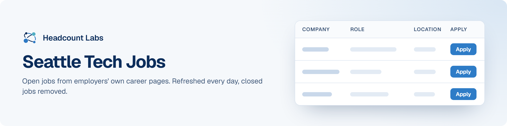

# Seattle Tech Jobs

Software, data, AI, product and design jobs in the Seattle area, sorted by field.

**400 open jobs** · 186 new since the last update · 134 removed because they closed or left the employer's board · updated November 3, 2026 at 5:12 AM EST

This list is built and refreshed every day by [Headcount Labs](https://headcountlabs.com/?utm_source=github&utm_medium=job-list&utm_campaign=seattle-tech-jobs), which reads jobs straight from employers' own career pages and job boards. Every job here was still listed on its source board when we last read that board, within the past 3 days, and was posted in the past 30 days. Copies of the same job are merged into one row, and jobs that close are removed at the next update.

Want this data in your own app or agent? Use the [Headcount Labs jobs API](https://headcountlabs.com/docs/?utm_source=github&utm_medium=job-list&utm_campaign=seattle-tech-jobs) (free tier), the [MCP server](https://headcountlabs.com/mcp/?utm_source=github&utm_medium=job-list&utm_campaign=seattle-tech-jobs) for Claude, ChatGPT and other AI assistants, or the [public dataset subsets](https://huggingface.co/HeadcountLabs) on Hugging Face (the full dataset is coming soon).

**Full dataset.** A bigger, one-off snapshot dated 2026-10-19 (all matching jobs, not only the open jobs below) is on Hugging Face: [Tech and software jobs](https://huggingface.co/datasets/HeadcountLabs/tech-jobs). It loads with `datasets.load_dataset` and is under the Open Database License (ODbL) 1.0.

**Jump to:** [Software engineering (195)](#software-engineering) · [Data, AI and machine learning (103)](#data-ai-and-machine-learning) · [Product and design (82)](#product-and-design) · [Hardware and engineering (19)](#hardware-and-engineering) · [Business, finance and operations (1)](#business-finance-and-operations)

**Columns.** *Apply* opens the original posting on the employer's site. *Details* opens the job on Headcount Labs, with every posting we found for it. *Remote* shows what the employer states; a dash means the posting doesn't say. *Pay* is the range the employer published.

## Software engineering

| Company | Role | Location | Remote | Pay | Posted | Apply | Details |
| --- | --- | --- | --- | --- | --- | :---: | :---: |
| **Truveta** | Software Engineer - Data Fulfillment | Seattle, WA | Hybrid | $110k–$145k/yr | Nov 2 |  | <a href="https://headcountlabs.com/catalog/jobs/051f59ec-337f-41cc-a9cc-562489c44775?utm_source=github&utm_medium=job-list&utm_campaign=seattle-tech-jobs">via Headcount Labs</a> |
| **Throne Labs** | Software Quality Assurance Engineer | 

2 locations
North Brentwood, MD Seattle, WA
 | Remote | $100k–$135k/yr | Nov 2 |  | <a href="https://headcountlabs.com/catalog/jobs/6ddac594-490e-490f-b71f-7e9e23ed86dd?utm_source=github&utm_medium=job-list&utm_campaign=seattle-tech-jobs">via Headcount Labs</a> |
| **Google** | Senior Staff Software Engineer, Machine Learning, ML Training | 

3 locations
Kirkland, WA Seattle, WA Sunnyvale, CA
 | — | $262k–$364k/yr | Nov 2 |  | <a href="https://headcountlabs.com/catalog/jobs/8e9c1196-e790-4ed3-a8c3-6827821ee8f2?utm_source=github&utm_medium=job-list&utm_campaign=seattle-tech-jobs">via Headcount Labs</a> |
| **Google** | Software Engineer, Generative Media AI, Apparel ML | 

3 locations
Mountain View, CA Seattle, WA New York, NY
 | — | $147k–$210k/yr | Nov 2 |  | <a href="https://headcountlabs.com/catalog/jobs/2fd54856-7705-460d-b6bc-db4438eee352?utm_source=github&utm_medium=job-list&utm_campaign=seattle-tech-jobs">via Headcount Labs</a> |
| **Google** | Software Engineer III, Infrastructure, Google Cloud Platforms | 

5 locations
Sunnyvale, CA Kirkland, WA New York, NY Seattle, WA Madison, WI
 | — | $147k–$210k/yr | Nov 2 |  | <a href="https://headcountlabs.com/catalog/jobs/0b29ccc9-6e30-4897-864f-7e7a254c2f6f?utm_source=github&utm_medium=job-list&utm_campaign=seattle-tech-jobs">via Headcount Labs</a> |
| **Google** | Software Engineer II, Early Career | 

12 locations
Mountain View, CA Kirkland, WA Los Angeles, CA Madison, WI New York, NY Palo Alto, CA Pittsburgh, PA Raleigh, NC Durham, NC San Bruno, CA Seattle, WA Sunnyvale, CA
 | — | $123k–$174k/yr | Nov 2 |  | <a href="https://headcountlabs.com/catalog/jobs/045c9688-51ad-4b85-b07c-22fb51e7dec1?utm_source=github&utm_medium=job-list&utm_campaign=seattle-tech-jobs">via Headcount Labs</a> |
| **Google** | Senior Staff Security Engineer, Security Engineering, Cloud CISO | 

5 locations
Kirkland, WA New York, NY Seattle, WA San Francisco, CA Sunnyvale, CA
 | — | $262k–$364k/yr | Nov 2 |  | <a href="https://headcountlabs.com/catalog/jobs/080eb346-14ba-4b76-b102-d13ad5676c42?utm_source=github&utm_medium=job-list&utm_campaign=seattle-tech-jobs">via Headcount Labs</a> |
| **Amazon.com Services LLC** | Security Engineer II, AWS Cloud Security Response | 

2 locations
Seattle, WA Herndon, VA
 | — | $159k–$202k/yr | Nov 2 |  | <a href="https://headcountlabs.com/catalog/jobs/b2ba0a01-44c9-4610-98d9-37d4d9931e6a?utm_source=github&utm_medium=job-list&utm_campaign=seattle-tech-jobs">via Headcount Labs</a> |
| **Amazon Development Center U.S., Inc.** | Software Development Engineer II, Managed Operations (MO) | Seattle, WA | — | $144k–$194k/yr | Nov 2 |  | <a href="https://headcountlabs.com/catalog/jobs/24af8481-218f-4007-8a0a-5b132eca9b69?utm_source=github&utm_medium=job-list&utm_campaign=seattle-tech-jobs">via Headcount Labs</a> |
| **Amazon.com Services LLC** | Software Development Engineer, Ads AI Core Infra (ACI) | Seattle, WA | — | — | Nov 1 |  | <a href="https://headcountlabs.com/catalog/jobs/25d4c3a8-a142-4c27-afa0-4fa4d75e161d?utm_source=github&utm_medium=job-list&utm_campaign=seattle-tech-jobs">via Headcount Labs</a> |
| **Perplexity** | Member of Technical Staff (Software Engineer, API Platform) | 

4 locations
San Francisco, CA Seattle, WA New York City, NY Toronto
 | — | $220k–$405k/yr | Oct 31 |  | <a href="https://headcountlabs.com/catalog/jobs/eef19812-824f-4262-92fe-d23be4ae2c84?utm_source=github&utm_medium=job-list&utm_campaign=seattle-tech-jobs">via Headcount Labs</a> |
| **Pacific Northwest National Laboratory** | Software Engineer II - Building Applications | 

4 locations
United States Portland, OR Seattle, WA Richland, WA
 | — | $109k/yr | Oct 31 |  | <a href="https://headcountlabs.com/catalog/jobs/0034ed13-69f0-4897-a448-7f16921706a1?utm_source=github&utm_medium=job-list&utm_campaign=seattle-tech-jobs">via Headcount Labs</a> |
| **Amazon.com Services LLC** | Software Development Engineer | 

15 locations
Seattle, WA New York, NY Arlington, VA Santa Clara, CA Astoria, NY Brooklyn, NY Carle Place, NY Raleigh, NC Cupertino, CA Boston, MA Austin, TX Bellevue, WA +3 more
 | — | $165k–$224k/yr | Oct 31 |  | <a href="https://headcountlabs.com/catalog/jobs/4b145ffa-edb6-46bb-a787-4085a8b757b0?utm_source=github&utm_medium=job-list&utm_campaign=seattle-tech-jobs">via Headcount Labs</a> |
| **Amazon.com Services LLC** | Software Development Engineer II, Lightsail | Seattle, WA | — | — | Oct 31 |  | <a href="https://headcountlabs.com/catalog/jobs/efe745c6-5e82-4733-83e9-85510e243abe?utm_source=github&utm_medium=job-list&utm_campaign=seattle-tech-jobs">via Headcount Labs</a> |
| **Virtual Service Operations** | Cleared AWS Cybersecurity Engineer (Seattle) | Seattle, WA | — | $165k–$215k/yr | Oct 30 |  | <a href="https://headcountlabs.com/catalog/jobs/df557000-16fe-4755-b3b6-ca10e32254ba?utm_source=github&utm_medium=job-list&utm_campaign=seattle-tech-jobs">via Headcount Labs</a> |
| **UiPath** | Principal Software Engineer, Growth | Bellevue, WA | On-site | $218k–$275k/yr | Oct 30 |  | <a href="https://headcountlabs.com/catalog/jobs/969b08d2-357c-493d-9ed8-667a59446966?utm_source=github&utm_medium=job-list&utm_campaign=seattle-tech-jobs">via Headcount Labs</a> |
| **Uber** | Senior Software Engineer, Capacity &amp; Efficiency Engineering (CEE) - Planning | 

3 locations
San Francisco, CA Seattle, WA Sunnyvale, CA
 | Remote | $202k/yr | Oct 30 |  | <a href="https://headcountlabs.com/catalog/jobs/adecd3f4-1b92-49fb-a7a3-761a17267ca6?utm_source=github&utm_medium=job-list&utm_campaign=seattle-tech-jobs">via Headcount Labs</a> |
| **True Talent Solutions Partners** | Software Engineer | Seattle, WA | On-site | — | Oct 30 |  | <a href="https://headcountlabs.com/catalog/jobs/673ecbf2-bbc5-4814-a268-f29a8e163f83?utm_source=github&utm_medium=job-list&utm_campaign=seattle-tech-jobs">via Headcount Labs</a> |
| **ThriftBooks** | Sr. Software Engineer - Full Stack Web Development | Seattle, WA | — | $120k–$145k/yr | Oct 30 |  | <a href="https://headcountlabs.com/catalog/jobs/a9c5602d-5e0d-4c37-aed4-19442a921b88?utm_source=github&utm_medium=job-list&utm_campaign=seattle-tech-jobs">via Headcount Labs</a> |
| **SpaceX** | Sr. Software Engineer (Starlink) | Redmond, WA | — | $165k–$270k/yr | Oct 30 |  | <a href="https://headcountlabs.com/catalog/jobs/60181ce9-eb28-48fb-82c1-acba37201156?utm_source=github&utm_medium=job-list&utm_campaign=seattle-tech-jobs">via Headcount Labs</a> |
| **Snap Inc.** | Software Engineer, ML infrastructure, Core Inference, Level 4 | 

4 locations
United States Bellevue, WA Los Angeles, CA Palo Alto, CA
 | On-site | $157k–$235k/yr | Oct 30 |  | <a href="https://headcountlabs.com/catalog/jobs/5b6cef4e-427f-4f79-8f42-fa34b8acfc71?utm_source=github&utm_medium=job-list&utm_campaign=seattle-tech-jobs">via Headcount Labs</a> |
| **Nintendo** | Intern - Software Engineer, Graphics (NTD) | Redmond, WA | — | $45/hr | Oct 30 |  | <a href="https://headcountlabs.com/catalog/jobs/49a9bb9b-9956-41d9-8b87-56c2ab9b8e67?utm_source=github&utm_medium=job-list&utm_campaign=seattle-tech-jobs">via Headcount Labs</a> |
| **Nintendo** | Intern - Software Engineer, Performance Tools (NTD) | Redmond, WA | — | $45/hr | Oct 30 |  | <a href="https://headcountlabs.com/catalog/jobs/7c22a5b7-0cb9-466d-b5df-667f07430851?utm_source=github&utm_medium=job-list&utm_campaign=seattle-tech-jobs">via Headcount Labs</a> |
| **Nexxen** | Senior Software Engineer - AdTech Bidding Platform / Traffic Shaping Specialist | Bellevue, WA | — | — | Oct 30 |  | <a href="https://headcountlabs.com/catalog/jobs/76adfc52-b83d-4f49-a8eb-c01f454e13c1?utm_source=github&utm_medium=job-list&utm_campaign=seattle-tech-jobs">via Headcount Labs</a> |
| **LE130 Unity Technologies SF** | Développeur(euse) de logiciels principal(e) / Principal Software Engineer, Core Engine | 

4 locations
Canonsburg, PA Bellevue, WA Montreal United States
 | Remote | — | Oct 30 |  | <a href="https://headcountlabs.com/catalog/jobs/08533f32-7442-45d0-8789-59a1ef02acae?utm_source=github&utm_medium=job-list&utm_campaign=seattle-tech-jobs">via Headcount Labs</a> |
| **Fluidstack** | Security Engineer, Offensive Security | 

6 locations
San Francisco, CA New York, NY Austin, TX United States London Seattle, WA
 | On-site | $224k–$275k/yr | Oct 30 |  | <a href="https://headcountlabs.com/catalog/jobs/a8cbe0b1-c887-4ee7-9f2d-5def280756c5?utm_source=github&utm_medium=job-list&utm_campaign=seattle-tech-jobs">via Headcount Labs</a> |
| **DevSelect** | Android Developer | Seattle / Redmond, WA | — | — | Oct 30 |  | <a href="https://headcountlabs.com/catalog/jobs/5175c550-f58a-4cf1-97f2-1a157f576e57?utm_source=github&utm_medium=job-list&utm_campaign=seattle-tech-jobs">via Headcount Labs</a> |
| **DAT** | Staff Software Engineer, Salesforce | 

3 locations
Denver, CO Portland, OR Seattle, WA
 | Hybrid | $195k–$221k/yr | Oct 30 |  | <a href="https://headcountlabs.com/catalog/jobs/eda62ac4-da07-457d-b3a3-86b978c59baa?utm_source=github&utm_medium=job-list&utm_campaign=seattle-tech-jobs">via Headcount Labs</a> |
| **Costco IT** | Software Engineer - Message Queuing and Integration | Issaquah (Seattle), WA | — | $85k–$110k/yr | Oct 30 |  | <a href="https://headcountlabs.com/catalog/jobs/d10986cf-bc1b-4157-9f6d-ae15fd49c3e6?utm_source=github&utm_medium=job-list&utm_campaign=seattle-tech-jobs">via Headcount Labs</a> |
| **Amazon.com Services LLC** | Software Development Engineer, Amazon Shopping | 

2 locations
Seattle, WA Palo Alto, CA
 | — | $165k–$224k/yr | Oct 30 |  | <a href="https://headcountlabs.com/catalog/jobs/cad63c15-e235-41b3-b629-9d77ecb63628?utm_source=github&utm_medium=job-list&utm_campaign=seattle-tech-jobs">via Headcount Labs</a> |
| **Amazon Kuiper Manufacturing Enterprises LLC** | Senior Embedded Software Engineer, Amazon Leo | 

2 locations
Austin, TX Redmond, WA
 | — | $168k–$227k/yr | Oct 30 |  | <a href="https://headcountlabs.com/catalog/jobs/b210308f-636d-463a-8cc3-12eba993277a?utm_source=github&utm_medium=job-list&utm_campaign=seattle-tech-jobs">via Headcount Labs</a> |
| **Amazon Development Center U.S., Inc.** | Software Dev Engineer, AWS DevOps Agent | Seattle, WA | — | $144k–$194k/yr | Oct 30 |  | <a href="https://headcountlabs.com/catalog/jobs/b104484e-e764-488e-9f11-dbc0ecf62645?utm_source=github&utm_medium=job-list&utm_campaign=seattle-tech-jobs">via Headcount Labs</a> |
| **Amazon Data Services, Inc.** | Software Dev Engineer II, DC Bridge | Seattle, WA | — | $144k–$194k/yr | Oct 30 |  | <a href="https://headcountlabs.com/catalog/jobs/723cb4e2-5ab3-44d0-9754-2f067e6edf26?utm_source=github&utm_medium=job-list&utm_campaign=seattle-tech-jobs">via Headcount Labs</a> |
| **WEXWEXUS** | Software Development Mgmt 5 | Seattle, WA | On-site | $199k–$247k/yr | Oct 29 |  | <a href="https://headcountlabs.com/catalog/jobs/1508e284-8621-465e-ac70-883565cfa64e?utm_source=github&utm_medium=job-list&utm_campaign=seattle-tech-jobs">via Headcount Labs</a> |
| **USAFacts** | AI &amp; Software Engineering Intern | Bellevue, WA | Hybrid | $38/hr | Oct 29 |  | <a href="https://headcountlabs.com/catalog/jobs/8f4f9105-94a8-484b-947e-5bdc763d5f5d?utm_source=github&utm_medium=job-list&utm_campaign=seattle-tech-jobs">via Headcount Labs</a> |
| **Sonos, Inc.** | Software Product Management Intern (Seattle) | Seattle, WA | — | — | Oct 29 |  | <a href="https://headcountlabs.com/catalog/jobs/82f248e7-f279-4a14-854f-3b5c4cd27442?utm_source=github&utm_medium=job-list&utm_campaign=seattle-tech-jobs">via Headcount Labs</a> |
| **Snap Inc.** | Software Engineer, ML Infrastructure, ML Data, Level 5 | 

3 locations
Palo Alto, CA Los Angeles, CA Seattle, WA
 | — | $209k–$313k/yr | Oct 29 |  | <a href="https://headcountlabs.com/catalog/jobs/e647982d-c17e-41e4-959e-970867fe9f96?utm_source=github&utm_medium=job-list&utm_campaign=seattle-tech-jobs">via Headcount Labs</a> |
| **Salesforce, Inc.** | Senior Software Engineering Manager - Full Stack (Slack) | 

8 locations
Atlanta, GA San Francisco, CA Georgia Bellevue, WA Seattle, WA Georgia - Atlanta California - San Francisco New York - New York
 | — | $172k–$260k/yr | Oct 29 |  | <a href="https://headcountlabs.com/catalog/jobs/12fbf421-899c-486d-9953-a1c9421e2dbf?utm_source=github&utm_medium=job-list&utm_campaign=seattle-tech-jobs">via Headcount Labs</a> |
| **Robinhood** | Senior Software Engineer, AI Security | 

2 locations
Bellevue, WA Menlo Park, CA
 | — | $196k–$230k/yr | Oct 29 |  | <a href="https://headcountlabs.com/catalog/jobs/b13f30d6-8141-46c8-b94f-9bcb8874f741?utm_source=github&utm_medium=job-list&utm_campaign=seattle-tech-jobs">via Headcount Labs</a> |
| **Qualtrics** | Senior Software Engineer - Platform Infrastructure | Seattle, WA | Hybrid | $147k–$178k/yr | Oct 29 |  | <a href="https://headcountlabs.com/catalog/jobs/84e80e86-5ee2-423f-8e41-b0f922da3c2d?utm_source=github&utm_medium=job-list&utm_campaign=seattle-tech-jobs">via Headcount Labs</a> |
| **Polsinelli** | Security Engineer | 

28 locations
Washington, DC Kansas City, MO New York, NY Clayton, MO Chicago, IL Atlanta, GA Birmingham, AL Boston, MA Chattanooga, TN Charleston, SC Dallas, TX Denver, CO +16 more
 | Remote | $100k–$150k/yr | Oct 29 |  | <a href="https://headcountlabs.com/catalog/jobs/81cc4e41-a92b-49c5-9f5a-df24c35446d0?utm_source=github&utm_medium=job-list&utm_campaign=seattle-tech-jobs">via Headcount Labs</a> |
| **Nintendo** | Intern - Software Engineer, Connectivity (NTD) | Redmond, WA | — | $45/hr | Oct 29 |  | <a href="https://headcountlabs.com/catalog/jobs/866f8379-1641-4619-b395-188ed68266c3?utm_source=github&utm_medium=job-list&utm_campaign=seattle-tech-jobs">via Headcount Labs</a> |
| **LE130 Unity Technologies SF** | Senior Software Engineer | Bellevue, WA | Remote | $115k–$173k/yr | Oct 29 |  | <a href="https://headcountlabs.com/catalog/jobs/3c7a8227-463b-4464-be2b-6c54cdd05e69?utm_source=github&utm_medium=job-list&utm_campaign=seattle-tech-jobs">via Headcount Labs</a> |
| **LE130 Unity Technologies SF** | Software Engineer, XR | Bellevue, WA | Remote | $92k–$139k/yr | Oct 29 |  | <a href="https://headcountlabs.com/catalog/jobs/7f42c2de-d5a2-4bbd-aa2d-137ccb07abc4?utm_source=github&utm_medium=job-list&utm_campaign=seattle-tech-jobs">via Headcount Labs</a> |
| **DoorDash USA** | Staff Software Engineer, Traffic | 

3 locations
San Francisco, CA Seattle, WA New York, NY
 | Hybrid | $194k–$285k/yr | Oct 29 |  | <a href="https://headcountlabs.com/catalog/jobs/fbc00bf5-7b3c-4197-86d5-4d5b2f98d640?utm_source=github&utm_medium=job-list&utm_campaign=seattle-tech-jobs">via Headcount Labs</a> |
| **Docusign** | Software Engineer Intern | Seattle, WA | — | $38–$45/hr | Oct 29 |  | <a href="https://headcountlabs.com/catalog/jobs/17d4f6cd-bdba-45fa-8f68-c9b08087d9e0?utm_source=github&utm_medium=job-list&utm_campaign=seattle-tech-jobs">via Headcount Labs</a> |
| **Docusign** | Lead Software Engineer, Identity &amp; Authentication Platform | Seattle, WA | — | $179k–$263k/yr | Oct 29 |  | <a href="https://headcountlabs.com/catalog/jobs/fad2feb7-d787-4ad7-8428-885aac709e37?utm_source=github&utm_medium=job-list&utm_campaign=seattle-tech-jobs">via Headcount Labs</a> |
| **DevSelect** | .NET Developer | Redmond, WA | — | — | Oct 29 |  | <a href="https://headcountlabs.com/catalog/jobs/a7a904fb-675d-43f0-820e-0756e3cfd2e0?utm_source=github&utm_medium=job-list&utm_campaign=seattle-tech-jobs">via Headcount Labs</a> |
| **DevSelect** | Front End Developer/DevOps | Redmond, WA | — | — | Oct 29 |  | <a href="https://headcountlabs.com/catalog/jobs/b7b80b84-0f22-4f4f-81d6-9cfc1f4a1bb0?utm_source=github&utm_medium=job-list&utm_campaign=seattle-tech-jobs">via Headcount Labs</a> |
| **DevSelect** | .NET/Software Developer | Redmond, WA | — | — | Oct 29 |  | <a href="https://headcountlabs.com/catalog/jobs/78e90e5d-d80e-4a89-8474-a5d47715753a?utm_source=github&utm_medium=job-list&utm_campaign=seattle-tech-jobs">via Headcount Labs</a> |
| **Annapurna Labs (U.S.) Inc.** | Software Development Engineer II, EFA Network - Annapurna Labs | Seattle, WA | — | $144k–$194k/yr | Oct 29 |  | <a href="https://headcountlabs.com/catalog/jobs/ffd7d08b-722c-43cc-80c1-eb5ea78d7a87?utm_source=github&utm_medium=job-list&utm_campaign=seattle-tech-jobs">via Headcount Labs</a> |
| **Amazon Web Services, Inc.** | Software Devevelopment Manager, AWS Tax Engine, AWS Invoicing | Seattle, WA | — | $185k–$250k/yr | Oct 29 |  | <a href="https://headcountlabs.com/catalog/jobs/4b4e62ac-e89e-451a-bb10-0b672648f21d?utm_source=github&utm_medium=job-list&utm_campaign=seattle-tech-jobs">via Headcount Labs</a> |
| **Amazon Kuiper Manufacturing Enterprises LLC** | Software Development Engineer II, Amazon Leo | 

4 locations
Redmond, WA Austin, TX Sunnyvale, CA San Diego, CA
 | — | $144k–$194k/yr | Oct 29 |  | <a href="https://headcountlabs.com/catalog/jobs/5102a0ab-37e5-4a83-a47c-edf1499d138e?utm_source=github&utm_medium=job-list&utm_campaign=seattle-tech-jobs">via Headcount Labs</a> |
| **Amazon Kuiper Manufacturing Enterprises LLC** | Software Development Engineer, AI Foundations, Amazon Leo AI Foundations | Redmond, WA | — | $168k–$227k/yr | Oct 29 |  | <a href="https://headcountlabs.com/catalog/jobs/d8be4928-8bb5-487c-ab96-4a190994d1a4?utm_source=github&utm_medium=job-list&utm_campaign=seattle-tech-jobs">via Headcount Labs</a> |
| **Amazon Kuiper Manufacturing Enterprises LLC** | Embedded Software Dev Engineer, Amazon Leo Customer Terminal Software | Redmond, WA | — | $144k–$194k/yr | Oct 29 |  | <a href="https://headcountlabs.com/catalog/jobs/93e3f6bf-2954-4e0f-8880-4cbec14b012f?utm_source=github&utm_medium=job-list&utm_campaign=seattle-tech-jobs">via Headcount Labs</a> |
| **Amazon Kuiper Manufacturing Enterprises LLC** | Embedded Software Dev Engineer, Amazon Leo | Redmond, WA | — | $144k–$194k/yr | Oct 29 |  | <a href="https://headcountlabs.com/catalog/jobs/5387e029-f2fb-4f71-9fbc-77fe2daa975b?utm_source=github&utm_medium=job-list&utm_campaign=seattle-tech-jobs">via Headcount Labs</a> |
| **Amazon Kuiper Manufacturing Enterprises LLC** | Senior Software Development Engineer , Leo Customer Terminals Applications &amp; Networking Team | Redmond, WA | — | $168k–$227k/yr | Oct 29 |  | <a href="https://headcountlabs.com/catalog/jobs/e32b85c0-b72d-41c4-8124-078cb6b840c6?utm_source=github&utm_medium=job-list&utm_campaign=seattle-tech-jobs">via Headcount Labs</a> |
| **Amazon Kuiper Infrastructure LLC** | Software Development Engineer - Embedded, Flight Computer Software | Redmond, WA | — | $144k–$194k/yr | Oct 29 |  | <a href="https://headcountlabs.com/catalog/jobs/b7e6e843-9567-48e5-987a-11ce4a5006ba?utm_source=github&utm_medium=job-list&utm_campaign=seattle-tech-jobs">via Headcount Labs</a> |
| **Amazon Development Center U.S., Inc.** | Software Development Engineer II, Identity and Registry, AWS IoT Core | Seattle, WA | — | $144k–$194k/yr | Oct 29 |  | <a href="https://headcountlabs.com/catalog/jobs/473e8a41-b401-4a72-bbd6-a8116085c6a1?utm_source=github&utm_medium=job-list&utm_campaign=seattle-tech-jobs">via Headcount Labs</a> |
| **Amazon Development Center U.S., Inc.** | Software Development Engineer, EC2 UltraServer Availability | Seattle, WA | — | $144k–$194k/yr | Oct 29 |  | <a href="https://headcountlabs.com/catalog/jobs/6ac5360b-f952-46a8-88b4-8442f716a698?utm_source=github&utm_medium=job-list&utm_campaign=seattle-tech-jobs">via Headcount Labs</a> |
| **Amazon Development Center U.S., Inc.** | Software Development Engineer II, Technical Content Experience | Seattle, WA | — | $144k–$194k/yr | Oct 29 |  | <a href="https://headcountlabs.com/catalog/jobs/54c01e05-d962-488d-b580-509990bd0c67?utm_source=github&utm_medium=job-list&utm_campaign=seattle-tech-jobs">via Headcount Labs</a> |
| **Amazon Data Services, Inc.** | Software Development Engineer, EC2 UltraServer Availability | Seattle, WA | — | $144k–$194k/yr | Oct 29 |  | <a href="https://headcountlabs.com/catalog/jobs/6ed9bcbf-5766-4f80-8cf6-70f3038025b9?utm_source=github&utm_medium=job-list&utm_campaign=seattle-tech-jobs">via Headcount Labs</a> |
| **Uber** | Sr Staff Security Engineer - Engineer | 

2 locations
Seattle, WA Sunnyvale, CA
 | Remote | $267k/yr | Oct 28 |  | <a href="https://headcountlabs.com/catalog/jobs/bc24d4ed-7a07-45e9-a748-7610c5b35da2?utm_source=github&utm_medium=job-list&utm_campaign=seattle-tech-jobs">via Headcount Labs</a> |
| **Uber** | Sr Staff Security Engineer - Enterprise Security | 

3 locations
Seattle, WA Sunnyvale, CA San Francisco, CA
 | Remote | $267k/yr | Oct 28 |  | <a href="https://headcountlabs.com/catalog/jobs/3563da33-ca41-4755-a841-272c823cb30c?utm_source=github&utm_medium=job-list&utm_campaign=seattle-tech-jobs">via Headcount Labs</a> |
| **The Pokémon Company International** | Software Development Engineer in Test (12-month Fixed Term) | Bellevue, WA | — | $117k–$156k/yr | Oct 28 |  | <a href="https://headcountlabs.com/catalog/jobs/3553420c-36b7-4d07-8013-3db6f7a620d9?utm_source=github&utm_medium=job-list&utm_campaign=seattle-tech-jobs">via Headcount Labs</a> |
| **Stripe** | Software Engineer - Full stack | Seattle, WA | — | $157k–$235k/yr | Oct 28 |  | <a href="https://headcountlabs.com/catalog/jobs/4c5da690-1119-40a9-b4b5-c0230d19dd3c?utm_source=github&utm_medium=job-list&utm_campaign=seattle-tech-jobs">via Headcount Labs</a> |
| **Spring Health** | Software Engineer II, Platform Core Services | Seattle, WA | Hybrid | $120k–$153k/yr | Oct 28 |  | <a href="https://headcountlabs.com/catalog/jobs/e8969274-ea67-4695-94de-db7150072234?utm_source=github&utm_medium=job-list&utm_campaign=seattle-tech-jobs">via Headcount Labs</a> |
| **ServiceNow** | Senior Staff Product Security Engineer &#124; Product Security Incident Response Team (PSIRT) | Kirkland, WA | Remote | $201k–$352k/yr | Oct 28 |  | <a href="https://headcountlabs.com/catalog/jobs/cc661144-0d00-49b5-957a-53ff70e19409?utm_source=github&utm_medium=job-list&utm_campaign=seattle-tech-jobs">via Headcount Labs</a> |
| **Salesforce, Inc.** | Staff Software Engineer, Data Infrastructure | 

4 locations
San Francisco, CA Atlanta, GA Bellevue, WA Seattle, WA
 | — | $197k–$314k/yr | Oct 28 |  | <a href="https://headcountlabs.com/catalog/jobs/ccff3200-4575-408a-8b2f-b9675293a509?utm_source=github&utm_medium=job-list&utm_campaign=seattle-tech-jobs">via Headcount Labs</a> |
| **Salesforce, Inc.** | Staff iOS Developer Experience Engineer - Slack | 

3 locations
San Francisco, CA Bellevue, WA Seattle, WA
 | — | $197k–$314k/yr | Oct 28 |  | <a href="https://headcountlabs.com/catalog/jobs/c3ec04a9-5df6-499e-a75e-46b9a7974e2b?utm_source=github&utm_medium=job-list&utm_campaign=seattle-tech-jobs">via Headcount Labs</a> |
| **Salesforce, Inc.** | Senior Software Engineer, Android Accessibility | 

4 locations
San Francisco, CA Atlanta, GA California Seattle, WA
 | — | $172k–$260k/yr | Oct 28 |  | <a href="https://headcountlabs.com/catalog/jobs/62decf03-977d-4652-b691-2c24d9e93e54?utm_source=github&utm_medium=job-list&utm_campaign=seattle-tech-jobs">via Headcount Labs</a> |
| **Salesforce, Inc.** | Senior Software Engineer, Identity Security | 

4 locations
San Francisco, CA Atlanta, GA Bellevue, WA Seattle, WA
 | — | $172k–$260k/yr | Oct 28 |  | <a href="https://headcountlabs.com/catalog/jobs/c02d7338-2672-4863-9756-9737b3a861b5?utm_source=github&utm_medium=job-list&utm_campaign=seattle-tech-jobs">via Headcount Labs</a> |
| **Robinhood** | Senior Software Engineer, Capacity &amp; Efficiency | Bellevue, WA | — | $196k–$230k/yr | Oct 28 |  | <a href="https://headcountlabs.com/catalog/jobs/be4a9796-1359-435e-86f7-4f5adec7f9db?utm_source=github&utm_medium=job-list&utm_campaign=seattle-tech-jobs">via Headcount Labs</a> |
| **QXO** | Senior Software Engineer | Seattle, WA | — | $138k–$235k/yr | Oct 28 |  | <a href="https://headcountlabs.com/catalog/jobs/29802334-42b1-4602-9e76-2995623432f5?utm_source=github&utm_medium=job-list&utm_campaign=seattle-tech-jobs">via Headcount Labs</a> |
| **Omni** | Frontend Engineer | 

5 locations
San Francisco, CA Santa Cruz, CA Denver, CO Philadelphia, PA Seattle, WA
 | Hybrid | $160k–$250k/yr | Oct 28 |  | <a href="https://headcountlabs.com/catalog/jobs/60f23c41-3f8f-4dcf-b4ea-aa443b5e3b95?utm_source=github&utm_medium=job-list&utm_campaign=seattle-tech-jobs">via Headcount Labs</a> |
| **Omni** | Frontend Engineer, Data Visualization | 

5 locations
San Francisco, CA Santa Cruz, CA Denver, CO Philadelphia, PA Seattle, WA
 | Hybrid | $160k–$250k/yr | Oct 28 |  | <a href="https://headcountlabs.com/catalog/jobs/c36b1863-9b03-4976-978b-72ac454e29cc?utm_source=github&utm_medium=job-list&utm_campaign=seattle-tech-jobs">via Headcount Labs</a> |
| **Nintendo** | Intern - Software Engineer, CPU Profiler (NTD) | Redmond, WA | — | $45/hr | Oct 28 |  | <a href="https://headcountlabs.com/catalog/jobs/ac67f5fc-8cd1-4543-ba63-d4767d63c9e6?utm_source=github&utm_medium=job-list&utm_campaign=seattle-tech-jobs">via Headcount Labs</a> |
| **Nintendo** | Intern - Software Engineer, DevOps (NTD) | Redmond, WA | — | $45/hr | Oct 28 |  | <a href="https://headcountlabs.com/catalog/jobs/2df49d54-d27f-40f7-b5d8-f22a85f39a3b?utm_source=github&utm_medium=job-list&utm_campaign=seattle-tech-jobs">via Headcount Labs</a> |
| **Nintendo** | Intern - Software Engineer, Audio (NTD) | Redmond, WA | — | $45/hr | Oct 28 |  | <a href="https://headcountlabs.com/catalog/jobs/66792e07-21c8-4e93-b44b-97cd864d0e34?utm_source=github&utm_medium=job-list&utm_campaign=seattle-tech-jobs">via Headcount Labs</a> |
| **Nintendo** | Intern - Software Engineer, CPU Debugger (NTD) | Redmond, WA | — | $45/hr | Oct 28 |  | <a href="https://headcountlabs.com/catalog/jobs/65f5db72-f8fa-4627-8ac0-485330f72823?utm_source=github&utm_medium=job-list&utm_campaign=seattle-tech-jobs">via Headcount Labs</a> |
| **NetApp, Inc.** | Software Engineer - Core Systems and Storage Roles (Multiple Individual Contributor Levels) | 

5 locations
San Jose, CA Bellevue, WA Boulder, CO Morrisville, NC Cranberry Township, PA
 | — | $120k–$280k/yr | Oct 28 |  | <a href="https://headcountlabs.com/catalog/jobs/6efa415f-7155-4c18-adb8-d26971286391?utm_source=github&utm_medium=job-list&utm_campaign=seattle-tech-jobs">via Headcount Labs</a> |
| **IMDb.com, Inc.** | Software Development Engineer II, Engagement and Growth Tech | Seattle, WA | — | $144k–$194k/yr | Oct 28 |  | <a href="https://headcountlabs.com/catalog/jobs/6ebda6d5-f6f5-492a-b4ec-6eb4cb2e7a65?utm_source=github&utm_medium=job-list&utm_campaign=seattle-tech-jobs">via Headcount Labs</a> |
| **Fluidstack** | Software Engineer, Infrastructure Modelling | 

4 locations
Austin, TX Phoenix, AZ San Francisco, CA Seattle, WA
 | On-site | $224k–$279k/yr | Oct 28 |  | <a href="https://headcountlabs.com/catalog/jobs/f3e9708e-42d4-4d2c-9847-815fdb2e372a?utm_source=github&utm_medium=job-list&utm_campaign=seattle-tech-jobs">via Headcount Labs</a> |
| **Flexport** | Software Engineer II, Autonomous Freight Technology | Bellevue, WA | On-site | $147k–$183k/yr | Oct 28 |  | <a href="https://headcountlabs.com/catalog/jobs/371c145e-058f-4b64-a41e-d8ed51646f8a?utm_source=github&utm_medium=job-list&utm_campaign=seattle-tech-jobs">via Headcount Labs</a> |
| **Brex** | Staff Software Engineer - Identity &amp; Access Management | 

4 locations
Vancouver San Francisco, CA Seattle, WA New York, NY
 | — | — | Oct 28 |  | <a href="https://headcountlabs.com/catalog/jobs/cd6430b4-8540-4bc6-9a41-8e76ce6a7298?utm_source=github&utm_medium=job-list&utm_campaign=seattle-tech-jobs">via Headcount Labs</a> |
| **Axon** | Sr Director, Software Engineering | Seattle, WA | Hybrid | $220k–$352k/yr | Oct 28 |  | <a href="https://headcountlabs.com/catalog/jobs/363ccd8f-ccf6-44e5-8163-3ea96c33c354?utm_source=github&utm_medium=job-list&utm_campaign=seattle-tech-jobs">via Headcount Labs</a> |
| **Annapurna Labs (U.S.) Inc.** | Sr. Software Development Engineer, Trainium Systems | 

4 locations
Austin, TX Seattle, WA San Diego, CA Cupertino, CA
 | — | $193k–$262k/yr | Oct 28 |  | <a href="https://headcountlabs.com/catalog/jobs/c54dd208-162f-41c1-a421-bbb8e1d1473c?utm_source=github&utm_medium=job-list&utm_campaign=seattle-tech-jobs">via Headcount Labs</a> |
| **Annapurna Labs (U.S.) Inc.** | Software Development Engineer, Trainium Systems | 

4 locations
Austin, TX Seattle, WA San Diego, CA Cupertino, CA
 | — | $165k–$224k/yr | Oct 28 |  | <a href="https://headcountlabs.com/catalog/jobs/bdee15df-6b11-4645-b96c-a77e5d21ae5e?utm_source=github&utm_medium=job-list&utm_campaign=seattle-tech-jobs">via Headcount Labs</a> |
| **Amazon Web Services, Inc.** | Software Development Engineer, AWS Compliance &amp; Security Assurance | Seattle, WA | — | $144k–$194k/yr | Oct 28 |  | <a href="https://headcountlabs.com/catalog/jobs/117f99ab-86be-4cfb-9cf3-dc7da2140352?utm_source=github&utm_medium=job-list&utm_campaign=seattle-tech-jobs">via Headcount Labs</a> |
| **Amazon Web Services, Inc.** | Front End Engineer II, AFX | 

3 locations
Boston, MA Seattle, WA Dallas, TX
 | — | $144k–$194k/yr | Oct 28 |  | <a href="https://headcountlabs.com/catalog/jobs/1295c998-b443-47bb-8732-72e3309b3ea1?utm_source=github&utm_medium=job-list&utm_campaign=seattle-tech-jobs">via Headcount Labs</a> |
| **Amazon Development Center U.S., Inc.** | Software Dev Manager, DDB Index and Search | Seattle, WA | — | $185k–$250k/yr | Oct 28 |  | <a href="https://headcountlabs.com/catalog/jobs/c8c97a9a-005f-4529-8d76-628621f9598f?utm_source=github&utm_medium=job-list&utm_campaign=seattle-tech-jobs">via Headcount Labs</a> |
| **Amazon Data Services, Inc.** | Software Dev Engineer II, NLM - Connectivity Services | Seattle, WA | — | $144k–$194k/yr | Oct 28 |  | <a href="https://headcountlabs.com/catalog/jobs/904837ba-298c-4dfc-9b9d-35da7c30598d?utm_source=github&utm_medium=job-list&utm_campaign=seattle-tech-jobs">via Headcount Labs</a> |
| **Advanced Micro Devices, Inc** | Software Development Engineer - AI Workload Optimization | Bellevue, WA | — | — | Oct 28 |  | <a href="https://headcountlabs.com/catalog/jobs/b1e8ddb7-7974-49f0-baf2-d075b5ed6ae5?utm_source=github&utm_medium=job-list&utm_campaign=seattle-tech-jobs">via Headcount Labs</a> |
| **Visa** | 2027 Sophomore Internship Program - Software Engineer Intern, Bellevue | Bellevue, WA | Hybrid | $41–$45/hr | Oct 27 |  | <a href="https://headcountlabs.com/catalog/jobs/d6475a5c-6ff6-451b-9cce-ca9e971a833d?utm_source=github&utm_medium=job-list&utm_campaign=seattle-tech-jobs">via Headcount Labs</a> |
| **Viasat, Inc.** | Team Lead, Connectivity Management — Aviation Edge Software (MAS) | 

4 locations
Carlsbad, CA Seattle, WA Tempe, AZ Germantown, MD
 | — | $168k–$265k/yr | Oct 27 |  | <a href="https://headcountlabs.com/catalog/jobs/926e4e4b-77e5-427d-af7a-32764e56c3b7?utm_source=github&utm_medium=job-list&utm_campaign=seattle-tech-jobs">via Headcount Labs</a> |
| **Quindar** | Sr. Software Engineer, Command &amp; Control | 

3 locations
Denver, CO Seattle, WA Washington, DC
 | Hybrid | $155k–$190k/yr | Oct 27 |  | <a href="https://headcountlabs.com/catalog/jobs/b53140c4-bcca-4e69-89c5-5286f5103fc7?utm_source=github&utm_medium=job-list&utm_campaign=seattle-tech-jobs">via Headcount Labs</a> |
| **Qualtrics** | Staff Software Engineer, Analytics Platform - Seattle | Seattle, WA | Hybrid | $176k–$214k/yr | Oct 27 |  | <a href="https://headcountlabs.com/catalog/jobs/ce22a2ec-7b71-459c-b761-68cf4108bcad?utm_source=github&utm_medium=job-list&utm_campaign=seattle-tech-jobs">via Headcount Labs</a> |
| **Overland AI** | Senior Backend Systems Engineer - Real Time Video &amp; Telemetry Streaming | Seattle, WA | On-site | $180k–$230k/yr | Oct 27 |  | <a href="https://headcountlabs.com/catalog/jobs/fea3b78f-1de8-4e59-bb00-15d40847f33c?utm_source=github&utm_medium=job-list&utm_campaign=seattle-tech-jobs">via Headcount Labs</a> |
| **Overland AI** | Software Engineer - C2 Interfaces &amp; Integrations | Seattle, WA | On-site | — | Oct 27 |  | <a href="https://headcountlabs.com/catalog/jobs/20a1e8eb-409c-4225-97c3-c86546bf91d9?utm_source=github&utm_medium=job-list&utm_campaign=seattle-tech-jobs">via Headcount Labs</a> |
| **LinkedIn** | Software Engineer, Systems and Infrastructure | Bellevue, WA | Hybrid | $120k–$195k/yr | Oct 27 |  | <a href="https://headcountlabs.com/catalog/jobs/cb87deb8-1ed2-4ca2-9c16-2afbe9c752c5?utm_source=github&utm_medium=job-list&utm_campaign=seattle-tech-jobs">via Headcount Labs</a> |
| **LinkedIn** | Sr. Software Engineer, Development Infrastructure | Bellevue, WA | Hybrid | $139k–$229k/yr | Oct 27 |  | <a href="https://headcountlabs.com/catalog/jobs/15227e52-e166-4117-be33-04a37cf103f4?utm_source=github&utm_medium=job-list&utm_campaign=seattle-tech-jobs">via Headcount Labs</a> |
| **Echodyne Corp** | Senior Software Engineer, Fullstack | Kirkland, WA | — | $137k–$205k/yr | Oct 27 |  | <a href="https://headcountlabs.com/catalog/jobs/3f69432a-75d2-4fd7-8a78-e3b5882a37cc?utm_source=github&utm_medium=job-list&utm_campaign=seattle-tech-jobs">via Headcount Labs</a> |
| **Docusign** | Senior Software Engineer | Seattle, WA | — | $158k–$233k/yr | Oct 27 |  | <a href="https://headcountlabs.com/catalog/jobs/a0868f7f-b6bf-48b6-b637-54b2cb40fc21?utm_source=github&utm_medium=job-list&utm_campaign=seattle-tech-jobs">via Headcount Labs</a> |
| **Darigold** | Senior Oracle Technical Developer | Seattle, WA | Hybrid | $128k–$192k/yr | Oct 27 |  | <a href="https://headcountlabs.com/catalog/jobs/e6cb61e1-0215-4710-b3bc-165c8a0becbb?utm_source=github&utm_medium=job-list&utm_campaign=seattle-tech-jobs">via Headcount Labs</a> |
| **Zeno Power** | Senior Cloud Platform Engineer (Contractor) | Seattle, WA | Remote | $80–$105/hr | Oct 26 |  | <a href="https://headcountlabs.com/catalog/jobs/10cc1b72-1355-494e-9223-a6344bd11d14?utm_source=github&utm_medium=job-list&utm_campaign=seattle-tech-jobs">via Headcount Labs</a> |
| **WEX Inc** | Senior Full-Stack Engineer (Java / Spring Boot) | 

14 locations
Maine Bay Area, ME Boston, ME Dallas, ME Salt Lake City, ME Seattle, ME Portland, ME Boston, MA Dallas, TX Salt Lake City, UT Seattle, WA United States +2 more
 | Remote | $122k–$146k/yr | Oct 26 |  | <a href="https://headcountlabs.com/catalog/jobs/afb54411-f895-4e4c-9a13-3880ede076b5?utm_source=github&utm_medium=job-list&utm_campaign=seattle-tech-jobs">via Headcount Labs</a> |
| **Stripe** | Android Engineer, Identity | 

3 locations
Seattle, WA San Francisco, CA New York City, NY
 | — | — | Oct 26 |  | <a href="https://headcountlabs.com/catalog/jobs/5ee58424-27e3-49ff-8973-bcb29036dfe7?utm_source=github&utm_medium=job-list&utm_campaign=seattle-tech-jobs">via Headcount Labs</a> |
| **Stripe** | iOS Engineer, Identity | 

3 locations
Seattle, WA San Francisco, CA New York City, NY
 | — | — | Oct 26 |  | <a href="https://headcountlabs.com/catalog/jobs/2116a020-e6f0-4640-ba4d-2922383e2eed?utm_source=github&utm_medium=job-list&utm_campaign=seattle-tech-jobs">via Headcount Labs</a> |
| **Sapience AI Corporation** | Forward Deployed AI Full Stack Engineer | Seattle, WA | — | $156k–$168k/yr | Oct 26 |  | <a href="https://headcountlabs.com/catalog/jobs/56b0fda1-76ec-4656-9bad-524c53a9640f?utm_source=github&utm_medium=job-list&utm_campaign=seattle-tech-jobs">via Headcount Labs</a> |
| **Quindar** | Backend Engineer | 

4 locations
Denver, CO Seattle, WA Washington, DC San Francisco, CA
 | Hybrid | $120k–$180k/yr | Oct 26 |  | <a href="https://headcountlabs.com/catalog/jobs/acf5f1fd-b4af-42a7-98e6-5255d1821721?utm_source=github&utm_medium=job-list&utm_campaign=seattle-tech-jobs">via Headcount Labs</a> |
| **G2i Inc.** | Senior Software Engineer, AI Training - United States | 

46 locations
New York City, NY Memphis, TN Sacramento, CA Mississauga Boston San Francisco, CA Denver, CO Oklahoma City, OK Nashville, TN Indianapolis, IN Chicago, IL Charlotte, NC +34 more
 | Remote | — | Oct 26 |  | <a href="https://headcountlabs.com/catalog/jobs/f6d11e67-d196-47e9-ad06-196f24537d18?utm_source=github&utm_medium=job-list&utm_campaign=seattle-tech-jobs">via Headcount Labs</a> |
| **Fluidstack** | Software Engineer, Networking | 

4 locations
London New York, NY Austin, TX Seattle, WA
 | — | $173k–$279k/yr | Oct 26 |  | <a href="https://headcountlabs.com/catalog/jobs/46a0543b-f51f-4432-b7b4-45815ad2ce49?utm_source=github&utm_medium=job-list&utm_campaign=seattle-tech-jobs">via Headcount Labs</a> |
| **Dematic Corp. (ILD-US)** | Software Engineering Manager | 

6 locations
Wauwatosa, WI Atlanta, GA Bellevue, WA Grand Rapids, MI Henrietta, NY Salt Lake City, UT
 | Hybrid | $129k–$162k/yr | Oct 26 |  | <a href="https://headcountlabs.com/catalog/jobs/73640bfd-d66d-4006-b414-beff6ba559aa?utm_source=github&utm_medium=job-list&utm_campaign=seattle-tech-jobs">via Headcount Labs</a> |
| **Amazon Web Services, Inc.** | Software Development Engineer, AWS Field Experience | 

4 locations
Boston, MA Seattle, WA Arlington, VA Dallas, TX
 | — | $144k–$194k/yr | Oct 26 |  | <a href="https://headcountlabs.com/catalog/jobs/ce1c08d6-18d8-4e96-8082-2a50fac06589?utm_source=github&utm_medium=job-list&utm_campaign=seattle-tech-jobs">via Headcount Labs</a> |
| **Amazon Web Services, Inc.** | Software Dev Engineer II, AWS QuickSight | Seattle, WA | — | $144k–$194k/yr | Oct 26 |  | <a href="https://headcountlabs.com/catalog/jobs/90f332ba-2d03-43ff-bbf6-74881add6367?utm_source=github&utm_medium=job-list&utm_campaign=seattle-tech-jobs">via Headcount Labs</a> |
| **Shield AI** | Senior Engineer, Cybersecurity (R6438) | Seattle, WA | On-site | $142k–$213k/yr | Oct 24 |  | <a href="https://headcountlabs.com/catalog/jobs/aec84cd5-e2c8-407d-9f1c-40cf7f1fb26e?utm_source=github&utm_medium=job-list&utm_campaign=seattle-tech-jobs">via Headcount Labs</a> |
| **Synthesia** | Staff/Principal Developer Advocate | Seattle, WA | — | — | Oct 23 |  | <a href="https://headcountlabs.com/catalog/jobs/e855eecf-999b-4db7-a933-ccfe708888a2?utm_source=github&utm_medium=job-list&utm_campaign=seattle-tech-jobs">via Headcount Labs</a> |
| **Sinclair Broadcast Group** | Software Development Engineer – Backend / Platform | Seattle, WA | On-site | $160k–$200k/yr | Oct 23 |  | <a href="https://headcountlabs.com/catalog/jobs/a0c5922e-7750-42e7-8b27-98562abbff24?utm_source=github&utm_medium=job-list&utm_campaign=seattle-tech-jobs">via Headcount Labs</a> |
| **Overland AI** | Senior Software Engineer (C++) | Seattle, WA | On-site | $150k–$230k/yr | Oct 23 |  | <a href="https://headcountlabs.com/catalog/jobs/ca67bacb-05c5-4455-896a-6c8fb08831cc?utm_source=github&utm_medium=job-list&utm_campaign=seattle-tech-jobs">via Headcount Labs</a> |
| **Overland AI** | Software Safety Engineer (Software) | Seattle, WA | On-site | $170k–$225k/yr | Oct 23 |  | <a href="https://headcountlabs.com/catalog/jobs/3db77f75-db89-4265-8ad1-c7413fb47af6?utm_source=github&utm_medium=job-list&utm_campaign=seattle-tech-jobs">via Headcount Labs</a> |
| **DAT** | Staff Software Engineer, Fintech Platform | Seattle, WA | Hybrid | $198k–$246k/yr | Oct 23 |  | <a href="https://headcountlabs.com/catalog/jobs/cf06b9cb-1760-4f9d-b55c-26a63a63af24?utm_source=github&utm_medium=job-list&utm_campaign=seattle-tech-jobs">via Headcount Labs</a> |
| **Anduril Industries** | Senior Software Engineer | Seattle, WA | — | $191k–$254k/yr | Oct 23 |  | <a href="https://headcountlabs.com/catalog/jobs/61c69168-47cb-4c41-9de7-96388a758779?utm_source=github&utm_medium=job-list&utm_campaign=seattle-tech-jobs">via Headcount Labs</a> |
| **Amazon Data Services, Inc.** | System Development Engineer, NW ADC Software Operations - NASO | Seattle, WA | — | $129k–$175k/yr | Oct 23 |  | <a href="https://headcountlabs.com/catalog/jobs/c538abed-7d12-422f-9273-912d1f822738?utm_source=github&utm_medium=job-list&utm_campaign=seattle-tech-jobs">via Headcount Labs</a> |
| **Zoox** | Senior Staff/Principal Software Engineer - GPU System Software, Onboard Execution | 

3 locations
Foster City, CA Seattle, WA Boston, MA
 | Hybrid | $339k–$455k/yr | Oct 22 |  | <a href="https://headcountlabs.com/catalog/jobs/7665ac5a-4dae-463d-a35e-c78b12b208f5?utm_source=github&utm_medium=job-list&utm_campaign=seattle-tech-jobs">via Headcount Labs</a> |
| **SpaceX** | Software Engineer, Linux Kernel (Starlink) | 

3 locations
Palo Alto, CA Bellevue, WA Redmond, WA
 | — | $125k–$165k/yr | Oct 22 |  | <a href="https://headcountlabs.com/catalog/jobs/f8f31c2a-c6cf-475a-8d63-a11a8a8a1aa7?utm_source=github&utm_medium=job-list&utm_campaign=seattle-tech-jobs">via Headcount Labs</a> |
| **SpaceX** | Software Engineer, Supercomputer Network (Starlink) | 

3 locations
Bellevue, WA Palo Alto, CA Redmond, WA
 | — | $125k–$165k/yr | Oct 22 |  | <a href="https://headcountlabs.com/catalog/jobs/5ec57f9e-975e-490a-9508-2c2d0dba1650?utm_source=github&utm_medium=job-list&utm_campaign=seattle-tech-jobs">via Headcount Labs</a> |
| **SpaceX** | Embedded Software Engineer, Laser Mesh Routing (Starlink) | 

3 locations
Redmond, WA Bellevue, WA Palo Alto, CA
 | — | $125k–$165k/yr | Oct 22 |  | <a href="https://headcountlabs.com/catalog/jobs/95b6460e-fa84-4c74-9a41-03f9295ba179?utm_source=github&utm_medium=job-list&utm_campaign=seattle-tech-jobs">via Headcount Labs</a> |
| **Rivet Industries** | Senior Software Engineer, Perceptual Calibration | 

2 locations
San Jose, CA Bellevue, WA
 | On-site | $210k–$290k/yr | Oct 22 |  | <a href="https://headcountlabs.com/catalog/jobs/7d5397c1-d861-4791-bd15-6c47bd9d8b18?utm_source=github&utm_medium=job-list&utm_campaign=seattle-tech-jobs">via Headcount Labs</a> |
| **Rivet Industries** | Senior Software Engineer, SLAM/VIO | 

2 locations
San Jose, CA Bellevue, WA
 | On-site | $210k–$300k/yr | Oct 22 |  | <a href="https://headcountlabs.com/catalog/jobs/adc69b55-fb12-47fa-be18-c8a9bde78514?utm_source=github&utm_medium=job-list&utm_campaign=seattle-tech-jobs">via Headcount Labs</a> |
| **Reliable Robotics Corporation** | Flight Software Verification Engineer | 

3 locations
Seattle, WA San Diego, CA Mountain View, CA
 | Remote | $160k–$210k/yr | Oct 22 |  | <a href="https://headcountlabs.com/catalog/jobs/0bb28e81-a2a7-48db-9448-e97ad2677bc5?utm_source=github&utm_medium=job-list&utm_campaign=seattle-tech-jobs">via Headcount Labs</a> |
| **Purpose Brands Intermediate, LLC** | Application Security Engineer | 

3 locations
Boca Raton, FL Seattle, WA Woodbury, MN
 | Hybrid | — | Oct 22 |  | <a href="https://headcountlabs.com/catalog/jobs/31b9125c-49ae-407d-97cf-8ada558c3223?utm_source=github&utm_medium=job-list&utm_campaign=seattle-tech-jobs">via Headcount Labs</a> |
| **OpenAI** | Software Engineer, Identity Infrastructure | 

3 locations
San Francisco, CA New York City Seattle, WA
 | Hybrid | $230k–$325k/yr | Oct 22 |  | <a href="https://headcountlabs.com/catalog/jobs/78c0fc4b-086b-4041-afa1-8d26ff9e7a5e?utm_source=github&utm_medium=job-list&utm_campaign=seattle-tech-jobs">via Headcount Labs</a> |
| **LE140 Unity Technologies Canada Company** | Sr. Software Engineer | 

2 locations
Mountain View, CA Bellevue, WA
 | Remote | $210k–$273k/yr | Oct 22 |  | <a href="https://headcountlabs.com/catalog/jobs/6a055fd5-5508-44db-84a0-5ef4b2deaf11?utm_source=github&utm_medium=job-list&utm_campaign=seattle-tech-jobs">via Headcount Labs</a> |
| **iSpot** | Software Development Engineer 3 | Bellevue, WA | Hybrid | $118k–$148k/yr | Oct 22 |  | <a href="https://headcountlabs.com/catalog/jobs/91062f48-d97e-4e11-8c92-44814b54b47c?utm_source=github&utm_medium=job-list&utm_campaign=seattle-tech-jobs">via Headcount Labs</a> |
| **HDR** | Software Engineer | 

5 locations
Omaha, NE St Louis, MO Minneapolis, MN Seattle, WA Salt Lake City, UT
 | — | — | Oct 22 |  | <a href="https://headcountlabs.com/catalog/jobs/9d96127f-61ac-4403-ae7a-c8bbc2cf34f5?utm_source=github&utm_medium=job-list&utm_campaign=seattle-tech-jobs">via Headcount Labs</a> |
| **DAT** | Senior Software Engineer | Seattle, WA | Hybrid | $162k–$207k/yr | Oct 22 |  | <a href="https://headcountlabs.com/catalog/jobs/4771ee10-3b79-4cb5-bbf0-823733c3b118?utm_source=github&utm_medium=job-list&utm_campaign=seattle-tech-jobs">via Headcount Labs</a> |
| **Blueprint Technologies** | Junior Azure DevOps Engineer | Redmond, WA | On-site | $40–$45/hr | Oct 22 |  | <a href="https://headcountlabs.com/catalog/jobs/d11737ae-30a4-4bd9-956a-f8db482c30ba?utm_source=github&utm_medium=job-list&utm_campaign=seattle-tech-jobs">via Headcount Labs</a> |
| **Baseten** | Software Engineer - Billing &amp; Internal Tooling | 

5 locations
San Francisco, CA Toronto New York, NY Montreal Seattle, WA
 | Hybrid | $165k–$330k/yr | Oct 22 |  | <a href="https://headcountlabs.com/catalog/jobs/87be510c-9c05-4140-975b-e9bdb85d8e7b?utm_source=github&utm_medium=job-list&utm_campaign=seattle-tech-jobs">via Headcount Labs</a> |
| **Baseten** | Software Engineer - Identity &amp; Authorization | 

5 locations
San Francisco, CA Toronto New York, NY Montreal Seattle, WA
 | Hybrid | $165k–$330k/yr | Oct 22 |  | <a href="https://headcountlabs.com/catalog/jobs/e5be7543-a570-41bc-b06d-5afaaa17cc64?utm_source=github&utm_medium=job-list&utm_campaign=seattle-tech-jobs">via Headcount Labs</a> |
| **Baseten** | Software Engineer - Partner Platform | 

5 locations
San Francisco, CA Toronto New York, NY Montreal Seattle, WA
 | Hybrid | $165k–$330k/yr | Oct 22 |  | <a href="https://headcountlabs.com/catalog/jobs/df48c2a2-442c-4507-a65c-0162aec21f0a?utm_source=github&utm_medium=job-list&utm_campaign=seattle-tech-jobs">via Headcount Labs</a> |
| **Baseten** | Product Platform - Backend Engineer | 

3 locations
San Francisco, CA New York, NY Seattle, WA
 | Hybrid | $165k–$330k/yr | Oct 22 |  | <a href="https://headcountlabs.com/catalog/jobs/5506f672-70f8-414f-be2c-42206cec150d?utm_source=github&utm_medium=job-list&utm_campaign=seattle-tech-jobs">via Headcount Labs</a> |
| **Aurora Innovation** | Staff Application Security Engineer | 

6 locations
Mountain View, CA Livonia, MI San Francisco, CA Pittsburgh, PA Dallas, TX Seattle, WA
 | Hybrid | — | Oct 22 |  | <a href="https://headcountlabs.com/catalog/jobs/c097ccdf-e006-49a0-8d21-72bbb80960dd?utm_source=github&utm_medium=job-list&utm_campaign=seattle-tech-jobs">via Headcount Labs</a> |
| **Warner Bros. Discovery** | Senior Software Engineer (Boundary Traffic Management) | 

2 locations
Bellevue, WA New York, NY
 | Hybrid | $146k–$272k/yr | Oct 21 |  | <a href="https://headcountlabs.com/catalog/jobs/17805185-941f-4d8c-bd96-5c79ceb70b70?utm_source=github&utm_medium=job-list&utm_campaign=seattle-tech-jobs">via Headcount Labs</a> |
| **Warner Bros. Discovery** | Staff Software Engineer | 

2 locations
Bellevue, WA New York, NY
 | Hybrid | $166k–$308k/yr | Oct 21 |  | <a href="https://headcountlabs.com/catalog/jobs/d0fb7aa6-4963-4bf0-b929-a96b6c326698?utm_source=github&utm_medium=job-list&utm_campaign=seattle-tech-jobs">via Headcount Labs</a> |
| **Twitch** | Software Engineer I | Seattle, WA | — | $110k–$160k/yr | Oct 21 |  | <a href="https://headcountlabs.com/catalog/jobs/93606a42-ec42-40fb-a534-09a42ee88ee4?utm_source=github&utm_medium=job-list&utm_campaign=seattle-tech-jobs">via Headcount Labs</a> |
| **Storable** | Software Development Engineer | Seattle, WA | — | — | Oct 21 |  | <a href="https://headcountlabs.com/catalog/jobs/e85d544a-67c2-4eb6-942d-8c035d93dceb?utm_source=github&utm_medium=job-list&utm_campaign=seattle-tech-jobs">via Headcount Labs</a> |
| **Storable** | Principal Software Development Engineer | Seattle, WA | — | — | Oct 21 |  | <a href="https://headcountlabs.com/catalog/jobs/919d90af-58cc-4671-8f91-ca1ec1f41552?utm_source=github&utm_medium=job-list&utm_campaign=seattle-tech-jobs">via Headcount Labs</a> |
| **Storable** | Sr. Software Development Engineer | Seattle, WA | — | — | Oct 21 |  | <a href="https://headcountlabs.com/catalog/jobs/e22e5147-b0b6-4458-9b5e-11c21c01728d?utm_source=github&utm_medium=job-list&utm_campaign=seattle-tech-jobs">via Headcount Labs</a> |
| **Storable** | Staff Software Development Engineer | Seattle, WA | — | — | Oct 21 |  | <a href="https://headcountlabs.com/catalog/jobs/138be143-cd63-4604-8037-f73965b81053?utm_source=github&utm_medium=job-list&utm_campaign=seattle-tech-jobs">via Headcount Labs</a> |
| **SpaceX** | Data Engineer (Starlink Mobile) | Redmond, WA | — | $125k–$165k/yr | Oct 21 |  | <a href="https://headcountlabs.com/catalog/jobs/c33ef83b-b21d-4be7-b6fc-4410b9a6dbfa?utm_source=github&utm_medium=job-list&utm_campaign=seattle-tech-jobs">via Headcount Labs</a> |
| **Sonos, Inc.** | Senior Software Development Manager, Mobile App Experience | Seattle, WA | Hybrid | $192k–$240k/yr | Oct 21 |  | <a href="https://headcountlabs.com/catalog/jobs/e51ac3a4-62fc-4170-8e4b-9eef10f30f50?utm_source=github&utm_medium=job-list&utm_campaign=seattle-tech-jobs">via Headcount Labs</a> |
| **Snap Inc.** | Software Engineer, Full Stack, Level 4 | 

5 locations
Los Angeles, CA Bellevue, WA New York, NY Palo Alto, CA San Francisco, CA
 | On-site | $157k–$235k/yr | Oct 21 |  | <a href="https://headcountlabs.com/catalog/jobs/9c91a555-02ab-49a6-a922-e8fc62a8ffc1?utm_source=github&utm_medium=job-list&utm_campaign=seattle-tech-jobs">via Headcount Labs</a> |
| **Scribd, Inc.** | Staff Backend Engineer (Payments and Billing) | 

11 locations
San Francisco, CA Toronto Los Angeles, CA Denver, CO Chicago, IL New York City, NY Vancouver Seattle, WA Austin, TX Boston, MA Dallas, TX
 | — | — | Oct 21 |  | <a href="https://headcountlabs.com/catalog/jobs/c1364ad0-e758-4292-babb-de94c7721a9b?utm_source=github&utm_medium=job-list&utm_campaign=seattle-tech-jobs">via Headcount Labs</a> |
| **Plaid** | Software Engineer - Security Engineering | 

3 locations
Seattle, WA New York City San Francisco, CA
 | On-site | $189k–$243k/yr | Oct 21 |  | <a href="https://headcountlabs.com/catalog/jobs/1c7aba95-8d31-4155-9f71-05b408e8a82e?utm_source=github&utm_medium=job-list&utm_campaign=seattle-tech-jobs">via Headcount Labs</a> |
| **onX** | Web Engineer III | 

11 locations
Austin, TX Bozeman, MT Denver, CO Free Solo Kalispell, MT Minneapolis, MN Missoula, MT Open to Portland, OR Salt Lake City, UT Seattle, WA
 | Remote | $130k–$153k/yr | Oct 21 |  | <a href="https://headcountlabs.com/catalog/jobs/35f0d6f7-1f47-464b-9169-9542a4249fe2?utm_source=github&utm_medium=job-list&utm_campaign=seattle-tech-jobs">via Headcount Labs</a> |
| **GoodLeap** | Staff Security Engineer, Security Operations | 

6 locations
Roseville San Francisco, CA Austin, TX Seattle, WA United States West Palm Beach, FL
 | Remote | $167k–$265k/yr | Oct 21 |  | <a href="https://headcountlabs.com/catalog/jobs/65b4c9d1-186b-4451-a83e-d4c41e5b6bb0?utm_source=github&utm_medium=job-list&utm_campaign=seattle-tech-jobs">via Headcount Labs</a> |
| **Fluidstack** | Security Engineer, Exposure and Vulnerability Management | 

5 locations
San Francisco, CA New York, NY Austin, TX United States Seattle, WA
 | On-site | $224k–$275k/yr | Oct 21 |  | <a href="https://headcountlabs.com/catalog/jobs/5267eeef-29e6-4ae1-abd6-83cc8104653c?utm_source=github&utm_medium=job-list&utm_campaign=seattle-tech-jobs">via Headcount Labs</a> |
| **Fluidstack** | Security Engineer, OT | 

5 locations
San Francisco, CA New York, NY Austin, TX United States Seattle, WA
 | On-site | $275k–$344k/yr | Oct 21 |  | <a href="https://headcountlabs.com/catalog/jobs/73667627-407d-4a31-b220-06cf5e8ef19a?utm_source=github&utm_medium=job-list&utm_campaign=seattle-tech-jobs">via Headcount Labs</a> |
| **DriveWealth** | Principal Security Engineer | 

7 locations
Austin, TX AMER-US Dallas, TX Denver, CO Miami, FL San Francisco, CA Seattle, WA
 | Remote | $185k–$235k/yr | Oct 21 |  | <a href="https://headcountlabs.com/catalog/jobs/74a46e2d-e200-467c-8683-9bd7b173173c?utm_source=github&utm_medium=job-list&utm_campaign=seattle-tech-jobs">via Headcount Labs</a> |
| **DoorDash USA** | Software Engineer, Reliability Platform | 

4 locations
San Francisco, CA Sunnyvale, CA Seattle, WA New York City, NY
 | — | $131k–$192k/yr | Oct 21 |  | <a href="https://headcountlabs.com/catalog/jobs/9e03fafc-6aa8-4e22-823a-a9d8e3eb4373?utm_source=github&utm_medium=job-list&utm_campaign=seattle-tech-jobs">via Headcount Labs</a> |
| **ATOMS Careers page** | Senior Software Engineer - Infrastructure Security Platform | Seattle, WA | On-site | $167k–$230k/yr | Oct 21 |  | <a href="https://headcountlabs.com/catalog/jobs/b9d5421a-647a-49fe-9342-f18b2e69d11a?utm_source=github&utm_medium=job-list&utm_campaign=seattle-tech-jobs">via Headcount Labs</a> |
| **Atoms** | Senior Software Engineer - Infrastructure Security Platform | Seattle, WA | On-site | $167k–$230k/yr | Oct 21 |  | <a href="https://headcountlabs.com/catalog/jobs/0de1eb5c-c2a7-41bb-b506-a09a8f887fc1?utm_source=github&utm_medium=job-list&utm_campaign=seattle-tech-jobs">via Headcount Labs</a> |
| **Arm** | Principal Software Engineer, AI Compute Infrastructure | Seattle, WA | — | $263k–$355k/yr | Oct 21 |  | <a href="https://headcountlabs.com/catalog/jobs/6a9e40d6-2dac-43cc-aee4-cf4e77b3fe14?utm_source=github&utm_medium=job-list&utm_campaign=seattle-tech-jobs">via Headcount Labs</a> |
| **QXO** | Staff AI Engineer, Full-Stack | Seattle, WA | — | $160k–$288k/yr | Oct 20 |  | <a href="https://headcountlabs.com/catalog/jobs/675c08ab-f0c4-483e-a078-9b7f5f811532?utm_source=github&utm_medium=job-list&utm_campaign=seattle-tech-jobs">via Headcount Labs</a> |
| **Monolithic Power Systems Inc.** | Sr. Staff/ Principal Software Engineer - Building Automation Systems | Kirkland, WA | On-site | $170k–$220k/yr | Oct 20 |  | <a href="https://headcountlabs.com/catalog/jobs/6c970238-cc05-4fbe-82ad-e113d4b579fe?utm_source=github&utm_medium=job-list&utm_campaign=seattle-tech-jobs">via Headcount Labs</a> |
| **Moloco** | Staff Software Engineer - AI Applications | 

2 locations
Menlo Park, CA Seattle, WA
 | — | $220k–$275k/yr | Oct 20 |  | <a href="https://headcountlabs.com/catalog/jobs/f82c4a30-191d-4971-9e02-2d04c845f29b?utm_source=github&utm_medium=job-list&utm_campaign=seattle-tech-jobs">via Headcount Labs</a> |
| **ITC Federal, Inc.** | Software/ML Engineer (Top-Secret) | Redmond, WA | Remote | $120k–$160k/yr | Oct 20 |  | <a href="https://headcountlabs.com/catalog/jobs/02b7c138-0d89-406b-9e3a-91d24217806c?utm_source=github&utm_medium=job-list&utm_campaign=seattle-tech-jobs">via Headcount Labs</a> |
| **Gradial** | Staff Security Engineer, AI | Seattle, WA | — | $175k–$265k/yr | Oct 20 |  | <a href="https://headcountlabs.com/catalog/jobs/50c90160-793c-483c-9d2e-db219e995f03?utm_source=github&utm_medium=job-list&utm_campaign=seattle-tech-jobs">via Headcount Labs</a> |
| **Gradial** | Software Engineer | Seattle, WA | — | $14/hr | Oct 20 |  | <a href="https://headcountlabs.com/catalog/jobs/4a99e3b9-d291-4aa4-8661-cd3c4e1c49fd?utm_source=github&utm_medium=job-list&utm_campaign=seattle-tech-jobs">via Headcount Labs</a> |
| **Amazon Kuiper Commercial Services LLC** | Software Development Engineer, Leo Ignition | Redmond, WA | — | $144k–$194k/yr | Oct 20 |  | <a href="https://headcountlabs.com/catalog/jobs/1d027b7a-7f9b-4e93-9e7f-d02226e7aa10?utm_source=github&utm_medium=job-list&utm_campaign=seattle-tech-jobs">via Headcount Labs</a> |
| **Trimble Inc.** | Software Engineering Manager | 

2 locations
Lake Oswego, OR Seattle, WA
 | — | $171k–$235k/yr | Oct 19 |  | <a href="https://headcountlabs.com/catalog/jobs/1e22dd0a-5d32-41b2-94df-1ca3d6f55e09?utm_source=github&utm_medium=job-list&utm_campaign=seattle-tech-jobs">via Headcount Labs</a> |
| **Siteimprove** | Principal Software Engineer | Bellevue, WA | Hybrid | $164k–$205k/yr | Oct 19 |  | <a href="https://headcountlabs.com/catalog/jobs/c5cad4f0-e6e0-4855-a84e-2c57f64bc98e?utm_source=github&utm_medium=job-list&utm_campaign=seattle-tech-jobs">via Headcount Labs</a> |
| **Sapience AI Corporation** | Forward Deployed Backend AI Engineer | Seattle, WA | — | $156k–$168k/yr | Oct 19 |  | <a href="https://headcountlabs.com/catalog/jobs/fab73afe-dd09-4e23-9ef2-26db78f1fc2f?utm_source=github&utm_medium=job-list&utm_campaign=seattle-tech-jobs">via Headcount Labs</a> |
| **Salesforce, Inc.** | Summer 2027 Intern - Software Engineer (Security/Government) | 

2 locations
San Francisco, CA Bellevue, WA
 | — | $43–$52/hr | Oct 19 |  | <a href="https://headcountlabs.com/catalog/jobs/f7ac388e-39d6-4b30-b429-a739532b2fc2?utm_source=github&utm_medium=job-list&utm_campaign=seattle-tech-jobs">via Headcount Labs</a> |
| **Docusign** | Senior Software Engineer - Oracle Fusion Finance - Record-to-Report | 

2 locations
San Francisco, CA Seattle, WA
 | — | $165k–$266k/yr | Oct 19 |  | <a href="https://headcountlabs.com/catalog/jobs/319f7f68-62c5-41da-ad03-94782deb73da?utm_source=github&utm_medium=job-list&utm_campaign=seattle-tech-jobs">via Headcount Labs</a> |
| **DevSelect** | UX Design Engineer - JavaScript Developer | Redmond, WA | — | — | Oct 19 |  | <a href="https://headcountlabs.com/catalog/jobs/cddde61a-a223-4951-b6cb-7eacd95bd67d?utm_source=github&utm_medium=job-list&utm_campaign=seattle-tech-jobs">via Headcount Labs</a> |
| **DevSelect** | Java Developer | Redmond, WA | — | — | Oct 19 |  | <a href="https://headcountlabs.com/catalog/jobs/a7ec1edf-7bb2-4fe6-b887-b0ac04bb47d2?utm_source=github&utm_medium=job-list&utm_campaign=seattle-tech-jobs">via Headcount Labs</a> |
| **BlackSky** | Senior Engineer - Embedded/Flight Software | Seattle, WA | Hybrid | $140k–$165k/yr | Oct 19 |  | <a href="https://headcountlabs.com/catalog/jobs/f9bc2a68-12a3-47bb-9bfa-5c1ede9fb095?utm_source=github&utm_medium=job-list&utm_campaign=seattle-tech-jobs">via Headcount Labs</a> |
| **Zoox** | Senior/Staff Software Engineer, ML Training Optimization | 

2 locations
Foster City, CA Seattle, WA
 | On-site | $254k–$350k/yr | Oct 16 |  | <a href="https://headcountlabs.com/catalog/jobs/188e18e9-82a4-40f2-afdd-1cb6d6711a7f?utm_source=github&utm_medium=job-list&utm_campaign=seattle-tech-jobs">via Headcount Labs</a> |
| **Virta Health** | Senior Software Engineer - Client Lifecycle | 

3 locations
San Francisco, CA Seattle, WA New York, NY
 | Remote | — | Oct 16 |  | <a href="https://headcountlabs.com/catalog/jobs/93755991-fb0f-4d08-9675-b01e91c748a5?utm_source=github&utm_medium=job-list&utm_campaign=seattle-tech-jobs">via Headcount Labs</a> |
| **Docusign** | Lead Software Engineer - Data Protection | Seattle, WA | — | $179k–$263k/yr | Oct 16 |  | <a href="https://headcountlabs.com/catalog/jobs/739a7438-8fd9-4412-80ab-c801ee491467?utm_source=github&utm_medium=job-list&utm_campaign=seattle-tech-jobs">via Headcount Labs</a> |
| **DAT** | Security Engineer II | Seattle, WA | Hybrid | $129k–$166k/yr | Oct 16 |  | <a href="https://headcountlabs.com/catalog/jobs/03b28d92-8bdf-4594-a33a-9800dbf67623?utm_source=github&utm_medium=job-list&utm_campaign=seattle-tech-jobs">via Headcount Labs</a> |
| **BlackSky** | Staff Engineer, Flight Software/Embedded Software | Seattle, WA | Hybrid | $155k–$180k/yr | Oct 16 |  | <a href="https://headcountlabs.com/catalog/jobs/04a46b80-0e1f-43b4-a49e-ae990c5ee305?utm_source=github&utm_medium=job-list&utm_campaign=seattle-tech-jobs">via Headcount Labs</a> |
| **Wrapbook** | Senior Software Engineer II, Applied AI | Seattle, WA | Hybrid | $206k–$284k/yr | Oct 15 |  | <a href="https://headcountlabs.com/catalog/jobs/02e29601-1c35-4721-ac2f-117c19b2de80?utm_source=github&utm_medium=job-list&utm_campaign=seattle-tech-jobs">via Headcount Labs</a> |
| **Snap Inc.** | Software Engineer, ML Infrastructure, ML Platform Level 5 | 

3 locations
Los Angeles, CA Bellevue, WA Palo Alto, CA
 | — | $209k–$313k/yr | Oct 15 |  | <a href="https://headcountlabs.com/catalog/jobs/46b545b8-84fe-4e3f-a8f0-841c84ef9e60?utm_source=github&utm_medium=job-list&utm_campaign=seattle-tech-jobs">via Headcount Labs</a> |
| **Plaid** | Senior Product Security Engineer | 

3 locations
Seattle, WA San Francisco, CA New York City
 | Hybrid | $190k–$263k/yr | Oct 15 |  | <a href="https://headcountlabs.com/catalog/jobs/b613163d-016a-4d58-b5c9-ab67449d7d25?utm_source=github&utm_medium=job-list&utm_campaign=seattle-tech-jobs">via Headcount Labs</a> |
| **Pinnacle Group** | Software Engineer III | Redmond, WA | On-site | $90–$95/hr | Oct 15 |  | <a href="https://headcountlabs.com/catalog/jobs/81b30488-6f9c-4383-97b1-ef09b651bea1?utm_source=github&utm_medium=job-list&utm_campaign=seattle-tech-jobs">via Headcount Labs</a> |
| **Parametric Portfolio Associates LLC** | Senior Software Engineer ( Research ) - Parametric | Seattle, WA | Hybrid | $78k–$185k/yr | Oct 15 |  | <a href="https://headcountlabs.com/catalog/jobs/56713aca-fa99-4348-9f4f-374cf576b221?utm_source=github&utm_medium=job-list&utm_campaign=seattle-tech-jobs">via Headcount Labs</a> |
| **omega solutions inc** | Full stack developer Node and React | 

2 locations
Bellevue, WA Chicago, IL
 | — | — | Oct 15 |  | <a href="https://headcountlabs.com/catalog/jobs/d681e8b2-0f1c-4390-b351-89c8e2e50b0b?utm_source=github&utm_medium=job-list&utm_campaign=seattle-tech-jobs">via Headcount Labs</a> |
| **Okta** | Senior Site Reliability Engineer - EPG | 

2 locations
Bellevue, WA San Francisco, CA
 | — | — | Oct 15 |  | <a href="https://headcountlabs.com/catalog/jobs/cfedef7f-882f-4eeb-9ac6-c8eacdf45f64?utm_source=github&utm_medium=job-list&utm_campaign=seattle-tech-jobs">via Headcount Labs</a> |
| **HIKINEX** | Embedded Firmware / Software Engineer – USB-C Power Delivery &#124; On-site Opportunity &#124; Bellevue, WA &#124; Fastwater Staffing | Bellevue, WA | Remote | — | Oct 15 |  | <a href="https://headcountlabs.com/catalog/jobs/482e2f2e-b355-42b6-89d1-3fa0c0ddc771?utm_source=github&utm_medium=job-list&utm_campaign=seattle-tech-jobs">via Headcount Labs</a> |
| **DoorDash USA** | Software Engineer, ML Infrastructure (MDX) | 

3 locations
San Francisco, CA Sunnyvale, CA Seattle, WA
 | — | $131k–$192k/yr | Oct 15 |  | <a href="https://headcountlabs.com/catalog/jobs/a22a9dc6-4ad9-4a5b-b26a-cd9b959635cb?utm_source=github&utm_medium=job-list&utm_campaign=seattle-tech-jobs">via Headcount Labs</a> |
| **Cast AI** | Developer Relations &amp; Experience Engineer | 

3 locations
Los Angeles, CA San Francisco, CA Seattle, WA
 | Remote | — | Oct 15 |  | <a href="https://headcountlabs.com/catalog/jobs/d093b541-f94b-4f89-ac9b-0b369a45c997?utm_source=github&utm_medium=job-list&utm_campaign=seattle-tech-jobs">via Headcount Labs</a> |
| **Viasat, Inc.** | Senior Software Engineer, Temporary | 

4 locations
Carlsbad, CA Tempe, AZ Englewood, CO Seattle, WA
 | — | $140k–$222k/yr | Oct 14 |  | <a href="https://headcountlabs.com/catalog/jobs/beb90218-4e06-41e6-9b73-1f712ef896ba?utm_source=github&utm_medium=job-list&utm_campaign=seattle-tech-jobs">via Headcount Labs</a> |
| **Truveta** | Software Engineer - Security &amp; Trust | Seattle, WA | On-site | $110k–$145k/yr | Oct 14 |  | <a href="https://headcountlabs.com/catalog/jobs/7d23d88b-82e2-48c5-b7b4-381783193c34?utm_source=github&utm_medium=job-list&utm_campaign=seattle-tech-jobs">via Headcount Labs</a> |

## Data, AI and machine learning

| Company | Role | Location | Remote | Pay | Posted | Apply | Details |
| --- | --- | --- | --- | --- | --- | :---: | :---: |
| **Google** | Data Center Electrical Engineer | 

9 locations
Sunnyvale, CA Atlanta, GA Austin, TX Addison, TX Kirkland, WA New York, NY Reston, VA Seattle, WA San Francisco, CA
 | — | $144k–$208k/yr | Nov 2 |  | <a href="https://headcountlabs.com/catalog/jobs/3d5da45b-9a18-45bf-a750-3d07c9b7db6e?utm_source=github&utm_medium=job-list&utm_campaign=seattle-tech-jobs">via Headcount Labs</a> |
| **Disney Worldwide Services, Inc.** | Senior Manager, AI &amp; Machine Learning Engineering | 

3 locations
Orlando, FL Burbank, CA Seattle, WA
 | Hybrid | $200k–$269k/yr | Nov 2 |  | <a href="https://headcountlabs.com/catalog/jobs/85a47f38-9662-4d59-818e-e98966c57664?utm_source=github&utm_medium=job-list&utm_campaign=seattle-tech-jobs">via Headcount Labs</a> |
| **Colliers Engineering &amp; Design** | Architecture Project Manager - Data Centers (Hybrid) | Seattle, WA | Hybrid | $80k–$152k/yr | Nov 1 |  | <a href="https://headcountlabs.com/catalog/jobs/a7663683-146d-4e4a-a0a6-ddf9503e6014?utm_source=github&utm_medium=job-list&utm_campaign=seattle-tech-jobs">via Headcount Labs</a> |
| **ZS** | Strategic Alliances Senior Associate - Data partners | 

3 locations
Bellevue, WA South San Francisco, CA Chicago, IL
 | — | — | Oct 30 |  | <a href="https://headcountlabs.com/catalog/jobs/0ef1e7a3-cc0d-4542-91f2-badeca975772?utm_source=github&utm_medium=job-list&utm_campaign=seattle-tech-jobs">via Headcount Labs</a> |
| **Uber** | Principal Engineer - Security AI | 

2 locations
Seattle, WA Sunnyvale, CA
 | Remote | $302k/yr | Oct 30 |  | <a href="https://headcountlabs.com/catalog/jobs/eea1ad03-4cc0-4b25-bd59-11681acf19bb?utm_source=github&utm_medium=job-list&utm_campaign=seattle-tech-jobs">via Headcount Labs</a> |
| **TowardJobs** | Work at home Data Entry Clerk - Part Time | Seattle, WA | Remote | — | Oct 30 |  | <a href="https://headcountlabs.com/catalog/jobs/676a81fc-b463-48ed-ad86-ac03c811e3bc?utm_source=github&utm_medium=job-list&utm_campaign=seattle-tech-jobs">via Headcount Labs</a> |
| **REI (Recreational Equipment Inc.)** | Manager, Logistics Data &amp; Analytics | Seattle, WA | — | $98k–$157k/yr | Oct 30 |  | <a href="https://headcountlabs.com/catalog/jobs/df8338ed-40f5-4eeb-82cd-363508a27384?utm_source=github&utm_medium=job-list&utm_campaign=seattle-tech-jobs">via Headcount Labs</a> |
| **Okta** | Principal Product Manager, Enterprise AI | 

3 locations
Bellevue, WA Chicago, IL San Francisco, CA
 | — | $210k–$289k/yr | Oct 30 |  | <a href="https://headcountlabs.com/catalog/jobs/b8d303b8-a26b-4103-a449-334619a0354b?utm_source=github&utm_medium=job-list&utm_campaign=seattle-tech-jobs">via Headcount Labs</a> |
| **Moloco** | Senior Applied Scientist, Product | 

2 locations
Menlo Park, CA Seattle, WA
 | — | $188k–$235k/yr | Oct 30 |  | <a href="https://headcountlabs.com/catalog/jobs/f75840c6-5056-4222-8267-1b404a6505c0?utm_source=github&utm_medium=job-list&utm_campaign=seattle-tech-jobs">via Headcount Labs</a> |
| **Cloudflare** | Global Vendor Manager, Data Center Infrastructure | 

5 locations
Atlanta, GA Austin, TX Denver, CO Seattle, WA Washington, DC
 | Hybrid | $93k–$128k/yr | Oct 30 |  | <a href="https://headcountlabs.com/catalog/jobs/e717231b-42ca-436b-ae39-bb75f274a09b?utm_source=github&utm_medium=job-list&utm_campaign=seattle-tech-jobs">via Headcount Labs</a> |
| **Boeing** | Boeing Summer 2027 Internship Program (Paid) – Data Analytics Intern | 

32 locations
Everett, WA Arlington, VA Atlanta, GA Auburn, WA Bellevue, WA Berkeley, MO Charleston, SC Chicago, IL Colorado Springs, CO Dallas, TX El Segundo, CA Fairfax, VA +20 more
 | — | $44k–$89k/yr | Oct 30 |  | <a href="https://headcountlabs.com/catalog/jobs/0404e0db-5034-49c3-bf2f-7a31b74b1e48?utm_source=github&utm_medium=job-list&utm_campaign=seattle-tech-jobs">via Headcount Labs</a> |
| **Anthropic** | Data Engineer | 

2 locations
San Francisco, NY Seattle, WA
 | — | $320k–$405k/yr | Oct 30 |  | <a href="https://headcountlabs.com/catalog/jobs/03e3d4cb-5942-44c0-af5c-7ceec7190c6c?utm_source=github&utm_medium=job-list&utm_campaign=seattle-tech-jobs">via Headcount Labs</a> |
| **Amazon Data Services, Inc.** | Senior Manager, Global Engineering Strategy AMER , Global Engineering Strategy, Data Center Design Engineering | 

2 locations
Seattle, WA Herndon, VA
 | — | $179k–$242k/yr | Oct 30 |  | <a href="https://headcountlabs.com/catalog/jobs/d9931ad9-f0ca-4ba9-b5d1-03a320fae73b?utm_source=github&utm_medium=job-list&utm_campaign=seattle-tech-jobs">via Headcount Labs</a> |
| **A-Alpha Bio** | Senior Scientist, Machine Learning Research | Seattle, WA | — | $164k–$206k/yr | Oct 30 |  | <a href="https://headcountlabs.com/catalog/jobs/a0fc2e26-87a0-4a2a-872d-a492a4e98fb7?utm_source=github&utm_medium=job-list&utm_campaign=seattle-tech-jobs">via Headcount Labs</a> |
| **Salesforce, Inc.** | Senior Product Manager, Data Products | 

5 locations
San Francisco, CA Palo Alto, CA Atlanta, GA California Seattle, WA
 | — | $172k–$260k/yr | Oct 29 |  | <a href="https://headcountlabs.com/catalog/jobs/272ff949-ee27-45ca-b658-10183b858a11?utm_source=github&utm_medium=job-list&utm_campaign=seattle-tech-jobs">via Headcount Labs</a> |
| **Logic20/20 Inc.** | Lead Data Scientist | Seattle, WA | Remote | $178k–$200k/yr | Oct 29 |  | <a href="https://headcountlabs.com/catalog/jobs/61ec4307-ddb3-48f4-a496-22cdd14b2c5a?utm_source=github&utm_medium=job-list&utm_campaign=seattle-tech-jobs">via Headcount Labs</a> |
| **Haleyaldrich** | Project Chemist/Data Validator | 

2 locations
Seattle, WA Portland, OR
 | — | $85k–$105k/yr | Oct 29 |  | <a href="https://headcountlabs.com/catalog/jobs/96a2f251-0afc-4faa-bf14-f931d3901e7d?utm_source=github&utm_medium=job-list&utm_campaign=seattle-tech-jobs">via Headcount Labs</a> |
| **Haley &amp; Aldrich, Inc.** | Project Chemist/Data Validator | 

2 locations
Seattle, WA Portland, OR
 | — | $85k–$105k/yr | Oct 29 |  | <a href="https://headcountlabs.com/catalog/jobs/d142c128-0173-4e51-98ac-4e0a68a6a251?utm_source=github&utm_medium=job-list&utm_campaign=seattle-tech-jobs">via Headcount Labs</a> |
| **Crusoe** | Senior Production Engineer, Managed AI | 

3 locations
San Francisco, CA Sunnyvale, CA Bellevue, WA
 | On-site | — | Oct 29 |  | <a href="https://headcountlabs.com/catalog/jobs/3d831f79-486e-41c2-84b1-3c3fbbc43bea?utm_source=github&utm_medium=job-list&utm_campaign=seattle-tech-jobs">via Headcount Labs</a> |
| **Amazon Development Center U.S., Inc.** | Data Engineer II, AWS Analytics Engineering | Seattle, WA | — | $132k–$179k/yr | Oct 29 |  | <a href="https://headcountlabs.com/catalog/jobs/89f0ec47-1ab7-4c5c-ab5a-2372b9fa0254?utm_source=github&utm_medium=job-list&utm_campaign=seattle-tech-jobs">via Headcount Labs</a> |
| **Uber** | Senior Machine Learning Engineer - Pricing | 

4 locations
New York City, NY San Francisco, CA Sunnyvale, CA Seattle, WA
 | Remote | $202k/yr | Oct 28 |  | <a href="https://headcountlabs.com/catalog/jobs/bd7b7ad4-48ab-4261-8cb7-53d4e28e8c91?utm_source=github&utm_medium=job-list&utm_campaign=seattle-tech-jobs">via Headcount Labs</a> |
| **Sift** | Machine Learning Engineer | 

2 locations
San Francisco, CA Seattle, WA
 | Hybrid | $170k–$240k/yr | Oct 28 |  | <a href="https://headcountlabs.com/catalog/jobs/b891bca6-00bf-402c-8d97-9abf57d2e77a?utm_source=github&utm_medium=job-list&utm_campaign=seattle-tech-jobs">via Headcount Labs</a> |
| **Salesforce, Inc.** | Staff Business Data Scientist - Slack | 

3 locations
San Francisco, CA Atlanta, GA Seattle, WA
 | — | $172k–$260k/yr | Oct 28 |  | <a href="https://headcountlabs.com/catalog/jobs/e017f07b-9c90-4a17-8037-ff2798d82d0a?utm_source=github&utm_medium=job-list&utm_campaign=seattle-tech-jobs">via Headcount Labs</a> |
| **Robinhood** | AI Operations Engineer | 

3 locations
Bellevue, WA Menlo Park, CA New York, NY
 | — | $132k–$155k/yr | Oct 28 |  | <a href="https://headcountlabs.com/catalog/jobs/24e7c78d-068a-4b96-a205-7bfdfa14efff?utm_source=github&utm_medium=job-list&utm_campaign=seattle-tech-jobs">via Headcount Labs</a> |
| **Overland AI** | Senior Manager - Enterprise Data &amp; Applications | Seattle, WA | On-site | $160k–$190k/yr | Oct 28 |  | <a href="https://headcountlabs.com/catalog/jobs/d2afd6b8-b494-41bb-b44a-46c9ba086d36?utm_source=github&utm_medium=job-list&utm_campaign=seattle-tech-jobs">via Headcount Labs</a> |
| **OpenAI** | Data Scientist, Cloud Distribution &amp; Growth | 

2 locations
San Francisco, CA Seattle, WA
 | Hybrid | $347k–$445k/yr | Oct 28 |  | <a href="https://headcountlabs.com/catalog/jobs/36d44a5e-1676-4a4a-81ed-329d542f8f30?utm_source=github&utm_medium=job-list&utm_campaign=seattle-tech-jobs">via Headcount Labs</a> |
| **onX** | Geospatial Data Operations Specialist (Fixed-Term) - Fish | 

9 locations
Austin, TX Bozeman, MT Denver, CO Kalispell, MT Minneapolis, MN Missoula, MT Portland, OR Salt Lake City, UT Seattle, WA
 | Remote | $25–$27.50/hr | Oct 28 |  | <a href="https://headcountlabs.com/catalog/jobs/b99a947b-5c40-4def-a543-2ac7ad96eb4f?utm_source=github&utm_medium=job-list&utm_campaign=seattle-tech-jobs">via Headcount Labs</a> |
| **Kestra Medical Technologies Inc.** | Sr Manager, Enterprise Data Platform &amp; Governance | Kirkland, WA | — | $185k–$215k/yr | Oct 28 |  | <a href="https://headcountlabs.com/catalog/jobs/97eefb0a-d3e5-4c8e-8c9e-afb1a441286b?utm_source=github&utm_medium=job-list&utm_campaign=seattle-tech-jobs">via Headcount Labs</a> |
| **Headway** | Senior Manager, Data Science - Provider Growth Product | 

3 locations
New York City San Francisco, CA Seattle, WA
 | Hybrid | $212k–$265k/yr | Oct 28 |  | <a href="https://headcountlabs.com/catalog/jobs/251e38a3-bd2b-400a-943a-f1b764ba5edb?utm_source=github&utm_medium=job-list&utm_campaign=seattle-tech-jobs">via Headcount Labs</a> |
| **Amazon Data Services, Inc.** | Senior Data Engineer, AWS Infrastructure Supply Chain Automation | Seattle, WA | — | $155k–$209k/yr | Oct 28 |  | <a href="https://headcountlabs.com/catalog/jobs/f0095039-373c-4c3b-9b97-f56c364592a3?utm_source=github&utm_medium=job-list&utm_campaign=seattle-tech-jobs">via Headcount Labs</a> |
| **Zoox** | Machine Learning Engineer - Vision Foundation Models | 

4 locations
Foster City, CA Boston, MA Seattle, WA San Diego, CA
 | Hybrid | $254k–$305k/yr | Oct 27 |  | <a href="https://headcountlabs.com/catalog/jobs/d3411058-3e20-4fe2-b1e0-ddd0bf180fab?utm_source=github&utm_medium=job-list&utm_campaign=seattle-tech-jobs">via Headcount Labs</a> |
| **WSP USA** | Project Manager (Data Centers) | 

6 locations
Houston, TX San Diego, CA Herndon, VA New York, NY Portland, OR Seattle, WA
 | — | $102k–$182k/yr | Oct 27 |  | <a href="https://headcountlabs.com/catalog/jobs/96d9e588-2e7a-4a9b-97a4-6800433c46fb?utm_source=github&utm_medium=job-list&utm_campaign=seattle-tech-jobs">via Headcount Labs</a> |
| **Rowan Digital Infrastructure** | Data Center Mechanical Engineer | 

2 locations
Denver, CO Seattle, WA
 | Hybrid | $108k–$125k/yr | Oct 27 |  | <a href="https://headcountlabs.com/catalog/jobs/5fcf8547-450d-44f3-8ce0-52fee96f91c0?utm_source=github&utm_medium=job-list&utm_campaign=seattle-tech-jobs">via Headcount Labs</a> |
| **Reailize** | Senior Data Engineer - Contract | 

6 locations
Brookhaven, GA Bothell, WA Alpharetta, GA Plano, TX Middletown, NJ Bellevue, WA
 | On-site | — | Oct 27 |  | <a href="https://headcountlabs.com/catalog/jobs/238ac2a8-46bf-48de-9af1-beca6f175e25?utm_source=github&utm_medium=job-list&utm_campaign=seattle-tech-jobs">via Headcount Labs</a> |
| **Ramboll** | Project Manager, Data Center Facilities | Seattle, WA | — | $130k–$170k/yr | Oct 27 |  | <a href="https://headcountlabs.com/catalog/jobs/5cb5aba9-c019-4907-a148-32701bae0e6b?utm_source=github&utm_medium=job-list&utm_campaign=seattle-tech-jobs">via Headcount Labs</a> |
| **QXO** | Senior AI Engineer, Platform | Seattle, WA | — | $138k–$235k/yr | Oct 27 |  | <a href="https://headcountlabs.com/catalog/jobs/1deb6bbe-3f3c-4a89-9da0-8109b961012d?utm_source=github&utm_medium=job-list&utm_campaign=seattle-tech-jobs">via Headcount Labs</a> |
| **Metropolis** | Senior Product Manager, Applied AI | 

3 locations
Seattle, WA New York, NY Los Angeles, CA
 | — | $170k/yr | Oct 27 |  | <a href="https://headcountlabs.com/catalog/jobs/175349f4-f4d0-4f58-b7e1-1a2e2a23dafe?utm_source=github&utm_medium=job-list&utm_campaign=seattle-tech-jobs">via Headcount Labs</a> |
| **Kohr Consulting** | Senior Data Analyst | Bellevue, WA | — | $120k–$140k/yr | Oct 27 |  | <a href="https://headcountlabs.com/catalog/jobs/99186288-a78b-4fec-995f-139a2181dac5?utm_source=github&utm_medium=job-list&utm_campaign=seattle-tech-jobs">via Headcount Labs</a> |
| **iLink Digital** | Sr. Data Engineers | Bellevue, WA | — | $135k/yr | Oct 27 |  | <a href="https://headcountlabs.com/catalog/jobs/fc693c39-60bd-4687-a6f8-3810ec351bd5?utm_source=github&utm_medium=job-list&utm_campaign=seattle-tech-jobs">via Headcount Labs</a> |
| **Expeditors** | Manager, Global Technology - EXP.O NOW Tracking and Data | Seattle, WA | On-site | $164k–$246k/yr | Oct 27 |  | <a href="https://headcountlabs.com/catalog/jobs/b062c623-503b-4137-b175-9f902c16901d?utm_source=github&utm_medium=job-list&utm_campaign=seattle-tech-jobs">via Headcount Labs</a> |
| **Blueprint Technologies** | Sales Director, Data &amp; AI Solutions | Bellevue, WA | Hybrid | $145k–$160k/yr | Oct 27 |  | <a href="https://headcountlabs.com/catalog/jobs/43d5de8b-aeec-4bad-b92e-7c9181170922?utm_source=github&utm_medium=job-list&utm_campaign=seattle-tech-jobs">via Headcount Labs</a> |
| **AECOM** | Global Client Account Director, Data Centers - Remote (U.S.) | Seattle, WA | Hybrid | $200k–$240k/yr | Oct 27 |  | <a href="https://headcountlabs.com/catalog/jobs/25fa7daf-cfda-4825-b596-6fd24dbd3383?utm_source=github&utm_medium=job-list&utm_campaign=seattle-tech-jobs">via Headcount Labs</a> |
| **Visa Technology and Operations LLC** | Staff Systems Engineer, Collaboration Platforms &amp; AI | 

3 locations
Foster City, CA Austin, TX Bellevue, WA
 | Hybrid | $133k–$251k/yr | Oct 26 |  | <a href="https://headcountlabs.com/catalog/jobs/c30d30d6-41c2-4e05-924b-338bcb033ecc?utm_source=github&utm_medium=job-list&utm_campaign=seattle-tech-jobs">via Headcount Labs</a> |
| **Uber** | Senior Staff Machine Learning Engineer - Core Services Engineering | 

3 locations
Sunnyvale, CA San Francisco, CA Seattle, WA
 | Remote | $267k/yr | Oct 26 |  | <a href="https://headcountlabs.com/catalog/jobs/8dd24e7f-1269-476c-a37c-51a0019cf0de?utm_source=github&utm_medium=job-list&utm_campaign=seattle-tech-jobs">via Headcount Labs</a> |
| **The Pokémon Company International** | Sr. Data Analyst (24-month Fixed Term) | Bellevue, WA | — | $141k–$188k/yr | Oct 26 |  | <a href="https://headcountlabs.com/catalog/jobs/8eeaed48-4690-4ddf-9a28-00f6a6dad5a6?utm_source=github&utm_medium=job-list&utm_campaign=seattle-tech-jobs">via Headcount Labs</a> |
| **Striveworks** | Senior Machine Learning Engineer–Field Engagement | 

3 locations
Washington, DC Seattle, WA Raleigh-Durham, NC
 | — | $160k–$200k/yr | Oct 26 |  | <a href="https://headcountlabs.com/catalog/jobs/fe487531-8ddd-4130-8997-480cca2b7d8e?utm_source=github&utm_medium=job-list&utm_campaign=seattle-tech-jobs">via Headcount Labs</a> |
| **Mutual of Enumclaw Insurance Company** | Head of Data &amp; AI | Seattle, WA | On-site | $208k–$230k/yr | Oct 26 |  | <a href="https://headcountlabs.com/catalog/jobs/4b0a25b6-a770-4cb6-8d7f-3b19a4501846?utm_source=github&utm_medium=job-list&utm_campaign=seattle-tech-jobs">via Headcount Labs</a> |
| **Mutual of Enumclaw Insurance Company** | AI Engineer | Seattle, WA | On-site | $149k–$162k/yr | Oct 26 |  | <a href="https://headcountlabs.com/catalog/jobs/49f29966-e7aa-4df1-8f1f-65990e336034?utm_source=github&utm_medium=job-list&utm_campaign=seattle-tech-jobs">via Headcount Labs</a> |
| **Farallon Consulting LLC** | Senior Environmental Data Analyst | Seattle, WA | — | $4k | Oct 26 |  | <a href="https://headcountlabs.com/catalog/jobs/af2906b6-e526-493b-acb2-22bbef6d197f?utm_source=github&utm_medium=job-list&utm_campaign=seattle-tech-jobs">via Headcount Labs</a> |
| **Chewy** | Business Intelligence Engineer III, Fulfillment Center Technology Analytics | Bellevue, WA | — | $126k–$220k/yr | Oct 26 |  | <a href="https://headcountlabs.com/catalog/jobs/eac6a7a3-b6df-46c5-b9ab-8a72bc5a07ab?utm_source=github&utm_medium=job-list&utm_campaign=seattle-tech-jobs">via Headcount Labs</a> |
| **Arm** | Staff AI Engineer | Seattle, WA | — | $171k–$231k/yr | Oct 26 |  | <a href="https://headcountlabs.com/catalog/jobs/99154042-a11b-4874-abce-33632c192351?utm_source=github&utm_medium=job-list&utm_campaign=seattle-tech-jobs">via Headcount Labs</a> |
| **Visa U.S.A. Inc.** | Sr. Product Manager – Dispute Management, Data Integrations &amp; AI | 

2 locations
Foster City, CA Bellevue, WA
 | Hybrid | $141k–$251k/yr | Oct 23 |  | <a href="https://headcountlabs.com/catalog/jobs/0be01f6c-34f6-4d60-ad03-cd301fda238c?utm_source=github&utm_medium=job-list&utm_campaign=seattle-tech-jobs">via Headcount Labs</a> |
| **Uber** | Sr Staff Machine Learning Engineer- Consumer Incentives | 

4 locations
Sunnyvale, CA San Francisco, CA New York City, NY Seattle, WA
 | Remote | $267k/yr | Oct 23 |  | <a href="https://headcountlabs.com/catalog/jobs/01096b47-7077-41bc-9aeb-beee00434d82?utm_source=github&utm_medium=job-list&utm_campaign=seattle-tech-jobs">via Headcount Labs</a> |
| **Publicis Groupe Holdings B.V** | Manager, Data Science | 

7 locations
New York, NY Atlanta, GA Chicago, IL Seattle, WA Los Angeles, CA Dallas, TX Birmingham, MI
 | — | $89k–$142k/yr | Oct 23 |  | <a href="https://headcountlabs.com/catalog/jobs/83fcb1c4-0c84-4536-88ea-e76a73844e37?utm_source=github&utm_medium=job-list&utm_campaign=seattle-tech-jobs">via Headcount Labs</a> |
| **Prologis Management LLC** | Senior Semantic Data Engineer | 

10 locations
San Francisco, CA Atlanta, GA Chicago, IL Columbus, OH Dallas, TX Denver, CO Nashville, TN New York, NY Phoenix, AZ Seattle, WA
 | — | $130k–$178k/yr | Oct 23 |  | <a href="https://headcountlabs.com/catalog/jobs/9d3d5749-24db-4dd6-af06-8ac585bb14ee?utm_source=github&utm_medium=job-list&utm_campaign=seattle-tech-jobs">via Headcount Labs</a> |
| **Downtown Seattle Association** | Data Analyst | Seattle, WA | — | $70k–$86k/yr | Oct 23 |  | <a href="https://headcountlabs.com/catalog/jobs/0f37c750-8102-4cdf-89a7-ccc30a2301c9?utm_source=github&utm_medium=job-list&utm_campaign=seattle-tech-jobs">via Headcount Labs</a> |
| **Amazon Data Services, Inc.** | Sr. Technical Infrastructure Program Manager, Data Center Planning &amp; Delivery | 

3 locations
Seattle, WA Herndon, VA Phoenix, AZ
 | — | $149k–$201k/yr | Oct 23 |  | <a href="https://headcountlabs.com/catalog/jobs/50ca4785-2aac-4980-8923-111d88f7e224?utm_source=github&utm_medium=job-list&utm_campaign=seattle-tech-jobs">via Headcount Labs</a> |
| **WFB Ashurst Perkins Coie US LLP** | Senior Manager, Data Engineering | 

12 locations
Seattle, WA Anchorage, AK Austin, TX Bellevue, WA Boise, ID Chicago, IL Dallas, TX Denver, CO Houston, TX Phoenix, AZ Portland, OR Washington, DC
 | Hybrid | $147k–$234k/yr | Oct 22 |  | <a href="https://headcountlabs.com/catalog/jobs/25bd3d68-c53e-482f-b7cc-d73ecbfa32c6?utm_source=github&utm_medium=job-list&utm_campaign=seattle-tech-jobs">via Headcount Labs</a> |
| **Visa Technology and Operations LLC** | Director, Data Engineering | Bellevue, WA | Hybrid | $197k–$316k/yr | Oct 22 |  | <a href="https://headcountlabs.com/catalog/jobs/d28ab96f-6aca-4d5d-b20d-f976980b0309?utm_source=github&utm_medium=job-list&utm_campaign=seattle-tech-jobs">via Headcount Labs</a> |
| **Scribd, Inc.** | Principal Engineer ( AI + Dev Tooling) | 

11 locations
San Francisco, CA Toronto Los Angeles, CA Denver, CO Chicago, IL New York City, NY Vancouver Seattle, WA Austin, TX Boston, MA Dallas, TX
 | Hybrid | — | Oct 22 |  | <a href="https://headcountlabs.com/catalog/jobs/bda31c49-41a4-4a70-9551-8d1dd1d049f6?utm_source=github&utm_medium=job-list&utm_campaign=seattle-tech-jobs">via Headcount Labs</a> |
| **Scribd, Inc.** | Senior Machine Learning Engineer, Premium Discovery | 

6 locations
San Francisco, CA Toronto Los Angeles, CA New York City, NY Vancouver Seattle, WA
 | Remote | — | Oct 22 |  | <a href="https://headcountlabs.com/catalog/jobs/79abb5ba-1388-4110-a580-157ecdedbaf7?utm_source=github&utm_medium=job-list&utm_campaign=seattle-tech-jobs">via Headcount Labs</a> |
| **Headway** | Senior Data Engineer | 

3 locations
New York City San Francisco, CA Seattle, WA
 | Hybrid | $180k–$225k/yr | Oct 22 |  | <a href="https://headcountlabs.com/catalog/jobs/748f9cc2-4d44-410c-aed6-7c3e3430cd26?utm_source=github&utm_medium=job-list&utm_campaign=seattle-tech-jobs">via Headcount Labs</a> |
| **CHPW** | Program Manager II, Quality Reporting &amp; Data Governance | Seattle, WA | Remote | — | Oct 22 |  | <a href="https://headcountlabs.com/catalog/jobs/c97adf74-bab4-4cfc-8857-92e0f12008a6?utm_source=github&utm_medium=job-list&utm_campaign=seattle-tech-jobs">via Headcount Labs</a> |
| **Warner Bros. Discovery** | Principal Data Scientist | 

4 locations
San Francisco, CA Burbank, CA Bellevue, WA New York, NY
 | Hybrid | $228k–$423k/yr | Oct 21 |  | <a href="https://headcountlabs.com/catalog/jobs/219cafab-9abc-417e-905d-3817d94038f5?utm_source=github&utm_medium=job-list&utm_campaign=seattle-tech-jobs">via Headcount Labs</a> |
| **PricewaterhouseCoopers Advisory Services LLC** | Manager, Data and Analytics Engineering, PricewaterhouseCoopers Advisory Services LLC, Seattle, WA | Seattle, WA | — | $150k–$175k/yr | Oct 21 |  | <a href="https://headcountlabs.com/catalog/jobs/bbf16045-3a5a-4167-9af5-0d2877369e90?utm_source=github&utm_medium=job-list&utm_campaign=seattle-tech-jobs">via Headcount Labs</a> |
| **Metropolis** | Senior Data Scientist, Growth Marketing | 

4 locations
Los Angeles, CA Chicago, IL Seattle, WA New York, NY
 | — | $190k/yr | Oct 21 |  | <a href="https://headcountlabs.com/catalog/jobs/a5038996-53aa-4235-9bb1-aa25b8cd860f?utm_source=github&utm_medium=job-list&utm_campaign=seattle-tech-jobs">via Headcount Labs</a> |
| **McKinstry** | Sales Coordinator- Data Center Development | Seattle, WA | — | $25–$41/hr | Oct 21 |  | <a href="https://headcountlabs.com/catalog/jobs/e2396eba-ba55-4b19-bdf1-b229d438b6f1?utm_source=github&utm_medium=job-list&utm_campaign=seattle-tech-jobs">via Headcount Labs</a> |
| **McKinstry** | Business Development Manager- Data Center Construction | Seattle, WA | — | $118k–$210k/yr | Oct 21 |  | <a href="https://headcountlabs.com/catalog/jobs/9adcc13b-a2e4-4411-8371-7fe3334aba8c?utm_source=github&utm_medium=job-list&utm_campaign=seattle-tech-jobs">via Headcount Labs</a> |
| **Launch Potato** | Staff Data Scientist, Lead Generation | 

77 locations
Panama City Alajuela Cartago Heredia San Jose Belo Horizonte Brasilia Fortaleza Manaus Rio de Jaineiro Salvador Sao Paulo +65 more
 | Remote | — | Oct 21 |  | <a href="https://headcountlabs.com/catalog/jobs/dbf1ded7-c97c-4cea-918f-0c7b36613529?utm_source=github&utm_medium=job-list&utm_campaign=seattle-tech-jobs">via Headcount Labs</a> |
| **Launch Potato** | Lead Data Scientist, AdTech | 

77 locations
Buenos Aires Cordoba La Plata Mar del Plata Rosario Santa fe Lima Valparaíso Barranquilla Bogota Cali Medellin +65 more
 | Remote | — | Oct 21 |  | <a href="https://headcountlabs.com/catalog/jobs/99a64565-9963-4b63-b947-8f4b5b9e3472?utm_source=github&utm_medium=job-list&utm_campaign=seattle-tech-jobs">via Headcount Labs</a> |
| **TRIGO Group** | Aerospace Senior Quality Data Technician/Analyst-Data Engineer | Redmond, WA | — | $60–$70/hr | Oct 20 |  | <a href="https://headcountlabs.com/catalog/jobs/680c2750-bdd1-4256-883d-ff4011b17c71?utm_source=github&utm_medium=job-list&utm_campaign=seattle-tech-jobs">via Headcount Labs</a> |
| **TRIGO Group** | Aerospace Senior Quality Data Technician/Analyst-Systems Engineer | Redmond, WA | — | $60–$70/hr | Oct 20 |  | <a href="https://headcountlabs.com/catalog/jobs/6594282f-030c-4fd3-a7d7-ec822df986c1?utm_source=github&utm_medium=job-list&utm_campaign=seattle-tech-jobs">via Headcount Labs</a> |
| **Snap Inc.** | Data Scientist, Level 4 | 

6 locations
Los Angeles, CA Bellevue, WA New York, NY Palo Alto, CA San Francisco, CA Seattle, WA
 | — | $157k–$235k/yr | Oct 20 |  | <a href="https://headcountlabs.com/catalog/jobs/7c80855e-89f8-4c7e-8435-80ecaa53af91?utm_source=github&utm_medium=job-list&utm_campaign=seattle-tech-jobs">via Headcount Labs</a> |
| **Sellen Construction** | Data and AI Engineer | Seattle, WA | On-site | $118k–$145k/yr | Oct 20 |  | <a href="https://headcountlabs.com/catalog/jobs/3d4966bc-9746-44de-9409-8fe23dae50a2?utm_source=github&utm_medium=job-list&utm_campaign=seattle-tech-jobs">via Headcount Labs</a> |
| **Milliman** | Healthcare Data Analyst (MedInsight) | Seattle, WA | Hybrid | $80k–$109k/yr | Oct 20 |  | <a href="https://headcountlabs.com/catalog/jobs/9e2563c9-312d-48c2-aa18-89d30c2e74a2?utm_source=github&utm_medium=job-list&utm_campaign=seattle-tech-jobs">via Headcount Labs</a> |
| **ITC Federal, Inc.** | Data Scientist (Top-Secret) | Redmond, WA | Remote | $120k–$160k/yr | Oct 20 |  | <a href="https://headcountlabs.com/catalog/jobs/36830e8a-98c4-4a07-af74-a28484c92acb?utm_source=github&utm_medium=job-list&utm_campaign=seattle-tech-jobs">via Headcount Labs</a> |
| **Google** | Agentic Data Cloud Customer Engineer III, Telco, Media, Entertainment and Gaming, Google Cloud | 

9 locations
New York, NY Atlanta, GA Austin, TX Cambridge, MA Chicago, IL Kirkland, WA Mountain View, CA Reston, VA Sunnyvale, CA
 | — | $152k–$221k/yr | Oct 20 |  | <a href="https://headcountlabs.com/catalog/jobs/8ba3a576-3ea3-49d2-b223-893f74a08418?utm_source=github&utm_medium=job-list&utm_campaign=seattle-tech-jobs">via Headcount Labs</a> |
| **Voyager Technologies, Inc.** | Senior Product Manager, Agentic AI Platform | 

3 locations
Long Beach, CA Washington, DC Seattle, WA
 | Remote | $225k–$275k/yr | Oct 19 |  | <a href="https://headcountlabs.com/catalog/jobs/761ee0d1-a9cb-4fb5-bb15-4e39236cbfd0?utm_source=github&utm_medium=job-list&utm_campaign=seattle-tech-jobs">via Headcount Labs</a> |
| **Sapience AI Corporation** | Forward Deployed AI Sales Engineer | Seattle, WA | — | $180k–$190k/yr | Oct 19 |  | <a href="https://headcountlabs.com/catalog/jobs/1b1f87a8-a23f-4241-a27a-e56d79e55bb2?utm_source=github&utm_medium=job-list&utm_campaign=seattle-tech-jobs">via Headcount Labs</a> |
| **PEMCO** | Data Scientist - Actuarial | 

2 locations
Seattle, WA United States
 | Remote | $128k–$156k/yr | Oct 19 |  | <a href="https://headcountlabs.com/catalog/jobs/e62f00cd-4660-40dc-8b2b-61f23ea857e7?utm_source=github&utm_medium=job-list&utm_campaign=seattle-tech-jobs">via Headcount Labs</a> |
| **PEMCO** | Senior Data Scientist - Actuarial | 

2 locations
Seattle, WA United States
 | Remote | $155k–$189k/yr | Oct 19 |  | <a href="https://headcountlabs.com/catalog/jobs/e952d1cd-609d-4361-bbec-b301bd50b657?utm_source=github&utm_medium=job-list&utm_campaign=seattle-tech-jobs">via Headcount Labs</a> |
| **Milliman** | Healthcare Data Analyst (Medicaid Finance &amp; Policy) | 

2 locations
Seattle, WA Chicago, IL
 | Remote | $72k–$132k/yr | Oct 19 |  | <a href="https://headcountlabs.com/catalog/jobs/dd7b9b7e-10c4-4766-9351-cdbd967464ea?utm_source=github&utm_medium=job-list&utm_campaign=seattle-tech-jobs">via Headcount Labs</a> |
| **Cloudflare** | Engineering Manager, Data Center Operations | 

7 locations
Atlanta, GA Austin, TX Denver, CO New York, NY San Francisco, CA Seattle, WA Washington, DC
 | Hybrid | $174k–$239k/yr | Oct 19 |  | <a href="https://headcountlabs.com/catalog/jobs/e9c94984-e622-43c8-9b94-48f690b169fe?utm_source=github&utm_medium=job-list&utm_campaign=seattle-tech-jobs">via Headcount Labs</a> |
| **Annapurna Labs (U.S.) Inc.** | ML Compiler Engineer, Neuron Kernel Interface | 

2 locations
Seattle, WA Cupertino, CA
 | — | $165k–$224k/yr | Oct 17 |  | <a href="https://headcountlabs.com/catalog/jobs/80127f17-74e6-49ca-8e0c-7b65f1053790?utm_source=github&utm_medium=job-list&utm_campaign=seattle-tech-jobs">via Headcount Labs</a> |
| **Scribd, Inc.** | Principal Analytics Engineer, AI Native Self Service Analytics | 

11 locations
San Francisco, CA Toronto Los Angeles, CA Denver, CO Chicago, IL New York City, NY Vancouver Seattle, WA Austin, TX Boston, MA Dallas, TX
 | — | — | Oct 16 |  | <a href="https://headcountlabs.com/catalog/jobs/7906482c-5cb7-419d-b354-db61cb0dbeb6?utm_source=github&utm_medium=job-list&utm_campaign=seattle-tech-jobs">via Headcount Labs</a> |
| **RM Staffing B.V.** | Data Center Technician - United States of America | 

10 locations
New York City, NY Newark, NJ Jersey City, NJ Piscataway, NJ Dallas, TX Santa Cruz, CA Santa Clara, CA San Jose, CA Fremont, CA Seattle, WA
 | On-site | — | Oct 16 |  | <a href="https://headcountlabs.com/catalog/jobs/98af8eb5-703c-4327-95c6-cc2ebf53ce69?utm_source=github&utm_medium=job-list&utm_campaign=seattle-tech-jobs">via Headcount Labs</a> |
| **Rippling** | Product Lead, Reporting and Analytics | 

2 locations
San Francisco, CA Seattle, WA
 | — | — | Oct 16 |  | <a href="https://headcountlabs.com/catalog/jobs/36c80fb5-0ccb-47df-952d-e59937193c5e?utm_source=github&utm_medium=job-list&utm_campaign=seattle-tech-jobs">via Headcount Labs</a> |
| **Impinj** | Senior Product Manager, Enterprise AI | Seattle, WA | — | $148k–$222k/yr | Oct 16 |  | <a href="https://headcountlabs.com/catalog/jobs/20eac707-1373-42ec-b003-5ed79a788a3b?utm_source=github&utm_medium=job-list&utm_campaign=seattle-tech-jobs">via Headcount Labs</a> |
| **Headway** | Senior Data Scientist | 

3 locations
New York, NY San Francisco, CA Seattle, WA
 | Hybrid | $180k–$225k/yr | Oct 16 |  | <a href="https://headcountlabs.com/catalog/jobs/81c66743-29c8-4e9b-a9e9-277776b57603?utm_source=github&utm_medium=job-list&utm_campaign=seattle-tech-jobs">via Headcount Labs</a> |
| **Fred Hutchinson Cancer Center** | Data Operations Associate Director | Seattle, WA | — | $144k–$227k/yr | Oct 16 |  | <a href="https://headcountlabs.com/catalog/jobs/c0479a45-9a3f-4cc7-9fae-30557cc7a6e2?utm_source=github&utm_medium=job-list&utm_campaign=seattle-tech-jobs">via Headcount Labs</a> |
| **Echodyne Corp** | Senior Machine Learning Engineer | Kirkland, WA | — | $125k–$187k/yr | Oct 16 |  | <a href="https://headcountlabs.com/catalog/jobs/d964fe4e-749c-4310-b7b7-c2ef176756a9?utm_source=github&utm_medium=job-list&utm_campaign=seattle-tech-jobs">via Headcount Labs</a> |
| **CoreWeave** | Director, Data Center Engineering | Livingston, NJ / New York, NY / Sunnyvale, CA / San Francisco, CA / Bellevue, WA | — | $180k–$264k/yr | Oct 16 |  | <a href="https://headcountlabs.com/catalog/jobs/b8690e5b-59fd-4627-b633-7edb7883c495?utm_source=github&utm_medium=job-list&utm_campaign=seattle-tech-jobs">via Headcount Labs</a> |
| **Zscaler** | Sr. Manager, People Data Infrastructure &amp; Platforms | 

2 locations
Bellevue, WA Santa Clara, CA
 | Hybrid | $172k–$215k/yr | Oct 15 |  | <a href="https://headcountlabs.com/catalog/jobs/d234bc6f-296c-48e0-abe5-809b8bc3ebf2?utm_source=github&utm_medium=job-list&utm_campaign=seattle-tech-jobs">via Headcount Labs</a> |
| **Yoodli AI Roleplays** | Principal Data Scientist | Seattle, WA | Hybrid | $200k–$220k/yr | Oct 15 |  | <a href="https://headcountlabs.com/catalog/jobs/07dcf4c8-ba97-4e2e-8f45-7acc1da217e3?utm_source=github&utm_medium=job-list&utm_campaign=seattle-tech-jobs">via Headcount Labs</a> |
| **ServiceNow** | Staff Machine Learning Engineer - VoIP Infrastructure | Seattle, WA | Hybrid | $176k–$308k/yr | Oct 15 |  | <a href="https://headcountlabs.com/catalog/jobs/60064ee3-5347-42aa-b619-ed932e56637b?utm_source=github&utm_medium=job-list&utm_campaign=seattle-tech-jobs">via Headcount Labs</a> |
| **Plenful** | Staff Machine Learning Engineer | 

4 locations
San Francisco, CA Seattle, WA Chicago, IL New York City, NY
 | Hybrid | — | Oct 15 |  | <a href="https://headcountlabs.com/catalog/jobs/fc11d12b-9b39-4ea1-bbfc-f1e423e9ca2c?utm_source=github&utm_medium=job-list&utm_campaign=seattle-tech-jobs">via Headcount Labs</a> |
| **PitchBook Data** | Machine Learning Engineer | Seattle, WA | On-site | $125k–$180k/yr | Oct 15 |  | <a href="https://headcountlabs.com/catalog/jobs/6f38c0ec-ad56-4959-93fa-bfed42474523?utm_source=github&utm_medium=job-list&utm_campaign=seattle-tech-jobs">via Headcount Labs</a> |
| **PitchBook Data** | Sr. Machine Learning Engineer | Seattle, WA | On-site | $170k–$240k/yr | Oct 15 |  | <a href="https://headcountlabs.com/catalog/jobs/21d16ecb-0bac-46d4-81db-2fed61c81c23?utm_source=github&utm_medium=job-list&utm_campaign=seattle-tech-jobs">via Headcount Labs</a> |
| **Grow Therapy** | Senior Data Analyst, Lives Covered | 

3 locations
San Francisco, CA Seattle, WA New York City
 | Hybrid | $152k–$177k/yr | Oct 15 |  | <a href="https://headcountlabs.com/catalog/jobs/310a0ffb-f6f7-4078-afbf-adcf40d236da?utm_source=github&utm_medium=job-list&utm_campaign=seattle-tech-jobs">via Headcount Labs</a> |
| **Databricks** | Product Finance Director, AI Products &amp; GPU Investment Strategy | 

3 locations
Mountain View, CA San Francisco, CA Seattle, WA
 | — | $224k–$308k/yr | Oct 15 |  | <a href="https://headcountlabs.com/catalog/jobs/5a52d05d-492c-403a-a828-ef118cfb3dab?utm_source=github&utm_medium=job-list&utm_campaign=seattle-tech-jobs">via Headcount Labs</a> |
| **Ashby** | Data Analytics Manager | 

7 locations
United States Austin, TX Los Angeles, CA Seattle, WA New York, NY San Francisco, CA Denver, CO
 | Remote | $190k–$240k/yr | Oct 15 |  | <a href="https://headcountlabs.com/catalog/jobs/d99815fe-6be4-4aff-9f43-122958a2c65e?utm_source=github&utm_medium=job-list&utm_campaign=seattle-tech-jobs">via Headcount Labs</a> |
| **Rippling** | Product Lead - Data Catalog | 

2 locations
San Francisco, CA Seattle, WA
 | — | — | Oct 14 |  | <a href="https://headcountlabs.com/catalog/jobs/9ad220d2-6203-4e7f-ae0c-7b6a820c6553?utm_source=github&utm_medium=job-list&utm_campaign=seattle-tech-jobs">via Headcount Labs</a> |
| **PwC US Group LLP** | NGA AI Engineer Manager | 

32 locations
Tampa, FL Hartford, CT Stamford, CT Washington, DC Jacksonville, FL Miami, FL Des Moines, IA Detroit, MI Grand Rapids, MI Florham Park, NJ Las Vegas, NV Albany, NY +20 more
 | — | $74k–$212k/yr | Oct 14 |  | <a href="https://headcountlabs.com/catalog/jobs/b299805e-6b76-4759-ab92-9f129b866b2f?utm_source=github&utm_medium=job-list&utm_campaign=seattle-tech-jobs">via Headcount Labs</a> |

## Product and design

| Company | Role | Location | Remote | Pay | Posted | Apply | Details |
| --- | --- | --- | --- | --- | --- | :---: | :---: |
| **Google** | Senior Staff Interaction Designer, Google Ads Measurement | 

4 locations
Mountain View, CA Los Angeles, CA Seattle, WA New York, NY
 | — | $236k–$329k/yr | Nov 2 |  | <a href="https://headcountlabs.com/catalog/jobs/f5008cab-70a4-4a63-be62-442db5f0a754?utm_source=github&utm_medium=job-list&utm_campaign=seattle-tech-jobs">via Headcount Labs</a> |
| **Flexport** | Senior Product Manager, Ops Tech | 

2 locations
Bellevue, WA San Francisco, CA
 | On-site | $156k–$194k/yr | Nov 2 |  | <a href="https://headcountlabs.com/catalog/jobs/fc88cd10-1e65-4ab0-b0fe-7ca06429d6e0?utm_source=github&utm_medium=job-list&utm_campaign=seattle-tech-jobs">via Headcount Labs</a> |
| **Amazon.com Services LLC** | Principal Product Manager - Technical, AWS Proactive Security / Support Authorization, AWS Proactive Security - AWS Piezo | Seattle, WA | — | $181k–$245k/yr | Nov 2 |  | <a href="https://headcountlabs.com/catalog/jobs/9ba16e24-20c5-4cbd-baa5-bf401bab8d16?utm_source=github&utm_medium=job-list&utm_campaign=seattle-tech-jobs">via Headcount Labs</a> |
| **Amazon.com Services LLC** | Sr. Product Manager, Delivery Experience Improvement (DXI) | 

2 locations
Austin, TX Seattle, WA
 | — | $136k–$184k/yr | Nov 2 |  | <a href="https://headcountlabs.com/catalog/jobs/8cfc545d-185d-4965-b4d5-9e5242cc5f47?utm_source=github&utm_medium=job-list&utm_campaign=seattle-tech-jobs">via Headcount Labs</a> |
| **Amazon Data Services, Inc.** | Sr. Product Manager Tech - AWS, Global System Integration | 

4 locations
Austin, TX Seattle, WA Columbus, OH Herndon, VA
 | — | $151k–$205k/yr | Nov 2 |  | <a href="https://headcountlabs.com/catalog/jobs/f629a562-486f-4b5b-ac2a-3118b6a2f0c4?utm_source=github&utm_medium=job-list&utm_campaign=seattle-tech-jobs">via Headcount Labs</a> |
| **Releady** | Guest Experience UI Designer | Seattle, WA | Hybrid | — | Oct 31 |  | <a href="https://headcountlabs.com/catalog/jobs/3517fd04-38ca-4c24-9435-1a132a1b63e2?utm_source=github&utm_medium=job-list&utm_campaign=seattle-tech-jobs">via Headcount Labs</a> |
| **Encore Semi, Inc.** | Senior IC Layout Designer | Redmond, WA | — | $65–$80/hr | Oct 31 |  | <a href="https://headcountlabs.com/catalog/jobs/28a187d4-a99e-41b7-8da1-28a1c38c4114?utm_source=github&utm_medium=job-list&utm_campaign=seattle-tech-jobs">via Headcount Labs</a> |
| **Amazon.com Services LLC** | Principal Product Manager, Amazon Customer Service | Seattle, WA | — | $162k–$219k/yr | Oct 31 |  | <a href="https://headcountlabs.com/catalog/jobs/14e752ed-b516-4ec0-a01c-5c26992a77c0?utm_source=github&utm_medium=job-list&utm_campaign=seattle-tech-jobs">via Headcount Labs</a> |
| **Alzheimer's Disease Data Initiative** | Senior Product Manager | Seattle, WA | — | $200k–$210k/yr | Oct 31 |  | <a href="https://headcountlabs.com/catalog/jobs/60e687da-8c32-4213-8741-807d61884dd7?utm_source=github&utm_medium=job-list&utm_campaign=seattle-tech-jobs">via Headcount Labs</a> |
| **UiPath** | Principal Product Manager (Agentic Automation) | Bellevue, WA | On-site | $220k–$255k/yr | Oct 30 |  | <a href="https://headcountlabs.com/catalog/jobs/be13371f-20d5-4a96-bc19-d0bf6b91fae0?utm_source=github&utm_medium=job-list&utm_campaign=seattle-tech-jobs">via Headcount Labs</a> |
| **Porch.com, Inc.** | Insurance Product Manager | Non Seattle, WA | Remote | $139k–$194k/yr | Oct 30 |  | <a href="https://headcountlabs.com/catalog/jobs/42728341-df93-43d2-bdd4-3003459733da?utm_source=github&utm_medium=job-list&utm_campaign=seattle-tech-jobs">via Headcount Labs</a> |
| **Deep Sync** | Senior Product Manager - Technical | Kirkland, WA | — | $155k–$185k/yr | Oct 30 |  | <a href="https://headcountlabs.com/catalog/jobs/87fa5461-badf-4f62-a1d7-adc2c4aa83d7?utm_source=github&utm_medium=job-list&utm_campaign=seattle-tech-jobs">via Headcount Labs</a> |
| **Bezos Academy** | Brand Designer (12-month limited term) | Seattle, WA | — | $100k–$160k/yr | Oct 30 |  | <a href="https://headcountlabs.com/catalog/jobs/db3a5e74-1fe9-40c9-b1d9-b4590e603fdd?utm_source=github&utm_medium=job-list&utm_campaign=seattle-tech-jobs">via Headcount Labs</a> |
| **The Boeing Company** | Senior Network Designer | 

9 locations
Seattle, WA Everett, WA Seal Beach, CA Berkeley, MO Huntington Beach, CA Long Beach, CA Hazelwood, MO Ridley Park, PA North Charleston, SC
 | — | $149k–$215k/yr | Oct 29 |  | <a href="https://headcountlabs.com/catalog/jobs/d6077960-4c19-4149-9c62-3d695e88daa8?utm_source=github&utm_medium=job-list&utm_campaign=seattle-tech-jobs">via Headcount Labs</a> |
| **Stanley 1913** | Senior Product Manager | Seattle, WA | — | $130k–$160k/yr | Oct 29 |  | <a href="https://headcountlabs.com/catalog/jobs/e0779c1d-3a1a-4712-843d-4ebf1ec26174?utm_source=github&utm_medium=job-list&utm_campaign=seattle-tech-jobs">via Headcount Labs</a> |
| **Okta** | Staff Product Designer - UI Platform | 

5 locations
Bellevue, WA Chicago, IL New York, NY Toronto Washington, DC
 | — | — | Oct 29 |  | <a href="https://headcountlabs.com/catalog/jobs/0379d3a9-9240-4343-a7db-0a2ebb2d7771?utm_source=github&utm_medium=job-list&utm_campaign=seattle-tech-jobs">via Headcount Labs</a> |
| **Nintendo** | Principal, eCommerce Product Management | Redmond, WA | Hybrid | $121k–$218k/yr | Oct 29 |  | <a href="https://headcountlabs.com/catalog/jobs/259cbf45-bf50-4197-aa7a-c57b2c2e13a6?utm_source=github&utm_medium=job-list&utm_campaign=seattle-tech-jobs">via Headcount Labs</a> |
| **Eclipse Space Technologies Corp.** | PCB Layout Designer (Mid to Principal) | Seattle, WA | — | $140k–$200k/yr | Oct 29 |  | <a href="https://headcountlabs.com/catalog/jobs/1cc8f529-75b7-444d-97c1-4b462553433e?utm_source=github&utm_medium=job-list&utm_campaign=seattle-tech-jobs">via Headcount Labs</a> |
| **Docusign** | Product Designer, CLM | 

3 locations
San Francisco, CA Chicago, IL Seattle, WA
 | — | $105k–$162k/yr | Oct 29 |  | <a href="https://headcountlabs.com/catalog/jobs/96315fb4-893d-4c99-adcd-b36afbd386ff?utm_source=github&utm_medium=job-list&utm_campaign=seattle-tech-jobs">via Headcount Labs</a> |
| **Amazon Kuiper Commercial Services LLC** | Sr. Product Manager - Tech, Amazon LEO | Redmond, WA | — | $151k–$205k/yr | Oct 29 |  | <a href="https://headcountlabs.com/catalog/jobs/0551544d-467f-4e0f-a53b-a8637d087c7c?utm_source=github&utm_medium=job-list&utm_campaign=seattle-tech-jobs">via Headcount Labs</a> |
| **Amazon Development Center U.S., Inc.** | Senior Product Manager, Technical - External Services, AWS Life Sciences | Seattle, WA | — | $152k–$206k/yr | Oct 29 |  | <a href="https://headcountlabs.com/catalog/jobs/d46f14bc-4e66-422b-8a81-5304ccbd6cea?utm_source=github&utm_medium=job-list&utm_campaign=seattle-tech-jobs">via Headcount Labs</a> |
| **UiPath** | Principal Product Management, Governance (Identity &amp; Auth) | Bellevue, WA | On-site | $230k–$270k/yr | Oct 28 |  | <a href="https://headcountlabs.com/catalog/jobs/fb20a855-9020-41f2-ade2-56ccbc54b02b?utm_source=github&utm_medium=job-list&utm_campaign=seattle-tech-jobs">via Headcount Labs</a> |
| **Quindar** | Product Manager, Mission Planning | 

5 locations
Denver, CO Seattle, WA Washington, DC San Francisco, CA Los Angeles, CA
 | Hybrid | $120k–$180k/yr | Oct 28 |  | <a href="https://headcountlabs.com/catalog/jobs/4aa5a8d1-9734-4db2-8c6d-06a264482284?utm_source=github&utm_medium=job-list&utm_campaign=seattle-tech-jobs">via Headcount Labs</a> |
| **PacSci** | Graphic Designer I (Temporary) | Seattle, WA | Hybrid | — | Oct 28 |  | <a href="https://headcountlabs.com/catalog/jobs/9ce28b3f-8220-44d2-ac07-159277cc952b?utm_source=github&utm_medium=job-list&utm_campaign=seattle-tech-jobs">via Headcount Labs</a> |
| **OpenAI** | BIM Designer &amp; Coordinator | 

3 locations
San Francisco, CA Seattle, WA United States
 | Hybrid | $141k–$285k/yr | Oct 28 |  | <a href="https://headcountlabs.com/catalog/jobs/03cc441d-6dd3-495c-b5c4-58e7dbb06a0c?utm_source=github&utm_medium=job-list&utm_campaign=seattle-tech-jobs">via Headcount Labs</a> |
| **Goodreads LLC** | Product Designer, Design Systems, Goodreads | 

2 locations
Seattle, WA San Francisco, CA
 | — | $130k–$176k/yr | Oct 28 |  | <a href="https://headcountlabs.com/catalog/jobs/8668d7c4-f59a-411a-b3cd-ec35cf439f67?utm_source=github&utm_medium=job-list&utm_campaign=seattle-tech-jobs">via Headcount Labs</a> |
| ***US AMR-Jones Lang LaSalle Americas, Inc.** | Senior Product Manager | 

2 locations
Seattle, WA Arlington, VA
 | On-site | $154k–$200k/yr | Oct 28 |  | <a href="https://headcountlabs.com/catalog/jobs/b4867e96-cff5-4151-bd48-d0a88f043fdb?utm_source=github&utm_medium=job-list&utm_campaign=seattle-tech-jobs">via Headcount Labs</a> |
| **SpaceX** | PCB Designer (Starlink) | Redmond, WA | — | $105k–$145k/yr | Oct 27 |  | <a href="https://headcountlabs.com/catalog/jobs/d9f0afb4-e0a7-4659-9ffa-4db1a53cd48f?utm_source=github&utm_medium=job-list&utm_campaign=seattle-tech-jobs">via Headcount Labs</a> |
| **ServiceNow** | Director, Product Management - Security and Risk Partnerships | Kirkland, WA | Remote | $221k–$387k/yr | Oct 27 |  | <a href="https://headcountlabs.com/catalog/jobs/2f7f53c1-5bde-4f55-9437-8823d9e54d8f?utm_source=github&utm_medium=job-list&utm_campaign=seattle-tech-jobs">via Headcount Labs</a> |
| **Palo Alto Networks, Inc.** | Sr Staff UX Designer (AIRS UX) | 

2 locations
Seattle, WA United States
 | On-site | $123k–$199k/yr | Oct 27 |  | <a href="https://headcountlabs.com/catalog/jobs/19cf8dd3-6193-4fb5-ba88-1ea721a719e1?utm_source=github&utm_medium=job-list&utm_campaign=seattle-tech-jobs">via Headcount Labs</a> |
| **NetApp, Inc.** | Sr. Manager of Operations Product Management | 

8 locations
San Jose, CA Morrisville, NC Bellevue, WA Boulder, CO Wichita, KS Santa Clara, CA Bellevue North Carolina
 | On-site | $148k–$220k/yr | Oct 27 |  | <a href="https://headcountlabs.com/catalog/jobs/4524485b-40cc-4d20-860d-33c438f96352?utm_source=github&utm_medium=job-list&utm_campaign=seattle-tech-jobs">via Headcount Labs</a> |
| **ecobee Technologies ULC** | Staff Product Manager, Professional Experience | 

4 locations
Toronto Boston, MA Chicago, IL Seattle, WA
 | Hybrid | — | Oct 27 |  | <a href="https://headcountlabs.com/catalog/jobs/c4cfe987-7ae5-4d50-821d-e61fbda7b3eb?utm_source=github&utm_medium=job-list&utm_campaign=seattle-tech-jobs">via Headcount Labs</a> |
| **City of Seattle** | Workday Product Manager | Seattle, WA | Hybrid | $62.26–$93.41/hr | Oct 27 |  | <a href="https://headcountlabs.com/catalog/jobs/1273da0a-b2a9-4315-b09a-41d0e45faab3?utm_source=github&utm_medium=job-list&utm_campaign=seattle-tech-jobs">via Headcount Labs</a> |
| **Amazon Web Services, Inc.** | Sr. Product Designer, AWS Search, Security, Observability, Governance | 

3 locations
Seattle, WA Santa Clara, CA New York, NY
 | — | $152k–$205k/yr | Oct 27 |  | <a href="https://headcountlabs.com/catalog/jobs/8363a378-2a66-4634-a11e-33093e794757?utm_source=github&utm_medium=job-list&utm_campaign=seattle-tech-jobs">via Headcount Labs</a> |
| **Uber** | Sr Product Manager - Uber Parcel | 

2 locations
Seattle, WA New York City, NY
 | Remote | $190k/yr | Oct 26 |  | <a href="https://headcountlabs.com/catalog/jobs/41519880-4ee2-4959-9366-785828f1e7b4?utm_source=github&utm_medium=job-list&utm_campaign=seattle-tech-jobs">via Headcount Labs</a> |
| **Scholarly** | Founding Product Designer | Seattle, WA | On-site | $160k–$190k/yr | Oct 26 |  | <a href="https://headcountlabs.com/catalog/jobs/ac258307-9fb7-49d1-9ff1-89cc3858b4d5?utm_source=github&utm_medium=job-list&utm_campaign=seattle-tech-jobs">via Headcount Labs</a> |
| **Perkins&amp;Will** | Designer II | Seattle, WA | On-site | $71k/yr | Oct 26 |  | <a href="https://headcountlabs.com/catalog/jobs/df4dace6-1fc3-4462-a6ea-3579299256d5?utm_source=github&utm_medium=job-list&utm_campaign=seattle-tech-jobs">via Headcount Labs</a> |
| **Amazon Web Services, Inc.** | Senior Product Manager-Tech, AWS Field eXperiences | 

3 locations
Boston, MA Seattle, WA Dallas, TX
 | — | $151k–$205k/yr | Oct 26 |  | <a href="https://headcountlabs.com/catalog/jobs/49ceab22-e21b-4a7b-83fc-39c381fffa99?utm_source=github&utm_medium=job-list&utm_campaign=seattle-tech-jobs">via Headcount Labs</a> |
| **Amazon Advertising LLC** | Sr. Instructional Designer, Programmatic Ads, Support Products &amp; Services | 

2 locations
New York, NY Seattle, WA
 | — | $155k–$210k/yr | Oct 26 |  | <a href="https://headcountlabs.com/catalog/jobs/95e46c50-22bc-4b78-afdd-62463df15944?utm_source=github&utm_medium=job-list&utm_campaign=seattle-tech-jobs">via Headcount Labs</a> |
| **Scribd, Inc.** | Lead Product Manager, Everand | 

11 locations
San Francisco, CA Toronto Los Angeles, CA Denver, CO Chicago, IL New York City, NY Vancouver Seattle, WA Austin, TX Boston, MA Dallas, TX
 | — | — | Oct 23 |  | <a href="https://headcountlabs.com/catalog/jobs/848a1874-872e-4d59-bf46-2cf88a21de03?utm_source=github&utm_medium=job-list&utm_campaign=seattle-tech-jobs">via Headcount Labs</a> |
| **Releady** | Instructional Designer II | Seattle, WA | Hybrid | — | Oct 23 |  | <a href="https://headcountlabs.com/catalog/jobs/42cb879b-cbcb-4714-8cc2-37c4e7bf9543?utm_source=github&utm_medium=job-list&utm_campaign=seattle-tech-jobs">via Headcount Labs</a> |
| **Plaid** | Product Designer - Dashboard | 

3 locations
San Francisco, CA Seattle, WA New York City
 | Hybrid | $164k–$210k/yr | Oct 23 |  | <a href="https://headcountlabs.com/catalog/jobs/221ef0cd-7110-4a79-962c-e25a757615a1?utm_source=github&utm_medium=job-list&utm_campaign=seattle-tech-jobs">via Headcount Labs</a> |
| **Fanatics Collectibles** | Senior Graphic Designer | Seattle, WA | On-site | $71k–$87k/yr | Oct 23 |  | <a href="https://headcountlabs.com/catalog/jobs/f52d57b4-9c77-4e14-80cd-966585808546?utm_source=github&utm_medium=job-list&utm_campaign=seattle-tech-jobs">via Headcount Labs</a> |
| **Avalara** | Senior UX Designer | Seattle, WA | — | — | Oct 23 |  | <a href="https://headcountlabs.com/catalog/jobs/f254f67d-3034-4a5f-88d3-d1e5709ae939?utm_source=github&utm_medium=job-list&utm_campaign=seattle-tech-jobs">via Headcount Labs</a> |
| **Avalara** | Principal Product Manager, Ecomm | Seattle, WA | — | — | Oct 23 |  | <a href="https://headcountlabs.com/catalog/jobs/a42cc541-7494-42bd-9e25-6f4fdf550776?utm_source=github&utm_medium=job-list&utm_campaign=seattle-tech-jobs">via Headcount Labs</a> |
| **Amazon Web Services, Inc.** | Senior Product Designer, AWS Field Experience | 

2 locations
Seattle, WA Dallas, TX
 | — | $138k–$186k/yr | Oct 23 |  | <a href="https://headcountlabs.com/catalog/jobs/f57f3f59-df44-4ec3-b01f-3e149ed9b546?utm_source=github&utm_medium=job-list&utm_campaign=seattle-tech-jobs">via Headcount Labs</a> |
| **Storable** | Senior Product Manager - Technical | Seattle, WA | — | $175k–$275k/yr | Oct 22 |  | <a href="https://headcountlabs.com/catalog/jobs/2eaddd98-a862-4645-9054-4f948d0aaaf7?utm_source=github&utm_medium=job-list&utm_campaign=seattle-tech-jobs">via Headcount Labs</a> |
| **Rubrik Job Board** | Cloud Architect, Product Management | Seattle, WA | Remote | $182k–$274k/yr | Oct 22 |  | <a href="https://headcountlabs.com/catalog/jobs/2c9c4588-4b69-464c-812f-b2e9705384e8?utm_source=github&utm_medium=job-list&utm_campaign=seattle-tech-jobs">via Headcount Labs</a> |
| **Moloco** | Group Product Manager, IAP Advertising Performance | 

3 locations
Menlo Park, CA New York, NY Seattle, WA
 | — | $211k–$264k/yr | Oct 22 |  | <a href="https://headcountlabs.com/catalog/jobs/b2df0513-275b-4938-95a1-ffe0546c3baa?utm_source=github&utm_medium=job-list&utm_campaign=seattle-tech-jobs">via Headcount Labs</a> |
| **Finvari** | Product UX Designer | Seattle, WA | Hybrid | $170k–$185k/yr | Oct 22 |  | <a href="https://headcountlabs.com/catalog/jobs/aa2396ee-15cc-4be3-9d7c-f49bed93b79f?utm_source=github&utm_medium=job-list&utm_campaign=seattle-tech-jobs">via Headcount Labs</a> |
| **Chewy** | Staff Product Designer - Retail Experience | 

2 locations
Boston, MA Bellevue, WA
 | — | $166k–$265k/yr | Oct 22 |  | <a href="https://headcountlabs.com/catalog/jobs/09329970-6335-4413-b298-7ca44ce08804?utm_source=github&utm_medium=job-list&utm_campaign=seattle-tech-jobs">via Headcount Labs</a> |
| **Avalara** | Senior Product Manager, MyLodgeTax | Seattle, WA | — | — | Oct 22 |  | <a href="https://headcountlabs.com/catalog/jobs/16f018ba-e021-4d97-89a8-646536e5eff9?utm_source=github&utm_medium=job-list&utm_campaign=seattle-tech-jobs">via Headcount Labs</a> |
| **Warner Bros. Discovery** | Senior Product Manager | 

4 locations
San Francisco, CA Bellevue, WA New York, NY Culver City, CA
 | Hybrid | $126k–$234k/yr | Oct 21 |  | <a href="https://headcountlabs.com/catalog/jobs/d794c14c-afd6-4bfc-816a-1ceb1868dcc4?utm_source=github&utm_medium=job-list&utm_campaign=seattle-tech-jobs">via Headcount Labs</a> |
| **NBBJ** | Interior Designer - Healthcare Practice | 

2 locations
Seattle, WA Portland, OR
 | — | $100k–$110k/yr | Oct 21 |  | <a href="https://headcountlabs.com/catalog/jobs/3ea30979-7882-4f8b-b742-c6f8fdb6c852?utm_source=github&utm_medium=job-list&utm_campaign=seattle-tech-jobs">via Headcount Labs</a> |
| **CodeAI** | Senior Designer &amp; Art Director | or Seattle, WA | Remote | $101k–$112k/yr | Oct 21 |  | <a href="https://headcountlabs.com/catalog/jobs/be176bfa-fa2b-4df5-805e-6b3df4c79a91?utm_source=github&utm_medium=job-list&utm_campaign=seattle-tech-jobs">via Headcount Labs</a> |
| **Twitch** | Sr. Product Manager, Premium Content Experience | 

4 locations
New York City Los Angeles, CA San Francisco, CA Seattle, WA
 | — | $151k–$205k/yr | Oct 20 |  | <a href="https://headcountlabs.com/catalog/jobs/f213bfde-cf64-4cc1-9143-a8538be8af5f?utm_source=github&utm_medium=job-list&utm_campaign=seattle-tech-jobs">via Headcount Labs</a> |
| **Storable** | Graphic Designer | Seattle, WA | — | $80k–$130k/yr | Oct 20 |  | <a href="https://headcountlabs.com/catalog/jobs/46c90da2-74e4-4f63-b0df-cb484bf4be98?utm_source=github&utm_medium=job-list&utm_campaign=seattle-tech-jobs">via Headcount Labs</a> |
| **Storable** | Junior Graphic Designer | Seattle, WA | — | $70k–$100k/yr | Oct 20 |  | <a href="https://headcountlabs.com/catalog/jobs/64e40a67-7320-4d34-9176-47676fd23c13?utm_source=github&utm_medium=job-list&utm_campaign=seattle-tech-jobs">via Headcount Labs</a> |
| **Okta** | Staff Product Manager - Okta Identity Governance | 

5 locations
Bellevue, WA Chicago, IL New York, NY San Francisco, CA Washington, DC
 | Hybrid | $217k–$298k/yr | Oct 20 |  | <a href="https://headcountlabs.com/catalog/jobs/ac5f39e6-c058-493d-acbc-9c08624f4cf8?utm_source=github&utm_medium=job-list&utm_campaign=seattle-tech-jobs">via Headcount Labs</a> |
| **Cyberhaven** | Director of Product Management, Strategy &amp; Monetization | 

4 locations
SF Bay Area Denver, CO Austin, TX Seattle, WA
 | Remote | $250k–$275k/yr | Oct 20 |  | <a href="https://headcountlabs.com/catalog/jobs/891bdb54-1104-4aff-b400-90f5e78f16e8?utm_source=github&utm_medium=job-list&utm_campaign=seattle-tech-jobs">via Headcount Labs</a> |
| **Storable** | Senior Product Designer | Seattle, WA | — | $180k–$210k/yr | Oct 19 |  | <a href="https://headcountlabs.com/catalog/jobs/3e55df9d-f29b-4e25-8392-27c273cedbdd?utm_source=github&utm_medium=job-list&utm_campaign=seattle-tech-jobs">via Headcount Labs</a> |
| **Spring Health** | Senior Product Designer, Complex Care | 

3 locations
New York, NY San Francisco, CA Seattle, WA
 | Hybrid | $150k–$202k/yr | Oct 19 |  | <a href="https://headcountlabs.com/catalog/jobs/4fcfdd2c-1cdb-458e-a914-21ee9cf6593c?utm_source=github&utm_medium=job-list&utm_campaign=seattle-tech-jobs">via Headcount Labs</a> |
| **Amazon Advertising LLC** | Sr. Product Manager - Tech, Partner Tech, Amazon Ads | Seattle, WA | — | $151k–$205k/yr | Oct 19 |  | <a href="https://headcountlabs.com/catalog/jobs/25321c4d-90e1-4ca1-be05-7e00d14c9318?utm_source=github&utm_medium=job-list&utm_campaign=seattle-tech-jobs">via Headcount Labs</a> |
| **Temporal (member)** | Staff Product Manager, Agent Connectivity | 

4 locations
Seattle, WA United States New York, NY San Francisco, CA
 | Hybrid | $200k–$262k/yr | Oct 16 |  | <a href="https://headcountlabs.com/catalog/jobs/1e0e1ed7-6c4d-46ba-939b-dddcf5aaff76?utm_source=github&utm_medium=job-list&utm_campaign=seattle-tech-jobs">via Headcount Labs</a> |
| **Scribd, Inc.** | Lead Product Manager, User Acquisition (scribd.com) | 

11 locations
San Francisco, CA Toronto Los Angeles, CA Denver, CO Chicago, IL New York City, NY Vancouver Seattle, WA Austin, TX Boston, MA Dallas, TX
 | Hybrid | — | Oct 16 |  | <a href="https://headcountlabs.com/catalog/jobs/8688f56e-57fd-4afb-90c5-1b4a07285e11?utm_source=github&utm_medium=job-list&utm_campaign=seattle-tech-jobs">via Headcount Labs</a> |
| **IMDb.com, Inc.** | Sr. UX Designer, IMDb | 

2 locations
Seattle, WA Santa Monica, CA
 | — | $138k–$186k/yr | Oct 16 |  | <a href="https://headcountlabs.com/catalog/jobs/5bb4223d-4ad3-4290-a2f1-f5f2d20180d0?utm_source=github&utm_medium=job-list&utm_campaign=seattle-tech-jobs">via Headcount Labs</a> |
| **Expeditors** | UX Designer III, Global Technology | Seattle, WA | On-site | $124k–$186k/yr | Oct 16 |  | <a href="https://headcountlabs.com/catalog/jobs/b4d753f4-0952-4e57-be1a-87df9afb190d?utm_source=github&utm_medium=job-list&utm_campaign=seattle-tech-jobs">via Headcount Labs</a> |
| **The Pokémon Company International** | Graphic Designer II – TCG Card Design (12-month Fixed Term Contract) | Bellevue, WA | Hybrid | $86k–$102k/yr | Oct 15 |  | <a href="https://headcountlabs.com/catalog/jobs/a67d1ac5-e426-4f90-88e8-ad4423aa9da4?utm_source=github&utm_medium=job-list&utm_campaign=seattle-tech-jobs">via Headcount Labs</a> |
| **ServiceNow, Inc.** | Director, Product Management, Microsoft Product Partnership | Kirkland, WA | — | $221k–$387k/yr | Oct 15 |  | <a href="https://headcountlabs.com/catalog/jobs/176651ea-b3bc-4ab5-a043-520922a007e6?utm_source=github&utm_medium=job-list&utm_campaign=seattle-tech-jobs">via Headcount Labs</a> |
| **Qualtrics** | Associate Instructional Designer | 

5 locations
Reston, VA Provo, UT Chicago, IL Dallas, TX Seattle, WA
 | Hybrid | $68k–$82k/yr | Oct 15 |  | <a href="https://headcountlabs.com/catalog/jobs/756f7f09-17b1-407c-837e-c9bad13543ba?utm_source=github&utm_medium=job-list&utm_campaign=seattle-tech-jobs">via Headcount Labs</a> |
| **Okta** | Senior Product Manager - Okta Identity Governance | 

6 locations
Bellevue, WA Chicago, IL New York, NY San Francisco, CA Seattle, WA Washington, DC
 | — | — | Oct 15 |  | <a href="https://headcountlabs.com/catalog/jobs/a097c6fc-c05f-4b6b-bebe-e4f61c604163?utm_source=github&utm_medium=job-list&utm_campaign=seattle-tech-jobs">via Headcount Labs</a> |
| **Okta** | Event &amp; Experiences Designer | 

2 locations
Bellevue, WA New York, NY
 | — | — | Oct 15 |  | <a href="https://headcountlabs.com/catalog/jobs/d0fed604-e00d-4b3b-b2a5-1e482a86acd7?utm_source=github&utm_medium=job-list&utm_campaign=seattle-tech-jobs">via Headcount Labs</a> |
| **LE130 Unity Technologies SF** | Staff Product Manager, Vector | 

2 locations
Mountain View, CA Bellevue, WA
 | — | $200k–$260k/yr | Oct 15 |  | <a href="https://headcountlabs.com/catalog/jobs/c113df20-728a-4a8b-8a3b-3b26af0125e7?utm_source=github&utm_medium=job-list&utm_campaign=seattle-tech-jobs">via Headcount Labs</a> |
| **IMEG Consultants Corp.** | Lighting Project Designer &#124; Chicago, IL | 

2 locations
Chicago, IL Seattle, WA
 | — | $60k–$95k/yr | Oct 15 |  | <a href="https://headcountlabs.com/catalog/jobs/ea038efd-d4c2-4de8-b761-2c8d44008d96?utm_source=github&utm_medium=job-list&utm_campaign=seattle-tech-jobs">via Headcount Labs</a> |
| **DOWL Brand** | Bridge &amp; Structures Designer (Engineer 1) | Bellevue, WA | On-site | $74k–$111k/yr | Oct 15 |  | <a href="https://headcountlabs.com/catalog/jobs/a9edfe88-8020-4114-88fe-5cf6eab1760e?utm_source=github&utm_medium=job-list&utm_campaign=seattle-tech-jobs">via Headcount Labs</a> |
| **Tetra Tech, Inc** | Plumbing Engineer/Designer - Austin, TX | 

2 locations
Austin, TX Seattle, WA
 | Hybrid | $100k–$135k/yr | Oct 14 |  | <a href="https://headcountlabs.com/catalog/jobs/0ce4d544-60a2-48e7-806e-b702aa9e8033?utm_source=github&utm_medium=job-list&utm_campaign=seattle-tech-jobs">via Headcount Labs</a> |
| **Tetra Tech, Inc** | Plumbing Engineer/Designer - Seattle, WA | Seattle, WA | Hybrid | $100k–$135k/yr | Oct 14 |  | <a href="https://headcountlabs.com/catalog/jobs/d7960f72-6fba-44f8-ad12-cec0b874996f?utm_source=github&utm_medium=job-list&utm_campaign=seattle-tech-jobs">via Headcount Labs</a> |
| **Sinclair Broadcast Group** | Senior Product Manager, Revenue and Ad Tech | Seattle, WA | On-site | $150k–$180k/yr | Oct 14 |  | <a href="https://headcountlabs.com/catalog/jobs/222b96c5-26b1-4a78-a780-0190ed667387?utm_source=github&utm_medium=job-list&utm_campaign=seattle-tech-jobs">via Headcount Labs</a> |
| **ServiceNow** | Director, Product Management, Microsoft Product Partnership | Kirkland, WA | Remote | $221k–$387k/yr | Oct 14 |  | <a href="https://headcountlabs.com/catalog/jobs/d8f62bbc-5a4b-40b9-a836-8a6723dfc716?utm_source=github&utm_medium=job-list&utm_campaign=seattle-tech-jobs">via Headcount Labs</a> |
| **PwC US Group LLP** | CTIO - Product Manager | 

32 locations
Tampa, FL Hartford, CT Stamford, CT Washington, DC Jacksonville, FL Miami, FL Des Moines, IA Detroit, MI Grand Rapids, MI Florham Park, NJ Las Vegas, NV Albany, NY +20 more
 | — | $74k–$212k/yr | Oct 14 |  | <a href="https://headcountlabs.com/catalog/jobs/48b90695-7ee5-4bd2-9e2f-0e33a6192143?utm_source=github&utm_medium=job-list&utm_campaign=seattle-tech-jobs">via Headcount Labs</a> |
| **Pinterest** | Sr. Staff Product Manager, Adversarial Actors | 

3 locations
San Francisco, CA Seattle, WA California
 | Remote | $196k–$403k/yr | Oct 14 |  | <a href="https://headcountlabs.com/catalog/jobs/e35667b5-8f75-4dd9-9ca5-4d0aca1307ec?utm_source=github&utm_medium=job-list&utm_campaign=seattle-tech-jobs">via Headcount Labs</a> |
| **Pinterest** | Sr. Product Manager, Ads Quality Delivery | 

3 locations
Palo Alto, CA Seattle, WA California
 | Remote | $140k–$288k/yr | Oct 14 |  | <a href="https://headcountlabs.com/catalog/jobs/5349c7dc-f598-4c82-8926-9e0fd6cd8411?utm_source=github&utm_medium=job-list&utm_campaign=seattle-tech-jobs">via Headcount Labs</a> |

## Hardware and engineering

| Company | Role | Location | Remote | Pay | Posted | Apply | Details |
| --- | --- | --- | --- | --- | --- | :---: | :---: |
| **WSP USA** | Lead Technology Systems Engineer | 

10 locations
Tacoma, WA Seattle, WA San Antonio, TX San Diego, CA Chicago, IL Denver, CO Arlington, VA New York, NY Dallas, TX Virginia Beach, VA
 | — | $120k–$164k/yr | Oct 30 |  | <a href="https://headcountlabs.com/catalog/jobs/fb1f1858-96d8-4fe3-b112-56c51020b4ea?utm_source=github&utm_medium=job-list&utm_campaign=seattle-tech-jobs">via Headcount Labs</a> |
| **Fluidstack** | Security Systems Engineer | 

5 locations
United States New York, NY San Francisco, CA Austin, TX Seattle, WA
 | Remote | $224k–$275k/yr | Oct 30 |  | <a href="https://headcountlabs.com/catalog/jobs/5007a334-dbf2-4140-a9f0-b0c19270c560?utm_source=github&utm_medium=job-list&utm_campaign=seattle-tech-jobs">via Headcount Labs</a> |
| **Flexport** | Senior IT Systems Engineer | 

3 locations
United States Bellevue, WA San Francisco, CA
 | — | $130k–$172k/yr | Oct 30 |  | <a href="https://headcountlabs.com/catalog/jobs/12b96c72-2be2-44b4-8694-15d1436d50a8?utm_source=github&utm_medium=job-list&utm_campaign=seattle-tech-jobs">via Headcount Labs</a> |
| **Amazon Kuiper Manufacturing Enterprises LLC** | Systems Engineer, Leo Core Infrastructure Development | Bellevue, WA | — | $104k–$160k/yr | Oct 29 |  | <a href="https://headcountlabs.com/catalog/jobs/e7fbaf26-45ee-486d-bded-8b53b31d8bf8?utm_source=github&utm_medium=job-list&utm_campaign=seattle-tech-jobs">via Headcount Labs</a> |
| **Amazon Kuiper Manufacturing Enterprises LLC** | Optical Network Engineer, Inter-satellite Link Avionics | Redmond, WA | — | $114k–$160k/yr | Oct 29 |  | <a href="https://headcountlabs.com/catalog/jobs/5917c575-d3c3-4d02-a69c-73314d99d737?utm_source=github&utm_medium=job-list&utm_campaign=seattle-tech-jobs">via Headcount Labs</a> |
| **Hidden Board** | Senior Systems Engineer | Seattle, WA | — | $94k–$110k/yr | Oct 28 |  | <a href="https://headcountlabs.com/catalog/jobs/2cc5d1da-86ca-4495-94a2-a9587896af88?utm_source=github&utm_medium=job-list&utm_campaign=seattle-tech-jobs">via Headcount Labs</a> |
| **Climate Pledge Arena: Full-Time + Front** | Senior Systems Engineer | Seattle, WA | — | $94k–$110k/yr | Oct 28 |  | <a href="https://headcountlabs.com/catalog/jobs/f75fd5d4-e227-42a2-9f8f-1691d484ade7?utm_source=github&utm_medium=job-list&utm_campaign=seattle-tech-jobs">via Headcount Labs</a> |
| **Sesame** | Audio Systems Engineer | 

2 locations
San Francisco, CA Bellevue, WA
 | — | $175k–$280k/yr | Oct 27 |  | <a href="https://headcountlabs.com/catalog/jobs/74fef6a8-ac92-423f-8859-c0c0ea607719?utm_source=github&utm_medium=job-list&utm_campaign=seattle-tech-jobs">via Headcount Labs</a> |
| **Docusign** | Cloud Ops Engineer | 

2 locations
Seattle, WA Chicago, IL
 | — | $143k–$203k/yr | Oct 27 |  | <a href="https://headcountlabs.com/catalog/jobs/f8789a38-bac3-4166-920f-c95720365a27?utm_source=github&utm_medium=job-list&utm_campaign=seattle-tech-jobs">via Headcount Labs</a> |
| **Blink Health** | Principal Network Engineer | 

3 locations
New York, NY Pittsburgh, PA Seattle, WA
 | — | — | Oct 27 |  | <a href="https://headcountlabs.com/catalog/jobs/f0b70713-c4c2-4b29-a1ee-aa07e1f02ce2?utm_source=github&utm_medium=job-list&utm_campaign=seattle-tech-jobs">via Headcount Labs</a> |
| **Evergreen Goodwill** | Systems Engineer I | Seattle, WA | On-site | $85k–$90k/yr | Oct 26 |  | <a href="https://headcountlabs.com/catalog/jobs/d54c3abb-1eda-4fa6-a31c-6f6da3200a00?utm_source=github&utm_medium=job-list&utm_campaign=seattle-tech-jobs">via Headcount Labs</a> |
| **Shield AI** | Senior Systems Engineer (R6455) | Seattle, WA | On-site | — | Oct 24 |  | <a href="https://headcountlabs.com/catalog/jobs/127bd1e3-cbfc-47aa-91f6-078e6ba67763?utm_source=github&utm_medium=job-list&utm_campaign=seattle-tech-jobs">via Headcount Labs</a> |
| **Shield AI** | Staff Mission Systems Engineer - Ranger (R6405) | Seattle, WA | On-site | $185k–$280k/yr | Oct 23 |  | <a href="https://headcountlabs.com/catalog/jobs/0e86671e-9729-4f97-a36d-b779ad2a313e?utm_source=github&utm_medium=job-list&utm_campaign=seattle-tech-jobs">via Headcount Labs</a> |
| **PricewaterhouseCoopers Advisory Services LLC** | Lead Engineer, Google Cloud | 

100 locations
IL-Chicago, IL NC-Raleigh NC-Charlotte OH-Cincinnati OH-Cleveland SC-Columbia OH-Columbus TX-Dallas VA-Richmond MD-Baltimore NY-Rochester IL-Rosemont +88 more
 | — | $99k–$232k/yr | Oct 23 |  | <a href="https://headcountlabs.com/catalog/jobs/c0f999ec-8065-4a6e-ba73-96cdae9137ed?utm_source=github&utm_medium=job-list&utm_campaign=seattle-tech-jobs">via Headcount Labs</a> |
| **PricewaterhouseCoopers Advisory Services LLC** | Senior Lead Engineer, Google Cloud | 

100 locations
IL-Chicago, IL NC-Raleigh NC-Charlotte OH-Cincinnati OH-Cleveland SC-Columbia OH-Columbus TX-Dallas VA-Richmond MD-Baltimore NY-Rochester IL-Rosemont +88 more
 | — | $124k–$280k/yr | Oct 23 |  | <a href="https://headcountlabs.com/catalog/jobs/23a5b8c8-332d-42b4-a41e-9781cb1732be?utm_source=github&utm_medium=job-list&utm_campaign=seattle-tech-jobs">via Headcount Labs</a> |
| **Delart** | Enterprise Systems Engineer - Lab Operations | Redmond, WA | — | — | Oct 23 |  | <a href="https://headcountlabs.com/catalog/jobs/5e98ff89-45e5-40ac-b9c2-60d506dbc320?utm_source=github&utm_medium=job-list&utm_campaign=seattle-tech-jobs">via Headcount Labs</a> |
| **Kymeta** | Senior Systems Engineer | Redmond, WA | — | $140k–$200k/yr | Oct 22 |  | <a href="https://headcountlabs.com/catalog/jobs/23135404-6963-4242-ade8-800cce773c86?utm_source=github&utm_medium=job-list&utm_campaign=seattle-tech-jobs">via Headcount Labs</a> |
| **Honeywell Aerospace** | Sr Advanced Systems Engineer | Redmond, WA | Hybrid | $133k–$167k/yr | Oct 21 |  | <a href="https://headcountlabs.com/catalog/jobs/f46620a1-8882-47ba-89dd-8df1ece234e3?utm_source=github&utm_medium=job-list&utm_campaign=seattle-tech-jobs">via Headcount Labs</a> |
| **Volant Partners** | Senior Systems Engineer | Seattle, WA | On-site | $142k–$177k/yr | Oct 19 |  | <a href="https://headcountlabs.com/catalog/jobs/c5c071b0-a304-48c2-a1a3-c9e6584b1546?utm_source=github&utm_medium=job-list&utm_campaign=seattle-tech-jobs">via Headcount Labs</a> |

## Business, finance and operations

| Company | Role | Location | Remote | Pay | Posted | Apply | Details |
| --- | --- | --- | --- | --- | --- | :---: | :---: |
| **Databricks** | Product Finance Senior Manager, Cloud Platform Costs &amp; Operations | 

3 locations
Mountain View, CA San Francisco, CA Seattle, WA
 | — | $216k–$297k/yr | Oct 16 |  | <a href="https://headcountlabs.com/catalog/jobs/cf4ac456-e3a4-427e-a262-0488ad3bee74?utm_source=github&utm_medium=job-list&utm_campaign=seattle-tech-jobs">via Headcount Labs</a> |

## Related data on Headcount Labs

- [Job postings data for Washington state](https://headcountlabs.com/data/job-postings-washington-us/)
- [Software engineer salary data from posted pay](https://headcountlabs.com/salary-data/software-engineer/)
- [US job market report: open jobs by state, top employers, pay and remote share](https://headcountlabs.com/reports/us-job-market/)

## More lists from Headcount Labs

[Software Engineering Internships](https://github.com/HeadcountLabs/software-engineering-internships) · [Data Science, AI and Machine Learning Internships](https://github.com/HeadcountLabs/data-science-ai-internships) · [Engineering Internships](https://github.com/HeadcountLabs/engineering-internships) · [Business, Finance and Marketing Internships](https://github.com/HeadcountLabs/business-finance-internships) · [Internships in the US](https://github.com/HeadcountLabs/internships) · [New Grad Software Engineer Jobs](https://github.com/HeadcountLabs/new-grad-software-engineer-jobs) · [Entry-Level and New Grad Jobs](https://github.com/HeadcountLabs/entry-level-jobs) · [Entry-Level Data Analyst Jobs](https://github.com/HeadcountLabs/entry-level-data-analyst-jobs) · [Remote Software Engineer Jobs](https://github.com/HeadcountLabs/remote-software-engineer-jobs) · [Remote Data, AI and Machine Learning Jobs](https://github.com/HeadcountLabs/remote-data-jobs) · [Remote Product Manager Jobs](https://github.com/HeadcountLabs/remote-product-manager-jobs) · [Remote Marketing Jobs](https://github.com/HeadcountLabs/remote-marketing-jobs) · [Remote Sales Jobs](https://github.com/HeadcountLabs/remote-sales-jobs) · [Remote Customer Support and Success Jobs](https://github.com/HeadcountLabs/remote-customer-support-jobs) · [Remote Healthcare Jobs](https://github.com/HeadcountLabs/remote-healthcare-jobs) · [Remote Finance and Accounting Jobs](https://github.com/HeadcountLabs/remote-finance-accounting-jobs) · [Remote Jobs in the US](https://github.com/HeadcountLabs/remote-jobs) · [AI and Machine Learning Engineer Jobs](https://github.com/HeadcountLabs/ai-ml-engineer-jobs) · [Data Engineer Jobs](https://github.com/HeadcountLabs/data-engineer-jobs) · [Cybersecurity Jobs](https://github.com/HeadcountLabs/cybersecurity-jobs) · [Product Manager Jobs](https://github.com/HeadcountLabs/product-manager-jobs) · [Registered Nurse Jobs](https://github.com/HeadcountLabs/registered-nurse-jobs) · [Software Jobs Paying $200k+](https://github.com/HeadcountLabs/high-paying-software-jobs) · [Tech and Software Jobs in the US](https://github.com/HeadcountLabs/tech-jobs) · [Jobs with Salary Listed in the US](https://github.com/HeadcountLabs/pay-transparency-jobs) · [San Francisco Bay Area Tech Jobs](https://github.com/HeadcountLabs/bay-area-tech-jobs) · [New York City Tech Jobs](https://github.com/HeadcountLabs/new-york-tech-jobs) · [Austin Tech Jobs](https://github.com/HeadcountLabs/austin-tech-jobs) · [Boston Tech Jobs](https://github.com/HeadcountLabs/boston-tech-jobs) · [Los Angeles Tech Jobs](https://github.com/HeadcountLabs/los-angeles-tech-jobs) · [Washington, DC Tech Jobs](https://github.com/HeadcountLabs/washington-dc-tech-jobs)

## Contributing

This README is generated, so edits to it are overwritten at the next update. If a job is closed, a link is broken or a detail is wrong, [open an issue](../../issues/new) with the link and we'll fix it in the data, which fixes it everywhere. Requests for new lists are welcome too.

## License

The list data is under the [Open Database License (ODbL) 1.0](LICENSE). Our own values in it are under the [Database Contents License (DbCL) 1.0](https://opendatacommons.org/licenses/dbcl/1-0/). Credit "Headcount Labs (https://headcountlabs.com)" when you reuse it. Job description text is the employer's own text and is not licensed by us. Takedown requests: [https://headcountlabs.com/remove/](https://headcountlabs.com/remove/). Location data includes data from OpenStreetMap contributors (ODbL) and Overture Maps. The same rows are in [`data/jobs.csv`](data/jobs.csv).

Generated by Headcount Labs from the jobs API on November 3, 2026 at 5:12 AM EST. At most 8 jobs per employer are shown in each list.
